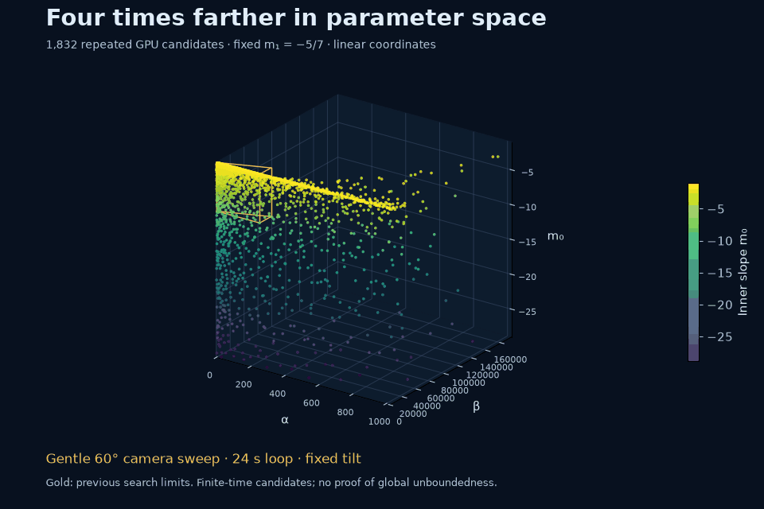
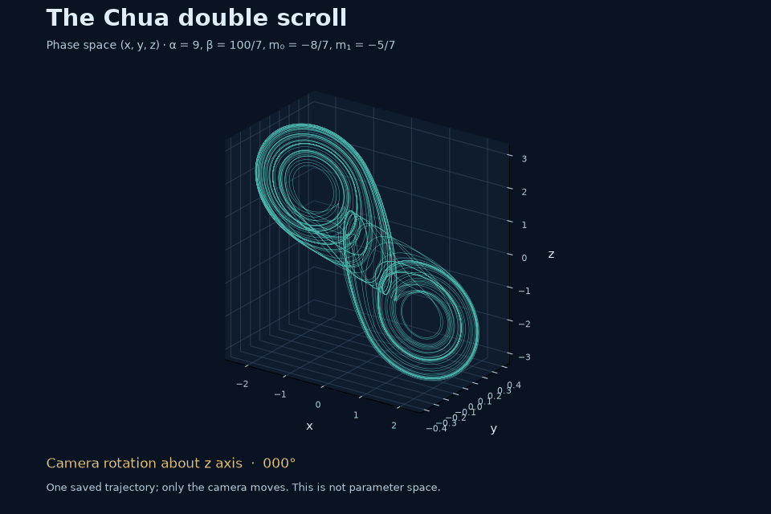
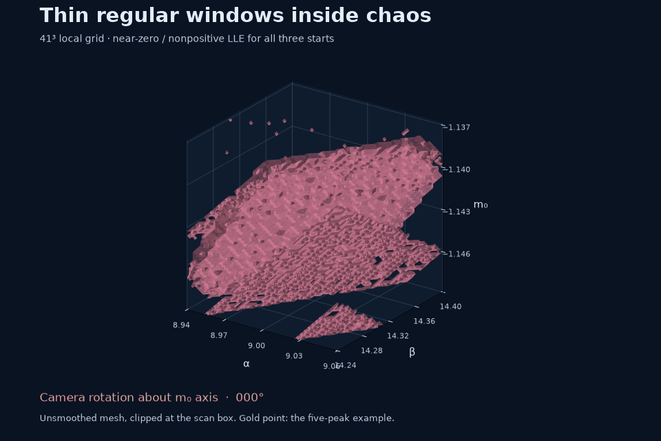
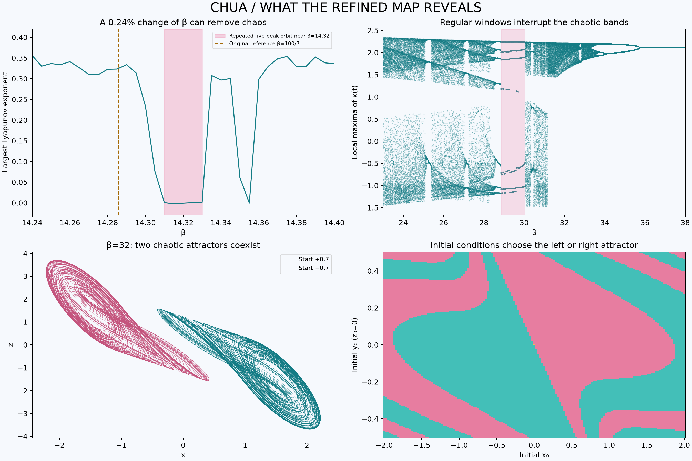
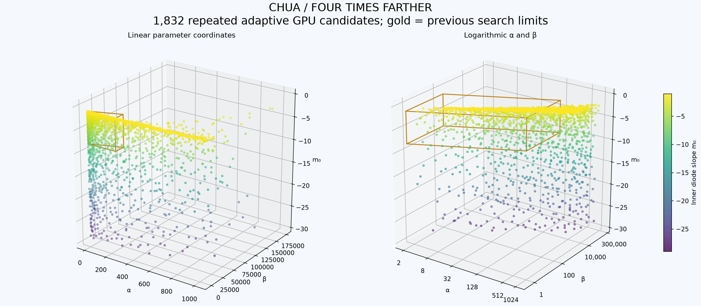
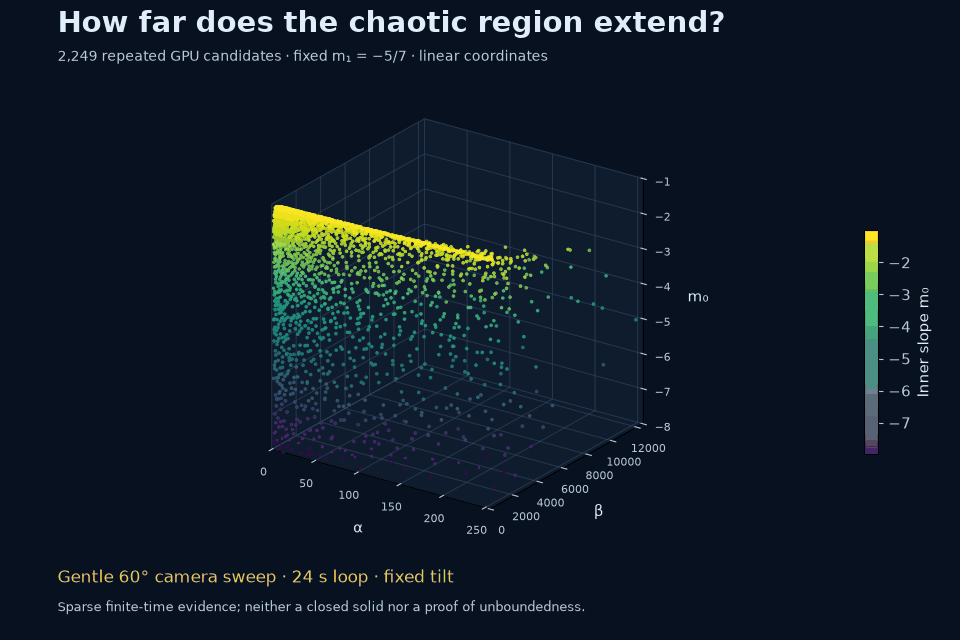
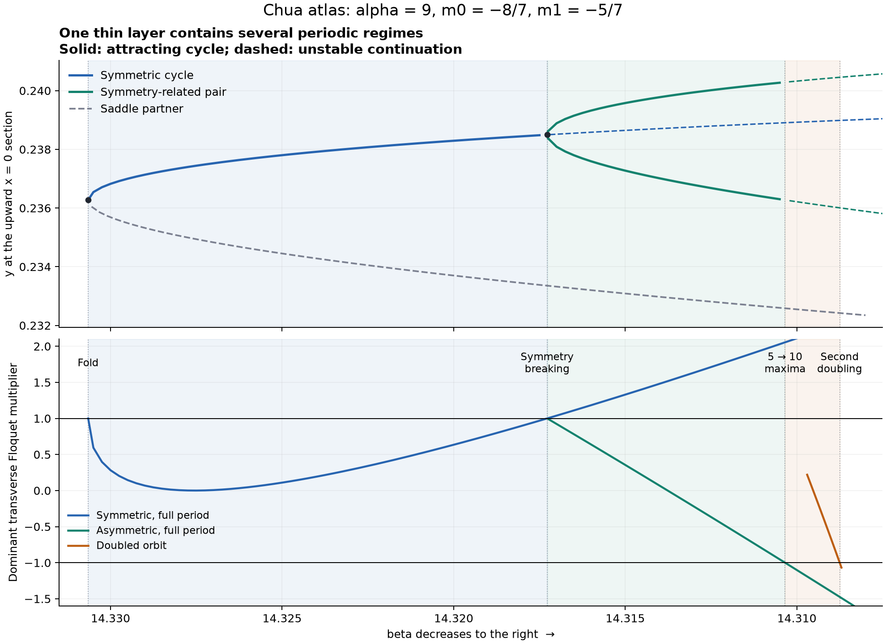
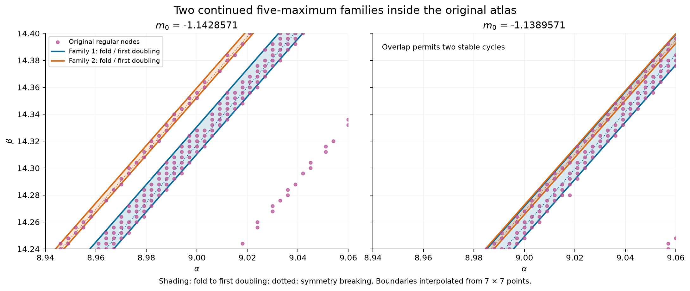

# Chua GPU Atlas

**Revisiting an old coursework problem: from a two-parameter scan that took months to a three-dimensional numerical atlas of chaos.**

Python + OpenCL · actual GPU calculations · reproducible data · MIT license

**Beyond Chua:** the searches in other physical and biological systems now have their own public MIT project, [Chaos Attractor Lab](https://github.com/Griboedow/chaos-attractor-lab), with [a readable findings overview](https://github.com/Griboedow/chaos-attractor-lab/blob/main/docs/research-findings.md), data and animations. The Chua atlas and its parameter-scaling investigation remain here. The verified transfer is complete; historical commits remain available.



*Each dot is a parameter tuple (α, β, m₀). These are 1,832 finite-time chaos candidates from the expanded adaptive GPU survey. Gold outlines the previous search domain. The camera rotates about all three coordinate axes; the data do not change. The axes have different scales, and the cloud is not a filled or proven existence region.*

## Why I came back to this

My university coursework involved studying the Chua system by scanning two parameters. I spent months running calculations. I did not understand the subject very well, and my computer was weak. Much of the experience was simply waiting for another calculation to finish.

I decided to return to the problem and see whether there had been anything interesting hiding in it. This time I could use a GPU, vary three parameters, and look inside the shapes instead of just waiting for them to appear.

There was plenty to look at: thin regular windows inside chaotic regions, different attractors at exactly the same parameters, and a parameter cloud that keeps extending beyond the original search boxes. This repository is a record of that return, including the numerical checks and the places where the evidence is still incomplete.

The old “months” is a personal recollection, **not a speedup benchmark**. The old and new calculations are not matched experiments.

## What is the Chua system?

Chua's circuit is a small nonlinear electrical circuit with two capacitors, an inductor, a resistor, and a nonlinear resistor often called the Chua diode. Its dimensionless model has three state variables and can produce the famous **double-scroll attractor**: motion that keeps folding around two lobes without settling into a repeating cycle [1, 2].

```text
dx/dt = α [y − x − h(x)]
dy/dt = x − y + z
dz/dt = −βy

h(x) = m₁x + ½(m₀ − m₁)(|x + 1| − |x − 1|)
```

Here `m₀` and `m₁` are the inner and outer diode slopes. Some references absorb the `x` term into the nonlinear function, shifting both slopes by one; parameter conventions matter.

This project studies **two different 3D spaces**:

| Space | Coordinates | What a point means |
|---|---|---|
| State space | x, y, z | One instantaneous state of one system |
| Parameter space | α, β, m₀ | A different system, with m₁ held fixed |



*One finite trajectory at α=9, β=100/7, m₀=−8/7, m₁=−5/7. Only the camera moves.*

## What turned out to be interesting?

**A tiny parameter change can remove the observed chaos.** At the classic slopes and α=9, changing β from 100/7 to 14.32 is only a 0.24% change. The new trajectory has a repeating five-peak pattern and an exponent near zero. The initial coarse grid missed the window; continuation now separates **32 periodic-window families** in the local atlas.


*Watch one family at a time: the coordinates and camera stay fixed. The refined view contains **5,447 checked periodic-cycle samples**, including **3,975 new parameter locations**; 4,126 samples lie inside the displayed box. Dots are closed attracting cycles, and connecting facets guide the eye. A colored sheet locates a family; its drawn thickness does not measure the width of its stable window. The label gives the peak count and period of that family's reference cycle.*

**More points alone cannot make every thin window visible at this scale.** The separate zoom below resolves the 55- and 65-peak symmetric cores with 25 newly closed cycles each. The narrowest core is about **126,000 times smaller** than the old beta spacing; its new interior beta spacing is about **1.27e-9**.


*Left: the alpha=9 slice over the original regular-node mask. Upper right: six shrinking windows on one beta scale, with a separate categorical row for each family. Lower right: magnified physical beta intervals; multiplier magnitude below one means the cycle is attracting. Open circles mark the previously estimated boundaries. [Data and reproduction](results/chua-layer-atlas/readme-layer-view/README.md).*

Two broad families overlap and support four attracting cycles at the same parameters. The [refined atlas report](docs/chua-refined-atlas.md) includes the new views, labelled branches, ancestry, behaviour comparisons, numerical controls, and an offline interactive atlas. **The catalogue is not an exhaustive count of every possible layer.**

<details><summary>Original 41³ scan, before resolving individual families</summary>



Pink: an unsmoothed surface extracted from nodes with near-zero/nonpositive exponents for all three starts. It is clipped at the search box. A five-peak pattern was checked at the highlighted example, not at every surface vertex. This earlier mask does not separate the 32 family identities.

</details>

**See what each family does:** the [32-family portrait gallery](docs/chua-family-gallery.md) shows one orbit, full repeating signal, and peak sequence per family. Its interactive comparison lets you rotate and overlay any two reference trajectories. Similar outlines can hide very different repetition patterns.

**The same parameters can support two different chaotic outcomes.** At α=15.6, β=32, m₀=−1.143 and m₁=−0.714, symmetric initial states approach two symmetric single-scroll attractors. A 151² initial-condition slice shows their different basins. At β=29 in the same section, the calculation instead finds a six-peak regular window.



**The original region was only a small piece.** A wider Sobol survey finds repeated candidates near α=256 and m₀=−8, with β reaching about 12,022. The search still reaches its imposed limits. We have not established whether the complete parameter set is bounded, or whether all distant points connect to the original component.

**There is an analytic clue to the bend.** For m₁=−5/7, the outer equilibria change linear stability at

```text
β = 5α/7 + 10α²/49.
```

All 2,249 repeated wide-survey candidates lie below this surface. It provides a useful growing β scale; it is not a proven global boundary of chaos.

These types of Chua phenomena are known in the literature [1, 2]. The contribution here is a reproducible numerical exploration of particular sections, not a claim to have discovered periodic windows or coexistence for the first time. More interpretation and open questions are in [the experiment notes](docs/experiment-notes.md).

## Four times farther: the expanded survey

The next experiment extends α from 256 to **1024**, and the slope depth −1−m₀ from 7 to **28** (m₀ down to −29). Sampling β relative to its quadratic stability scale extends the upper search limit to about **279,144**.

Of **16,384** new Sobol parameter samples, **1,832** remain candidates after a second calculation with tighter tolerances and longer observation. Their separate coordinate extrema are:

| Coordinate | Previous wide cloud | Expanded cloud |
|---|---:|---:|
| Largest α | 255.69 | **1023.64** |
| Largest β | 12,022.30 | **173,658.02** |
| Most negative m₀ | −7.9912 | **−28.9107** |

The expanded cloud contains 732 candidates beyond α=256 and 440 beyond m₀=−8; 981 lie outside the previous search domain in at least one coordinate constraint. There are still candidates near both newly extended limits, so **a natural outer cutoff has not been located in those directions**. Finite sampling does not establish unboundedness or connectedness.

The new FP64 GPU backend uses adaptive Dormand–Prince 5(4), controlling both the state and tangent vector. Scout and candidate verification took **281.5 seconds** in total on the GTX 1080, excluding independent CPU checks and plotting. The escape cutoff, sampling measure and integration settings differ from the previous survey, so candidate counts must not be compared as volumes.



Four selected distant examples, including the largest α, largest β and most negative m₀, retain positive exponents in every window of independent full-field DOP853 checks. Their exponent magnitudes are not uniformly converged; the new report shows both solver estimates.

The new report adds a view of β/βcrit, with βcrit=5α/7+10α²/49, to separate the quadratic bend from the remaining shape. All repeated candidates in this sample remain below that stability surface. Small original regions and thin windows are still easy to miss in a coarse global survey.

The previous wide-map animation remains available for comparison:

<details><summary>Earlier cloud, before the fourfold expansion</summary>



</details>

## Inside the thin periodic layers

The [periodic-layer study](docs/chua-layer-bifurcations.md) continues the classical five-maximum window instead of only classifying sampled trajectories. It resolves a fold near beta = **14.330652**, symmetry breaking near **14.317275**, and period-doubling thresholds near **14.310344** and **14.308751**, at alpha = 9 and the classical slopes. Both sides of the symmetry transition have five maxima, hiding an internal boundary from the original recurrence count. Three local bifurcation surfaces and independent numerical checks are included; the end of the cascade and global layer connections remain open.



The [layer census](docs/chua-layer-census.md) now matches **two broad five-maximum families** to the visible atlas, checks representatives of **17 periodic windows on one fixed transect**, and resolves a shrinking **15 → 25 → 35 → 45** sequence. The two broad families can overlap: a verified parameter point supports two different attracting five-maximum cycles with periods **10.8914** and **14.4952**. The transect count is not an exhaustive count of globally connected layers, and infinitude remains unproved for this box.



## Fixed slopes and the quadratic scaling question

A further [fixed-slope experiment](docs/chua-scaling-research.md) follows beta = kappa alpha squared through alpha = **2048**. Of 5,670 prescribed trajectories, 1,536 retain a positive four-window screen after tighter continuation; all numerical failures in the first tight pass are preserved and separately resumed after a clock repair. A selected alpha = 2048 case has independent CPU/GPU leading rates near **0.960** on a matched finite interval. These are numerical candidates, not proof of persistence to infinite alpha.

The [exact rescaling](docs/chua-scaling-structure.md) produces a harmonic oscillator driving a scalar equation at infinite alpha. Its frozen-amplitude responses are regular, but several stable responses can coexist. In a sampled example, outer and central responses produce opposite averaged amplitude drift. This suggests a concrete branch-switching question for the long-time limit. An exact affine transient also demonstrates why a positive finite-time exponent alone is insufficient.


## Results and downloads

[**Download the complete results from release v1.1.0**](https://github.com/Griboedow/chua-gpu-atlas/releases/tag/v1.1.0).

The release contains `chua-results-v1.1.0.zip` and a SHA-256 checksum. Extract it into the repository root to obtain `outputs/`. Then open:

- `outputs/index.html` — the original atlas;
- `outputs/detailed/index.html` — refined surfaces, slices, bifurcation diagrams and basins;
- `outputs/extent/index.html` — the earlier wide point cloud;
- `outputs/expanded/index.html` — the fourfold expansion, old/new overlay and normalized β view.

Reports are **in English and work offline**, with a bundled Plotly runtime. They include links to NPZ arrays and JSON settings/validation records. Large raw arrays live in the release instead of Git history. The repository includes small illustration datasets, all GIFs and selected [evidence records](results/README.md).

| Experiment | Parameter samples | Initial states | Measured GPU scan time |
|---|---:|---:|---:|
| Original two local boxes | 2 × 51³ | 3 each | 34.4 + 36.7 s |
| Refined two local boxes | 2 × 81³ | 3 each | 137.2 + 147.1 s |
| Thin-window zoom | 41³ | 3 each | 83.4 s |
| Wide scout + candidate reruns + selected long reruns | 32,768 scout points | 3 each | about 15.8 min |
| Expanded adaptive scout + candidate reruns | 16,384 scout points | 3 each | 88.2 + 193.2 s |

Hardware: **NVIDIA GeForce GTX 1080, 8 GB**, FP64 OpenCL. Timings exclude plotting, archive creation and independent CPU checks; workloads use different integration settings. Exact metadata is retained with each experiment.

## Run it

Use **64-bit Python 3.11+** and a GPU driver exposing OpenCL with FP64 support. The recorded environment used Python 3.14.3. A separate CUDA toolkit is not required. The scanner requires an actual GPU; there is no silent CPU fallback.

```bash
python -m venv .venv
# Activate: source .venv/bin/activate (Linux/macOS)
# Activate: .\.venv\Scripts\Activate.ps1 (PowerShell)
python -m pip install -r requirements.txt
python run.py devices

# Small exploratory run
python run.py all --grid 21 --transient 100 --duration 200 --output outputs/quick

# Reproduce the original atlas and its numerical checks
python run.py all --grid 51
python validate.py
python run.py report

# Re-render all four GIFs from included illustration data; no GPU required
python render_animations.py
```

The [methods and reproduction guide](docs/methods.md) covers refined scans, the wide survey, validation, classification codes and array layouts. `requirements-lock.txt` records exact versions from the supplied run; `requirements.txt` gives portable version ranges. `requirements-render.txt` is sufficient if you only want to rebuild the GIFs.

Published starting points:

| Section | α | β | m₀ | Fixed m₁ | Source |
|---|---:|---:|---:|---:|---|
| Classic | 9 | 100/7 | −8/7 | −5/7 | Muthuswamy, Eqs. 11–14 [3] |
| Chua Circuits example | 15.6 | 28 | −1.143 | −0.714 | Published dimensionless example [4] |

These are separate sections of a four-parameter family. The slightly different outer slopes are deliberately preserved.

## How strong is the evidence?

The GPU integrates the state and a tangent vector with RK4. Repeated tangent normalization estimates the largest **finite-time Lyapunov exponent**: positive values indicate growth of small perturbations. To become a candidate, a trajectory must also stay inside the observation cutoff, keep moving, and pass a positive-exponent criterion in all four observation windows.

The original study passes eight numerical checks, including adaptive DOP853 comparisons, a linear exact-solution control, and rejection of a stationary unstable equilibrium. Separate refinement samples preserve candidate membership at 98.83% and 99.02% of sampled nodes. The thin-window check preserves 252/256 sampled categories. These are sample diagnostics, not confidence levels for the entire boundary.

**A reference-solver correction is part of the result.** During the expansion, the original v1.0 CPU routine failed at a distant example: after a missed crossing, it could keep extrapolating the wrong affine branch. Its historical values, including the earlier 0.18 estimate at α≈255.69, should not be treated as definitive reference measurements. The corrected DOP853 control evaluates the actual piecewise field at every stage; crossing events are diagnostics, not branch selectors. New independent checks are stored under `results/expanded/`. The original records remain available for provenance.

The adaptive backend also passes short-trajectory comparisons at α=9, 255.69 and 1024, an exact linear matrix-exponential control, and rejection of a stationary unstable equilibrium. Quantitative convergence of Lyapunov estimates across the full cloud is still not established. Cloud colors indicate m₀, not a claimed intensity of chaos.

A finite-time positive exponent does not prove an asymptotic strange attractor. Three initial conditions do not exhaust all basins. A ragged mesh does not prove fractality, and a finite search cannot settle global boundedness. These limitations matter when reading the pictures.

## Looking beyond Chua

The investigations of other physical and biological systems have moved to the separate public MIT repository [Chaos Attractor Lab](https://github.com/Griboedow/chaos-attractor-lab). It contains independently checked numerical candidates, negative searches, equations, Python/OpenCL code, datasets, figures, rotating GIFs and primary references.

Start with [the findings overview](https://github.com/Griboedow/chaos-attractor-lab/blob/main/docs/research-findings.md), [collective motor rows](https://github.com/Griboedow/chaos-attractor-lab/blob/main/docs/motor-rows-gpu-survey.md), or [long optical transients](https://github.com/Griboedow/chaos-attractor-lab/blob/main/docs/optical-lifetime-extension.md). Scientific priority and a new topological attractor class remain unestablished.

The Chua circuit, its parameter atlas and the quadratic-scaling investigation remain here. The [transfer record](docs/research-transfer.md) explains the verified forward move; historical commits are intact.

## License

Project code, original text, generated figures and numerical datasets are provided under the [MIT License](LICENSE). Dependencies retain their own licenses. The results archive bundles an unmodified Plotly.js runtime; its MIT notice is retained and included in [THIRD_PARTY_NOTICES.md](THIRD_PARTY_NOTICES.md). Referenced publications are linked, not redistributed.

## References

1. **Chua, L. O.** (2007). Chua circuit. *Scholarpedia*, **2**(10), 1488. [doi:10.4249/scholarpedia.1488](https://doi.org/10.4249/scholarpedia.1488).
2. **Kennedy, M. P.** (1993). Three steps to chaos. II. A Chua's circuit primer. *IEEE Transactions on Circuits and Systems I: Fundamental Theory and Applications*, **40**(10), 657–674. [doi:10.1109/81.246141](https://doi.org/10.1109/81.246141). [Author-hosted PDF](https://people.eecs.berkeley.edu/~chua/papers/Kennedy93b.pdf).
3. **Muthuswamy, B.** (2012). Chua's Equation was Proved to be Chaotic in Two Years, Lorenz Equation in Thirty Six Years. Author-hosted chapter manuscript, dated March 25, 2012; Eqs. 11–14, printed p. 6. [PDF](https://www.bharathm.org/pubs/MuthuswamyWSPCSampleChapter-ChuaCircuit.pdf).
4. **Chua Circuits.** (n.d.). MATLAB: dimensionless Chua's circuit. [Online example](https://chuacircuits.com/matlab/). Accessed October 29, 2026.
5. **Matsumoto, T.** (1984). A chaotic attractor from Chua's circuit. *IEEE Transactions on Circuits and Systems*, **31**(12), 1055–1058. [doi:10.1109/TCS.1984.1085459](https://doi.org/10.1109/TCS.1984.1085459). [Berkeley technical-report version](https://www2.eecs.berkeley.edu/Pubs/TechRpts/1984/307.html).
6. **PyOpenCL contributors.** PyOpenCL documentation. [Runtime documentation](https://documen.tician.de/pyopencl/). Accessed October 29, 2026.
7. **SciPy contributors.** `scipy.integrate.solve_ivp`: initial-value ODE solvers, including DOP853. [API documentation](https://docs.scipy.org/doc/scipy/reference/generated/scipy.integrate.solve_ivp.html). Accessed October 29, 2026.
