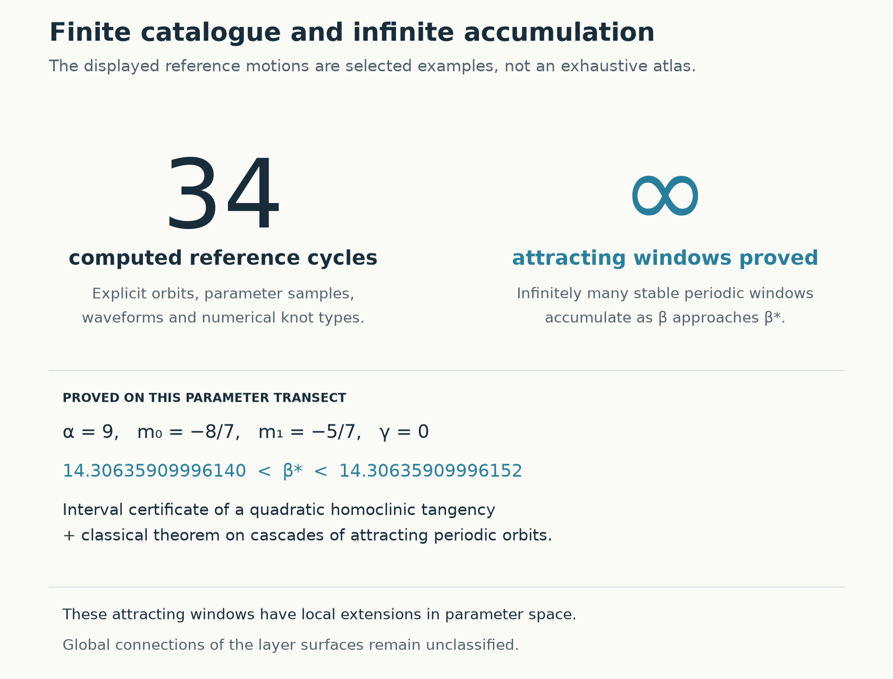
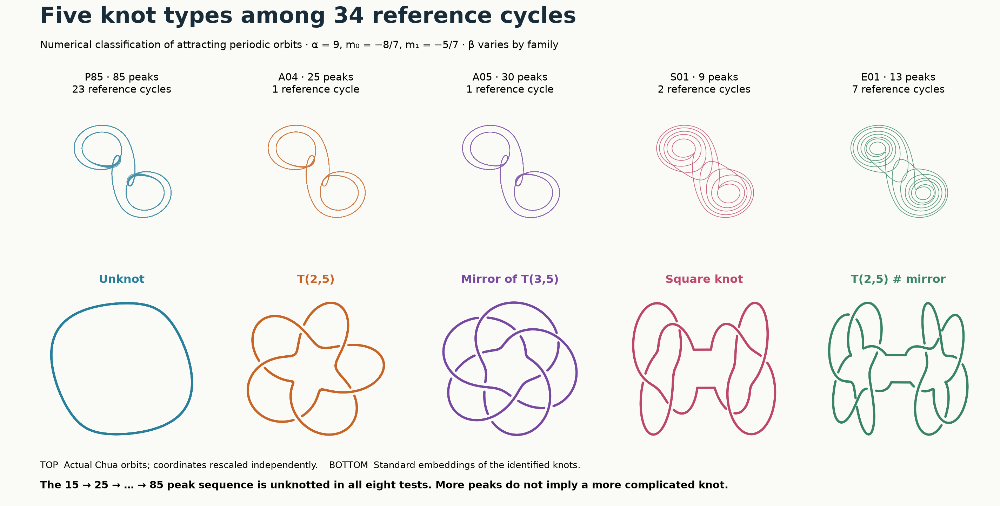
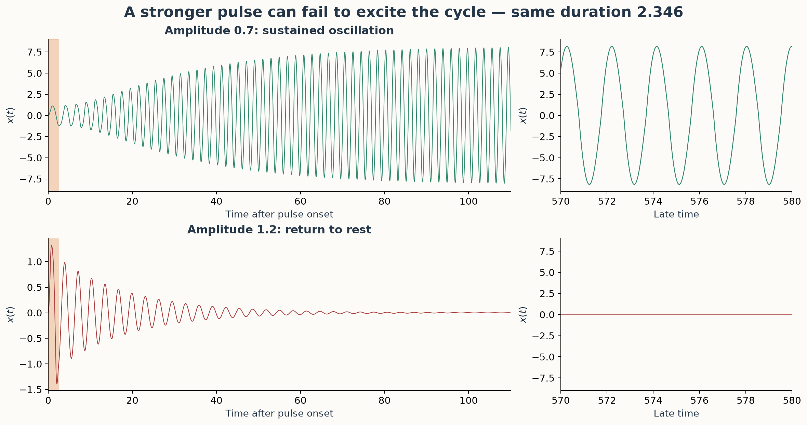

# Chua GPU Atlas

An atlas of attracting periodic motions in the continuous piecewise-linear Chua system, with numerical predictions, interval certificates and reproducible data.

The central question is how the visible layers in parameter space relate to the system's motions: **what distinguishes the layers, where they appear, how thin they become, and how many attracting motions can coexist**. The study starts with GPU surveys, follows individual periodic orbits, and uses interval arithmetic and analytic arguments to establish selected existence and basin results.

[The system](#the-system-and-the-question) · [Reading the atlas](#reading-the-atlas) · [Results](#main-results) · [Verification](#evidence-and-limitations) · [Reproduction](#reproducibility) · [Background](#background)

## The system and the question

Chua's circuit can settle to an equilibrium, repeat a periodic motion or exhibit more complicated dynamics. Its dimensionless state consists of two capacitor voltages, x and y, and an inductor current, z. The parameters α and β describe circuit ratios; m₀ and m₁ are the inner and outer slopes of the diode characteristic.

A trajectory is a curve in **state space**. The atlas plots **parameter space**: each point specifies a system whose possible long-term motions we investigate. Different initial states at the same parameter point can approach different attractors. A scan can therefore miss a motion because its stability window is narrow or because the chosen initial state lies outside its basin of attraction.

<details>
<summary>Equations and parameter convention</summary>

```math
\dot x=\alpha[y-x-h(x)],\qquad \dot y=x-y+z,\qquad \dot z=-\beta y,
```

```math
h(x)=m_1x+\frac{m_0-m_1}{2}\left(|x+1|-|x-1|\right).
```

The classic starting section uses α = 9, β = 100/7, m₀ = −8/7 and m₁ = −5/7. Some conventions absorb the x term into h and shift both slopes by one. The robustness study also includes nonnegative inductor loss, replacing the last equation by ż = −βy − γz; elsewhere γ = 0 unless stated.

Background: [Chua circuit](https://doi.org/10.4249/scholarpedia.1488), [Kennedy's circuit primer](https://doi.org/10.1109/81.246141), and [Muthuswamy's model discussion, Eqs. 11–14](https://www.bharathm.org/pubs/MuthuswamyWSPCSampleChapter-ChuaCircuit.pdf).

</details>

## Reading the atlas

A **stability region** is a set of parameter values supporting an attracting periodic-orbit branch. We use **layer** as a visual shorthand for the region associated with a continued family. Moving along that family changes its repeating motion continuously. Different families can have different waveforms, periods, visits to the two scrolls and symmetries.



**From a layer to its motion.** Each eight-second card connects a highlighted layer with its reference attracting cycle, catalogue group, symmetry, knot type and full-period waveform. It gives the reference parameters, period, peak count, section returns and transverse stability. The first two cards compare A04 and A01: both have 25 peaks, but their knots differ. [Choose any of the 34 static cards](docs/chua-layer-cards.md#choose-a-family) to inspect it without waiting for the animation.

The camera and parameter axes stay fixed. The original 32 meshes contain 5,447 checked samples, of which 4,126 lie in the displayed box; P75 and P85 show three later continuation samples each, explicitly marked as partial coverage. Dots represent closed cycles and facets indicate sample adjacency, not stability-window width. Each portrait uses its own reference β. Knot types are numerical classifications of those reference orbits; the companion drawing is a standard knot embedding. The [card guide](docs/chua-layer-cards.md#reading-a-card) explains every field, and the [original geometry-only animation](docs/assets/chua-readme-layers.gif) remains available.

| Difference in motion | Example |
|---|---|
| Repetition time and waveform | [S08 and S11](docs/chua-family-gallery.md#s08) both have five peaks but periods of about 10.89 and 14.50. |
| Number of peaks before repetition | The measured thin sequence has 15, 25, …, 85 peaks per full cycle. |
| Scroll visits | [E06](docs/chua-family-gallery.md#e06) stays near one outer scroll; the other mesh representatives visit both. |
| Symmetry | A symmetric cycle can lose symmetry and produce two inversion-related attracting cycles. |
| Knot type in state space | [A04 and A01](docs/chua-knot-atlas.md) both have 25 peaks; A04 is a torus knot and A01 is an unknot. |

The finite catalogue contains **34 reference entries** under a stated continuation and normalization convention: the 32 original entries plus the later 75- and 85-peak motions. Those two are absent from the original mesh and have small slope patches in the later study. These are catalogue counts, not 34 simultaneous attractors or an exhaustive count of globally disconnected surfaces. Peak counts and orbit silhouettes alone do not identify a family.

The [orbit gallery](docs/chua-family-gallery.md) shows each original representative's orbit, complete signal and peak sequence. The [refined atlas](docs/chua-refined-atlas.md) explains branch matching and numerical checks; the [terminology guide](docs/terminology.md) distinguishes families, stability regions, windows and individual cycles.

## Main results

The results below move from the geometry of the atlas to the dynamics within it. Different studies use different parameter sections; their counts and certificates apply to the domains stated in their reports.

| Question | Result | Evidence |
|---|---|---|
| Are different motions tied into different knots? | The 34 references realize five numerical knot types; the eight tested thin-sequence members are all unknots. | Refined periodic roots, diagram reductions and exact knot invariants |
| How do layers change with the diode slopes? | Two families are followed through 6,713 accepted cross-sections; diode crossings can change within one attracting family. | Continuation and independent orbit checks |
| Can thin windows be predicted before searching? | A calibrated rule locates 48/48 held-out windows, then 24/24 on a larger slope square. | Frozen forecasts followed by independent searches |
| How many attracting motions can coexist? | Four cycles persist in an explicit parameter box. In another specified family, some parameters support infinitely many simultaneous hidden cycles. | Interval certificates, analytic arguments and a classical parameter theorem |
| How can a hidden motion be reached? | One initial-state ray has a proved excitation infimum; energy and pulse studies identify other ways to reach the cycle. | Basin certificates and separately identified numerical experiments |
| Can an empty region be proved empty? | An explicit slope sector has convergence to the origin from every initial state. | A storage-function argument |

### Knot types of the periodic motions



**Similar outlines can conceal different knots.** The [knot atlas](docs/chua-knot-atlas.md) identifies 23 unknotted reference cycles, two torus-knot representatives and nine composite-knot representatives. The lower row makes their topology visible using standard embeddings; these are not additional circuit trajectories. An [interactive 3D comparison](results/chua-knot-atlas/knot-atlas.html), downloaded and opened locally, covers every reference entry.

All eight tested cycles in the 15 → 25 → … → 85 peak sequence are unknots. Increasing period therefore does not establish increasing knot complexity, and the infinite-window result below does not prove infinitely many knot types. The classification uses 108 projection/resolution checks and exact diagram calculations; a certified isotopy from the sampled polygons to the exact ODE orbits remains open. The report also retains a [sampling counterexample](docs/chua-knot-atlas.md#5-a-sampling-error-that-changes-the-knot) in which a coarse trajectory produces the wrong knot polynomial.

### Parameter changes and family structure

The [m₀–m₁ plane](docs/chua-slope-plane.md) and the volumes below vary both diode slopes independently. The volumes use **(m₀,m₁,α)** at β = 100/7 and **(m₀,m₁,β)** at α = 9.


**Two continued families.** Blue identifies P5; rose and purple identify P7 before and after an additional excursion through the central diode region. The colour change occurs along the same seven-peak family: its cycle remains attracting while the number of diode crossings changes from eight to twelve.

The [refinement study](docs/chua-slope-refinement.md) contains four 41 × 41 meshes, 6,713 accepted cross-sections, eleven unresolved P5 nodes and the located contact curves. It records actual stability widths and independent controls. The earlier [sampled volumes](docs/chua-slope-volumes.md), their [interior views](docs/assets/chua-slope-volumes-interior.png) and [slow rotation](docs/assets/chua-slope-volumes.gif) show the broader survey; those finite-time masks do not identify individual periodic families.

### Predicting thin windows

A short unstable periodic orbit organizes the measured 15 → 25 → … sequence. Longer cycles spend additional returns near this saddle before making a global excursion. Its expansion factor predicts the rate at which window spacing and width decrease; its period predicts the additional repetition time.


**Predictions and subsequent searches.** The first two-slope test used 48 held-out windows for the 65-, 75- and 85-peak families. The uncorrected model placed 32 predicted midpoints inside the measured intervals; a correction calibrated at the central parameter node raised this to 48. The lower panels subtract the estimated homoclinic-tangency surface so the thin sheets can be distinguished. Nine solved folds per family support each displayed surface.

The [larger-square test](docs/chua-excitation-robustness-prediction.md#3-prospective-prediction-on-a-larger-slope-square) doubled the slope offsets to ±0.0008 and reused that calibration without refitting: **24/24 corrected forecasts** and **16/24 uncorrected forecasts** locate their windows. The largest corrected fold error is 4.40% of a window width; the largest width error is 6.69%. Its [comparison figure](docs/assets/chua-extended-predictions.png) shows all 24 predictions against the measured intervals.

The [first predictions](docs/chua-layer-prediction.md) and [48-window test](docs/chua-prediction-and-hidden-coexistence.md#1-predicting-two-slope-sections) retain forecasts published before their target searches, including the original 85-peak location miss. That window is approximately 1/6.65 million of the original β grid spacing. A uniform prediction-error bound over the slope domain remains open.

### Coexistence and the question of infinity

Layers can overlap because different attracting cycles coexist at the same parameters. Their basins determine which motion a trajectory reaches. Symmetry breaking can also produce multiple attracting descendants of one family.


**Finite coexistence.** The region supporting two symmetric cycles splits into islands, while a three-cycle region connects their primary branches. Nearby parameters support four cycles. The [overlap study](docs/chua-overlap-geometry.md) traces 18 contact curves and distinguishes the motions using [orbit portraits](docs/assets/chua-overlap-orbits.png) and [section points](docs/assets/chua-overlap-sections.png).

A later [uniform certificate](docs/chua-excitation-robustness-prediction.md#2-four-cycles-throughout-a-parameter-box) proves that four distinct attracting cycles persist throughout an explicit five-parameter box, including nonnegative inductor loss. Its component tolerances are too narrow for a practical hardware specification. The separate numerical slope map merges continuations that converge to the same cycle before counting distinct attractors.


**Infinite accumulation and simultaneous coexistence are different statements.** At α = 9, m₀ = −8/7 and m₁ = −5/7, the interval calculation encloses a homoclinic tangency in **14.30635909996140 < β∗ < 14.30635909996152**. The [certificate and classical sink-cascade theorem](docs/chua-infinity-certificate.md) give infinitely many attracting windows accumulating there. A [localization argument](docs/chua-basin-and-coexistence.md#3-proof-of-theorem-b) establishes the stronger conclusion: some individual β values arbitrarily near β∗ support infinitely many simultaneous attracting periodic orbits.

At a different fixed α and pair of slopes, the [hidden-coexistence argument](docs/chua-hidden-infinity-certificate.md) combines a second certified tangency with exclusion of equilibrium neighborhoods from the periodic-attractor basins. It gives parameters with infinitely many simultaneous **hidden** attracting cycles. Neither argument identifies a decimal parameter realizing infinite coexistence, counts the attractors at β∗, or classifies globally connected layer surfaces.

### Hidden attractors and excitation

A periodic attractor is **hidden** when its basin avoids a neighborhood of every equilibrium. A scan started only near equilibria can miss it. At α = 8.4, β = 12, m₀ = −0.95 and m₁ = −0.05, the [accessibility certificate](docs/chua-accessibility.md) encloses a hidden attracting cycle and proves that every initial state within Euclidean distance 0.0305 of the unique equilibrium returns to it.

The [local basin proof](docs/chua-basin-and-coexistence.md#2-proof-of-theorem-a) identifies a saddle cycle whose stable manifold separates the two destinations in a specified section. For initial states (0,A,0), the [excitation proof](docs/chua-prediction-and-hidden-coexistence.md#2-excitation-of-a-hidden-attracting-cycle) gives an infimum near **A = 0.340610116440** and excludes every smaller positive amplitude. Six other directions have certified local crossings. The complete global basin boundary remains unclassified.



**Finite-duration excitation.** Starting at the origin, a rectangular input added to the y equation with duration τ = 2.3455264 and amplitude 0.7 excites the hidden cycle; amplitude 1.2 returns to rest. The pulse endpoint crosses the basin boundary twice as amplitude increases. These are numerical trajectories checked independently; the pulse thresholds are not interval-certified.

The [excitation study](docs/chua-excitation-robustness-prediction.md#1-excitation-in-a-plane-of-initial-states) also compares initial directions using physical stored energy. The lowest sampled threshold in x = 0 is near a current-only start and costs about **27% of the voltage-only threshold energy**; global optimality is not proved. A local short-pulse expansion derived from the basin separator predicts the quadratic correction to threshold pulse area without fitting its coefficient to the pulse data.

### A region with no oscillatory attractors


**Proved absence in a specified sector.** At α = 8.4 and β = 12, a storage function establishes convergence to the origin for every initial state when **m₀ > m∗ and m₁ ≥ m∗**, with m∗ ≈ −0.181371900613. The darker m₀ face contains neutral periodic orbits and is excluded by the strict inequality. This distinguishes an empty region established analytically from a scan that found no oscillations. The [derivation](docs/chua-hidden-boundary.md#2-an-explicit-region-without-oscillatory-attractors) gives the general assumptions and the unclassified region.

## Evidence and limitations

The [review guide](docs/chua-review-guide.md) connects each conclusion to its assumptions, certificate fields, executable checks and possible failure points.

| Evidence level | What it supports |
|---|---|
| GPU surveys and finite-time integration | Candidate regions and sampled basin destinations; a positive finite-time Lyapunov exponent is treated as a chaos candidate. |
| Periodic-orbit continuation and independent checks | Computed closed cycles, their stability and branch relationships within the tested domains. |
| Interval arithmetic and analytic arguments | Existence, stability, complete local basin coverage or parameter-uniform statements in the explicitly certified sets. |
| Classical theorem applications | Infinite windows and simultaneous coexistence after the stated hypotheses and localization are established. |
| Partial Lean formalization | A general stationary-zero existence argument, ten rational inequalities and three storage-algebra implications. The complete Chua dynamical arguments are not formalized. |

Periodic windows, coexistence and homoclinic cascades are established phenomena. The contribution here is parameter-specific data, forecasts tested against subsequent searches and computer-assisted arguments for the stated families. Historical priority for the particular structures has not been established. The reports retain failed forecasts, rejected certificate boxes and unresolved continuation nodes so that conclusions can be checked against the limitations of the calculations.

The remaining questions include a global classification of family connections, a uniform prediction-error bound over slope domains, the complete hidden-cycle basin boundary, a proved minimum-energy excitation and useful certified component tolerances.

## Reproducibility

The [research guide](docs/research-guide.md) provides the full study map; the [results index](results/README.md) links settings, datasets and reproduction instructions.

| To inspect or reproduce | Start here |
|---|---|
| Family catalogue, meshes and numerical audits | [Atlas report](docs/chua-refined-atlas.md), [orbit gallery](docs/chua-family-gallery.md) |
| Knot types, orbit diagrams and sampling controls | [Knot atlas](docs/chua-knot-atlas.md), [reproduction](results/chua-knot-atlas/README.md) |
| First forecasts and the classical interval certificate | [Prediction data](results/chua-layer-prediction/README.md), [certificate reproduction](results/chua-layer-infinity/README.md) |
| Slope predictions, excitation thresholds and hidden coexistence | [Follow-up data](results/chua-followup/README.md) |
| Energy, finite pulses, robust coexistence and larger-square forecasts | [Extended-study reproduction](results/chua-followup/extended-studies.md) |
| Assumptions and independent review | [Review guide](docs/chua-review-guide.md), [formal verification scope](formal/README.md) |
| Wider surveys and large-α scaling | [Research guide](docs/research-guide.md#broader-surveys-and-scaling) |
| Original scanner, methods and array layouts | [Methods](docs/methods.md) |

The interval computations run on a CPU; the original GPU scanner requires an OpenCL device with FP64 support. Each reproduction guide specifies its dependencies and commands. To check the published file hashes from the repository root:

```bash
python research/manifest_refined_chua_atlas.py --check
```

This checks file integrity, not the mathematical claims. Use the report-specific instructions to replay computations, preferably in a separate checkout that preserves the published records. The GPU surveys used an NVIDIA GTX 1080; scan timings exclude independent CPU checks and plotting.

[Release v1.1.0](https://github.com/Griboedow/chua-gpu-atlas/releases/tag/v1.1.0) supplies large historical arrays and offline HTML reports. It predates the layer predictions and interval proofs; their evidence is in this repository.

## Background

My university coursework involved studying the Chua system by scanning two parameters. I spent months running calculations. I did not understand the subject very well, and my computer was weak. Much of the experience was simply waiting for another calculation to finish.

I decided to return to the problem and see whether there had been anything interesting hiding in it. This time I could use a GPU, vary three parameters, and look inside the shapes instead of just waiting for them to appear.

The months are a personal recollection; those calculations and today's scans are not a matched speed benchmark.

Investigations of other physical and biological models are maintained in [Chaos Attractor Lab](https://github.com/Griboedow/chaos-attractor-lab). Chua data and reports remain here.

## License

Original code, text, figures and datasets use the [MIT License](LICENSE). Dependencies retain their own licenses; bundled Plotly notices are in [THIRD_PARTY_NOTICES.md](THIRD_PARTY_NOTICES.md). Publications are linked, not redistributed.
