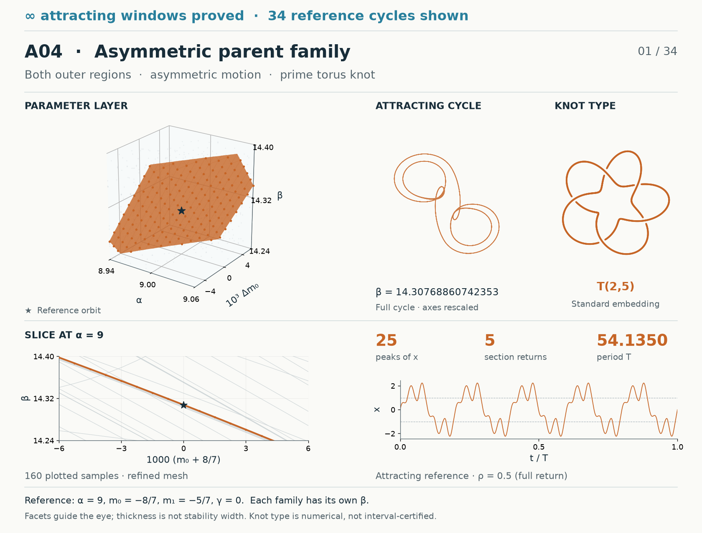
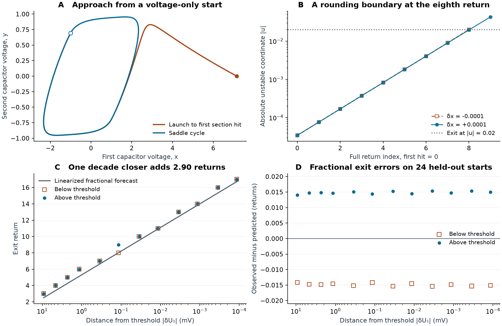

# Chua GPU Atlas

An atlas of periodic windows, coexisting attractors and basin boundaries in Chua’s circuit. GPU scans locate candidate regimes and continuation follows the periodic orbits. At one parameter setting, an interval calculation proves that two attracting orbits form a non-split link. The circuit experiments examine inductor loss and capacitor precharge.

[Research reports](docs/README.md) · [Data and reproduction](results/README.md) · [Model and conventions](#the-system-and-the-question)

## Reading the atlas

A **layer** is a region of parameter space in which a continued periodic motion attracts nearby trajectories. The 34 illustrated families are sampled at their own reference settings. For instance, A04 and A01 each have 25 peaks in one period, but their trajectories have different numerical knot types. [Browse the 34 cards or play the animation](docs/chua-layer-cards.md)



| Explore | Start here |
|---|---|
| Periodic windows and observation time | [Slow passage outside three folds](docs/chua-fold-passage.md) · [Return geometry](docs/chua-return-geometry.md) · [Nested returns through 245 peaks](docs/chua-nested-returns.md) |
| Coexistence and basin boundaries | [Overlap of attracting branches](docs/chua-overlap-geometry.md) · [A certified local separator](docs/chua-basin-and-coexistence.md) |
| Infinitely many periodic attractors | [Window accumulation](docs/chua-infinity-certificate.md) · [Hidden periodic coexistence at nearby parameters](docs/chua-hidden-infinity-certificate.md) |
| Geometry and topology | [Certified non-split pair](docs/chua-link-certificate.md) · [Knot catalogue](docs/chua-knot-atlas.md) · [Diode slope continuation](docs/chua-slope-refinement.md) |
| Global convergence | [Exact convergence region for every memoryless diode](docs/chua-global-relaxation.md) |
| Large-parameter dynamics | [Quadratic scaling limit](docs/chua-scaling-structure.md) · [Frozen switching thresholds](docs/chua-fiber-switching.md) · [Finite-rate correction at a fold](docs/chua-dynamic-fold.md) |
| Voltage measurements | [DC voltage at symmetry breaking](docs/chua-symmetry-dc.md) · [Spectrum from diode crossings](docs/chua-diode-spectrum.md) · [Reconstruct two coordinates from one voltage](docs/chua-voltage-reconstruction.md) |

## Hidden attractors in a lossy circuit

How precisely must a capacitor be charged to keep a trajectory near a saddle cycle for one more turn? At one published circuit setting, reducing the voltage offset tenfold adds **2.899 turns** to the predicted fractional exit count. A forecast recorded before integration gave the exact integer count for **23 of 24** starts and missed once by one turn. [Voltage-start experiment](docs/chua-saddle-residence.md) · [Published circuit, Figs. 9–10](https://doi.org/10.1007/s11071-022-08078-y)



| Question | Report |
|---|---|
| Can component tolerances explain the 218-sample saddle period in the published trace? | [545 µs on the oscilloscope, 586.70–593.35 µs for the model orbit](docs/chua-saddle-period.md) |
| Which precharges reach each regime as components vary? | [Launch voltages and component tolerances](docs/chua-precharge.md) |
| Which hidden cycles coexist at the same parameter settings? | [Three attracting cycles throughout 12.21775 ≤ β ≤ 12.24225 on the separate m₁ = −0.12 slice](docs/chua-explicit-hidden.md) |
| Can a short residence distinguish startup jitter from continuing noise? | [First-exit counts under two disturbance models](results/chua-residence-noise/README.md) |

## The system and the question

The state consists of capacitor voltages $x,y$ and inductor current $z$, in dimensionless units. The inner and outer diode slopes are $m_0,m_1$. The loss parameter $\gamma$ is zero on the classical atlas slice and positive in the circuit experiments above.

```math
\dot x=\alpha(y-x-h(x)),\qquad \dot y=x-y+z,\qquad \dot z=-\beta y-\gamma z,
```

```math
h(x)=m_1x+\tfrac12(m_0-m_1)(|x+1|-|x-1|).
```

The component study includes the second pair of diode breakpoints reached by the large outer cycle. [Five-segment model and waveform comparison](docs/chua-precharge.md)

For $\gamma=0$ and $\alpha>1$, every bounded trajectory approaches the equilibrium set for every locally Lipschitz diode law exactly when $4\beta>(\alpha+1)^2$. At $\alpha=9$, $\beta=25$, a diode with inner slope $-5/9$ admits an exact sinusoid on the boundary. [Proof, lossy criterion and parameter check](docs/chua-global-relaxation.md)

## Reproducibility

From the repository root, reconstruct the 34 reference waveforms on a CPU or replay the 24 voltage-start forecasts. Both commands write to `outputs/`.

```bash
python -m pip install -r requirements-certificate.txt
python research/chua_voltage_reconstruction.py atlas
python research/observed_saddle_validate.py --figure
```

The orbit and interval studies run on a CPU. The original parameter survey uses FP64 OpenCL. [Data index](results/README.md) · [Survey instructions](docs/methods.md) · [Proof review](docs/chua-review-guide.md)

## Background

My university coursework involved studying the Chua system by scanning two parameters. I spent months running calculations. I did not understand the subject very well, and my computer was weak. Much of the experience was simply waiting for another calculation to finish.

I decided to return to the problem and see whether there had been anything interesting hiding in it. This time I could use a GPU, vary three parameters, and look inside the shapes instead of just waiting for them to appear.

[MIT license](LICENSE) · [Third-party notices](THIRD_PARTY_NOTICES.md) · [Citation](CITATION.cff) · [Other dynamical systems](https://github.com/Griboedow/chaos-attractor-lab)
