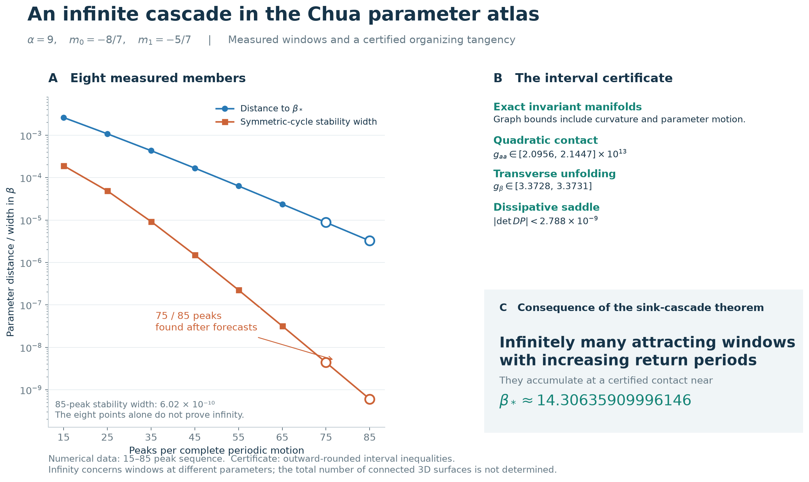
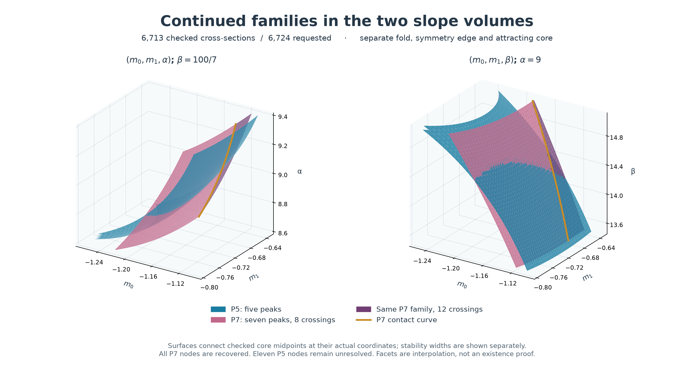
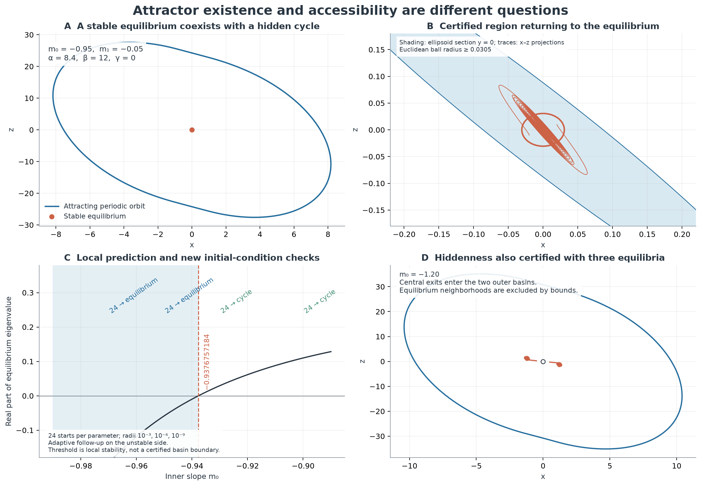

# Chua GPU Atlas

## Abstract

We study families of attracting periodic orbits in the continuous piecewise-linear Chua system. GPU parameter surveys identify candidate regions, periodic-orbit continuation resolves stability boundaries and coexistence, and interval arithmetic is used to verify a quadratic homoclinic tangency. The finite catalogue contains 34 reference identities under a stated continuation and normalization convention; 32 have sampled three-dimensional sheets.

At α = 9, m₀ = −8/7 and m₁ = −5/7, the interval calculation encloses the tangency parameter in 14.30635909996140 < β∗ < 14.30635909996152. Application of the classical sink-cascade theorem gives infinitely many attracting periodic windows accumulating at this parameter. This concerns windows at different parameter values. Infinite coexistence at a single parameter value remains conditional on the localization argument described in the [coexistence report](docs/chua-coexistence-audit.md).

The repository contains the numerical data, continuation programs, interval certificates and a partial Lean formalization. Lean verifies a general stationary-zero existence argument, ten rational inequalities and three storage-algebra implications; it does not verify the complete Chua dynamical arguments.

[Study outline](docs/research-guide.md) · [Interval certificate](docs/chua-infinity-certificate.md) · [Orbit catalogue](docs/chua-family-gallery.md) · [Data and reproduction](results/README.md)

An [accessibility study](docs/chua-accessibility.md) adds interval certificates for four coexisting cycles and two hidden-cycle examples, explicit equilibrium neighborhoods excluded from their basins, a sufficient global-convergence sector and a numerical component-tolerance experiment.

The [global-stability and basin study](docs/chua-hidden-boundary.md) addresses questions posed by Leonov, Kuznetsov, Chua and colleagues. It derives an explicit slope sector where all trajectories converge to the origin, certifies a saddle beside a hidden attracting cycle, and tests amplitude and flight-time predictions near two linear contacts. The maximum coexistence count and complete basin boundary remain open in this investigation.

## Background

My university coursework involved studying the Chua system by scanning two parameters. I spent months running calculations. I did not understand the subject very well, and my computer was weak. Much of the experience was simply waiting for another calculation to finish.

I decided to return to the problem and see whether there had been anything interesting hiding in it. This time I could use a GPU, vary three parameters, and look inside the shapes instead of just waiting for them to appear.

The months are a personal recollection; those calculations and today's scans are not a matched speed benchmark.

## Periodic-window accumulation



Figure 1. Measured periodic windows and the conditions verified by the interval certificate. The infinite sequence does not determine the number of globally disconnected surfaces or the number of attractors at β∗. The [certificate report](docs/chua-infinity-certificate.md) states the assumptions, derivation and numerical controls.

## Layer definition and finite catalogue

A layer is a region in **parameter space** supporting a family of attracting periodic motions. Following that family changes its orbit continuously. Different families can differ in their complete repeating signal, period, visits to the two scrolls and symmetry. The corresponding orbit is a curve in **state space**.


Figure 2. The 32 sampled families, highlighted individually with fixed camera and coordinates. The view contains 5,447 checked periodic-cycle samples, including 3,975 parameter locations added during refinement; 4,126 samples lie in the displayed box. Dots represent closed attracting cycles. Facets indicate sample adjacency; their displayed thickness does not measure window width. The 75- and 85-peak entries have checked reference cycles but no three-dimensional mesh.

| Difference in motion | Example |
|---|---|
| Repetition time and waveform | [S08 and S11](docs/chua-family-gallery.md#s08) both have five peaks but periods of about 10.89 and 14.50. |
| Number of peaks before the motion repeats | The measured thin sequence has 15, 25, …, 85 peaks per full cycle. |
| Scroll visits | [E06](docs/chua-family-gallery.md#e06) stays near one outer scroll; the other mesh representatives visit both. |
| Symmetry | A symmetric cycle can lose symmetry and produce two inversion-related attracting cycles. |

Peak counts and orbit silhouettes alone do not identify a family. The catalogue follows normalized periodic roots and their continuation ancestry. The [gallery](docs/chua-family-gallery.md) shows an orbit, complete signal and peak sequence for each original family; [two further portraits](docs/chua-layer-prediction.md) show the 75- and 85-peak motions. The [refined atlas](docs/chua-refined-atlas.md) documents the identity convention and numerical checks.

## Predicted and measured stability windows

A short unstable periodic orbit organizes the measured 15 → 25 → … sequence. Longer cycles spend additional returns near this saddle before making a global excursion. Its expansion factor predicts the rate at which window spacing and width decrease, while its period predicts the additional repetition time.

Forecasts for the 75- and 85-peak members were [published before the search](https://github.com/Griboedow/chua-gpu-atlas/commit/0fc47ea). Both motions were subsequently found and checked independently. Their symmetric-core widths differed from the forecasts by **1.89% and 2.70%**.


Figure 3. Forecast and measured symmetric-core intervals, normalized by each measured width. The 75-peak forecast overlaps its core. The 85-peak forecast has no overlap; the orbit search locates the core after correction. Its width is approximately 1/6.65 million of the original β grid spacing, so the original uniform survey could not resolve it.

The [prediction report](docs/chua-layer-prediction.md) records the forecasts, measured orbits and unsuccessful numerical controls. The [interval certificate](docs/chua-infinity-certificate.md) bounds the exact invariant manifolds and verifies the organizing tangency, including itinerary validity over complete flights, curvature, dissipativity and parameter unfolding. The infinite-cascade conclusion follows from these hypotheses and the classical theorem.

## Coexistence of periodic orbits

Different attracting motions can coexist at the same parameters. Their basins determine which one a trajectory reaches. Following only one initial state can therefore miss a family even on a dense parameter grid.


Figure 4. Coexistence regions for two selected families. The region supporting two symmetric cycles splits into islands, while a region supporting three cycles connects their primary branches. Nearby parameters support four cycles. The [overlap study](docs/chua-overlap-geometry.md) follows symmetric and asymmetric branches, traces 18 contact curves and checks representative motions independently. [Orbit portraits](docs/assets/chua-overlap-orbits.png) and [section points](docs/assets/chua-overlap-sections.png) distinguish the cycles.

## Two-slope parameter sections

The [m₀–m₁ section](docs/chua-slope-plane.md) and the two volumes below vary both slopes independently. The volumes use **(m₀,m₁,α)** at β = 100/7 and **(m₀,m₁,β)** at α = 9.



Figure 5. Refined continuation of two selected families in both slope volumes: 6,713 accepted cross-sections on four 41 × 41 meshes. Blue identifies P5; rose and purple identify P7 before and after an additional excursion through the central diode region. The colour change does not create a new family. The [refinement report](docs/chua-slope-refinement.md) gives actual stability widths, independent checks, eleven unresolved P5 nodes and the located contact curves. Twelve separated branch controls retain fold birth and symmetry breaking; a contact inside the P7 stability band changes eight diode crossings to twelve while the same seven-peak cycle remains attracting.

The earlier [sampled volumes](docs/chua-slope-volumes.md) each contain 152,561 parameter nodes and three initial states per node. Their [interior views](docs/assets/chua-slope-volumes-interior.png), [slow rotation](docs/assets/chua-slope-volumes.gif) and offline viewer remain available. Those finite-time masks can miss thin windows and small basins; they do not label individual periodic families.

## Hidden periodic attractors and equilibrium accessibility

An attracting cycle can coexist with a stable equilibrium while its basin remains separated from that equilibrium. At α = 8.4, β = 12, m₀ = −0.95 and m₁ = −0.05, an interval certificate encloses such a cycle and an invariant neighborhood of the unique equilibrium. Every initial state within Euclidean distance 0.0305 of the origin returns to it, although a large periodic attractor exists at the same parameters.



Figure 6. Periodic-attractor existence and accessibility from equilibria. The [report](docs/chua-accessibility.md) proves hiddenness at two parameter points, certifies four distinct coexisting cycles at another point, and compares local-stability predictions with subsequent initial-condition tests. A [component study](docs/chua-accessibility.md#5-component-constraints) checks an ideal circuit realization and a finite set of component perturbations. These results establish neither an exhaustive attractor count nor an exact hiddenness boundary. The new interval arguments are not formalized in Lean.

## A proved region without oscillatory layers


Figure 7. An explicit storage function proves convergence to the origin for every initial state in the stated green sector. At α = 8.4 and β = 12, the threshold is m* ≈ −0.181371900613: the result requires m₀ > m* and m₁ ≥ m*. The darker m₀ face contains neutral periodic orbits. Thus this part of the atlas can distinguish proved absence from a scan that found nothing. The [derivation](docs/chua-hidden-boundary.md#2-an-explicit-region-without-oscillatory-attractors) gives the general parameter assumptions and the unclassified region.

Outside that sector, a [certified saddle cycle](docs/chua-hidden-boundary.md#3-a-certified-saddle-beside-a-hidden-periodic-attractor) coexists with the hidden cycle and stable origin at m₀ = −0.95, m₁ = −0.05. Its computed local stable manifold separates all sixteen tested trajectories into two destinations. The complete basin boundary is not certified. A [prediction comparison](docs/chua-hidden-boundary.md#4-predicting-the-two-linear-contacts) shows that the two investigated cycle contacts approach amplitude 1, with excess proportional to δ²ᐟ³ and outer-flight duration proportional to δ¹ᐟ³.

## Model

```math
\dot x=\alpha[y-x-h(x)],\qquad \dot y=x-y+z,\qquad \dot z=-\beta y,
```

```math
h(x)=m_1x+\frac{m_0-m_1}{2}\left(|x+1|-|x-1|\right).
```

m₀ and m₁ are the inner and outer diode slopes. Some conventions absorb the x term into h and shift both slopes by one. The classic starting section uses α = 9, β = 100/7, m₀ = −8/7 and m₁ = −5/7. Background: [Chua circuit](https://doi.org/10.4249/scholarpedia.1488), [Kennedy's circuit primer](https://doi.org/10.1109/81.246141), and [Muthuswamy's model discussion, Eqs. 11–14](https://www.bharathm.org/pubs/MuthuswamyWSPCSampleChapter-ChuaCircuit.pdf).

## Reproducibility

The interval certificate and its independent checks run on a CPU:

```bash
python -m venv .venv
# PowerShell: .\.venv\Scripts\Activate.ps1
# Linux/macOS: source .venv/bin/activate
python -m pip install -r requirements-certificate.txt
python research/certify_chua_homoclinic_tangency.py --digits 100
python research/check_chua_interval_derivatives.py
python research/check_chua_global_connection.py
python research/manifest_refined_chua_atlas.py --check
```

See the [certificate reproduction guide](results/chua-layer-infinity/README.md) for the 80-digit repeat, center reconstruction, rejected controls and figures. The recorded environment used Python 3.14.3 and python-flint 0.9.0.

The original scanner requires an OpenCL device with FP64 support:

```bash
python -m pip install -r requirements.txt
python run.py devices
python run.py all --grid 21 --transient 100 --duration 200 --output outputs/quick
```

[Methods](docs/methods.md) covers the full scans, classifications, numerical controls and array layouts. The GPU surveys were run on an NVIDIA GTX 1080; scan timings exclude independent CPU checks and plotting.

| Evidence | Location |
|---|---|
| Interval proof, positive and negative controls | [Certificate files](results/chua-layer-infinity/README.md) |
| Published forecasts and 75/85-peak checks | [Prediction files](results/chua-layer-prediction/README.md) |
| Family meshes, ancestry and sample audits | [Atlas report](docs/chua-refined-atlas.md) |
| Symmetry and coexistence | [Overlap files](results/chua-overlap-geometry/README.md) |
| Wider chaos surveys and large-α scaling | [Research guide](docs/research-guide.md#broader-surveys-and-scaling) |
| Large historical arrays and offline reports | [Release v1.1.0](https://github.com/Griboedow/chua-gpu-atlas/releases/tag/v1.1.0) |

The release predates the layer prediction and interval proof; their data are in this repository. The [manifest](results/chua-layer-atlas/manifest.json) records hashes of the research files. Historical failed checks remain available and are identified in their reports. A positive finite-time Lyapunov exponent is treated as a chaos candidate, not as a proof of an asymptotic attractor.

## Scope and related work

Periodic windows, coexistence and homoclinic cascades are established phenomena. The present study gives parameter-specific continuation data, forecasts tested against subsequent searches and a computer-assisted certificate for the stated transect. Historical priority for the particular Chua structures has not been established. The complete certificate relies on the analytical argument and Python/FLINT implementation; the partial Lean verification covers only the statements specified above.

Investigations of other physical and biological models are maintained in [Chaos Attractor Lab](https://github.com/Griboedow/chaos-attractor-lab). Chua data and reports remain here.

## License

Original code, text, figures and datasets use the [MIT License](LICENSE). Dependencies retain their own licenses; bundled Plotly notices are in [THIRD_PARTY_NOTICES.md](THIRD_PARTY_NOTICES.md). Publications are linked, not redistributed.
