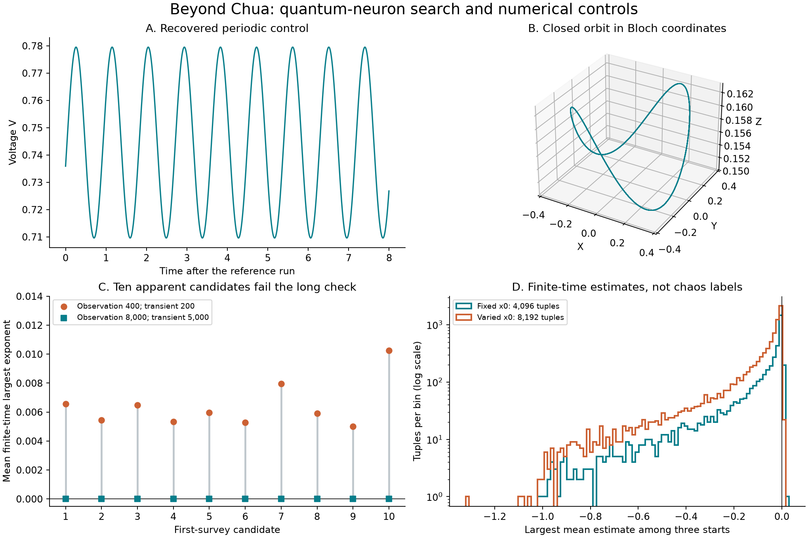

# Looking beyond Chua: a first research pass

Research log, 29 October 2026. This is an exploratory investigation, not a claim of a new chaotic system. Code, numerical settings, unsuccessful searches, and literature exclusions are retained so the investigation can be checked and continued.

**Result of this pass:** no new chaotic attractor was confirmed. Both GPU surveys and 58 long follow-ups failed to retain a candidate. Mathematical analysis gives useful exclusions and identifies a missing feedback-model ingredient for the second target.



## Candidate selection and prior work

| Candidate | What the checked literature establishes | Decision |
| --- | --- | --- |
| Potter et al.'s quantum memristive neuron [1] | Hysteresis and periodic self-oscillation in a four-dimensional feedback ODE | First numerical target: explicit equations, compact physical state domain, and several unexplored parameter directions within this investigation |
| Dinavahi and Harris's physical electromechanical meminductor [2] | A moving winding with optical feedback produces sustained oscillations; local-activity analysis uses the term *edge of chaos* | Analyze the uncoupled equations first; model the feedback dynamics explicitly before attempting a chaos search |
| A classical diffusive memristive neuron with particle inertia [3] | Intermittent, metastable chaotic, and chaotic regimes are already reported | Excluded as a candidate for a first discovery of chaos |
| Meminductor emulator circuits [4, 5] | Chaotic oscillators are already constructed | Excluded as an unexplored class; an emulator is not the physical moving-coil device in [2] |
| Quantized leaky integrate-and-fire circuit [6] | A different quantum circuit model with spiking dynamics | Deferred: less directly comparable to an autonomous smooth flow, and reset/measurement conventions need separate treatment |

For the first two **specific** models, this search did not identify a publication establishing a strange chaotic attractor. That statement describes the search result, not guaranteed novelty. It does not apply to quantum circuits, memristors, meminductors, or artificial neurons as whole classes.

Searches combined exact titles, authors, DOI/arXiv identifiers, and the terms `chaos`, `chaotic`, `Lyapunov`, `attractor`, `photoresistor`, and `light dependent resistor`. The primary papers were read beyond their abstracts. An author publication list and OpenAlex forward citations were checked. The query families and limits are recorded in [the search log](../results/candidate-research/literature-search.json); the small forward-citation snapshot is in [citation_search.json](../results/candidate-research/citation_search.json).

OpenAlex returned one citing work for [1], about hysteresis in a different materials model, and two for [2], including another emulator and a review. An incomplete citation index cannot certify that no relevant paper, dissertation, preprint, differently named equivalent model, or unindexed result exists. A publication claim would require a more exhaustive equivalence and citation review.

## Quantum neuron: the equation actually searched

The implementation follows Eq. (10) of the accessible preprint of [1]. States are the Bloch-vector components `(X,Y,Z)` and a classical circuit voltage `V`:

```math
\dot X=\Omega Y+2\dot V Z-\Gamma X,\quad
\dot Y=-\Omega X-\Gamma Y,
```

```math
\dot Z=-2\dot V X-\alpha\Gamma(Z-Z_T),\quad
\dot V=V_n-[1+R_n G(X,Z,V)]V.
```

Here

```math
G=\tfrac12[(1+Z)F_{00}(x_V)+2XF_{01}(x_V)+(1-Z)F_{11}(x_V)],
\quad x_V=x_0-\sqrt2\,lV.
```

The `F` functions are Gaussian-weighted matrix elements of `sech((l u+xV)/lambda)`. With normalized Gauss–Hermite weights, their polynomial factors are `1`, `sqrt(2)*u`, and `2*u*u`. We fix `l=0.5`, `lambda=0.13`, and introduce no forcing, reset, noise, or additional feedback. This is a nonlinear semiclassical feedback model; it is not a claim about chaos in isolated linear quantum evolution.

### Mathematical filters derived here

Let `r²=X²+Y²+Z²`. Direct cancellation of the rotation/feedback terms gives

```math
\frac{d r^2}{dt}=-2\Gamma[X^2+Y^2+\alpha Z(Z-Z_T)].
```

For `Gamma>0`, `0<alpha<=2`, and `0<=ZT<=1`, the unit Bloch ball is forward invariant. On its boundary, the bracket is

```math
1+(\alpha-1)Z^2-\alpha Z_T Z
\ge(1-|Z|)[1+(1-\alpha)|Z|]\ge0.
```

The conductance operator has spectrum in `[0,1]`; its compression to two levels preserves these bounds. Hence `0<=G<=1` for a physical density matrix. For positive `Vn,Rn`, `0<=V<=Vn` is also forward invariant. **The searched physical trajectories therefore have an analytically bounded domain**, independently of whether their motion is regular or chaotic.

At `ZT=0`, the same identity gives

```math
r^2(t)\le r^2(0)e^{-2\Gamma\min(1,\alpha)t}.
```

The limiting dynamics lies on `X=Y=Z=0` and is a scalar autonomous voltage equation. A persistent chaotic attractor is excluded on this temperature slice. This is a useful exact exclusion, not a claim of a new theorem in the literature. It does not exclude long transients or settle `ZT>0`.

### GPU search and follow-up

The GTX 1080 integrates the state and its analytic tangent equation in FP64 with adaptive Dormand–Prince 5(4). Gauss–Hermite quadrature with 512 nodes supplies a cubic Hermite conductance table on `[-32,32]`, spaced by `0.002`; the tangent equation differentiates the same interpolant. The solver checks the Bloch ball and voltage bounds without projecting trajectories back into them.

| Parameter | Range | Sampling |
| --- | --- | --- |
| Vn | 0.05–12 | logarithmic |
| Rn | 1–200 | logarithmic |
| Gamma | 0.01–1 | logarithmic |
| Omega | 0.3–30 | logarithmic |
| alpha | 0.1–2 | logarithmic |
| ZT | 0.3–1 | linear |
| x0 | 0.8 in the first survey; −0.9–0.9 in the second | fixed / linear |

Scrambled Sobol points use seed `20261029`. Each tuple has three physical starts: thermal/low voltage, a coherent state/intermediate voltage, and thermal/high voltage. This is not a uniform measure of parameter volume and does not exhaust attraction basins. Satisfying Bloch-state constraints does not establish that every parameter tuple can be realized by a particular fabricated device.

The initial screen requires mean finite-time LLE `>0.005`, all four observation windows `>0.002`, late voltage range `>1e-5`, and no domain/numerical failure. The thresholds are numerical selection choices, not definitions of chaos.

- **First survey:** 4,096 tuples, 12,288 trajectories, transient 200 and observation 400, `rtol=1e-7`, `atol=1e-10`. Ten trajectories pass the initial screen.
- **Long rerun:** those ten original starts are reintegrated with transient 5,000 and observation 8,000, `rtol=1e-9`, `atol=1e-12`. None survives the screen. The largest mean LLE falls to about `2.16e-6`; the results are consistent with regular oscillations after long transients.
- **Geometry survey:** 8,192 tuples, 24,576 trajectories, transient 500 and observation 1,000, with `x0` varied as above. None passes the four-window screen.
- **Intermittency safeguard:** an additional 24 high-mean-LLE histories from each survey are selected regardless of their individual window signs, excluding the ten already rerun. These 48 trajectories receive the same long rerun; none survives the screen and their maximum mean LLE is `1.68e-5`. Their results are recorded in [ranked-refined](../results/candidate-research/ranked-refined/summary.json).

The two surveys cover **36,864 trajectories at 12,288 parameter tuples**. They do not prove that chaos is absent elsewhere, below the exponent threshold, on a small basin, or after an even longer transient. The remaining geometry parameters `l` and `lambda` have not been scanned.

All 36,864 survey runs and 58 follow-ups finish without a reported domain or integration failure. The four bulk runs take approximately 528 seconds in total wall time on the GTX 1080 (validation, CPU references, compilation, and table preparation excluded). This is a timing observation, not a measured speedup over a CPU implementation.

### Independent numerical controls

The analytic tangent equation agrees with finite differences of the state equation to `2.7e-10` in the control. The 512-node conductance quadrature differs from adaptive scalar quadrature by less than `1e-11` over the checked interval. Interpolated values differ from a 1,024-node reference by about `1.2e-11`; derivative error is below `1e-8` at the sampled points. Three five-time-unit GPU state trajectories agree with direct-quadrature DOP853 to less than `1e-9`.

The published periodic regime is recovered qualitatively. At `Vn=1.73, Rn=5, Gamma=0.1, Omega=7, alpha=ZT=1, x0=0.8`, direct DOP853 gives voltage span `0.0699207`, consistent with the approximately `0.07` vertical scale of preprint Fig. 4(a). The adjacent preprint prose says `0.699`, apparently a decimal-place typo; we do not treat that prose value as a successful quantitative match. Two suspicious first-survey histories, restarted from their long-run endpoints, also have nearly repeated voltage peaks under direct-quadrature DOP853. Their short-window exponents fluctuate around zero; these CPU checks are not proofs of asymptotic periodicity.

Raw validation and reference data are under [results/candidate-research](../results/candidate-research). No claim of a new chaotic attractor is made.

## Physical meminductor: a useful exclusion before simulation

For the uncoupled constant-current model in Eq. (33) of [2], write

```math
\dot x=y,\qquad\dot y=A I\frac{\mu(x)}{x^4}-b y-g,
\quad A=K_1/m_T>0,\ b=k_a/m_T>0,\ x>0.
```

Define

```math
U(x)=gx-AI\int_{x_*}^{x}\frac{\mu(s)}{s^4}\,ds,
\qquad E=\tfrac12y^2+U(x).
```

Then **`dE/dt = -b*y² <= 0`**. For the paper's positive, decreasing sigmoid permeability and `I>0`, the force decreases strictly with height. The potential diverges at both `x→0+` and `x→infinity` and has a unique minimum. Bounded energy sublevels and LaSalle's argument give convergence to the unique equilibrium. Neither a sustained periodic orbit nor a strange chaotic attractor exists in this uncoupled model.

This conclusion does **not** contradict the coupled-device experiment: its winding current changes through an optical feedback network. There is a further modeling trap: if that entire network is replaced by an instantaneous single-valued current `I(x)` and the only velocity term remains `-b*y`, the resulting force is still a position-dependent potential and the energy argument still excludes a nonstationary recurrent attractor in a compact interior region. An actual feedback model must retain the dynamical ingredient supplying the phase lag, such as an electrical or photoresponse state, or an appropriate non-instantaneous law. Friction and impacts also require their own assumptions.

The most useful next question for this candidate is therefore **which measured feedback timescale supplies the energy and the additional effective state**, followed by bifurcation analysis of that explicit model. We did not substitute an arbitrary delay equation and label its attractor a discovery in the published device. Device-specific chaos remains an unverified research direction, not a result of this pass.

A later [reciprocity and energy audit](meminductor-energy-audit.md) retains the electrical state and proves a conditional exclusion for a reversible magnetic transducer under fixed DC voltage and resistance. It also identifies an opposite-sign cross-derivative mismatch between the source's printed force and flux approximations. The exclusion therefore cannot be applied to the complete optical apparatus without resolving its constitutive model and additional feedback physics.

## Reproduction

Run from the repository root with the existing Python dependencies and an FP64 OpenCL GPU:

```sh
python research/search_quantum.py --validate
python research/search_quantum.py --power 12
python research/search_quantum.py --refine results/candidate-research/scout --output results/candidate-research/refined --transient 5000 --duration 8000 --rtol 1e-9
python research/search_quantum.py --power 13 --x0-variable --transient 500 --duration 1000 --output results/candidate-research/geometry-scout
python research/refine_ranked_quantum.py
python research/check_quantum_reference.py
python research/plot_candidate_results.py
```

The reference solver uses the CPU deliberately as an independent check of selected trajectories. The bulk search uses the GPU. Source articles and their figures are linked, not redistributed in the repository.

## References

1. Potter, F., Zagoskin, A., Savel'ev, S., & Balanov, A. G. (2024). Hysteresis and self-oscillations in an artificial memristive quantum neuron. *Physical Review A*, **110**, 042604. [DOI](https://doi.org/10.1103/PhysRevA.110.042604). [Accessible preprint, Eq. 10](https://arxiv.org/html/2405.00624v1).
2. Dinavahi, A., & Harris, H. R. (2025). Edge-of-chaos operation and persistent dynamics for neuromorphic meminductor computing. *Scientific Reports*, **15**, 40672. [DOI](https://doi.org/10.1038/s41598-025-12529-y).
3. Wojtusiak, A. M., Balanov, A. G., & Savel'ev, S. E. (2021). Intermittent and metastable chaos in a memristive artificial neuron with inertia. *Chaos, Solitons & Fractals*, **142**, 110383. [DOI](https://doi.org/10.1016/j.chaos.2020.110383).
4. Rai, S. K., Aggarwal, B., & Singroha, V. (2024). Meminductor emulators using off-the-shelf active blocks with application in chaotic oscillator. *Integration*, **96**, 102165. [DOI](https://doi.org/10.1016/j.vlsi.2024.102165).
5. Kalra, A., Pandey, N., & Rai, S. K. (2026). Compact design of MOSFET-only meminductor emulator and its application in chaos and neural spike generator. *Integration*, **109**, 102740. [DOI](https://doi.org/10.1016/j.vlsi.2026.102740).
6. Brand, D., Dibenedetto, D., & Petruccione, F. (2026). Canonical quantization of a memristive leaky integrate-and-fire neuron circuit. *Physical Review Research*, **8**, 013131. [DOI](https://doi.org/10.1103/y61v-2bxf).
