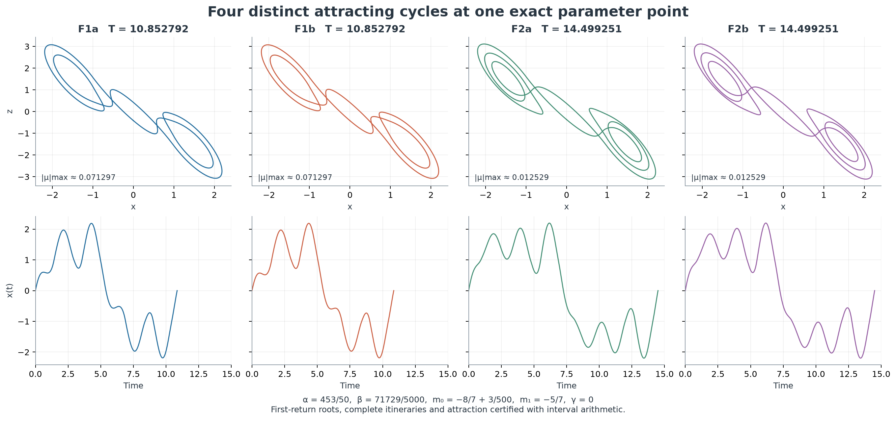
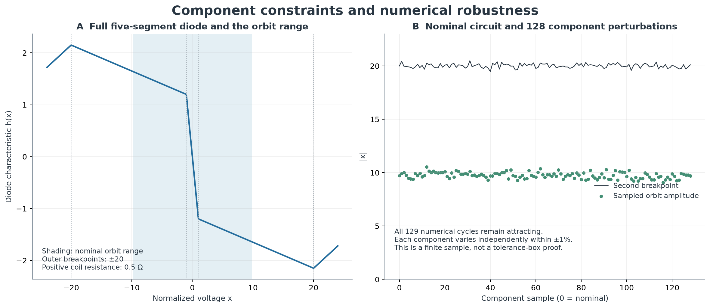

# Certified periodic attractors and equilibrium accessibility

## Abstract

We extend the Chua atlas with interval certificates addressing finite coexistence, hidden periodic attractors and a sufficient condition for global convergence. At one parameter point, four distinct attracting periodic orbits are enclosed. At two other points, an attracting cycle is certified together with explicit neighborhoods of every equilibrium that cannot reach that cycle. One of these examples has a unique, locally stable equilibrium. A common quadratic Lyapunov function certifies global exponential convergence on a separate closed slope sector. A component construction and a finite tolerance experiment examine the relation to the two-op-amp circuit. The exact global-stability boundary, an exhaustive attractor count and infinite simultaneous coexistence remain unresolved here.


Figure 1. A–B: a periodic attractor coexists with the unique stable equilibrium; the shaded section belongs to an invariant ellipsoid. C: an equilibrium-stability calculation supplies a prediction tested with new initial conditions. The marked threshold is not asserted to be the exact boundary of hiddenness. D: a second certificate follows exits from a saddle equilibrium into the basins of two stable equilibria. Orbit curves illustrate the enclosed objects; the proofs use complete time intervals rather than plotted samples.

## 1. Questions and scope

Kuznetsov, Chua and coauthors explicitly ask how many attractors can coexist in the Chua system and how many can be hidden. They also discuss the difficulty of excluding undiscovered attractors and determining global-stability boundaries. Their circuit analysis identifies physical accessibility of the slope plane as a question requiring further investigation. [Kuznetsov et al. (2023), §§5.1 and 6](https://doi.org/10.1007/s11071-022-08078-y).

A later review identifies parameter localization and prediction of hidden-attractor generation as continuing problems. [Guan and Xie (2025), §4](https://doi.org/10.1007/s11071-025-11327-5). The following are restricted contributions to these questions, not solutions of their general forms.

| Question | Result in this study | Remaining obligation |
|---|---|---|
| Finite coexistence | At least four attracting periodic orbits at one exact point | Exclude additional attractors or determine a maximum |
| Hiddenness | Two periodic attractors certified at different parameter points; explicit excluded equilibrium neighborhoods | Continue and certify the boundary of their basins |
| Global convergence | A sufficient closed slope sector and a separate counterexample to convergence | Determine the intervening global-stability boundary |
| Circuit accessibility | Positive component construction; 128 tolerance samples plus the nominal lossy model | Certify a complete tolerance box and validate a physical device |

All interval statements use the repository's model with **γ = 0** and its inner/outer slope convention. The component experiment explicitly adds **−γz** to the third equation. No result from a model with negative γ is transferred to a passive coil.

## 2. Four distinct attracting periodic orbits

The exact parameters are

```math
\alpha=\frac{453}{50},\qquad
\beta=\frac{71729}{5000},\qquad
m_0=-\frac87+\frac3{500},\qquad
m_1=-\frac57,\qquad \gamma=0.
```

At this point the system has at least four geometrically distinct asymptotically stable periodic orbits. The periods and dominant nontrivial multipliers are approximately:

| Orbit | Period | Dominant multiplier |
|---|---:|---:|
| F1a | 10.852791855216832 | −0.0712973660792 |
| F1b | 10.852791855216832 | −0.0712973660792 |
| F2a | 14.499251118050043 | −0.0125287539019 |
| F2b | 14.499251118050043 | −0.0125287539019 |



Figure 2. Four periodic motions at identical parameters, with common coordinate and time scales. Members of each pair are related by inversion. The first-return section points distinguish them even when their periods coincide.

### Certificate argument

Within each linearity region, the flow is a matrix exponential about the affine equilibrium. Interval Newton inclusion encloses each transverse crossing time. Every central flight crossing x = 0 is split there; interval subdivision verifies the sign of x throughout each resulting half-flight, including its endpoint collars. There is exactly one downward section crossing and one upward return. Thus the enclosed map is the **first upward return**, not an unspecified iterate.

Krawczyk inclusion and a contraction bound certify a unique fixed point in each section box of radius 10⁻³⁵. The four boxes are disjoint. Distinct fixed points of the first return correspond to distinct flow orbits, so the count does not count different phases of one orbit.

For each real 2 × 2 return derivative J, the certificate verifies

```math
1-\operatorname{tr}J+\det J>0,\qquad
1+\operatorname{tr}J+\det J>0,\qquad
1-\det J>0.
```

These Schur inequalities place both return multipliers strictly inside the unit disk. The transverse flow direction is not included in this attraction test. A deliberately shifted section box fails Krawczyk inclusion.

The [80-digit certificate](../results/chua-accessibility/four-cycle-certificate-80.json) and [100-digit repeat](../results/chua-accessibility/four-cycle-certificate-100.json) contain root boxes, crossing times, all-time path coverage, stability margins and separation bounds. This establishes a lower bound, not an exhaustive count or a historical record.

## 3. Hidden periodic attractors

We use the basin definition: an attractor is hidden if its basin avoids some neighborhood of every equilibrium. A finite set of unsuccessful starts near equilibria cannot establish that property.

### 3.1 A unique stable equilibrium

At α = 8.4, β = 12, m₀ = −0.95, m₁ = −0.05 and γ = 0, the origin is the only equilibrium. The interval return calculation encloses an attracting cycle of period

```math
T\approx1.944286411398320295.
```

The central region is exactly linear. A specified rational symmetric matrix P satisfies P > 0 and −(AᵀP + PA) > 0, checked by interval bounds on leading principal minors. The level

```math
V(u)=u^\mathsf{T}Pu\le c,
\qquad c=\frac{1}{2(P^{-1})_{11}},
```

lies strictly inside |x| < 1, because its maximum x² is 1/2. It is therefore a positively invariant ellipsoid for the actual piecewise-linear system, and every trajectory in it converges to the origin. The Euclidean ball **‖u‖₂ ≤ 0.0305** is contained in this ellipsoid. Consequently it is disjoint from the periodic attractor's basin. Since there are no other equilibria, this proves hiddenness.

The system thus has a locally stable equilibrium and an attracting periodic orbit at the same parameters. Global convergence to the equilibrium is false. The [stability certificate](../results/chua-accessibility/stability-certificate-80.json) contains the matrix, strict minor bounds, ellipsoid level and cycle enclosure.

### 3.2 A saddle and two stable equilibria

At α = 8.4, β = 12, m₀ = −1.2, m₁ = −0.05 and γ = 0, the equilibria are the origin and ±(23/19, 0, −23/19). An attracting cycle has period approximately 1.944555308803737640. The origin is a saddle with one real expanding direction and a contracting complex pair; the outer equilibria are stable.

An enclosed real eigenbasis writes the central linear flow in coordinates (u,v), where u is scalar, v is two-dimensional, and

```math
\dot u=\lambda u,\qquad
\dot v=(\sigma I+\omega R)v,
\qquad \lambda>0,\quad\sigma<0,\quad R^\mathsf{T}=-R.
```

The first physical coordinate is x = u + v₁. In |u| ≤ 1/2, ‖v‖₂ ≤ 10⁻⁵, the flow remains inside the central linearity region. If u = 0 it converges to the origin. Otherwise it reaches u = ±1/2 with the stable-coordinate norm still at most 10⁻⁵.

The positive exit disk is enclosed by a box. The certificate follows every state in that box through the x = 1 event and along a 120-time-unit outer flight. Complete-time subdivision excludes a return through the breakpoint. The entire endpoint enclosure lies strictly inside an invariant Lyapunov ellipsoid about the positive outer equilibrium. Odd symmetry gives the corresponding negative statement.

Bounds on the inverse eigenbasis and the Lyapunov matrix imply the following conservative Euclidean radii:

| Center | Ball guaranteed not to reach the cycle |
|---|---:|
| Origin | 1.8 × 10⁻⁶ |
| Either outer equilibrium | 0.0028 |

All three equilibrium neighborhoods therefore avoid the cycle's basin. These are lower bounds on excluded neighborhoods, not estimates of the distance to the basin boundary. The [hidden-cycle certificate](../results/chua-accessibility/hidden-cycle-certificate-80.json) records the eigenvalue enclosure, exit tube, 1,465 outer time cells and Lyapunov inequalities. A separate interval cover bounds the cycle by |x| < 12 throughout its period.

## 4. Prediction, testing and global convergence

For γ = 0, the Jacobian at an equilibrium in a segment of slope m has characteristic coefficients

```math
a_1=1+\alpha(1+m),\qquad
a_2=\beta+\alpha m,\qquad
a_3=\alpha\beta(1+m).
```

The remaining Routh–Hurwitz condition is

```math
a_1a_2-a_3=\beta+\alpha m+\alpha^2m(1+m)>0.
```

At α = 8.4 and β = 12 its roots are approximately −0.937675718434966 and −0.181371900612653. Denote the exact lower root by m₋. The other coefficient conditions must also hold. With m₁ = −0.05, the origin is unique and stable for −1 < m₀ < m₋. Any additional periodic attractor there is hidden, because a stable equilibrium has an open basin neighborhood.

Exploratory continuation had already located the large cycle on both sides of the lower threshold. We then fixed four test values, eight directions and three starting radii. The prediction was convergence to the origin at m₀ = −0.97 and −0.95, and convergence to the continued cycle at −0.93 and −0.90. The latter is a **basin hypothesis**, not a consequence of the linear stability calculation. This is not an externally timestamped blind discovery experiment.

The fixed-step experiment integrates 24 starts per parameter to time 1000 at steps 0.01 and 0.005. All 48 starts at the two stable-origin parameters return to the origin. Some outcomes on the unstable side remain unresolved or change classification under refinement, even after replacing linear section interpolation with cubic Hermite interpolation. In the independent adaptive DOP853 calculation, 39 of 48 unstable-side starts reach the cycle's section point within 10⁻⁶ by time 1000. The remaining nine pass the same criterion after a further 400 time units from their last section crossing, with tighter tolerances. The [adaptive check](../results/chua-accessibility/adaptive-prediction-check.json) retains both stages. All prescribed outcomes agree after this follow-up, but the exact hiddenness boundary remains unproved.

### A separate sufficient sector for global convergence

**Follow-up:** the [storage-function study](chua-hidden-boundary.md#2-an-explicit-region-without-oscillatory-attractors) extends the sufficient region to m₀ > m*, m₁ ≥ m*, with m* ≈ −0.181371900613 at these α and β. It proves global asymptotic convergence and identifies an exact adjacent neutral face. The smaller quadratic certificate below remains a separate exponential-convergence result. The same follow-up also certifies a saddle beside the H2 hidden cycle and computes a local basin separator.

At α = 8.4, β = 12 and γ = 0, global exponential convergence to the origin is certified whenever both slopes belong to **[−0.055, −0.045]**. For x ≠ 0, h(x)/x lies between m₀ and m₁. The field can therefore be written as A(k)u with k in this sector. A common rational P gives P > 0 and −(A(k)ᵀP + PA(k)) > 0 at both endpoints. Affine dependence on k extends the inequality throughout the sector. The resulting radially unbounded quadratic function decreases uniformly away from the origin.

The chosen P fails the same test at the unstable slope m = −0.5, providing a rejection control. The certified global sector and the hidden-cycle point are separated in parameter space. They do **not** enclose a unique first transition or establish an exact global-stability boundary. The Lyapunov method is established; the recorded bounds are specific to this study.

## 5. Component constraints

For the two-op-amp realization used in the cited circuit paper, positive component values imply

```math
m_1-m_0=\frac{RK_1}{R_1}>0,\qquad m_0<0,
\qquad \gamma=\frac{C_2RR_L}{L}\ge0.
```

Here K₁ = 1 + R₃/R₄ and K₂ = 1 + R₅/R₆, with K₁ > K₂. These are restrictions of this realization, not impossibility statements for all possible Chua circuits. An atlas point violating them cannot be implemented by merely selecting positive resistors in this arrangement.

For the m₀ = −1.2, m₁ = −0.05 example, choose K₁ = 40 and K₂ = 2. The ratio of the second to first breakpoint is 20. One nominal construction is:

| Component | Nominal value |
|---|---:|
| R | 1 kΩ |
| R₁ | 34.782609 kΩ |
| R₂ | 12.698413 kΩ |
| R₃; R₄ | 39 kΩ; 1 kΩ |
| R₅; R₆ | 1 kΩ; 1 kΩ |
| C₁; C₂ | 11.904762 nF; 100 nF |
| L | 8.333333 mH |
| R_L in the lossy experiment | 0.5 Ω |

The displayed component values are rounded; the construction uses R₁ = RK₁/(m₁ − m₀) and R₂ = R(K₂ − 1)/[(m₁ − m₀)/K₁ − m₁]. Its lossless limit has the certified parameters. The positive coil resistance gives γ = 0.006, so that numerical experiment is a different, explicitly specified model. A 9 V supply gives the ideal first breakpoint at 0.225 V. The lossless certificate's bound |x| < 12 lies below the second breakpoint at 20.



Figure 3. The complete five-segment diode and its two breakpoint pairs. The nominal lossy cycle and 128 independently generated component perturbations, each within ±1%, remain numerically attracting and below the second breakpoint. The sampled maximum amplitudes range from about 9.09 to 10.54, while the second breakpoints range from about 19.48 to 20.49.

Three cases, including the nominal circuit, smallest saturation margin and largest multiplier, are independently integrated with Radau using the five-segment diode. All close within 1.1 × 10⁻¹². This checks those cases; it neither certifies all component tolerances nor proves that hiddenness persists after perturbation. Finite op-amp bandwidth, slew rate, noise and component availability are outside the model. [Component data and checks](../results/chua-accessibility/circuit-constraints.json).

## 6. Numerical controls and limits

All six enclosed cycles are independently integrated using DOP853 and Radau. The largest closure discrepancy is below 3.7 × 10⁻⁹. Direct variational integration agrees with the dominant interval multiplier within 9.5 × 10⁻⁸. The 80- and 100-digit runs give overlapping enclosures of the mathematical quantities and pass the same inequalities. Rounded `ball` strings include serialization error; diagnostic midpoint and radius strings must not be treated as a lossless interval encoding. Computed one-sided bounds are checked by their inequalities rather than by equality across runs.

The four-cycle point also received a basin screen from 768 starts near all three equilibria. With cubic section interpolation, **557 of 768 labels change** when the time step is halved; two fine-step outcomes remain unresolved. This experiment cannot justify hiddenness labels or basin proportions for the four cycles. Earlier linear-interpolation records are retained as superseded controls. The interval coexistence proof does not depend on either screen.

These are computer-assisted arguments using analytical reductions and Python/FLINT interval evaluations. **The new Chua certificates are not checked by Lean.** The existing partial Lean project covers its previously documented statements only. The numerical controls test implementations; they do not replace the interval arguments or replace the analytical [localization proof](chua-basin-and-coexistence.md#3-proof-of-theorem-b).

Historical priority for these parameter-specific certificates has not been established. Hidden Chua attractors, multistability, Lyapunov estimates and interval validation are existing subjects. The contribution recorded here is a set of explicit enclosures, exclusion neighborhoods, reproducible controls and a component-map experiment.

## 7. Remaining work

The next mathematical task is continuation of the basin-separating invariant objects near the local-stability threshold, followed by validated parameter intervals. It must distinguish a sufficient hiddenness region from an exact basin boundary. For the four-cycle point, a validated basin method is needed before classifying accessibility; increasing an unvalidated random scan is insufficient. A complete component-tolerance box requires parameter-dependent orbit enclosures. The separate [localization proof](chua-basin-and-coexistence.md) now establishes infinite simultaneous periodic coexistence on the classical slice.

[Evidence files and reproduction commands](../results/chua-accessibility/README.md) · [Study outline](research-guide.md)
