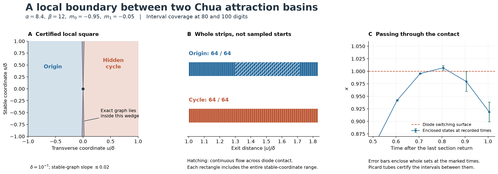
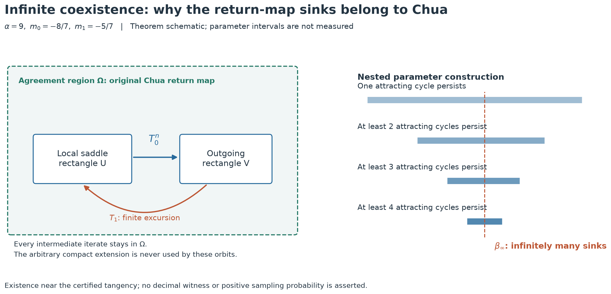

# A local basin boundary and infinite periodic coexistence in the Chua system

## Abstract

We address two questions left open by the earlier atlas reports. At (α, β, m₀, m₁) = (8.4, 12, −0.95, −0.05), we certify a local surface separating convergence to the equilibrium from convergence to a hidden periodic attractor. The proof covers continua of initial states, including trajectories that encounter different diode itineraries. On the classical slice α = 9, m₀ = −8/7, m₁ = −5/7, a localization argument completes the application of the parameter Newhouse–Robinson theorem to the previously certified quadratic homoclinic tangency. Consequently, some parameter values arbitrarily close to that tangency support infinitely many simultaneous attracting periodic orbits.

The first conclusion uses a new interval computation and a graph-transform argument. The second uses the existing interval certificate and a classical dynamical theorem, with the domain issue resolved below. Neither complete argument has been formalized in Lean. These are applications to specified Chua parameters, not new general basin or homoclinic-bifurcation theorems.



Figure 1. A local section through the saddle cycle and the destinations of its two exit strips. Each strip is covered by 64 closed rectangles, with no gaps. The narrow central wedge bounds the unknown exact stable graph; it is not a fitted basin boundary. The flight through a diode contact is checked as a continuous flow enclosure when a common event itinerary cannot be established.

## 1. Model and statements

We use the ideal continuous three-segment model with γ = 0:

```math
\dot x=\alpha(y-x-h(x)),\qquad
\dot y=x-y+z,\qquad \dot z=-\beta y,
```

```math
h(x)=m_1x+\frac{m_0-m_1}{2}(|x+1|-|x-1|).
```

The two results concern different parameter slices.

**Theorem A — local basin separation.** At α = 42/5, β = 12, m₀ = −19/20 and m₁ = −1/20, let p be the saddle-cycle intersection with x = 0, y > 0, and let V be the exact decimal matrix recorded in the certificate. In the section square

```math
q=p+V(u,s)^T,\qquad |u|,|s|\leq\delta=10^{-7},
```

there is an invariant stable graph u = χ(s), with χ(0) = 0 and Lipschitz constant at most 0.02. Every point with u < χ(s) converges to the origin. Every point with u > χ(s) converges to the certified hidden attracting cycle. Points on the graph converge to the saddle cycle. The graph is therefore exactly the common basin boundary **within this square**. Flowing the graph gives a local two-dimensional basin-separating surface in state space.

**Theorem B — infinite simultaneous periodic coexistence.** Fix α = 9, m₀ = −8/7, m₁ = −5/7. There exists a tangency parameter β∗ satisfying

```math
14.30635909996140\lt \beta_*\lt 14.30635909996152.
```

For every ε > 0, there is a β∞ with |β∞ − β∗| < ε at which the Chua flow has infinitely many geometrically distinct asymptotically stable periodic orbits. In particular, some β∞ lies in the displayed interval. The assertion does not identify β∞ by a decimal expansion and does not assert infinite coexistence at β∗ itself.

## 2. Proof of Theorem A

### 2.1 Verified local and capture domains

Let H denote the first downward return from x = 0, y > 0, followed by inversion of all three state coordinates. The vector field is odd, and both destination attractors are invariant under inversion. Capture under H therefore implies the corresponding capture for the flow. The ordinary upward return is H².

The saddle and attracting fixed points of H are enclosed by interval Newton–Krawczyk tests. Their section locations are approximately

```math
p=(0.259191482881335,\ 0.381403591372549),\qquad
p_c=(3.52731878672458,\ 24.24653460235).
```

In the (u,s) coordinates, write H as (F,G), with its exact fixed point at the origin. The interval derivative enclosure on the complete square implies the following conservative bounds:

| Quantity | Bound used in the argument |
|---|---:|
| ∂F/∂u | greater than 1.8308514 |
| \|∂F/∂s\| | less than 0.000000758 |
| \|∂G/∂u\| | less than 0.000000649 |
| \|∂G/∂s\| | less than 0.004809672 |
| Stable-graph slope L | 0.02 |

The program uses the unrounded interval endpoints, not these presentation bounds. It checks all flight interiors and crossing directions. The exact fixed-point enclosure is included in every initial strip enclosure; its coordinate uncertainty is less than 10⁻³⁸.

Two independent capture sets terminate the propagation. Around p_c, a square of radius 0.01 in a fixed eigenvector coordinate system maps strictly into itself and has induced derivative norm below one. It contains the unique attracting fixed point, so every point in it converges to that cycle. Around the origin, a rational symmetric positive-definite matrix P satisfies

```math
Q=-(A_0^TP+PA_0)\gt 0,\qquad
E_0=\{X:X^TPX\lt 0.99/(P^{-1})_{11}\}.
```

The ellipsoid lies strictly inside |x| < 1. There the system is exactly linear, and the positive definiteness of Q proves invariance and convergence to zero. Both matrix inequalities are checked by interval leading principal minors. The complete matrix and contraction bounds are included in the certificates.

### 2.2 Existence of the separating graph

Put a = inf Fᵤ, b = sup |Fₛ|, c = sup |Gᵤ| and d = sup |Gₛ| on the square. The certified inequalities are

```math
a-b\gt 1,\quad c+d\lt 1,\quad
\frac{b+Ld}{a-Lc}\lt L,\quad
\frac1{a-Lc}\lt 1,\quad cL+d\lt 1.
```

Consider the complete space of graphs u = ψ(s) through zero with Lipschitz constant at most L. For each s, solve

```math
F(u,s)=\psi(G(u,s)).
```

The left side minus the right side is strictly increasing in u, with lower difference quotient a − Lc. Its signs on u = ±δ are opposite: the first two inequalities place the image beyond the possible graph values. Thus it has a unique solution. Implicit difference estimates give slope at most (b + Ld)/(a − Lc), and the graph transformation contracts the uniform distance by at most 1/(a − Lc). Its unique fixed graph χ exists by the contraction theorem. Along that graph, the s-coordinate contracts by at most cL + d, so its points converge to p.

For a point off the graph, the signed transverse displacement obeys

```math
|F(u,s)-\chi(G(u,s))|\geq(a-Lc)|u-\chi(s)|.
```

Its sign is preserved while the point remains in the square. Since a − Lc > 1, every such point eventually leaves. Because c + d < 1, it cannot leave through an s-face. At its first exit it belongs to one of the closed strips

```math
\delta\leq |u|\leq M\delta,\qquad
|s|\leq(c+d)\delta,\qquad M=\sup|F_u|+b.
```

This reduces the basin-boundary question to capture of two **whole strips**, rather than selected trajectories.

### 2.3 Uniform capture, including diode contacts

Each strip is subdivided into 64 adjoining u-intervals; every interval retains the complete s-range. The calculation transports a parallelogram enclosing all its points. On a fixed itinerary, affine matrix exponentials and implicit crossing equations give interval first and second derivatives. Centred Taylor enclosures and transported coordinates reduce interval overestimation. A rejected itinerary is never accepted on the basis of its centre trajectory.

Some negative-side enclosures meet the diode contact x = 1, where different points can have different itineraries. For these, the calculation switches to fixed-time integration. A Picard tube Y encloses the entire time step. In a single affine region the flow is evaluated exactly. In a mixed region, it uses the identity

```math
X(t+h)=e^{A_0h}X(t)+
\int_0^h e^{A_0(h-v)} e_1 r(x(t+v))\,dv,
```

```math
r(x)=-\alpha(m_1-m_0)\bigl[(x-1)_+-(-x-1)_+\bigr].
```

The integral is enclosed using the whole Picard tube and the matrix exponential on 0 ≤ v ≤ h. This identity only requires a continuous Lipschitz vector field. It remains valid at a diode contact. Two complementary enclosures are used: a transported basis retains coordinate correlations; a P-norm ball uses verified inequalities A₀ᵀP + PA₀ ≤ −2κP and A₁ᵀP + PA₁ ≤ 2μP to bound homogeneous propagation by exp(−κh) and exp(μh). The forcing enclosure is added by the triangle inequality. If these bounds are insufficient, the initial rectangle is bisected and **both** children must pass. Reducing every step to an unrelated coordinate box was insufficient in preliminary runs.

All 64 negative strips enter E₀; all 64 positive strips enter the cycle contraction domain. The calculation repeats at 80 and 100 decimal working digits. Together with the exit argument, this proves the three destinations in Theorem A. Both attraction basins are open. Every neighborhood of a graph point meets both sides, and every off-graph point belongs to one of the two basins. Hence the graph is their exact common boundary relative to the square.

This does not prove that the entire global boundary is a single surface, or exclude other attractors away from this neighborhood. The older drawing over |s| ≤ 0.035 remains a numerical continuation illustration; it is much larger than the certified local square.

## 3. Proof of Theorem B



Figure 2. Domain and parameter logic of the theorem application. The left panel tracks complete return itineraries. The right panel illustrates preservation of previously created sinks while another is added. These are schematic domains and intervals, not numerically located coexistence windows or a computed value of β∞.

### 3.1 The imported theorem and its local scope

The parameter Newhouse–Robinson theorem applies to a fixed sufficiently smooth one-parameter family unfolding a quadratic homoclinic tangency of a dissipative surface saddle with nonzero parameter speed. It produces parameter intervals accumulating at the original tangency and parameters with infinitely many simultaneous sinks. This is a statement about the given family, not only about arbitrary perturbations of maps. See [Robinson, *Bifurcation to infinitely many sinks* (1983)](https://doi.org/10.1007/BF01206892).

We use its localized construction: the saddle neighborhood and the finite excursion joining its local unstable and stable manifolds can be chosen inside a prescribed neighborhood of the complete homoclinic orbit. The thick horseshoe and the subsequent periodic sinks use repetitions of these return domains. The relevant formulation and return decomposition appear in Theorem 2.6, Remark 3.4 and §4 of [Catsigeras, Cerminara and Enrich, author manuscript](https://www.fing.edu.uy/~eleonora/Recopilacion/Archivos/InfinitosPozos_Premat-2008-108.pdf), [published in 2011](https://doi.org/10.3934/dcds.2011.29.693). The distinction between single-round cascades and simultaneous multi-round sinks is also stated in §1 of [Gonchenko, Ovsyannikov and Turaev (2012)](https://www.ma.imperial.ac.uk/~dturaev/mypapers/physd12.pdf).

The following domain argument explains why that construction applies to our return map. Merely extending a map to a compact surface would not suffice.

### 3.2 Localization and extension argument

Let Pβ = Hβ² be the ordinary first return, and let K be its saddle together with the complete homoclinic orbit at β∗. K is compact: its two infinite tails converge to the saddle. Each of the finitely many excursion flights is transverse to the switching and section surfaces. The analytic implicit-function theorem for its crossing time therefore gives a smooth return branch on an open neighborhood. The local saddle box supplies the two remaining tails. A finite subcover gives a neighborhood W of K and a parameter interval on which all needed branches and their local inverses are smooth.

For completeness, the compact-surface formulation can be used without changing this germ. Choose a closed disk near the saddle and finitely many pairwise disjoint closed disks around the remaining excursion points, with closures in W. They cover K after the convergent tails have entered the saddle disk. Shrink their neighborhoods if necessary. The first-return map is injective by uniqueness of flow orbits and of the preceding section crossing. It preserves orientation: its determinant is the exponential of integrated divergence multiplied by the ratio of the two positive section speeds. Consequently its restrictions to these disks form an orientation-preserving embedding of finitely many disks. Extend it to a diffeomorphism of the sphere; smooth isotopy extension also extends its small parameter variations. The extended family agrees with Pβ on smaller disks covering K.

Now fix an open neighborhood Ω of K whose closure is inside that agreement region. Choose a saddle rectangle U and an outgoing rectangle V so small that every intermediate image of the finite transition from V back to U lies in Ω. The local return used in the homoclinic construction has the form T₁ ∘ T₀ⁿ: all n local iterates stay in U, and all intermediate iterates of T₁ stay in the finite transition rectangles. The rescaled return rectangles shrink toward the local invariant manifolds as n increases. Thus they can be chosen with all these containments strict.

Apply the parameter theorem with these return rectangles. Its thick horseshoe is the invariant set of this localized return construction. The nearby tangencies and newly created sinks are obtained from finite words of the same local and transition pieces, so **every point of every resulting periodic orbit** stays in Ω. Compactness of each finite orbit makes this property persist on a sufficiently small parameter interval. No iterate uses the arbitrary part of the extension.

One can also see explicitly how simultaneity preserves localization. In the resulting parameter interval, let Uₙ be the set of parameters with at least n distinct hyperbolic sinks whose complete orbits lie in Ω. These sets are open. The dense tangencies supplied by the parameter theorem, followed by the local sink-creation construction with arbitrarily long return time, make each Uₙ dense: retain any previously chosen finite set of sinks and create another one of larger period inside Ω. The Baire intersection of the Uₙ is nonempty. Every parameter in this intersection has infinitely many sinks, all belonging to the original Chua return map. This also establishes that a statement about one sink point near the tangency has not been substituted for a statement about its whole orbit.

The compact extension and localization are analytical steps. The interval program does not construct a thick horseshoe or an infinite list of sinks; their existence comes from the cited theorem.

### 3.3 Application to the certified Chua tangency

The [existing tangency proof](chua-infinity-certificate.md) verifies the hypotheses for the exact invariant manifolds, rather than fitted tangent lines. At both working precisions it establishes:

| Hypothesis | Certified bound or construction |
|---|---|
| Fixed family | β varies; α = 9, m₀ = −8/7, m₁ = −5/7, γ = 0 |
| Unstable multiplier of Pβ | [2.7134317828, 2.7134317831] |
| Stable multiplier of Pβ | [1.02745 × 10⁻⁹, 1.02747 × 10⁻⁹] |
| Saddle determinant | [2.78792 × 10⁻⁹, 2.78794 × 10⁻⁹] |
| Quadratic normal curvature | [2.0956 × 10¹³, 2.1447 × 10¹³] |
| Normal β derivative | [3.3728, 3.3731] |
| Excursion validity | 27 half returns; 135 flights; 12,534 checked time cells |
| Exact stable and unstable curves | Uniform graph-transform and derivative bounds |

Append one local half return to the 27-return contact. The connection then uses H²⁸ = P¹⁴. A local diffeomorphism preserves the quadratic contact and nonzero unfolding. The local branch regularity, compactness and orientation conditions used above therefore hold for P. Applying the parameter theorem and the localization argument gives infinitely many distinct periodic sinks of P at nearby single parameter values.

Each sink is a finite periodic first-return orbit with all its flights in the valid domain. Its flow suspension is an asymptotically stable periodic orbit. One periodic flow orbit has only finitely many section crossings in these compact transverse neighborhoods; infinitely many distinct map cycles therefore give infinitely many geometrically distinct flow cycles. This proves Theorem B.

## 4. Consequences for the atlas

There is **no finite upper bound on the number of simultaneous attracting periodic motions** in this ideal model, even on the stated fixed-slope, fixed-α slice. This closes the existence question that was conditional in the earlier coexistence audit. It does not determine the number at an arbitrary supplied decimal parameter, classify hiddenness of the infinitely many cycles, or give their basin volumes.

A [subsequent study](chua-hidden-infinity-certificate.md) establishes infinite hidden periodic coexistence on a different parameter family by combining a second tangency certificate with uniform equilibrium exclusion. The hiddenness statement does not transfer automatically to the classical slice considered here.

The 32 sampled sheets and 34 catalogue identities remain finite computational objects. Infinite coexistence does not prove that every motion belongs to a different globally disconnected continuation surface. Counting connected family sheets is a different question from counting simultaneous periodic attractors.

There is also a direct sampling consequence. In a bounded section neighborhood Ω containing the localized sinks, their basin sections Bᵢ are disjoint open sets of positive area. Hence ∑ᵢ area(Bᵢ) ≤ area(Ω). For every a > 0, at most area(Ω)/a of them can have area at least a. Infinitely many coexisting cycles therefore entail arbitrarily small basin sections in this fixed observation domain. This is a measure argument, not a measured basin-size distribution; it explains why refining parameter resolution alone cannot make a finite initial-state survey exhaustive.

The local basin result explains one concrete failure of searches started near an equilibrium: a stable surface of a saddle cycle separates those starts from a large periodic attractor. Its certified local character matters; a global basin diagram still requires further work.

## 5. Evidence and reproduction

The [evidence directory](../results/chua-basin-proof/README.md) contains both complete strip certificates, independent high-precision derivative controls, a deliberately shifted root rejected by the inclusion test, continuous-flow checks against a separate ODE solver, the theorem-application audit and figure data. The failed preliminary strategies are recorded as failures, not silently treated as certified domains.

```bash
python research/certify_chua_basin_separator.py --digits 80
python research/certify_chua_basin_separator.py --digits 100
python research/check_chua_basin_proof.py
python research/audit_chua_local_results.py
python research/plot_chua_local_results.py
python research/manifest_refined_chua_atlas.py --check
```

The proofs depend on the stated analytic arguments, established dynamical theorems and the correctness of Python/FLINT's interval computations. The existing Lean development checks selected general implications and algebra; it does not formally verify Theorem A, Newhouse–Robinson, the compact extension or Theorem B. Historical priority for these parameter-specific applications has not been established.
