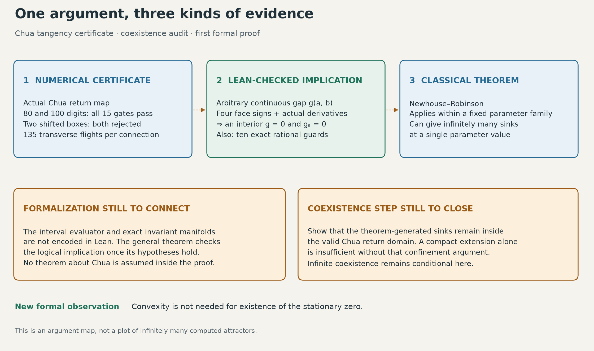

# From infinitely many windows to infinitely many coexisting cycles

The existing certificate concerns a quadratic homoclinic tangency near β = 14.30635909996146, with α = 9, m₀ = −8/7 and m₁ = −5/7. This audit asks whether it also establishes infinitely many attracting cycles **at one parameter value**, and starts a formal verification of the tangency argument.

**Result:** the numerical local hypotheses reproduce, and the relevant classical theorem does apply to fixed one-parameter families. The application to Chua still needs a precise localization argument. Infinite simultaneous coexistence is therefore **conditional in this repository**. Separately, Lean checks a general theorem turning the four boundary signs into an interior stationary zero, together with the rational graph-transform guards. It does not yet check the Chua interval computation or the Newhouse–Robinson theorem.



## 1. Two different meanings of infinity

The [cascade report](chua-infinity-certificate.md) concerns infinitely many attracting windows at different parameter values. That statement alone does not imply coexistence: an infinite collection of intervals can be pairwise disjoint.

The stronger question is whether, for every sufficiently small neighborhood of the tangency parameter, some **single** β in that neighborhood supports infinitely many distinct attracting periodic orbits. The β may depend on the neighborhood. It need not equal the tangency parameter, and the theorem does not identify it by a finite decimal expansion.

The parameter version of the **Newhouse–Robinson theorem** is the appropriate result. For a sufficiently smooth family of surface diffeomorphisms, a generically unfolding quadratic homoclinic tangency of a dissipative saddle produces nearby parameter intervals with infinitely many simultaneous sinks on a dense set of parameters. Thus the theorem is stronger than an arbitrary perturbation in the space of all maps. See [Robinson (1983)](https://doi.org/10.1007/BF01206892) and the explicit formulation in Theorem 2.6 of the [Catsigeras–Cerminara–Enrich author manuscript, p. 6](https://www.fing.edu.uy/~eleonora/Recopilacion/Archivos/InfinitosPozos_Premat-2008-108.pdf), subsequently [published in DCDS](https://doi.org/10.3934/dcds.2011.29.693).

The cited formulation uses diffeomorphisms of a compact surface. Its density statement is not a statement of positive probability under random parameter sampling. Neither that statement nor our audit provides a finite scan guaranteed to find a parameter with infinitely many sinks.

## 2. Hypothesis audit

Write H for the sign-reduced half return and P = H² for the ordinary upward first return. The numerical evidence below is recomputed, not inferred from a plot. The full records are in [numerical-audit.json](../results/chua-proof-audit/numerical-audit.json).

| Requirement | Chua evidence or argument | Status |
|---|---|---|
| A fixed one-parameter family | Only β varies; α = 9, m₀ = −8/7, m₁ = −5/7, γ = 0 | Exact specification |
| A smooth family near the relevant orbit | Affine matrix-exponential flights, transverse event equations, fixed admissible itineraries | Analytical argument using interval path checks |
| A continued saddle | Uniform Krawczyk inclusion and derivative bounds | Interval checks pass |
| Positive saddle multipliers for P | Unstable in [2.7134317828, 2.7134317831]; stable in [1.02745 × 10⁻⁹, 1.02747 × 10⁻⁹] | Interval checks pass |
| Dissipation at the saddle | det DP in [2.78792 × 10⁻⁹, 2.78794 × 10⁻⁹], strictly between zero and one | Interval checks pass |
| An actual homoclinic excursion | Exact invariant-graph bounds, 27 half returns, departure from the local square, endpoint on the stable graph | Computer-assisted argument in the existing report |
| Quadratic contact | Normal second derivative in [2.0956 × 10¹³, 2.1447 × 10¹³] | Interval checks pass |
| Nonzero parameter unfolding | Normal parameter derivative in [3.3728, 3.3731] | Interval checks pass |
| Contact for P, rather than only H | Append one local H iterate: H²⁸ = P¹⁴; a local diffeomorphism preserves contact order and nonzero unfolding | Analytical argument |
| The theorem's domain and localization of its sinks | The implemented return is defined on certified neighborhoods, not on an entire compact surface | **Open obligation in this audit** |
| Attracting map cycles correspond to attracting flow cycles | A periodic first-return sink gives a stable periodic flow orbit, provided every return stays in the valid domain | Conditional on the preceding localization |

Both 80- and 100-digit runs pass all 15 final gates, all local gates and all graph-transform guards. Each global connection covers 135 flights and 12,534 accepted time cells. Shifting the box by +10⁻¹⁰ or −10⁻¹⁰ fails the required parameter-face sign, as expected. A rejected box is not a proof that no other tangency exists nearby.

### Why the diode corners are not automatically an obstruction

The vector field is continuous and piecewise affine, with derivative jumps at x = ±1. A global smooth-flow theorem cannot simply be applied to that field.

On each flight, however, the solution is an analytic matrix-exponential expression. The crossing time is an analytic implicit function when the crossing speed is nonzero. Composition along a fixed transverse itinerary therefore gives an analytic event map on an open neighborhood. The certificate checks the itinerary for complete time intervals, including endpoint collars. Reversing the flights gives a local inverse. This supplies the needed local smoothness without claiming that the entire Chua flow is globally smooth.

### The remaining localization obligation

Let K be the saddle together with the complete homoclinic orbit of P. Its two tails approach the saddle, so K is compact. The certified local box and finite excursion provide a neighborhood on which the relevant return branches are smooth.

To finish the stronger coexistence argument, one must supply either:

1. A precise local version of Newhouse–Robinson whose generated periodic orbits stay in an arbitrarily small prescribed neighborhood of K, and verify its assumptions for these branches; or
2. A parameter-dependent extension to compact-surface diffeomorphisms, agreeing with P on that neighborhood, **plus** a proof that the theorem-generated sinks stay in the agreement region.

Merely extending a map is insufficient: a sink created outside the agreement region would say nothing about Chua. Nor does the small determinant alone construct a thick horseshoe or give a computable coexistence parameter. The local estimates strongly support the proposed route, but this report does not replace that obligation with an unsupported assertion of locality.

No historical-priority claim is made. This is an audit of the explicit certificate in this repository, not a claim that homoclinic tangencies or Newhouse phenomena are new.

## 3. What Lean now checks

The source is [TangencyBox.lean](../formal/ChuaProof/TangencyBox.lean). Its central theorem, `ChuaProof.tangency_box`, takes an arbitrary real function g(a,b), continuous on a closed rectangle, and an actual state derivative gₐ. Its four uniform sign assumptions are:

```math
\begin{aligned}
g(a,b_L)&\lt0,&g(a,b_R)&\gt0&&\text{for every }a\in[a_L,a_R],\\
g_a(a_L,b)&\lt0,&g_a(a_R,b)&\gt0&&\text{for every }b\in[b_L,b_R].
\end{aligned}
```

It proves the existence of an interior pair satisfying

```math
g(a_*,b_*)=0,\qquad g_a(a_*,b_*)=0.
```

The proof minimizes g over the compact state interval. The minimum depends continuously on b and changes sign between the parameter faces. A minimizer at the zero cannot lie on either state boundary because of the derivative signs. Fermat's theorem then gives the zero state derivative. The code proves this implication; it does not assume the existence of a contact or insert a precomputed witness.

An additional theorem, `quadratic_contact`, includes the actual second state derivative and parameter derivative, positive throughout the rectangle. The same interior witness has positive curvature and nonzero parameter derivative. These derivatives are tied to g by `HasDerivAt` hypotheses, rather than being unrelated functions with convenient names.

The existence argument needs less than the original prose argument: **strict convexity is unnecessary for existence**. It remains useful for uniqueness and classification. Uniqueness of the tangency is not part of this first formalization.

[Guards.lean](../formal/ChuaProof/Guards.lean) also proves the ten rational graph-transform inequalities with the exact published constants. This checks the arithmetic of those guards, not the graph-transform construction or the bounds on the actual Chua map.

## 4. Where formal verification stops

| Part | Checked by Lean? |
|---|---|
| Four face signs imply an interior stationary zero | Yes |
| Positive curvature and parameter derivative at that witness, under the stated derivative hypotheses | Yes |
| Exact rational graph-transform guard inequalities | Yes |
| Construction and smoothness of the exact Chua invariant manifolds | No |
| Matrix-exponential enclosures, event times, jets and all-time itinerary checks | No; executable Python/FLINT certificate |
| The connection between the interval output and the hypotheses of the Lean theorem | No |
| Newhouse–Robinson and the localization obligation | No |

The [formal check record](../results/chua-proof-audit/formal-check.json) records the toolchain, source hashes, build result and transitive axiom dependencies. Accepted dependencies are Lean's standard `propext`, `Classical.choice` and `Quot.sound`. The checker rejects additional axioms and incomplete proof placeholders. This is a partial formalization with an explicit boundary, not a formally verified proof of infinitely many Chua attractors.

Reproduction commands and the exact pinned dependency revisions are in [formal/README.md](../formal/README.md). The numerical audit and visual can be reproduced through the [evidence guide](../results/chua-proof-audit/README.md).
