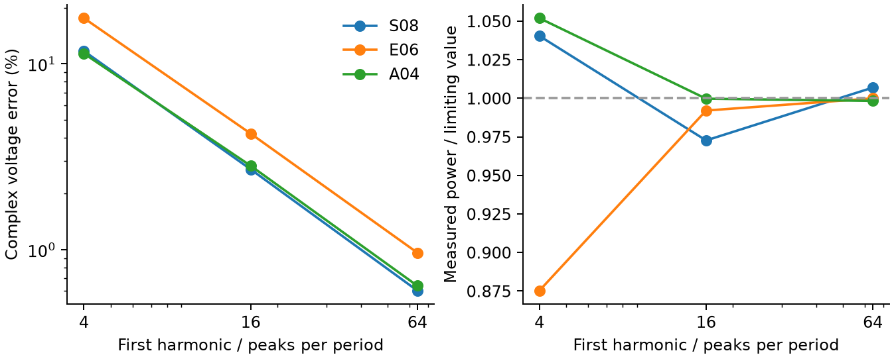

# Predicting the voltage spectrum from diode crossings

For a periodic orbit of the ideal three-segment Chua circuit, the times and velocities of its diode crossings determine every nonzero voltage harmonic at which the affine resolvents exist. At high frequency the crossing times and the signed jumps of $\ddot x$ suffice to predict the leading term for $x$. On three atlas orbits the resulting approximation predicted the complex high harmonics with **0.60–0.97% relative error** in the highest tested band. [Forecast committed before waveform integration](https://github.com/Griboedow/chua-gpu-atlas/commit/22a12116c11f870461199d4df1ae913487407bd0)

## Exact formula at finite frequency

Let $u=(x,y,z)$ have period $T$ and finitely many transverse crossings at times $t_j$ modulo $T$. Write $v_j=\dot u(t_j)$, $s=2\pi i k/T$ and $U_k=T^{-1}\int_0^T u(t)e^{-st}\,dt$. Within each affine region the velocity obeys $\dot v=A_m v$, where $A_m$ is the Jacobian at diode slope $m$. Define $R_m=(sI-A_m)^{-1}$. Integrating the velocity on each flight and summing endpoint terms gives

```math
U_k=\frac{1}{Ts}\sum_j e^{-s t_j}
\big(R_{m_j^+}-R_{m_j^-}\big)v_j,\qquad k\ne 0 .
```

Here $m_j^-$ and $m_j^+$ are the slopes before and after the crossing. A section cut inside one linear region contributes zero. The result uses the continuous velocity of the piecewise-linear circuit. The reference phase is the same as for its archived orbit.

## What survives in the high harmonics

Only the first diagonal entry of $A_m$ changes at a breakpoint. The curvature jump is $J_j=[\ddot x]_j=-\alpha(m_j^+-m_j^-)\dot x(t_j)$. Expanding the resolvents at large $|k|$ gives the complex voltage coefficient

```math
X_k=\frac{1}{T s^3}\sum_j J_j e^{-s t_j}+O(|k|^{-4}).
```

Different crossings can cancel in a single harmonic. For example, half-period inversion removes every even harmonic. A whole band instead measures a phase-independent quantity. With $s_k=2\pi i k/T$,

```math
\lim_{K\to\infty}\frac1K\sum_{k=K}^{2K-1}|T s_k^3 X_k|^2
=\sum_j J_j^2=\alpha^2(m_1-m_0)^2\sum_j \dot x(t_j)^2.
```

In the squared sum each off-diagonal term averages a geometric progression to zero because distinct crossings have distinct times modulo $T$. The remainder after scaling tends uniformly to zero over the band. Thus the high-frequency power gives a check on the total squared crossing speed even if the acquisition phase is unknown. The linear response of the other two coordinates adds one power of decay for $Y_k=O(|k|^{-4})$ and two for $Z_k=O(|k|^{-5})$. [Voltage-to-current transfer functions](chua-voltage-reconstruction.md)

## Independent waveform test

The forecast used the 70-digit orbit roots and their affine flight itinerary. For the test, DOP853 integrated the full continuous field from the starting states of the separate 60-digit reconstruction, with no prescribed switching times. We Fourier transformed the first voltage over one period, without forcing the endpoint to close. Here $p$ is the number of voltage peaks per period and the high band contains $64p\le k<128p$.

| Orbit | Crossings | Predicted $\sum J_j^2$ | High-band power / prediction | Relative complex error of leading term |
|---|---:|---:|---:|---:|
| S08, symmetric | 8 | 478.661 | 1.00690 | 0.602% |
| E06, one lobe | 4 | 185.521 | 0.99993 | 0.963% |
| A04, asymmetric | 40 | 2312.205 | 0.99827 | 0.639% |



The finite-frequency formula agreed within $4.5\times10^{-10}$ in relative complex norm over $1\le k\le6p$. A second integration with Radau and half the sampling density changed the high-band complex coefficients by less than 0.011% in the same norm. The $k^{-3}$ result assumes sharp changes in diode slope. A smooth physical diode can have a different spectral tail. [All three band tests and closure errors](../results/chua-diode-spectrum/measurements.json)

Samoilenko and Chua derived scalar component equations with impulses at diode crossings. Fourier expansions for signals with derivative jumps are classical, and Elgar and Chandran measured higher-order voltage spectra in a physical Chua oscillator. Here the crossing speeds predict complex harmonics and a limiting band power for individual atlas orbits. [Component equations](https://doi.org/10.2991/jnmp.1994.1.1.2) · [Piecewise-smooth Fourier data](https://arxiv.org/abs/1211.0680) · [Experimental Chua spectra](https://doi.org/10.1109/81.246144)

From the repository root, run the following [CPU programs](../research/check_chua_diode_spectrum.py). The commands write to `outputs/chua-diode-spectrum/`.

```bash
python research/predict_chua_diode_spectrum.py
python research/check_chua_diode_spectrum.py --forecast outputs/chua-diode-spectrum/forecast.json
```
