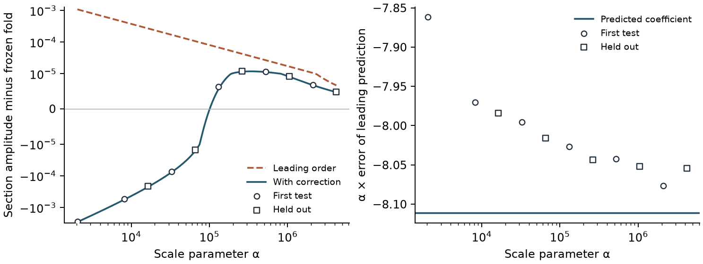

# A finite-α correction to the slow passage through a Chua fold

How far does the full circuit move past the frozen one-well fold before its section coordinate reaches the fold orbit? For the controlled launches below the predicted signed excess in oscillator amplitude is

```math
R_{\rm section}-R_f \simeq 0.174363964\,\alpha^{-2/3}-8.111454954\,\alpha^{-1},
\qquad R_f=1.73421854387648.
```

The second term puts the crossing below the static fold at two of five held-out settings. Direct three-state integrations confirm both negative excesses. The two coefficients come from the equations and the launch protocol. [Forecast recorded before the five tests](https://github.com/Griboedow/chua-gpu-atlas/tree/a7a56ec2349379a02fb91ad420946df1c9bd0847/results/chua-dynamic-fold)



| α | Leading excess × 10⁶ | Corrected excess × 10⁶ | Measured excess × 10⁶ |
|---:|---:|---:|---:|
| 16,384 | +270.298 | −224.786 | −217.034 |
| 65,536 | +107.268 | −16.503 | −15.049 |
| 262,144 | +42.569 | +11.627 | +11.885 |
| 1,048,576 | +16.894 | +9.158 | +9.215 |
| 4,194,304 | +6.704 | +4.770 | +4.784 |

## What was predicted

Fix $\kappa=\beta/\alpha^2=0.1425$, $m_0=-2$, $m_1=-5/7$, with fast time $s=\alpha t$ and $Z=z/\alpha$. On each rising $y=0$ crossing record $x$ and $R=Z/\sqrt\kappa$. The positive-well fold has $x_f=0.14324857338$ on this section. Interpolate $R$ between the first two section points bracketing the downward crossing of $x_f$. Each launch starts on the attracting frozen solution eight scaled amplitude units below the fold. [Static fold and matched flights](chua-fiber-switching.md)

The first forecast used the Airy law for slow passage through a saddle-node. At $\alpha=2^{21}$ the measured excess at the section was only **0.638** times the leading prediction. The first turn spanning both wells gave **0.465** times its separate Airy-pole prediction. Both missed their declared tolerances. This prompted the correction for the section marker. The two-well marker and the reverse transition remain outside that correction. [Original forecast](https://github.com/Griboedow/chua-gpu-atlas/tree/73397665d8b6291898e2950b73eb4a168706c34f/results/chua-dynamic-fold) · [First test](../results/chua-dynamic-fold/measurements.json) · [Airy delay in the swept normal form](https://pmc.ncbi.nlm.nih.gov/articles/PMC6836434/) · [Two-thirds law in discrete maps](https://arxiv.org/abs/2311.07242)

## Derivation

Set $h=x-x_f$, $\mu=R-R_f$ and $\epsilon=1/\alpha$. The leading terms of the rising-section map on this transverse itinerary are

```math
\Delta h=A\mu+B h^2+C h\mu+D h^3+E\epsilon+\cdots,\qquad
\Delta\mu=\epsilon(H+Jh+\cdots).
```

The frozen fold is parametrized by its time $d$ on the inner diode segment. For outer and inner slopes $a=2/7$, $b=-1$, its multiplier is $q(d)=\exp[(a-b)d-aT]$. Differentiating the fixed-point equation and the multiplier along the family at $q=1$ gives $AB=-(a-b)^2/[2R''(d_f)]=42.449553$. Further derivatives along this family give $C,D$. The exact radial identity gives $H=\int_0^T y(x-y)\,ds/R_f=0.461309873$. Differentiating that integral in the initial $x$ gives $J$. Differentiating the full flow in $\epsilon$, including the change of return time, gives $E$. [Coefficient calculation](../research/predict_chua_section_delay.py)

Write $V=(ABH\epsilon)^{1/3}$, $L=V^2/(AB)$, $u=Bh/V$, $\sigma=\mu/L$. Then $u=U+V W+\cdots$, where $U'=\sigma+U^2$ and primes now denote $\sigma$ derivatives. Keeping the next terms of the discrete map gives

```math
W'=2UW+\frac{C}{AB}U\sigma+\frac{D}{B^2}U^3+\frac{E}{AH}
-\frac{J}{BH}UU'-\tfrac12 U''.
```

The frozen launch fixes $U(-8)=-\sqrt8$ and $W(-8)=-[C(-8)/(AB)+D\,U(-8)^2/B^2]/2$. The first zero of $U$ is $\sigma_*=1.018792972$. The section marker shifts to $\sigma_*-V W(\sigma_*)/\sigma_*$. Since $LV=H/\alpha$, this gives the displayed $-8.111454954/\alpha$ correction. The calculation uses the finite launch position in both equations. It supplies an asymptotic expansion without a validated remainder bound.

## Numerical checks

At the three largest held-out settings, the corrected error was 0.607%, 0.337% and 0.204% of the leading excess. Relative to the measured signed excess, the errors were 2.17%, 0.62% and 0.29%. Independent LSODA integrations passed the same gates. The checker also differentiates the frozen return off its fixed branch and checks both feedback derivatives by direct integration. These launches probe the loss of the positive well with prescribed starting states. Other initializations, sections and markers can have different coefficients. [Held-out results](../results/chua-dynamic-fold/section-measurements.json)

Run the four commands from the repository root with the [CPU dependencies](../requirements-certificate.txt). Checkers read the archived forecasts and write to `outputs/chua-dynamic-fold/`.

```bash
python research/predict_chua_fold_delay.py
python research/check_chua_fold_delay.py
python research/predict_chua_section_delay.py
python research/check_chua_section_delay.py
```
