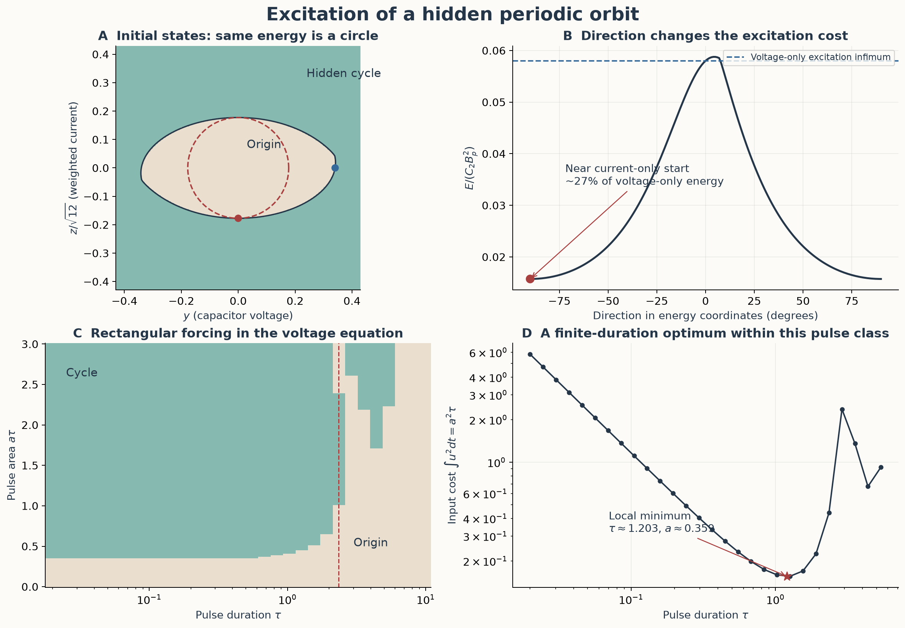
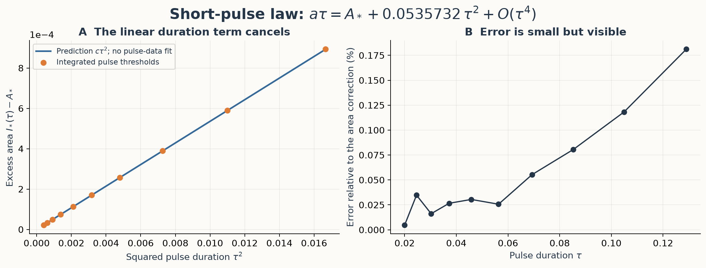
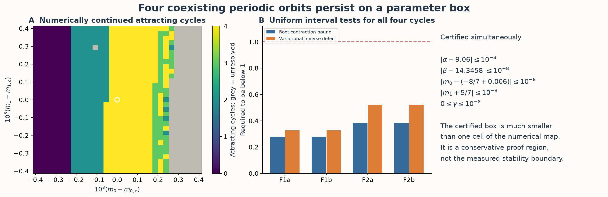
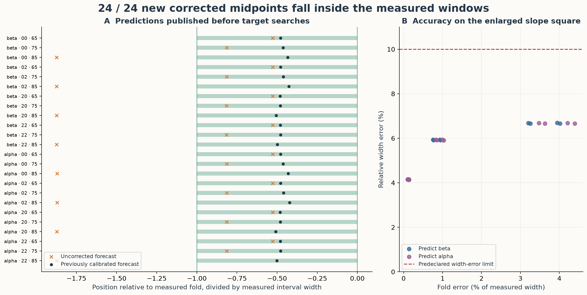

# Excitation, robust coexistence and prediction across slopes

## Results and their scope

This study extends three parts of the atlas: selecting an initial state, retaining several attracting motions under parameter changes, and locating thin stability windows without solving them first.

| Question | Result | Evidence level |
|---|---|---|
| Which initial direction excites the known hidden cycle with less stored energy? | In the plane x = 0, the lowest sampled threshold is near a current-only start. Its energy is about 27% of the voltage-only threshold. | Numerical basin section and independent trajectory checks; no global optimality proof |
| Does a stronger finite pulse always improve excitation? | No. At a specified duration, a moderate rectangular pulse excites the cycle and a stronger pulse returns to the origin. | Numerical thresholds and independently integrated trajectories |
| Do four cycles coexist beyond one exact parameter point? | Yes. All four persist throughout an explicit five-parameter box, including nonnegative inductor loss. | Uniform interval multiple shooting and a stability argument |
| Does the existing prediction rule work on a larger slope square? | The unchanged calibrated model locates 24/24 new windows; the uncorrected model locates 16/24. | Forecasts published before target searches; independent checks of twelve cycles |

The experiments use different parameter sets. The four-cycle box below is not asserted to contain hidden cycles. The hidden-cycle excitation experiment does not address chaotic attractors. The distinction between periodic windows, simultaneous cycles and catalogue entries remains as stated in the [terminology guide](terminology.md).

The motivation is concrete. Kuznetsov and colleagues describe how prescribed initial conditions expose hidden attractors and how circuit components constrain accessible parameter changes. Their experimental apparatus adjusts capacitor voltages, rather than prescribing a nonzero inductor current. The current-only calculation below therefore identifies a mathematical opportunity for a different initialization mechanism, not a capability demonstrated by that apparatus. [Kuznetsov et al. (2023), Sections 3–5](https://doi.org/10.1007/s11071-022-08078-y).

## 1. Excitation in a plane of initial states

We fix α = 8.4, β = 12, m₀ = −0.95, m₁ = −0.05 and γ = 0. The origin is asymptotically stable; the attracting periodic orbit and the saddle cycle separating its basin locally were established in the [basin study](chua-basin-and-coexistence.md). The previous [excitation proof](chua-prediction-and-hidden-coexistence.md#2-excitation-of-a-hidden-attracting-cycle) covers seven local ray intersections and establishes the first excitation infimum on the positive y ray.

### Stored energy, rather than coordinate distance

With x = U₁/Bₚ, y = U₂/Bₚ, z = RIₗ/Bₚ, α = C₂/C₁ and β = C₂R²/L, physical stored energy satisfies

```math
\frac{E}{C_2 B_p^2}=\frac12\left(\frac{x^2}{\alpha}+y^2+\frac{z^2}{\beta}\right).
```

Consequently, an energy-based comparison on x = 0 uses initial states

```math
(x_0,y_0,z_0)=(0,r\cos\theta,\sqrt{12}\,r\sin\theta),
\qquad \frac{E}{C_2B_p^2}=\frac{r^2}{2}.
```

Equal Euclidean distances in the original y,z plot would not give equal energies.



**Figure 1.** A: the sampled basin section in energy coordinates, enlarged near its boundary. Odd symmetry supplies the opposite half-plane. B: numerical first-entry thresholds along 181 directions. C: destinations after rectangular pulses, starting from the origin. D: squared-input costs at the sampled entry thresholds. Joining sample points does not certify the intervening parameter values.

The section contains 181 directions and 241 radii, with 0 ≤ r ≤ 1.5: **43,621 initial states**, integrated independently at steps 0.004 and 0.002. Their destination labels agree at every grid point. Each sampled ray has one origin-to-cycle transition; no repeated crossing was found on this grid. This does not exclude narrow unsampled basin intervals or establish that the entire basin is star-shaped.

The lowest numerical threshold is close to (0,0,±0.61447), with r ≈ 0.177382 and E/(C₂Bₚ²) ≈ 0.0157323. The previously certified positive-y infimum A* ≈ 0.34061011644 corresponds to energy 0.0580076. The ratio is approximately **0.271**. The small angular displacement returned by numerical minimization is below what this calculation should interpret physically; the conclusion is “near current-only,” not a certified nonzero optimal angle.

The minimum is an excitation threshold: the limiting boundary trajectory need not approach the attracting cycle. A successful initialization must lie on the cycle side. No minimum over all three-dimensional initial states is claimed.

There is a geometric reason to examine the current-only direction. At (0,0,z), the vector field is (0,z,0). If a smooth invariant basin-boundary surface meets x = 0 transversely there, the intersection curve is tangent to this vector. The directional derivative of stored energy along it vanishes. Thus such a current-only crossing is a stationary energy point. This conditional argument explains the numerical candidate; it does not prove that the observed crossing is a global minimum.

### Finite-duration forcing

We now start exactly at the origin and replace the second equation during a pulse by

```math
\dot y=x-y+z+u(t),\qquad
u(t)=\begin{cases}a,&0\leq t\leq\tau,\\0,&t>\tau.\end{cases}
```

This specifies the input channel and waveform. We compare J = ∫u²dt = a²τ, a squared-input cost, which is **not** the stored energy or the electrical work supplied by a physical source.

The scan uses 31 durations between 0.02 and 10 and 151 pulse areas between 0 and 3. A local minimization over 0.8 ≤ τ ≤ 1.6 gives approximately τ = 1.203, a = 0.3594 and J = 0.15537 at the first entry threshold. This is a numerical local optimum within a restricted pulse class; it does not optimize arbitrary waveforms.

At τ = 2.3455264, the sampled excitation interval is approximately **0.43208 < a < 1.02189**. Both ends were refined and checked on either side. Thus increasing amplitude can cross the basin boundary twice. The pulse endpoint, rather than its amplitude alone, determines the subsequent unforced destination.


**Figure 2.** Same duration and input channel, amplitudes 0.7 and 1.2. The left panels show the transient; the right panels show a later interval. The stronger pulse ends in the origin's basin. The displayed trajectories and their final destination checks are retained in [pulse-demonstration.json](../results/chua-followup/excitation-plane/pulse-demonstration.json).

### A short-pulse law from the basin separator

For sufficiently short pulses with fixed area I = aτ, the forced segment remains in the central linear region. Let A₀ be its system matrix and eᵧ = (0,1,0). The pulse endpoint is

```math
X_\tau=\frac{I}{\tau}\int_0^\tau e^{A_0s}e_y\,ds.
```

The unforced flow preserves the basin boundary. Moving the endpoint backwards by τ/2 therefore preserves its boundary membership and removes the first-order term:

```math
e^{-A_0\tau/2}X_\tau
=I\left(e_y+\frac{\tau^2}{24}A_0^2e_y+O(\tau^4)\right).
```

The known voltage-ray crossing is transverse to the smooth local separator. With n its normal there, the implicit-function expansion gives

```math
I_*(\tau)=A_*+c\tau^2+O(\tau^4),\qquad
c=-\frac{A_*\,n\cdot A_0^2e_y}{24\,n\cdot e_y},\qquad
J_*(\tau)=\frac{A_*^2}{\tau}+2A_*c\tau+O(\tau^3).
```

The quadratic correction is a consequence of centering the forced segment in time; it is not fitted to the pulse thresholds. Pulling back numerical saddle-manifold normals over four, six and eight half returns gives c ≈ **0.0535732**. These are finite-iterate normal approximations, not an interval enclosure of c.



**Figure 3.** The predicted area correction cτ² and measured corrections agree to within 0.182% of the correction itself on the ten tested durations from 0.02 to 0.1291. The error panel also exposes integration error at the smallest increments. This comparison was made with the existing pulse data after deriving the expansion; it is not a separate prospective experiment. [Derivation program and normal approximations](../research/derive_chua_pulse_limit.py), [numerical comparison](../results/chua-followup/excitation-plane/short-pulse-law.json).

**Checks and limitations.** The map uses fixed-step RK4 and finite-time destination tests. Origin capture uses the previously established Lyapunov ellipsoid; numerical cycle capture requires two successive upward section crossings within 0.002 of the known cycle point. Selected threshold sides are re-integrated for 600 time units with DOP853 and Radau, using a final section tolerance of 10⁻⁶. These checks are numerical, not interval proofs of the new plane or pulse thresholds. The small bisection brackets in the data measure solver refinement, not rigorous error bounds. See [settings and controls](../results/chua-followup/excitation-plane/).

## 2. Four cycles throughout a parameter box

### Statement

For every parameter vector satisfying

```math
\begin{aligned}
|\alpha-453/50|&\leq10^{-8},&
|\beta-71729/5000|&\leq10^{-8},\\
|m_0-(-8/7+3/500)|&\leq10^{-8},&
|m_1+5/7|&\leq10^{-8},\\
0&\leq\gamma\leq10^{-8},
\end{aligned}
```

the ideal continuous piecewise-linear Chua system has **at least four geometrically distinct attracting periodic orbits**. The equation for z is now ż = −βy − γz. The four orbits continue the previously certified F1a, F1b, F2a and F2b cycles. Neither a maximum count nor hiddenness is asserted.



**Figure 4.** A: a 31 × 31 numerical slope section at nominal α,β and γ = 0. Four attracting continuations were recovered at 301 nodes. Grey marks at least one unresolved continuation; failed solves do not establish absence. B: sufficient interval bounds for existence and exclusion of unit multipliers. C: the much smaller parameter box covered by the proof. The numerical map and the proof box have different scales and verification status.

### Uniform existence and admissibility

Split each orbit into ten affine flights, including its two crossings of x = 0. Each flight has independent initial y,z and duration variables. The three matching equations per flight form a 30-dimensional system F(q,p) = 0, where p denotes the five parameters. All matrix exponentials and derivative enclosures are evaluated with Arb at 100 decimal working digits.

Let c be a fixed approximate root, p̄ the midpoint of the parameter box P, Q a shooting-variable box, and C a fixed approximate inverse of Fq(c,p̄). The enclosure uses the parameter derivative **before** interval multiplication by P − p̄:

```math
K=c-CF(c,\bar p)-[CF_p(c,P)](P-\bar p)
  +[I-CF_q(Q,P)](Q-c).
```

The mean-value theorem places every parameter-dependent Newton image in K. For each cycle, K is strictly inside Q and the weighted infinity norm of I − CFq is below one. Hence there is a unique root in Q for every p in P. Parameter derivatives of each affine exponential are enclosed through its block-matrix Fréchet derivative, not finite differences. Four further intersections tighten the root enclosure without changing the initial existence argument.

Full-time interval coverage verifies that every flight stays in its prescribed signed region and that all crossings are transverse. The signs and ordering establish a **first upward return** to x = 0. The four section boxes have disjoint y projections, so they describe distinct orbits rather than different phases of one orbit.

### Stability without an overestimated matrix product

Directly multiplying interval return matrices gave unnecessarily wide multiplier bounds. We instead use three facts:

1. At the nominal parameter, each cycle satisfies an independently replayed two-dimensional Schur criterion. The nominal certified orbit lies in the corresponding shooting box.
2. Liouville's formula gives the nontrivial return determinant as exp(∫div f dt), uniformly below one throughout the box.
3. For λ = +1 and λ = −1, the cyclic variational equations vk+1 = Akvk, vn = λv0 have no nonzero solution. An interval inverse test for their block matrix verifies this without multiplying all Ak together. The largest inverse-defect bound is below 0.522.

The uniquely continued roots depend continuously on the parameters. A real two-dimensional return map starting inside the unit disk can leave it only through ±1 or through a complex pair of modulus one. The inverse tests exclude the first possibility; the determinant bound excludes the second. Every continued orbit is therefore attracting. The largest weighted root-contraction bound is below 0.384.

This argument is computer-assisted, not fully formalized in Lean. It relies on Arb arithmetic, the implemented shooting and flight checks, and the stated existence and continuity arguments. An independent mpmath implementation checks every shooting and parameter derivative at each nominal cycle using 80-digit finite differences; this is a numerical code check, not a second interval proof. A shifted-root negative control is rejected. Wider unsuccessful boxes are retained as failed estimates, not interpreted as physical bifurcations. [Certificate and attempts](../results/chua-followup/coexistence-box/), [implementation](../research/certify_chua_coexistence_box.py).

### Component interpretation

The component formulas are evaluated jointly, retaining their shared dependence on resistors, capacitances and inductance. An interval image with relative component deviations at most 10⁻¹⁰ and inductor resistance between 0 and 3 × 10⁻⁷ Ω lies inside the certified parameter box. The ideal diode's additional saturation breakpoint lies beyond every enclosed orbit. See [component-image.json](../results/chua-followup/coexistence-box/component-image.json).

These tolerances are **far too small to serve as a practical hardware specification**. They demonstrate a nonzero uniform coexistence region and a correct component-to-parameter calculation. They do not show that ordinary production tolerances preserve all four cycles. Eight nearby initial states at the nominal parameters were independently integrated to their designated cycles; their coordinates are recorded in [slope-section.json](../results/chua-followup/coexistence-box/slope-section.json).

## 3. Prospective prediction on a larger slope square

The original test used slope offsets of ±0.0004. We now use the four corners with offsets **±0.0008 in each slope**, at α = 9 while predicting β and at β = 14.30635909996146 while predicting α. The parameter values used by the solver are the explicitly stored decimals in the protocol.

At each new node, the 35-, 45- and 55-peak cycles train the original asymptotic position and width rules. The family-specific correction remains the **previously published central residual**. No new 65-, 75- or 85-peak endpoint enters the predictions. All 24 predictions, the protocol and training records were committed and pushed in [0c39117](https://github.com/Griboedow/chua-gpu-atlas/commit/0c39117) before the new target searches.



**Figure 5.** Green segments are the measured fold-to-symmetry-breaking intervals, normalized separately by their actual widths. Orange crosses are uncorrected predicted midpoints; dark points use the previous central calibration. The right panel shows location and width errors on the eight new nodes.

| Predeclared comparison | Result |
|---|---:|
| Uncorrected midpoint inside the measured interval | 16 / 24 |
| Previously calibrated midpoint inside the measured interval | 24 / 24 |
| Largest corrected fold error / measured interval width | 0.04395 |
| Largest absolute relative width error | 6.689% |
| Targets satisfying the predeclared 10% width-error limit | 24 / 24 |

All 24 representative cycles pass itinerary and full-period peak-count checks. Twelve corner representatives were recomputed at 65 digits with nonspectral matrix exponentials and independently integrated with variational equations. This extends the earlier 48 held-out successes; it does not turn a finite test into a uniform error enclosure.

An initialization failure is scientifically relevant here. Coarse shooting of a training cycle converged to a different root with the same formal itinerary. Before freezing the forecasts, training was repeated by implicit continuation from the known central folds. The preliminary records and failed solves remain in [initialization-attempts](../results/chua-followup/extended-slopes/initialization-attempts/); they are not used in the reported forecasts. The [checker](../research/check_chua_extended_predictions.py) compares the frozen file against its original Git publication and recomputes the scores from the measured endpoints.

## 4. What is still missing

The excitation minimum needs a continuous boundary enclosure over angle to become a theorem about all directions. The finite pulse experiment suggests a useful next calculation: continue both entry and exit boundaries in amplitude and duration, rather than treating excitation as a single monotone threshold.

The four-cycle certificate needs stronger parameter-dependent enclosures or subdivision before it can approach practical component tolerances. Failed larger boxes currently identify limits of this enclosure method, not limits of the motions themselves.

For prediction, the main unresolved step is a uniform error bound for the asymptotic laws over a slope region. A certified curve of homoclinic tangencies would support this work, but would not by itself bound the remainder of the window formula.

Coomes, Koçak and Palmer give a computable criterion for tangencies of a two-parameter C³ planar diffeomorphism, including a finite matrix test and explicit smallness conditions. Our transverse local return maps are smooth on their admissible itinerary domains, but they are partial maps. Applying their theorem requires a justified localization or extension, the augmented orbit-and-tangent matrix, bounds on its inverse and nonlinear derivatives, and quantitative control of both tails. Those obligations have not been verified here. This is an applicability assessment, not a second independent tangency certificate. [Coomes, Koçak and Palmer (2026), Theorem 2.1 and Remark 2.3](https://doi.org/10.1007/s10884-026-10533-y).

Reproduction commands, data roles and negative controls are listed in the [extension data guide](../results/chua-followup/extended-studies.md).
