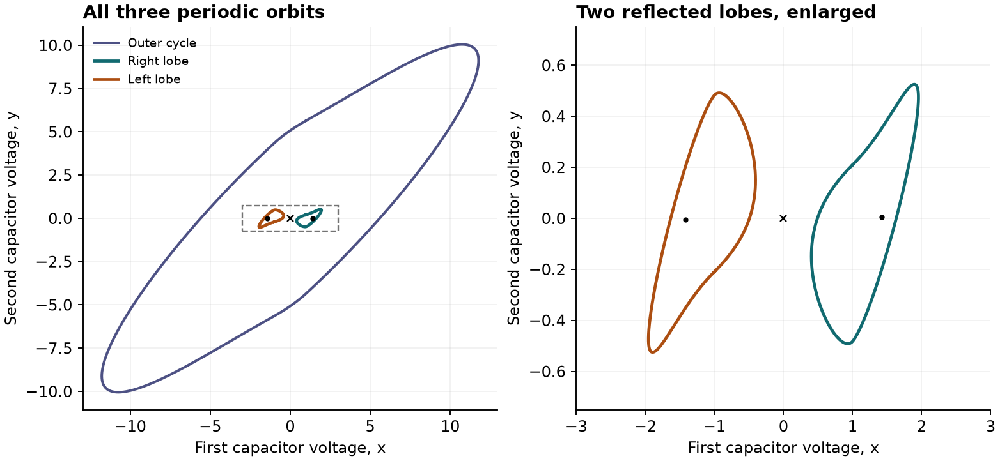

# Three hidden periodic attractors on a positive-loss Chua circuit parameter interval

In the continuous, three-segment Chua model, **at least three geometrically distinct attracting periodic orbits coexist and are hidden for every β in [12.21775, 12.24225]** at α = 8.41, γ = 0.0435, m₀ = −1.366 and m₁ = −0.12. Two orbits occupy opposite lobes. The third visits both sides of the diode. At β = 12.23, interval calculations also enclose sets of initial capacitor voltages that select each orbit with zero initial inductor current.

Kuznetsov, Mokaev, Ponomarenko, Seleznev, Stankevich and Chua studied these attractors. Figure 6 and its accompanying text give the small periodic pair and a launch at (0.55, −0.36, 0). Sections 3 and 4 describe the outer cycle and experimental access through initial voltages. The contribution here is an interval proof of coexistence and hiddenness across a stated positive-loss parameter range, and of capture from specified launch rectangles at the published β. The separate [infinite hidden coexistence argument](chua-hidden-infinity-certificate.md) concerns other slopes and γ = 0. [Kuznetsov et al., *Nonlinear Dynamics* 111, 5859–5887 (2023)](https://doi.org/10.1007/s11071-022-08078-y)



Numerical voltage projections at β = 12.23. Dots mark the outer stable equilibria and the cross marks the saddle equilibrium at the origin. The two panels use different axis scales. The interval proof uses the three-dimensional flow and its transverse section.

## Periods and voltage-only starts

| Orbit | Nominal period, numerical | Period enclosure over the full β interval | Certified nominal precharge (x₀, y₀), with z₀ = 0 |
|---|---:|---:|---|
| Right lobe | 2.084306483842 | (2.08214, 2.08647) | (0.55, −0.36), each voltage ±0.0000004 |
| Left lobe | 2.084306483842 | (2.08214, 2.08647) | (−0.55, 0.36), each voltage ±0.0000004 |
| Outer | 1.943738298387 | (1.94282, 1.94466) | (−10.65, −10.05), each voltage ±0.001 |

Voltages, periods and precharge widths use the dimensionless model coordinates. The precharge rectangles are sufficient subsets of the basins. Their widths measure the present rigorous enclosures. The voltage-to-basin calculation fixes β at 12.23. An experiment with component drift or noise requires an additional tolerance analysis.

## Periodic-orbit proof

The model has ẋ = α[y − x − h(x)], ẏ = x − y + z and ż = −βy − γz, with h(x) = m₁x + (m₀ − m₁) sat(x) and sat(x) clipped to [−1, 1]. Each region admits an affine matrix-exponential solution. The section is x = 1, ẋ > 0. Multiple shooting assigns independent section coordinates (y,z) and a duration to each flight. The equations match all three terminal coordinates to the next flight, closing the last flight to the first.

For each of 490 contiguous closed β cells of radius 0.000025, a parameter-uniform Krawczyk inclusion encloses a root of the matching equations. Its preconditioned derivative has weighted maximum norm below one. Interval covers of every flight, including its endpoints, check the region itinerary. The right-lobe cycle stays in x > 0 and crosses x = 1 upward exactly once per period. Its image under (x,y,z) ↦ (−x,−y,−z) lies in x < 0. The outer orbit also crosses x = 1 upward once, and visits x < −1. Applying inversion and shifting the outer shooting solution by three of its six flights brings the entire transformed solution enclosure into the same uniqueness box. Hence inversion preserves this outer orbit. These checks give three distinct cycles and two classes under inversion.

For a closed orbit, the determinant of the section derivative equals the exponential of the integrated divergence. The velocity factors from successive section crossings cancel. The trace is enclosed using the derivatives of the individual transverse events. All three Schur margins 1 − trace + determinant, 1 + trace + determinant and 1 − determinant are positive on each cell, establishing attraction. [Cycle proof program](../research/explicit_hidden_cycles.py) · [490-cell record](../results/chua-explicit-hidden/beta-cover.json) · [Detailed central cell at 70 digits](../results/chua-explicit-hidden/certificate-70.json) · [90-digit repeat](../results/chua-explicit-hidden/certificate-90.json)

## Why all three orbits are hidden

An attractor is hidden here if its basin avoids an open neighborhood of every equilibrium. There are precisely three equilibria. In the central linear region the origin has one real expanding eigenvalue and a contracting complex pair. A verified real modal basis writes the stable coordinates as a damped rotation. In an explicit origin ball the stable pair starts with Euclidean norm below 10⁻⁶ and keeps that bound until the first diode crossing. The invariant stable plane converges to the origin. Any other point eventually reaches x = 1 or x = −1 in the linear flow.

At x = 1, the first coordinate of the real unstable eigenvector and of the real part of the stable eigenvector is normalized to one. This gives the entire exit rectangle directly from the bound on the two stable coordinates. Its subsequent outer affine flight stays in x > 1 for positive times up to capture. A fixed positive quadratic form decreases strictly around the stable outer equilibrium. Its sublevel ellipsoid fits inside x > 1 and contains the entire exit set after 80 time units in every β cell. Odd symmetry supplies the corresponding result on the left. The resulting Euclidean ball radii exceed 2.32 × 10⁻⁷ around the origin and 0.00588 around each outer equilibrium throughout the β cover. No trajectory in those neighborhoods tends to a periodic orbit. [Interval bounds and nominal Lyapunov matrix](../results/chua-explicit-hidden/certificate-70.json)

## How a launch is certified

At β = 12.23 a local box around each section fixed point contracts in a fixed linear coordinate system. Its radius is 10⁻⁷ in those coordinates. The programs enclose the derivative on the whole box, bound the residual at its center and check strict inclusion. A fresh nominal shooting enclosure lies inside both the earlier uniform shooting box and the contracting return box. This identifies the captured attractor.

The full voltage rectangle advances to the section through interval-enclosed transverse flights. Centered derivative estimates transport its enclosure through subsequent returns. The right-lobe rectangle enters the trapping box after the initial section crossing and seven further returns. The outer rectangle enters after the initial crossing and 153 further returns. These counts bound entry into deliberately small verification boxes. Observational settling depends on instrument resolution. The third launch follows by exact inversion. [Capture program](../research/explicit_hidden_starts.py) · [70-digit starts](../results/chua-explicit-hidden/starts-70.json) · [90-digit starts](../results/chua-explicit-hidden/starts-90.json)

The check program verifies cell adjacency, period separation and stability margins from the exported records. Full-field DOP853 and Radau integrations independently locate one positive section return per nominal period on each orbit. The largest time discrepancy among the four integrations is below 1.2 × 10⁻¹¹ model time units. A deliberately displaced shooting box fails the interval inclusion. The proof establishes a lower bound of three attracting periodic orbits and leaves the rest of phase space unclassified. [Independent checks](../results/chua-explicit-hidden/independent-check.json)

## Reproduction

Run from the repository root with NumPy, SciPy and python-flint. The figure additionally requires Matplotlib. The four-worker cover can also run serially. The central-cell proof and capture were repeated at two working precisions.

```sh
python research/explicit_hidden_cycles.py --digits 70
python research/explicit_hidden_cycles.py --digits 90
python research/explicit_hidden_cycles.py --cover --digits 70 --workers 4
python research/explicit_hidden_starts.py --digits 70
python research/explicit_hidden_starts.py --digits 90
python research/explicit_hidden_check.py
python research/explicit_hidden_figure.py
```
