# Reference periodic orbits in the family catalogue

The figures compare one numerically checked reference orbit from each of 32 catalogued families. A family is defined by periodic-orbit continuation and ancestry, rather than by peak count or orbit outline alone.

## Orbit characteristics

- E06 remains near one outer scroll; the other representatives visit both outer regions.
- Full periods range from approximately 9.57 to 140.53. Different cycles can make nearly coincident passes in state space.
- Time signals and ordered local maxima distinguish recurrence patterns. S08 and S11 both have five peaks, with periods of approximately 10.89 and 14.50.
- Twenty-three representatives have half-period inversion symmetry and nine are asymmetric. Symmetry can change along descendant branches.

Continuation, ancestry and parameter location distinguish families whose orbit outlines are visually similar.

[Offline interactive comparison](../results/chua-layer-atlas/family-gallery.html): download and open the HTML in a browser. Select two families, rotate their 3D paths and compare signals. A phase slider shifts the second signal; the saved starting crossing need not be the same position within a repeated multi-loop pattern.

The interactive time axis is the fraction of a full cycle, so equal panel width does not mean equal physical period. The peak-order panel uses the saved starting phase and does not shift with the signal slider. The orange/blue on the static cards mark cycle halves; in the interactive comparison they identify the selected families.

All cards fix alpha = 9, m0 = -8/7, m1 = -5/7 and use the family-specific reference beta shown. The E-family reference roots can lie outside the original beta box; their continued families enter that box elsewhere. These are comparisons at different parameters, not a claim of 32 simultaneous attractors. Asymmetric cards show one partner. The normalized transverse multiplier is chosen by convention, so this gallery does not rank stability or basin size.

## Catalogue of reference orbits

| Family | Peaks | Full period T | Reference symmetry |
|---|---:|---:|---|
| [E01](#e01) | 13 | 32.600605 | Symmetric |
| [E02](#e02) | 6 | 16.535686 | Asymmetric |
| [E03](#e03) | 21 | 55.804857 | Symmetric |
| [E04](#e04) | 35 | 92.971793 | Symmetric |
| [E05](#e05) | 7 | 18.604353 | Symmetric |
| [E06](#e06) | 4 | 9.565440 | Asymmetric |
| [E07](#e07) | 6 | 16.630707 | Asymmetric |
| [S01](#s01) | 9 | 23.675535 | Symmetric |
| [S02](#s02) | 11 | 28.250272 | Symmetric |
| [S03](#s03) | 25 | 54.324478 | Symmetric |
| [S04](#s04) | 15 | 32.604301 | Symmetric |
| [S05](#s05) | 25 | 54.164550 | Symmetric |
| [S06](#s06) | 35 | 75.748666 | Symmetric |
| [S07](#s07) | 45 | 97.340444 | Symmetric |
| [P55](#p55) | 55 | 118.934493 | Symmetric |
| [P65](#p65) | 65 | 140.529123 | Symmetric |
| [A01](#a01) | 25 | 54.068429 | Asymmetric |
| [A02](#a02) | 20 | 43.270109 | Asymmetric |
| [A03](#a03) | 15 | 32.468735 | Asymmetric |
| [A04](#a04) | 25 | 54.135020 | Asymmetric |
| [A05](#a05) | 30 | 64.969283 | Asymmetric |
| [S08](#s08) | 5 | 10.891608 | Symmetric |
| [S09](#s09) | 15 | 43.466290 | Symmetric |
| [S10](#s10) | 25 | 72.391542 | Symmetric |
| [A06](#a06) | 15 | 43.426194 | Asymmetric |
| [S11](#s11) | 5 | 14.495248 | Symmetric |
| [E08](#e08) | 9 | 24.345325 | Symmetric |
| [E09](#e09) | 11 | 28.207056 | Symmetric |
| [E10](#e10) | 7 | 19.663194 | Symmetric |
| [E11](#e11) | 13 | 30.573957 | Symmetric |
| [E12](#e12) | 9 | 24.263194 | Symmetric |
| [E13](#e13) | 13 | 28.857468 | Symmetric |

## E01

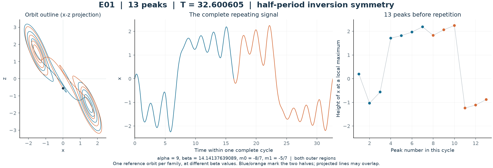

## E02

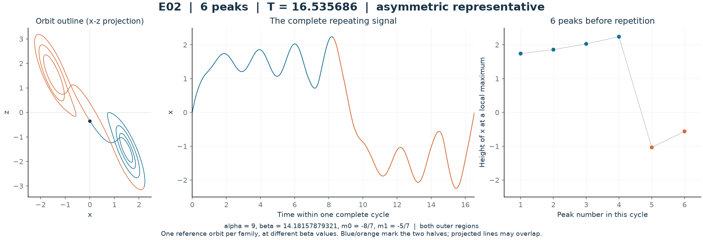

## E03

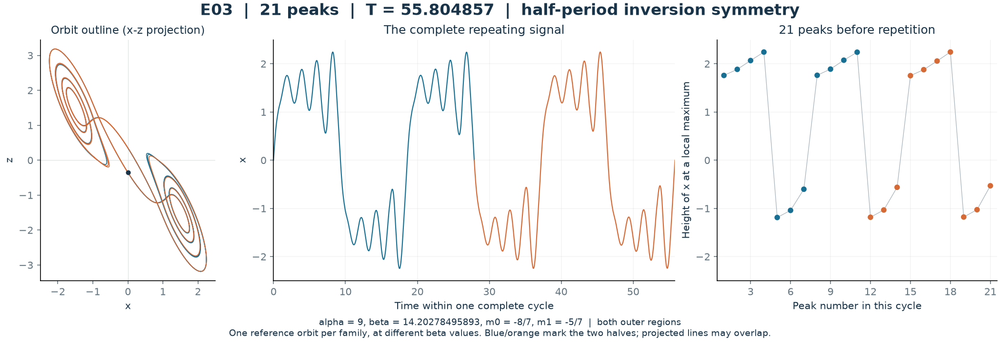

## E04

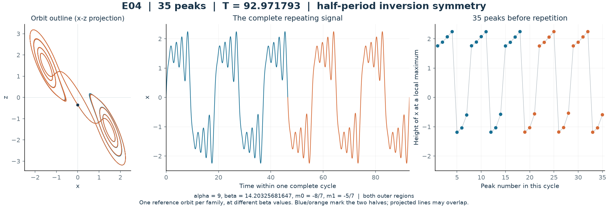

## E05

## E06

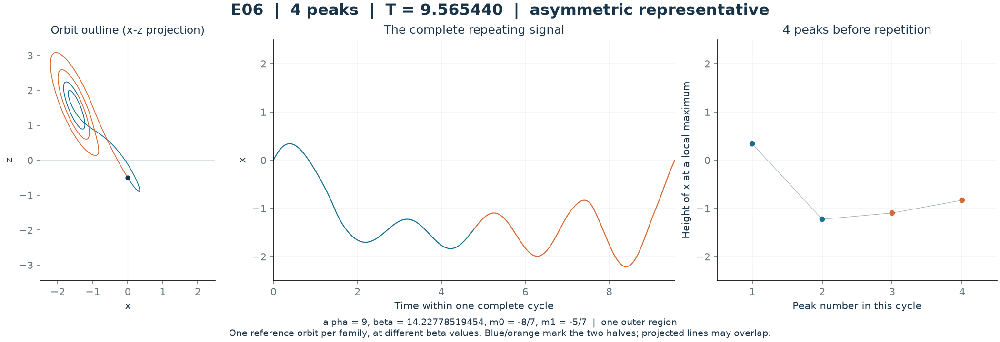

## E07

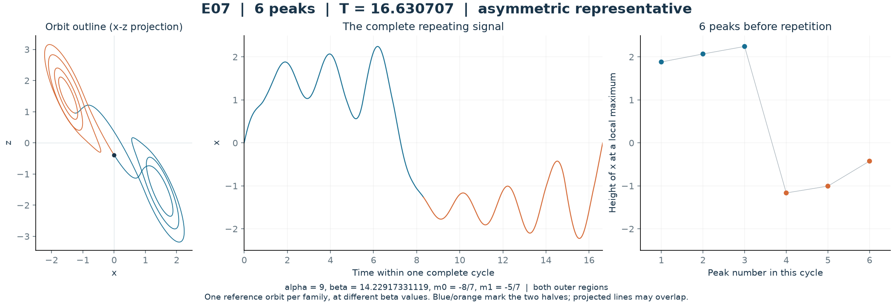

## S01

## S02

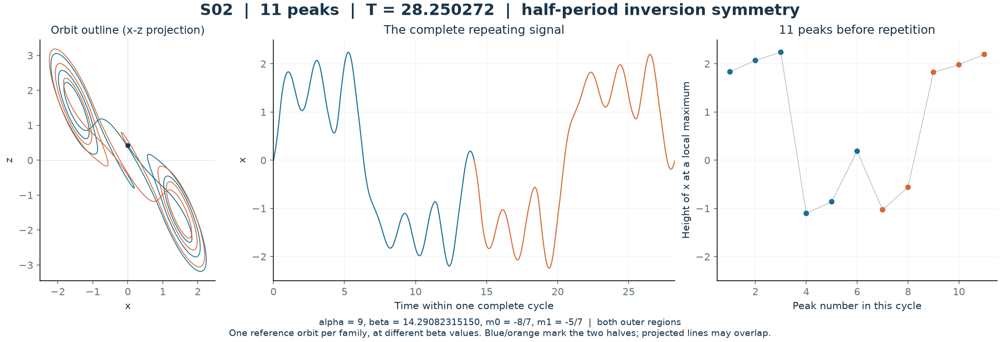

## S03

## S04

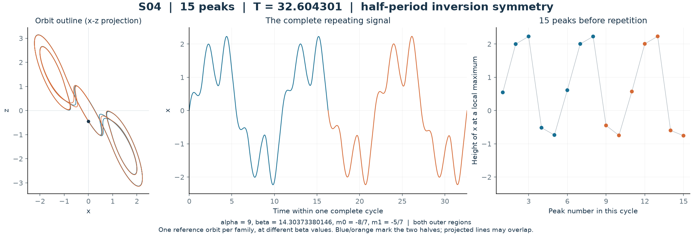

## S05

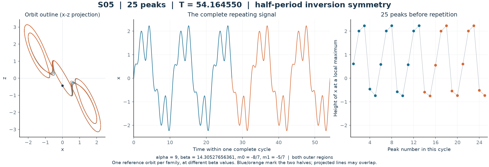

## S06

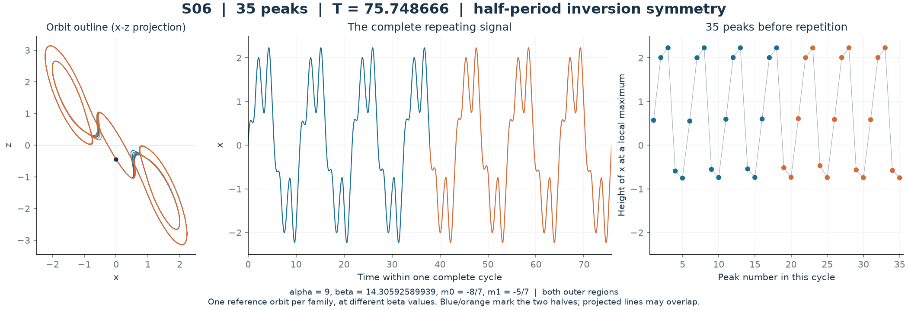

## S07

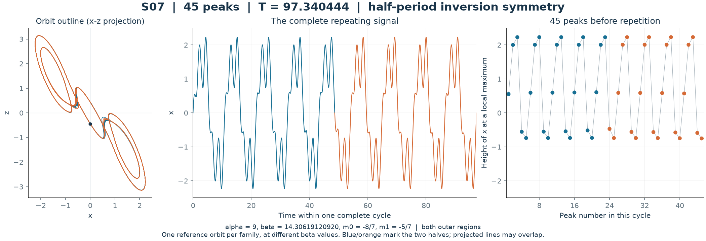

## P55

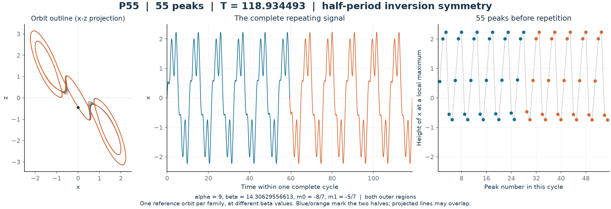

## P65

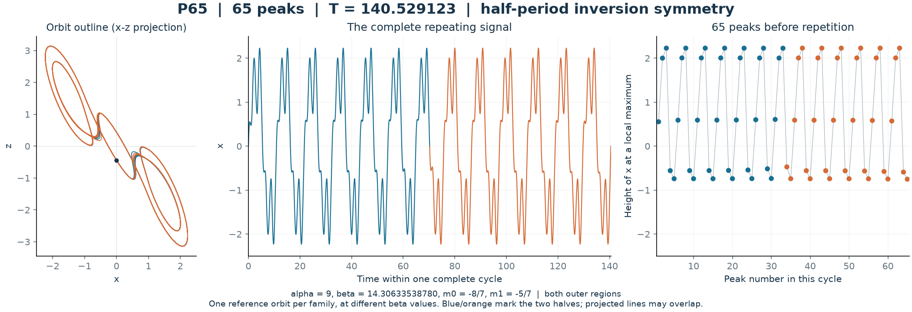

## A01

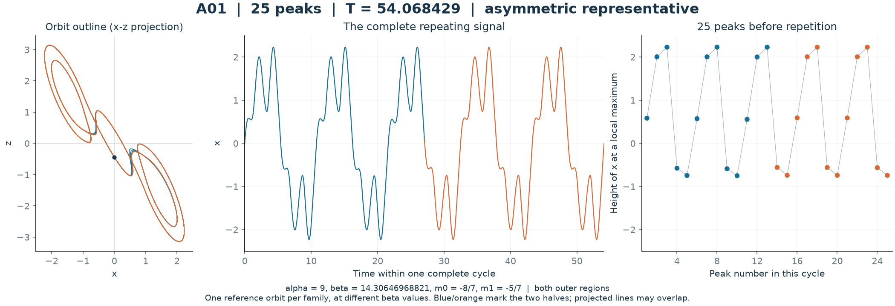

## A02

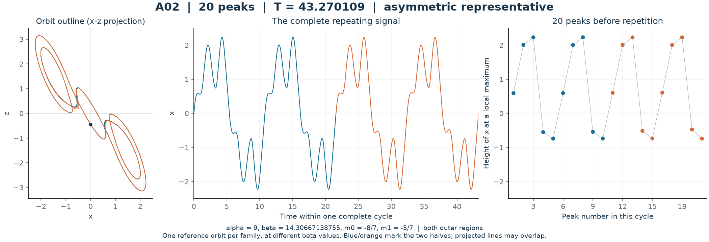

## A03

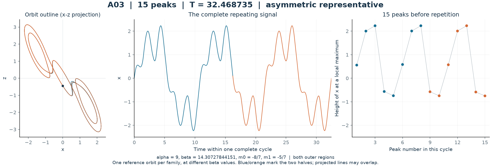

## A04

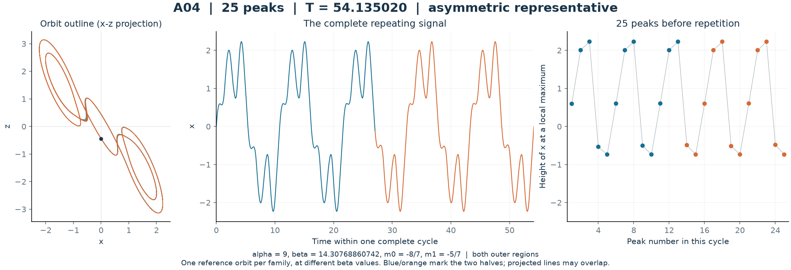

## A05

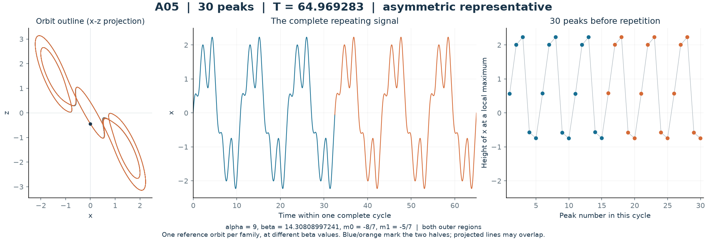

## S08

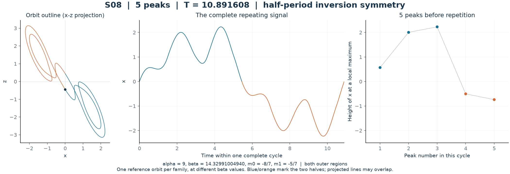

## S09

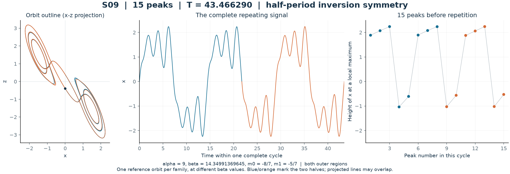

## S10

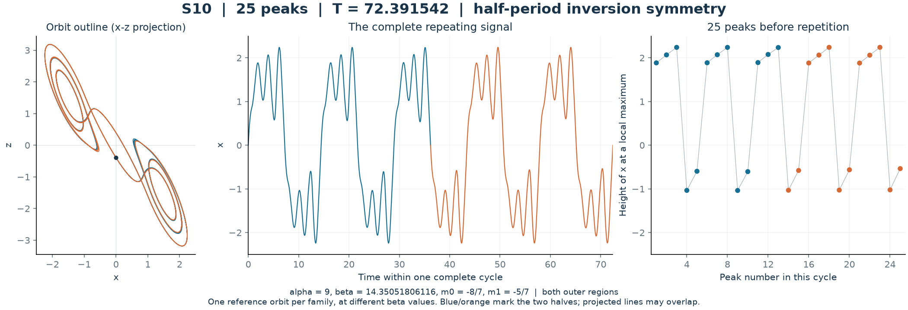

## A06

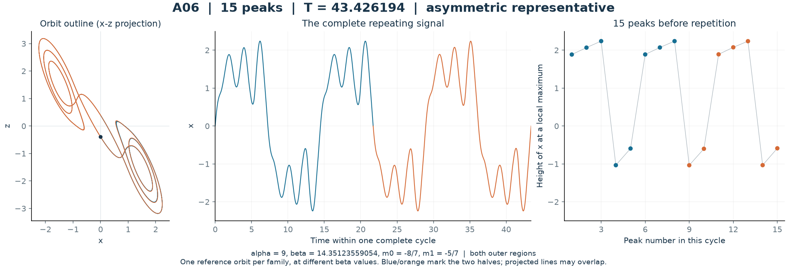

## S11

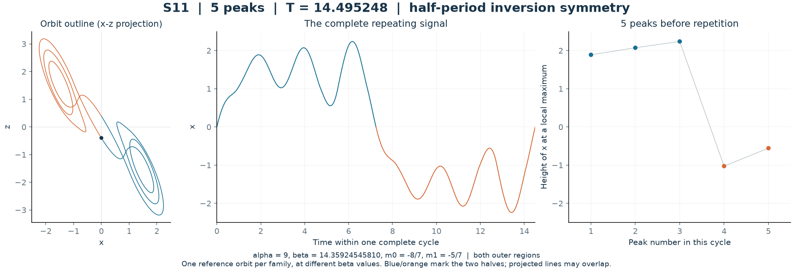

## E08

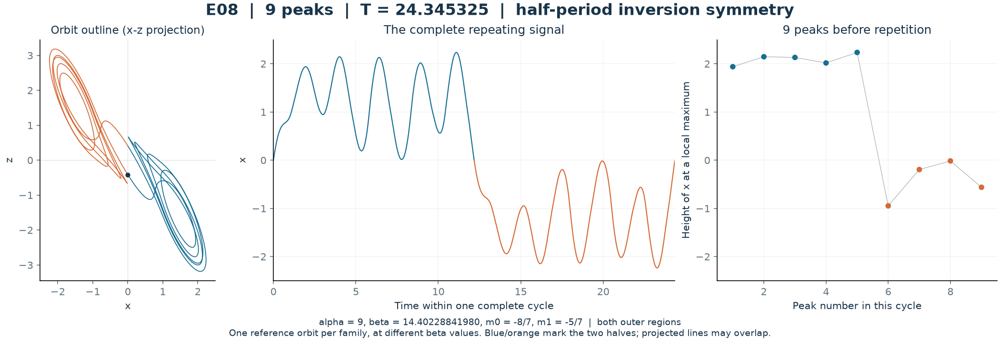

## E09

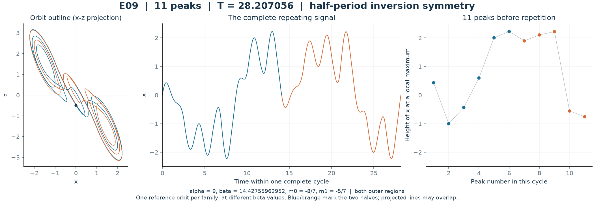

## E10

## E11

## E12

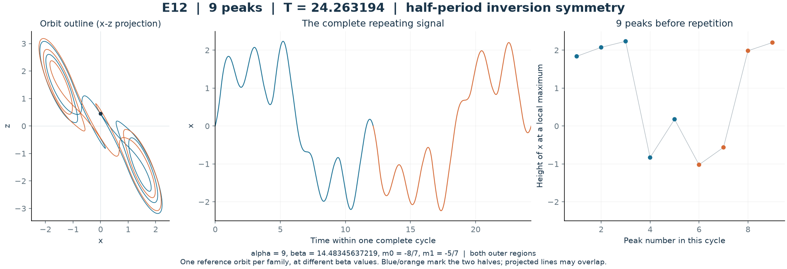

## E13

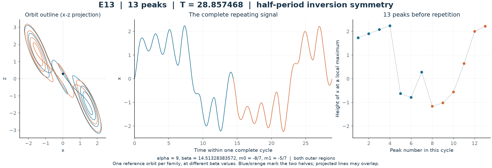

Source: [family behaviour data](../results/chua-layer-atlas/family-behavior.json), [sampled orbits](../results/chua-layer-atlas/family-orbits.npz), and [display checks](../results/chua-layer-atlas/gallery-checks.json). Scientific interpretation and numerical limitations are in the [refined atlas report](chua-refined-atlas.md).

Regenerate with `python research/plot_chua_family_gallery.py`. The PNGs and PDFs use the full stored arrays; the interactive paths use every second sample for display.
