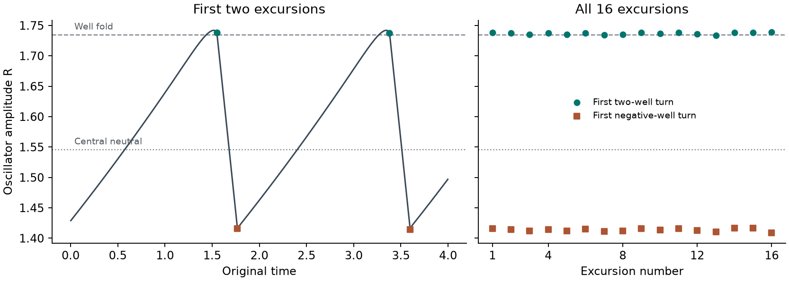

# Well switching at large α in Chua’s circuit

Can the stability of a periodically forced scalar equation predict when the full circuit moves between wells? On the archived trajectory at $\alpha=2048$, the answer depends on the direction of travel. The amplitude at the first turn spanning both wells came within **0.0046** of the frozen one-well fold on all 16 excursions. On the way back, the trajectory kept visiting both wells until its amplitude was **0.128–0.137 below** the frozen central stability threshold. [Large-parameter survey, row 2198](chua-scaling-research.md)

| Direction | Threshold at frozen amplitude | Amplitude at start of first turn with the new itinerary |
|---|---:|---:|
| Negative well to both wells | 1.734219, one-well fold | 1.733354–1.738743 |
| Both wells to the negative well | 1.545278, central response changes stability | 1.408769–1.416786 |



## The two frozen thresholds

Write $s=\alpha t$, $Z=z/\alpha$ and $\kappa=\beta/\alpha^2=0.1425$. In the limit $1/\alpha=0$, the oscillator amplitude $R=\sqrt{y^2+Z^2/\kappa}$ is constant. The remaining equation is $x'=C\cos(\omega s)+S\sin(\omega s)-g(x)$, with $\omega=\sqrt\kappa$ and $R=\sqrt{C^2+S^2}$. The slope of $g$ is $b=1+m_0=-1$ inside the breakpoints and $a=1+m_1=2/7$ outside. The forcing period is $T=2\pi/\omega$. [Scaling equations](chua-scaling-structure.md)

Each threshold requires only two affine flights. For the half-wave symmetric response, follow $x=-1$ to $+1$ in time $d$, then follow the positive outer branch back to $+1$ at $h=T/2$. Central inversion supplies the second half. For the positive-well response, both flights start and end at $+1$ and $h=T$. In either case the multiplier over the full period is

```math
q=\exp\!\left[\frac{T}{h}\big((a-b)d-ah\big)\right].
```

At $q=1$ this fixes $d=ah/(a-b)$. Each endpoint equation is linear in $C,S$, giving the tabulated thresholds directly. The central response stabilizes as $R$ increases, with $dR/dd=-0.315933$ at the crossing. The one-well branch reaches a local maximum with $d^2R/dd^2=-0.019471$ and fixed-phase return derivative $\partial_R P=-2.53060$. Inversion gives the negative well the same fold. These derivative values are numerical evaluations of the matched affine solutions. Independent DOP853 integrations verified both crossing orders and closed to within $1.3\times10^{-11}$. The same formula recovers the five archived central amplitudes from their independently integrated multipliers within $3.6\times10^{-11}$.

## What the full trajectory did

We took each complete interval between rising $y=0$ crossings in the 30-unit CPU record. A two-well turn visits both $x<-1$ and $x>1$. A negative-well turn visits $x<-1$ and stays below $+1$. Of 3,686 turns, 433 visited both wells and 3,253 stayed on the negative side by this rule. Taking every fourth saved sample and requiring a 0.05 margin at the breakpoints preserved every label. Independent Radau integration of the two turns straddling each switch reproduced all 32 changes. The thresholds describe stability at fixed $R$. Assigning the lower switching amplitude to a particular delay mechanism would require varying $\alpha$ or the starting state.

Berkolaiko and Grinfeld studied coexisting responses in periodically forced bistable equations, including a three-segment example. Here the comparison is between the two thresholds for the atlas slopes and the switching amplitudes of one finite-$\alpha$ trajectory. [Earlier scalar bifurcation study, §4 and concluding remarks](https://arxiv.org/abs/cond-mat/0310735) · [All switch times, thresholds and controls](../results/chua-fiber-switching/switching.json)

For controlled positive-well starts at eleven values of $\alpha$, the [finite-rate fold study](chua-dynamic-fold.md) compares the section crossing and the first turn spanning both wells with two distinct delay predictions.

Regenerate the records and plot from the repository root with `python research/chua_fiber_switching.py`. Output goes to `outputs/chua-fiber-switching/`. [Analysis script](../research/chua_fiber_switching.py)
