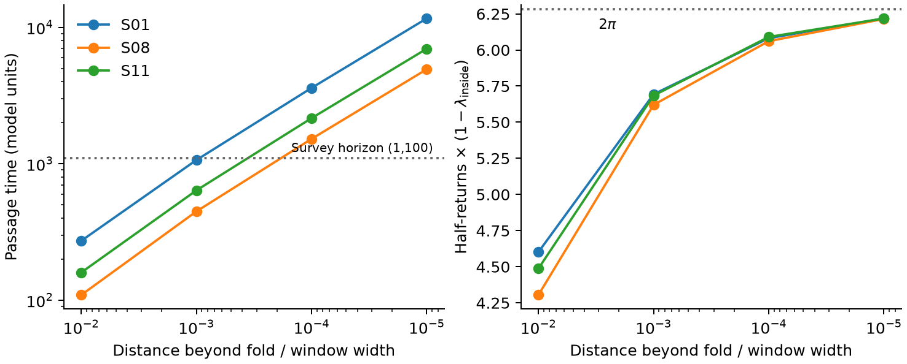

# Long transients just outside three Chua periodic windows

How long can motion look periodic after a stable cycle has disappeared? We initialized a trajectory at the entrance to each of three saddle-node bottlenecks. At a distance of $10^{-4}$ window widths beyond each fold, passage took **1,522 to 3,599 model time units**. The original atlas survey discarded 300 units and measured four consecutive 200-unit windows. A single local passage can therefore outlast the entire survey run. [Original scan settings and starts](../results/original/classic_scan.json) · [GPU integration schedule](../chua_gpu.py) · [Fold continuation](chua-layer-bifurcations.md)



## Three folds on the classical slice

Fix $\alpha=9$, $m_0=-8/7$, $m_1=-5/7$ and $\gamma=0$. Each row uses the same absolute offset $\delta=\beta-\beta_f=10^{-6}$. A half-return goes from an upward crossing of $x=0$ to the next downward crossing, followed by central inversion. The time column sums the actual flight times. The last column is a prediction from derivatives at the fold.

| Family | Peaks per full cycle | Fold $\beta_f$ | Half-returns to exit | Elapsed model time | Predicted half-returns |
|---|---:|---:|---:|---:|---:|
| S01 | 9 | 14.2599633533 | 25 | 295.94 | 25.13 |
| S08 | 5 | 14.3306519686 | 324 | 1,767.98 | 324.17 |
| S11 | 5 | 14.3595337664 | 203 | 1,471.98 | 202.19 |

## Predicting the delay

Let $H$ denote the signed half-return at the fold point $q_f$ in section coordinates $(y,z)$. Let $r$ and $\ell$ be its right and left unit-multiplier eigenvectors, with $\|r\|=1$ and $\ell r=1$. Define $a=\ell\,\partial_\beta H$ and $b=\tfrac12\ell D^2H[r,r]$, choosing the sign of $r$ so that $b>0$. In $u=b\ell(q-q_f)$ the leading center dynamics give $u_{n+1}-u_n=ab\delta+u_n^2$. Start at $q_f-(g/b)r$ and count half-returns until $u\ge g$, with $g=0.2$. Integrating the leading drift gives

```math
N_g\simeq\frac{2}{\sqrt{ab\delta}}\arctan\!\frac{g}{\sqrt{ab\delta}}.
```

Across the table and twelve additional passages at $\delta/W=10^{-2},10^{-3},10^{-4},10^{-5}$, this predicts the count to within one half-return. Here $W$ is the fold-to-symmetry-breaking width of the symmetric branch. A second check uses the attracting half-return multiplier $\lambda$ at the matching parameter $\beta_f-\delta$. Since $1-\lambda\sim2\sqrt{ab\delta}$, the product $N_g(1-\lambda)$ should approach $2\pi$. At $\delta/W=10^{-5}$ it is 6.215–6.219 across the three families. The return counts at that offset are 904–983.

An unsplit DOP853 integration agreed on the exit counts for all three families at $\delta/W=10^{-3}$. The records also give the derivative step checks, an independent 48-digit calculation of $ab$, and passages with narrower and wider gates. [Data](../results/chua-fold-passage/passages.json) · [Reproduction script](../research/chua_fold_passage.py)

## Do ordinary survey starts reach the bottleneck?

We also launched the three archived survey starts at each off-grid setting $\delta/W=10^{-4}$. We used DOP853 with relative tolerances $10^{-9}$ and $10^{-11}$ and a maximum step of 0.1. For S08 at $\beta=14.3306533063$, the start $(-0.2,0.1,0)$ spent **769 and 795 of the 800 observation units**, respectively, between successive crossings near the vanished cycle. Both endpoint crossings had to satisfy $|u|\le0.2$ and $b\|(q-q_f)-r\ell(q-q_f)\|\le0.2$. Other starts were sensitive to tolerance. For S01 at $\beta=14.2599633653$, $(1.5,0.02,-1.5)$ gave 793 and zero units, respectively. These runs illustrate the difference between reaching a bottleneck and predicting a passage once inside.

The inverse-square-root delay at a saddle-node and experimental intermittency in Chua’s circuit are established. This calculation gives the coefficients and finite observation times for the three atlas folds. The long-time frequency of reinjection into these neighborhoods remains open. [Pomeau and Manneville](https://doi.org/10.1007/BF01197757) · [Chua and Lin](https://doi.org/10.1109/31.76487)

From the repository root, run `python research/chua_fold_passage.py` with the [CPU dependencies](../requirements-certificate.txt). The script writes to `outputs/chua-fold-passage/`.
