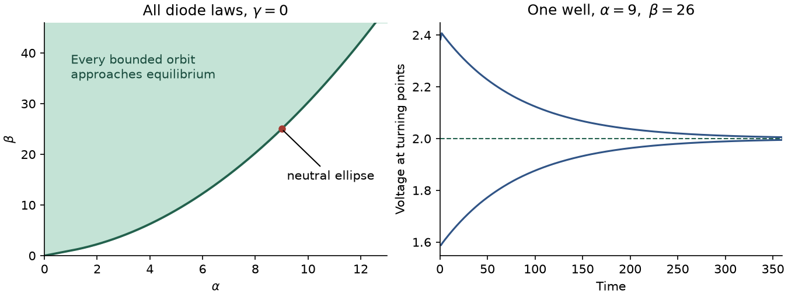

# When every bounded Chua trajectory approaches equilibrium

Which circuit parameters rule out sustained oscillations for **every** memoryless diode law? In the classical Chua circuit ($\gamma=0$), the exact answer is

$$
\begin{cases}
\beta\ge\alpha,&0<\alpha\le1,\\
\beta>(\alpha+1)^2/4,&\alpha>1.
\end{cases}
$$

This includes diodes with three equilibria. Outside the region one can construct a continuous piecewise-linear diode with an exact periodic orbit. The test below also covers nonnegative inductor loss. The [slope-specific sector](chua-hidden-boundary.md) gives a complementary test when the slopes are known.

Left, the shaded region excludes bounded recurrent oscillations. Its boundary belongs to the region only for $\alpha\le1$. Right, successive voltage maxima and minima approach $x=2$ from the initial state $(0.9,0,0)$ with diode slopes $(-3/2,-1/2)$.

Run `python research/chua_global_relaxation.py --classify 9 25 0` to test exact decimal or fractional inputs without integrating. Here it returns a periodic witness with $\omega^2=20$ and $m_0=-5/9$. At `9 19 1/4` it guarantees convergence to the equilibrium set for every bounded trajectory and every diode.

## Criterion with inductor loss

Use $\dot x=\alpha[y-g(x)]$, $\dot y=x-y+z$, $\dot z=-\beta y-\gamma z$, with $\alpha,\beta>0$, $\gamma\ge0$ and locally Lipschitz $g(x)=x+h(x)$. Set

$$
a=1+\gamma,\quad b=\beta+\gamma,\quad L=\beta-\gamma^2,\quad
B=\alpha+1+\gamma^2-2\beta,\quad C=b^2-\alpha L.
$$

**Theorem.** The parameters guarantee convergence of every bounded forward trajectory to the equilibrium set for **all** such $g$ if and only if $F(q)=q^2+Bq+C>0$ for every $q>0$. Equivalently, either $C>0$ and $B+2\sqrt C>0$, or $C=0$ and $B\ge0$. In this region isolated equilibria imply convergence to one point. All initial states give bounded trajectories when

$$
U(x)=\int_0^x [g(s)-\gamma s/b]\,ds\ \longrightarrow+\infty
\qquad (|x|\to\infty).
$$

For the atlas diode $h(x)=m_1x+(m_0-m_1)\operatorname{sat}(x)$, with saturation at $\pm1$, $m_1>-\beta/b$ suffices for this last condition.

### Proof

Write $u=\dot x$, $w=y+\gamma z/\beta$ and $v=\dot w=x-ay+(1-\gamma^2/\beta)z$. The change $(x,y,z)\mapsto(x,w,v)$ has determinant $b/\beta$. Direct substitution gives

$$
\dot v=u-av-bw,\qquad y=(\gamma x+Lw-\gamma v)/b .
$$

If $C>0$, choose $\max(0,-B/2)<c<\sqrt C$. In the included equality case take $c=0$. Define $V=\alpha U+S$ with

$$
\begin{aligned}
S(w,v)={}&\left(a+\frac{\alpha\gamma}{2b}\right)v^2+
\left(2b-\frac{\alpha L}{b}-2c\right)wv\\
&+\left(ab-\frac{\alpha La}{2b}+\frac{\alpha\gamma}{2}\right)w^2 .
\end{aligned}
$$

Substitute $u=\dot v+av+bw$ into $\alpha\dot U=[\alpha(Lw-\gamma v)/b-u]u$. Completing the square gives

$$
\dot V=-(\dot v+cw)^2-(B+2c)v^2-(C-c^2)w^2 .
$$

The same algebra for the filter driven by $u=0$ gives $\dot S$ equal to this right-hand side. Its free trajectories decay exponentially since $a,b>0$. Integration to infinity therefore gives $S>0$ off the origin. In the equality case a zero integral would force $\dot v\equiv0$, hence $w$ affine in time, and exponential decay forces $w=v=0$.

On a bounded trajectory $V$ tends to a finite limit. It is constant on the compact invariant $\omega$-limit set. In the strict case the identity gives $w=v=u=0$ there. In the equality case $\dot v=0$ there, bounded $w$ forces $v=0$, and then $u=bw$ is constant. Bounded $x$ forces $u=w=0$. Both cases leave only equilibria. The $\omega$-limit set is connected, hence a singleton for isolated equilibria. Coercive $U$ makes $V$ proper with compact sublevel sets and thus bounds every trajectory.

For necessity, failure of the test gives a positive root $q$ of $F$, since $F(q)\to+\infty$. Put $\omega=\sqrt q$, $D(s)=s^2+as+b$ and $H(s)=(s+\gamma)/D(s)$. The linear subsystem maps a harmonic $x$ to $y$ with gain $H(i\omega)$. Since $\operatorname{Im} H(i\omega)/\omega=(L-q)/|D(i\omega)|^2$, the root gives $\operatorname{Im} H(i\omega)=\omega/\alpha$. Set $g(x)=\operatorname{Re} H(i\omega)\,x$ on $|x|\le1$. Then $x=A\cos(\omega t)$, $0<A<1$, solves the full equations with $y,z$ given by the gains $H(i\omega),-\beta/D(i\omega)$. Any continuous piecewise-linear continuation outside the central segment preserves that orbit. Finally $B^2-4C=(\alpha+1-\gamma^2)^2-4a^2\beta$ gives the classical region above.

## Two uses in the atlas

**Certifying a basin.** At $x=0$, $V=S\ge0$. Thus $V(x_0,y_0,z_0)<0$ prevents a voltage sign change and excludes convergence to the origin. For $(\alpha,\beta,\gamma)=(9,26,0)$ and $(m_0,m_1)=(-3/2,-1/2)$ the equilibria have $x=0,\pm2$. On $y_0=z_0=0$, $V_0<0$ for $0<|x_0|<(18+3\sqrt{10})/13$. Each such start converges to the equilibrium of its sign.

**Pruning the quadratic scan.** On $\beta=\kappa\alpha^2$, $\gamma=0$, every $\kappa>1/4$ excludes bounded oscillations for $\alpha>1/(2\sqrt\kappa-1)$. Indeed this gives $\beta>(\alpha+1)^2/4\ge\alpha$, also sufficient at $\alpha\le1$. The classical test covers 160 of the 1,890 archived parameter tuples, accounting for 480 integrations and zero preliminary positive candidates. At $\kappa=0.26$ the cutoff is $50.4951$. The [remaining scaling question](chua-scaling-structure.md) includes $\kappa=0.1425$, outside this exclusion.

| Frozen check | Numerical outcome |
|---|---|
| Twelve starts, $(\beta,\gamma)=(26,0),(19,1/4)$ | All reached the predicted signed well within $2.2\times10^{-10}$ in maximum norm at $t=3000$. |
| Boundary $(\alpha,\beta,\gamma)=(9,25,0)$, $m_0=-5/9$ | Twelve periods of the exact ellipse of period $\pi/\sqrt5$. Largest sampled full-state error $2.1\times10^{-10}$. |
| Three starts, $\kappa=0.26$, $\alpha=64$ | All reached an equilibrium within $8.2\times10^{-10}$ at $t=1500$. |

The independent integration uses the original $(x,y,z)$ equations. Run `python research/chua_global_relaxation.py` with NumPy, SciPy, SymPy and Matplotlib. [Predictions committed before the integrations](https://github.com/Griboedow/chua-gpu-atlas/blob/5203454917fdbc769ec842608a59eaf880d1a95e/results/chua-global-relaxation/forecast.json) · [Numerical results](../results/chua-global-relaxation/checks.json) · [Generator](../research/chua_global_relaxation.py)

## Related results

Chua and Huynh (§3.1) give the lossless imaginary-eigenvalue locus $\beta=-\alpha m(1+\alpha+\alpha m)$, $\omega^2=\alpha m+\beta$. With $t=-\alpha m$, positive frequency requires $0<t<\alpha$. The supremum of $t(1+\alpha-t)$ over this interval gives precisely the lossless boundary above, including the change at $\alpha=1$. Escudero et al. (Eqs. 9–11) give $(1+\alpha)^2-4\beta>0$ for two distinct critical differential conductances. The storage identity establishes global convergence on the indicated side. [Chua & Huynh (1992)](https://doi.org/10.1109/MWSCAS.1992.271217) · [Escudero et al. (2024)](https://doi.org/10.1109/TCSI.2023.3323854)

Brayton gave a necessary and sufficient condition on the linear part of a system with one memoryless nonlinear resistor for bounded global stability. The specialization here supplies the loss-dependent equality case, an explicit basin subset and a cutoff for the atlas scan. Martini et al. give a different sufficient nonoscillation condition for Chua's circuit using second additive compounds and slope bounds (§4.1). [Brayton (1971)](https://doi.org/10.1090/QAM/288366) · [Martini et al. (2025)](https://doi.org/10.1142/S0218127425501512)
