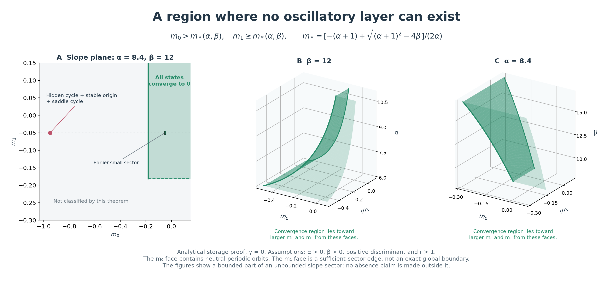
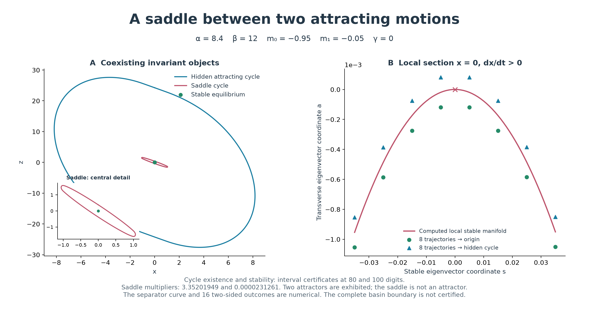
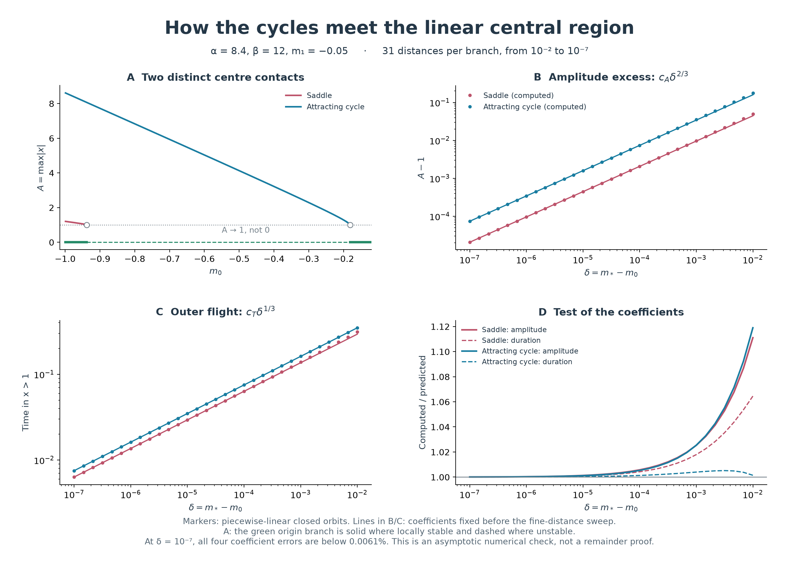

# Global convergence, hidden cycles and the boundary between their basins

This study connects the atlas to questions about coexistence and global stability posed in the Chua literature. For the ideal piecewise-linear model, it derives a sufficient global-convergence sector with an exact adjacent loss-of-convergence face, certifies a saddle periodic orbit beside an already certified hidden attractor, and tests quantitative predictions for two centre-to-cycle contacts.

The general maximum number of coexisting attractors remains undetermined. Neither a complete basin boundary nor the complete global-stability region is established here.

## 1. Published questions and their atlas formulation

The relevant authors include **Gennady Leonov**, Nikolay Kuznetsov, Leon Chua and Natalia Stankevich. Lyapunov's methods enter through stability analysis; these modern Chua questions are not attributed to Lyapunov himself.

| Published question or mechanism | What the atlas can address | Present status |
|---|---|---|
| Maximum coexistence count, including hidden attractors: Kuznetsov and colleagues, 2023, §6 | Count distinct attracting motions at the same parameters; distinguish this from a family count across parameter space | The earlier interval result gives at least four periodic attractors at one point. No upper bound is proved. |
| Exact global-stability boundary: the same paper, §6 | Separate parameters where every initial state converges to an equilibrium from parameters with another invariant motion | The explicit sector in §2 excludes all nonconstant recurrent motions and has an exact neutral face. The remainder of the slope plane is not classified. |
| Birth of hidden attractors and a conjecture concerning a stable unique equilibrium and a subcritical Hopf bifurcation: Stankevich and colleagues, 2017 | Follow the attracting and saddle branches, and their relation to equilibrium accessibility | A saddle and a hidden periodic sink are certified together in §3. The local basin separator is computed, not globally certified. The general conjecture is not resolved. |

Sources: [Kuznetsov et al., *Hidden attractors in Chua circuit: mathematical theory meets physical experiments* (2023)](https://link.springer.com/article/10.1007/s11071-022-08078-y), and [Stankevich, Kuznetsov, Leonov and Chua, *Scenario of the Birth of Hidden Attractors in the Chua Circuit* (2017)](https://arxiv.org/abs/1710.02677). The latter reports Chua's formulation of the conjecture in a 2012 private communication. These are questions as posed in those publications; this report does not claim an exhaustive survey of subsequent resolutions.

The saddle-separator mechanism is already described in the 2017 work. Our calculations use **γ = 0**, whereas the paper's principal numerical examples use γ = −0.005. Parameter values cannot be transferred between the two models without recalculation. The contribution here is the parameter-specific proof and reproducible comparison, rather than a claim to have discovered hidden attractors or their separating saddles.

Throughout, the equations and slope convention are

```math
\dot x=\alpha[y-x-h(x)],\qquad
\dot y=x-y+z,\qquad \dot z=-\beta y,
```

```math
h(x)=m_1x+(m_0-m_1)\operatorname{sat}(x),\qquad
\operatorname{sat}(x)=\max(-1,\min(1,x)).
```

## 2. An explicit region without oscillatory attractors



**Figure 1.** Green denotes a sufficient global-convergence sector. Its darker m₀ face contains neutral periodic orbits and is excluded from the convergence conclusion. The lighter m₁ face is included when m₀ is strictly above its threshold. It is not asserted to be an exact boundary. The three-dimensional panels show these faces in the two parameter volumes; their interiors lie toward larger slopes. Grey regions are unclassified by this argument.

### 2.1 Statement

Let α > 0 and β > 0, and suppose

```math
d=\sqrt{(\alpha+1)^2-4\beta}>0,\qquad
r=\frac{\alpha+1+d}{2}>1,\qquad
m_* = \frac{r-\alpha-1}{\alpha}.
```

For **m₀ > m\*** and **m₁ ≥ m\***, the origin is globally asymptotically stable: every initial state converges to it. In particular, no other equilibrium, periodic orbit, hidden attractor or nonconstant recurrent motion exists in this sector.

At **m₀ = m\***, with m₁ ≥ m\*, nonzero periodic orbits lying entirely in the central linear region exist. Thus convergence to the origin fails on this face. Immediately below this face, the origin is unstable. The result identifies an exact adjacent loss-of-convergence face in this restricted slope sector; it does not locate the full global-stability boundary elsewhere.

At α = 8.4 and β = 12,

```math
m_*=-0.181371900612652594505553758502\ldots
```

The conclusion holds on an unbounded quadrant of slopes, extending the earlier sufficient box m₀,m₁ ∈ [−0.055,−0.045]. No finite scan is needed to exclude a missed thin layer inside this new sector.

### 2.2 Linear decomposition

Put b = α + 1 − r and ω² = (r − 1)b. The assumptions imply b > 0, ω² > 0, β = rb and m\* > −1. With u = (x,y,z)ᵀ, define

```math
\phi(x)=h(x)-m_*x,\qquad v=-\phi(x),\qquad
\dot u=Au+Bv,
```

```math
A=\begin{pmatrix}-\alpha(1+m_*)&\alpha&0\\1&-1&1\\0&-\beta&0\end{pmatrix},
\quad B=\begin{pmatrix}\alpha\\0\\0\end{pmatrix},\quad C=(1,0,0).
```

The characteristic polynomial is (s+r)(s²+ω²). Define the positive constants

```math
q=\frac{2r-1}{(r-1)d},\quad
p=\frac{\alpha^2r}{(r-1)d},\quad
D=\alpha q,\quad K=\frac{\alpha(1+qb)}r.
```

The transfer function from v to x obeys the exact identity

```math
G(s)=\frac{\alpha(s^2+s+\beta)}{(s+r)(s^2+\omega^2)},\qquad
(1+qs)G(s)=D-\frac{p}{s+r}+\frac{Ks}{s^2+\omega^2},
\qquad Dr-p=\frac{\alpha r}{r-1}>0.
```

This decomposition suggests a storage function. It can also be verified without invoking a frequency-domain stability criterion. Use coordinates w = (ζ,η,ν)ᵀ = Tu in which

```math
\dot\zeta=-r\zeta+v,\qquad
\dot\eta=\nu,\qquad \dot\nu=-\omega^2\eta+v,
\qquad x+q\dot x=-p\zeta+K\nu+Dv.
```

For an explicit construction, let A_c and B_c be the matrix and input column in these three equations, let O(A,B) = [B, AB, A²B], and set T = O(A_c,B_c)O(A,B)⁻¹. The determinants are −(r²+ω²) and −α³β respectively, so T is nonsingular. Direct substitution gives TA = A_cT, TB = B_c and C + qCA = (−p,0,K)T. The symbolic record contains every entry of T and checks these identities exactly.

### 2.3 Storage and global convergence

Define

```math
E=\tfrac12\left[p\zeta^2+K(\nu^2+\omega^2\eta^2)\right],
\qquad V(u)=E(Tu)+q\int_0^x\phi(s)\,ds.
```

For the specified slopes, xφ(x) > 0 when x ≠ 0. Indeed, φ(x) = (m₀−m\*)x for |x| ≤ 1, while for x ≥ 1,

```math
\phi(x)=(m_1-m_*)(x-1)+(m_0-m_*)>0;
```

odd symmetry gives the negative side. Consequently the integral is nonnegative. Since T is nonsingular and the quadratic energy is positive definite, V is positive definite and proper. Differentiation along the globally Lipschitz Chua flow gives

```math
\dot V=-x\phi(x)-\left[D\phi(x)^2+2p\zeta\phi(x)+rp\zeta^2\right].
```

The bracket is positive definite in (φ,ζ), because

```math
D\phi^2+2p\zeta\phi+rp\zeta^2
=D\left(\phi+\frac pD\zeta\right)^2
 +p\left(r-\frac pD\right)\zeta^2,
\qquad Dr-p>0.
```

Thus V is nonincreasing and all trajectories remain in compact sublevel sets. The zero-derivative set requires x = 0 and ζ = 0. Any trajectory remaining at x = 0 must have y = 0 from the first physical equation, and then z = 0 from the second. The largest invariant subset is therefore the origin. LaSalle's invariance principle proves global attractivity; positive definiteness of V also proves Lyapunov stability.

At m₀ = m\*, the central matrix has eigenvalues −r and ±iω. Arbitrarily small nonzero ellipses in its centre plane remain within |x| < 1, where the full vector field equals this matrix exactly. They are periodic solutions of the nonlinear system. This proves failure of global asymptotic convergence on the stated face. The two simple roots of the Routh determinant are the thresholds in §4; the interval just below the upper one has an unstable conjugate pair.

### 2.4 Verification scope

Nine symbolic rational identities are checked with SymPy. Arb calculations at 80 and 100 digits enclose the numerical coefficients and verify the storage matrix's positive principal minors. An additional 1,000 direct derivative comparisons at five slope pairs have maximum relative discrepancy 3.15 × 10⁻¹⁴; those samples are implementation controls, not the global proof.

[Three Lean declarations](../formal/ChuaProof/Storage.lean) check the energy-balance algebra, the nonnegative quadratic form and the resulting nonpositive derivative under their stated assumptions. The coordinate construction, nonlinear-sector argument, properness and LaSalle step are mathematical arguments in this report, **not Lean-formalized theorems**. The [formal check record](../results/chua-hidden-boundary/storage-formal-check.json) lists dependencies and a rejected altered cross-term control.

## 3. A certified saddle beside a hidden periodic attractor



**Figure 2.** The left panel shows two certified periodic orbits and the stable origin at the same parameters. The right panel uses a linear eigenvector coordinate system on the upward x = 0 section. The red curve approximates the saddle's stable manifold; initial points displaced by ±10⁻⁴ in the transverse direction converge to different attracting motions in all sixteen tests.

At α = 8.4, β = 12, m₀ = −0.95 and m₁ = −0.05, the [accessibility study](chua-accessibility.md) already certified a hidden periodic sink and a neighborhood of the unique stable origin excluded from its basin. A second periodic root is now enclosed at these same exact parameters.

| Object | Period | Nontrivial full-return multipliers | Interpretation |
|---|---:|---|---|
| Inner cycle | 3.074381061464706 | 3.352019489185619; 0.00002312611526382 | Hyperbolic saddle |
| Outer cycle | 1.94428641139829 | 0.923650107404766; 0.00000008021954050 | Attracting hidden periodic orbit |
| Origin | — | Equilibrium stability certified previously | Attracting equilibrium |

The interval computations use Krawczyk inclusion for the first upward return, verify the itinerary over complete flights and enclose the multipliers at 80 and 100 digits. The sink test rejects the saddle, and a root box shifted by 10⁻¹² fails inclusion. Independent DOP853 and Radau integrations check both periodic trajectories and their variational equations; the largest closure discrepancy is below 5 × 10⁻¹⁴.

These are **two exhibited attractors and one saddle**, not three attractors. The result also does not exclude additional attractors elsewhere in phase space.

To investigate the separator, we solve for 71 section points whose fourth or sixth return has zero unstable displacement from the saddle. The two approximations differ by at most 1.18 × 10⁻¹⁵. This agreement indicates numerical consistency, not a rigorous manifold-error bound. All eight trajectories on the inward side approach the origin; all eight on the outward side approach the hidden cycle, with integrations extending to time 700. Their endpoint tests and initial states are retained in [basin-separator.json](../results/chua-hidden-boundary/basin-separator.json).

The interval certificate proves the saddle exists and has a stable manifold. The computed curve's position and its role in the complete basin boundary remain numerical. A global certificate would have to enclose that manifold and account for its continuations and possible other invariant sets.

## 4. Predicting the two linear contacts



**Figure 3.** At fixed α = 8.4, β = 12 and m₁ = −0.05, two different cycle branches approach the boundary of the central linear region. Panels B and C compare computed cycles with coefficients fixed before the fine-distance sweep. Panel D displays the actual ratio, including the visible error at larger distances.

The Routh determinant of the central matrix vanishes when

```math
\alpha^2m^2+(\alpha+\alpha^2)m+\beta=0.
```

The two thresholds are m₋ = −0.9376757184349664 and m₊ = −0.1813719006126526. The inner saddle approaches the first and the outer attracting branch approaches the second from smaller m₀. In both cases the limiting amplitude is **A = max|x| = 1**, rather than zero: the central subsystem is exactly linear and contains a continuum of ellipses at the critical parameter.

This is a focus–centre–limit-cycle mechanism, studied before this atlas; see [*The Focus-Center-Limit Cycle Bifurcation in Symmetric 3D Piecewise Linear Systems* (2005)](https://epubs.siam.org/doi/10.1137/040606107). We do not claim a new universal exponent. The following calculation supplies coefficients for these particular Chua branches.

For a sinusoidal input of amplitude A > 1, the first-harmonic gain of saturation is

```math
N(A)=\frac2\pi\left[\arcsin(1/A)+\frac{\sqrt{A^2-1}}{A^2}\right],
\qquad 1-N(1+\eta)\sim\frac{8\sqrt2}{3\pi}\eta^{3/2}.
```

Let δ = m\* − m₀ > 0, taking m\* to be the corresponding threshold. Balancing the leading effective slope against m\* gives

```math
A-1\sim c_A\delta^{2/3},\qquad
c_A=\left[\frac{3\pi}{8\sqrt2(m_1-m_*)}\right]^{2/3},
```

```math
\tau_{x>1}\sim c_T\delta^{1/3},\qquad
c_T=\frac{2\sqrt{2c_A}}{\sqrt{\beta+\alpha m_*}}.
```

This harmonic calculation is an asymptotic prediction; a rigorous remainder bound for the true orbit has not been supplied. We test it against the actual piecewise-linear closed orbits, rather than against a harmonic-balance solver.

| Branch | Predicted c_A | Predicted c_T | Amplitude error at δ = 10⁻⁷ | Duration error at δ = 10⁻⁷ |
|---|---:|---:|---:|---:|
| Saddle at m₋ | 0.9585347635 | 1.3636868924 | 0.006074% | 0.004522% |
| Attractor at m₊ | 3.4259086062 | 1.6174291581 | 0.005062% | 0.001669% |

The [prediction record](../results/chua-hidden-boundary/linear-contact-prediction.json) fixes both coefficients after exploratory coarse continuation and before 31 logarithmically spaced distances per branch, from 10⁻² to 10⁻⁷. This was not an externally published blind forecast. Eight independent segmented integrations have maximum closure discrepancy below 9.3 × 10⁻¹⁵ and multiplier discrepancy below 6.5 × 10⁻¹¹. All 62 roots and the four computed/predicted ratios are published.

The exponents concern this particular path through a centre contact. The earlier [P7 grazing experiment](chua-slope-refinement.md) instead measured a newly inserted flight along a regular transverse parameter path and obtained a square-root duration law. These are different local geometries and observables; one exponent should not be assigned to every layer edge.

## 5. What this adds to the atlas, and what remains

The atlas can now distinguish three pieces of evidence: a periodic-family continuation, a change in accessibility across a computed basin separator, and an analytical region where no oscillatory family can occur. Empty sampling and proved absence are different statements.

This stage leaves the principal broader questions open:

1. **Maximum coexistence at one parameter point.** Four certified periodic sinks remain a lower bound, not a maximum. The 32 sampled sheets and 34 reference identities count families across parameters.
2. **The full global-stability boundary.** The theorem settles the stated upper slope sector and its neutral m₀ face. Regions with one slope below m\*, nonzero γ, and the lower stable-equilibrium band require other arguments.
3. **The complete hiddenness boundary.** A certified saddle and a numerically located local separator do not describe its entire global stable manifold or all possible basins.
4. **Simultaneous infinite coexistence.** The previous infinite-window result concerns different nearby parameter values. The stronger coexistence claim still has the localization obligation identified in the [audit](chua-coexistence-audit.md).

The next numerical target is continuation of the saddle separator over the slope plane, coupled to interval bounds on local stable-manifold patches. That would test where the verified hidden-cycle example persists and where accessibility changes. An exhaustive count would additionally require exclusion arguments for every remaining return domain.

## 6. Reproduction and audit trail

All computations run locally on the CPU. The [data guide](../results/chua-hidden-boundary/README.md) gives commands, file roles and exportable PDF figures. The [numerical audit](../results/chua-hidden-boundary/numerical-audit.json) checks repeated precision, independent integrations, both sides of the separator and the reported prediction errors. A [correction record](../results/chua-hidden-boundary/audit-corrections.json) retains two failures caught during preparation: reconstruction from rounded display fields and a plotting endpoint error. Neither changed the certified periodic roots or the storage argument.

The proof combines an analytical argument, exact symbolic identities, interval certificates and limited Lean verification. These components are stated separately so that the result can be checked without treating a numerical scan, a hash manifest or an algebraic lemma as a proof of the entire dynamical conclusion.
