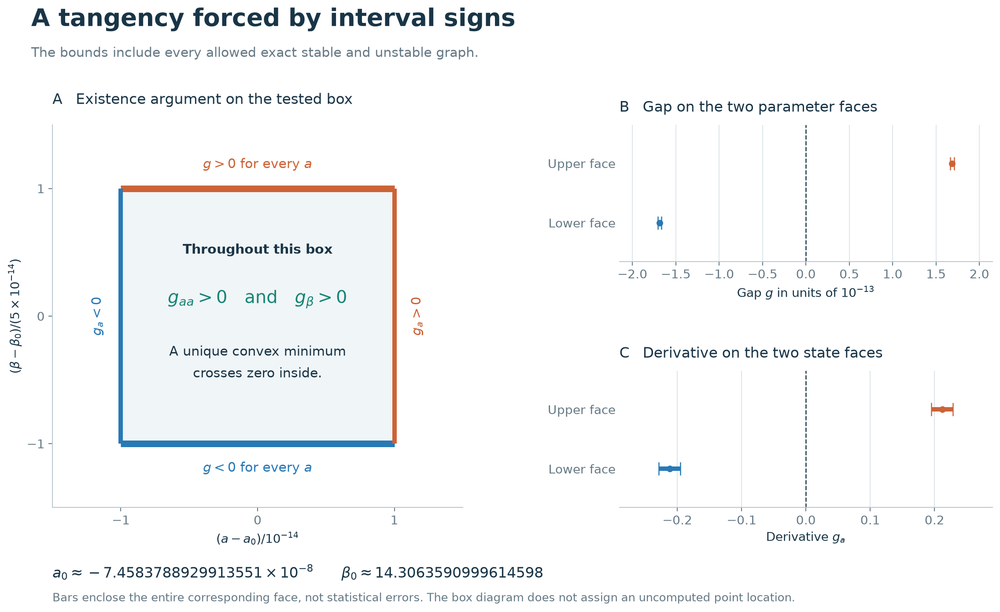

# Infinitely many attracting windows in the Chua transect

The fixed transect **α = 9, m₀ = −8/7, m₁ = −5/7** contains infinitely many parameter intervals supporting attracting periodic orbits of increasing return period. They accumulate at a parameter β∗ enclosed by

```math
14.30635909996140 \lt \beta_* \lt 14.30635909996152.
```

This conclusion combines an **executable interval certificate of a quadratic homoclinic tangency** with the classical theorem on cascades of periodic sinks. The certificate checks the actual invariant manifolds through bounds on their graphs, admissible flight paths, dissipativity and nonzero parameter unfolding. It passes at 80 and 100 decimal working digits.


The result concerns distinct attracting windows at different parameter values. It does not give the number of attractors at β∗, an exhaustive classification of the atlas, or a count of globally disconnected surfaces. The **34 reference identities** in the finite catalogue remain a record of explicitly computed motions. Hyperbolic attracting cycles persist under small changes of the other parameters, so the windows have local extensions in parameter space; their complete connections have not been mapped.

## What changed since the prediction study

The [prediction study](chua-layer-prediction.md) published forecasts before searching for the 75- and 85-peak cycles. Their measured widths differed from the forecasts by 1.89% and 2.70%. The 85-peak location forecast missed its core; that miss and the original forecasts remain unchanged.

Those calculations suggested a manifold tangency but only propagated tangent lines. The present calculation encloses the **exact local stable and unstable manifolds**, including their possible curvature and parameter dependence. The difference is essential: agreement between high-precision approximations alone cannot establish existence.

| Statement | Evidence |
|---|---|
| Eight measured members, 15 through 85 peaks | Numerical continuation and independent orbit checks |
| Exact quadratic homoclinic tangency in the stated β interval | Interval inclusions, graph transforms and sign inequalities below |
| Infinitely many attracting windows accumulating there | The sink-cascade theorem applied to the certified hypotheses |
| Every sufficiently long window has exactly the proposed 10n+5 peak label | Not established by this certificate |
| All visible families have this same organizer | Not established |

The previously fitted limit was 14.30635910320525. Its difference from the certified interval is about 3.24 × 10⁻⁹, already larger than the 85-peak core. The new certificate therefore improves the limiting location without rewriting the earlier forecast.

## 1. Model and return map

We use the continuous piecewise-linear system

```math
\dot x=9\,[y-x-h(x)],\qquad \dot y=x-y+z,\qquad \dot z=-\beta y,
```

```math
h(x)=-\frac57x-\frac3{14}\left(|x+1|-|x-1|\right).
```

On the section x = 0, y > 0, follow the orbit to its next downward crossing of x = 0 and invert the state. Call this map Hβ. Odd symmetry of the vector field makes **Pβ = Hβ²** the ordinary upward first-return map. In each certified half-return the regions and target sections are

```math
(C,R,C,R,C),\qquad (1,1,1,1,0).
```

Here C is the central affine region and R the right outer region. The calculation proves 0 < x < 1 on every open C flight and x > 1 on every open R flight. All crossings are transverse. Consequently, these are the intended first crossings, and their event maps are analytic on the tested neighborhoods despite the vector field's derivative jumps at x = ±1.

For each affine region, the solution is c + exp(At)(q − c). Arb encloses the matrix exponential, interval Newton encloses the crossing time, and implicit differentiation of the event equation gives first and second derivatives in the initial section coordinates and β. Adaptive dyadic time intervals cover each complete flight, including endpoint collars. This avoids accepting a correct endpoint reached by an invalid earlier itinerary.

The 27 half-returns in the connection use 135 affine flights and **12,534 accepted time cells** in the 100-digit run. Local manifold domains and saddle enclosures have their own path checks.

## 2. A certified saddle and local coordinates

A parameter-uniform Krawczyk inclusion gives a unique fixed point p(β) of Hβ near (y,z) = (0.23910, −0.43900). The preconditioned fixed-point map sends its box strictly inside itself and has norm below one. Differentiating Hβ(p(β)) = p(β) then encloses p′ and p″.

The full-return multipliers and determinant satisfy the following outward-rounded bounds:

| Quantity for Pβ | Certified enclosing interval |
|---|---:|
| Unstable multiplier | [2.7134317828, 2.7134317831] |
| Stable multiplier | [1.02745 × 10⁻⁹, 1.02747 × 10⁻⁹] |
| Determinant | [2.78792 × 10⁻⁹, 2.78794 × 10⁻⁹] |

Thus the saddle is strongly dissipative. The half-return multipliers have opposite signs; squaring the map removes the orientation reversal.

Use coordinates (u,s) = V⁻¹(q − p(β)), with the following exact decimal matrix:

```math
V=\begin{pmatrix}0.5085382183836141&0.7893852382512966\\0.8610394186349539&-0.6138981557481208\end{pmatrix}.
```

V is only an approximate eigenbasis. No exact diagonalization is assumed. Write the centered half-return as (F,G). Throughout |u|, |s| ≤ δ = 10⁻⁷ and the full certified β interval, the interval code verifies

```math
F_u\lt -a,\quad |F_s|\lt b,\quad |G_u|\lt c,\quad |G_s|\lt d,
```

with a = 1.6469, b = 0.00035, c = 0.00024 and d = 0.00032. Every state Hessian entry is bounded in magnitude by M = 1500. Both centered parameter derivatives are bounded by Q = 0.000041. For the latter bound, F(0,0,β) = G(0,0,β) = 0; integrating the enclosed mixed state/parameter derivatives along a segment from the origin gives the bound 2δ times their maximum.

## 3. Bounds on the exact invariant manifolds

We construct the local graphs

```math
W^u_{\rm loc}:s=\psi(u,\beta),\qquad W^s_{\rm loc}:u=\chi(s,\beta),
```

through the origin, with common bounds

```math
|\psi_u|,|\chi_s|\le L=10^{-3},\quad |\psi_{uu}|,|\chi_{ss}|\le K=2000,\quad |\psi_\beta|,|\chi_\beta|\le\Gamma=10^{-4}.
```

These bounds follow from graph transforms, rather than replacing a manifold by its tangent line. For the unstable transform, solve u′ = F(u,ψ(u)) and set ψnew(u′) = G(u,ψ(u)). The expanding projection covers the entire local u′ interval because a − bL > 1. For the stable transform, solve F(χnew(s),s) = χold(G(χnew(s),s)). The slope inequality below gives a unique solution within |u| ≤ L|s|, and its image has |s′| ≤ (cL+d)|s| < δ.

Differentiation and the triangle inequality give the following bounds. Every displayed strict comparison is checked in Arb, using exact decimal guard constants.

| Graph-transform quantity | Bound used | Computed upper value |
|---|---|---:|
| Unstable slope | (c+dL)/(a−bL) < L | 0.000146 |
| Stable slope | (b+Ld)/(a−Lc) < L | 0.000213 |
| Unstable contraction in graph values | d+Lb < 1 | 0.000321 |
| Stable contraction in graph values | 1/(a−Lc) < 1 | 0.607202 |
| Unstable second derivative | [M(1+L)³+(d+Lb)K]/(a−bL)² < K | 554.938 |
| Stable second derivative | [M(1+L)³+K(cL+d)²]/(a−Lc) < K | 913.538 |
| Unstable parameter derivative | Q(1+L)+(d+Lb)Γ < Γ | 0.000041074 |
| Stable parameter derivative | [Γ+Q(1+L)]/(a−Lc) < Γ | 0.000085641 |

For example, if A = Fu + Fsψu, differentiation of the unstable graph twice gives

```math
\psi_{\rm new}''=\frac{D^2G[(1,\psi_u),(1,\psi_u)]-\psi_{\rm new}'D^2F[(1,\psi_u),(1,\psi_u)]+(G_s-\psi_{\rm new}'F_s)\psi_{uu}}{A^2}.
```

This yields the unstable curvature row. For the stable transform, the corresponding denominator is Fu − χold′Gu and the term involving χold″ is bounded by K(cL+d)², giving the stable row. At fixed u′, parameter differentiation of the unstable graph gives Gβ − ψnew′Fβ + (Gs − ψnew′Fs)ψβ. The stable equation gives the denominator Fu − χold′Gu again. These yield the last two rows.

Starting from zero graphs, the transforms preserve all these bounds and contract in graph values. Their limits are the local invariant manifolds. Uniform derivative bounds pass to the limits; the smooth parameter-dependent stable-manifold theorem supplies their smoothness. In particular, the second-derivative bounds hold for the exact smooth graphs. The construction is uniform in β.

## 4. A global return of the exact unstable graph

The numerical tangent-line root only supplies a box center, rounded here:

```math
a_0=-7.45837889299135509806551755\times10^{-8},\qquad \beta_0=14.30635909996145981536765451.
```

The full decimal centers are stored in [connection-center.json](../results/chua-layer-infinity/connection-center.json). Test

```math
|a-a_0|\le10^{-14},\qquad |\beta-\beta_0|\le5\times10^{-14},\qquad |v|\le8\times10^{-11}.
```

Since L|a| < 8 × 10⁻¹¹, the whole exact unstable graph v = ψ(a,β) lies inside the initial box. Compose Hβ 27 times and express the result relative to p(β) as (U(a,v,β), S(a,v,β)). The entire final S enclosure lies within the local stable graph's domain. The first iterate already has u > 1.22857 × 10⁻⁷, outside the local square, so the connection makes a nontrivial excursion.

The signed normal gap between the returning unstable graph and the exact stable graph is

```math
g(a,\beta)=U(a,\psi(a,\beta),\beta)-\chi\!\left(S(a,\psi(a,\beta),\beta),\beta\right).
```

Interval jets and centered Taylor forms enclose the whole composition without replacing manifold values or derivatives by zero. For example,

```math
g_\beta=U_\beta+U_v\psi_\beta-\chi_s(S_\beta+S_v\psi_\beta)-\chi_\beta.
```

Writing D = Sa + Svψa, the second state derivative is

```math
g_{aa}=U_{aa}+2U_{av}\psi_a+U_{vv}\psi_a^2+U_v\psi_{aa}-\chi_s(S_{aa}+2S_{av}\psi_a+S_{vv}\psi_a^2+S_v\psi_{aa})-\chi_{ss}D^2.
```

All unknown graph quantities in these expressions range over the bounds from Section 3. The resulting outward-rounded enclosures are:

| Test | Domain | Enclosure |
|---|---|---:|
| g | Lower β face, every a | [−1.709 × 10⁻¹³, −1.664 × 10⁻¹³] |
| g | Upper β face, every a | [1.664 × 10⁻¹³, 1.709 × 10⁻¹³] |
| ga | Lower a face, every β | [−0.2288, −0.1952] |
| ga | Upper a face, every β | [0.1952, 0.2288] |
| gaa | Entire box | [2.0956 × 10¹³, 2.1447 × 10¹³] |
| gβ | Entire box | [3.3728, 3.3731] |



For each β, strict convexity and the opposite signs of ga give a unique interior minimizer a(β). At the lower β face its gap is negative; at the upper face it is positive. Continuity gives a parameter β∗ with g = ga = 0. Moreover, the derivative of this minimum with respect to β equals gβ > 0, so the crossing is transverse and unique within this box.

The curvature gaa > 0 makes the contact quadratic. The image of the unstable graph has a nonzero tangent because the return map is a local diffeomorphism. The initial point is different from the saddle; its backward orbit stays on the local unstable graph, while the final point's forward orbit stays on the local stable graph. Thus this is a homoclinic tangency of the exact manifolds.

## 5. Why this implies infinity

The classical **Gavrilov–Shilnikov sink-cascade theorem** applies to a smooth one-parameter family of planar diffeomorphisms with a dissipative saddle and a quadratic homoclinic tangency unfolding with nonzero speed. It gives infinitely many disjoint parameter intervals, accumulating at the tangency value, with attracting periodic orbits of unbounded period. The original results are in Gavrilov and Shilnikov, Parts [I](https://doi.org/10.1070/SM1972v017n04ABEH001597) and [II](https://doi.org/10.1070/SM1973v019n01ABEH001741); the two-dimensional statement is also summarized explicitly in the introduction, pp. 1115–1116, of [Gonchenko, Ovsyannikov and Turaev (2012)](https://www.ma.imperial.ac.uk/~dturaev/mypapers/physd12.pdf).

All required local hypotheses have been checked here. To use the ordinary return P = H², append one local H iterate to the 27-iterate connection. Its endpoint remains on the local stable manifold. A parameter-dependent local diffeomorphism preserves quadratic contact and nonzero unfolding, so the resulting 28-iterate connection is a homoclinic tangency for P. P has the positive multipliers and dissipative determinant in Section 2.

The analytic return maps exist on neighborhoods of the whole connection and the local saddle. A periodic sink of the upward first-return map corresponds to an attracting periodic orbit of the flow. Hence the theorem yields infinitely many attracting windows on this exact Chua transect, inside any sufficiently small neighborhood of β∗. No extrapolation from eight numerical points is used for this implication.

The theorem does not supply an explicit first index at which its asymptotic conclusions hold. Matching every theorem-generated orbit to the proposed 10n+5 peak sequence, obtaining rigorous widths for all later members, and extending the contact surface over a specified three-dimensional box are further problems.

## 6. Reproduction and checks

The [evidence directory](../results/chua-layer-infinity/README.md) gives the full commands and files. The main certificate runs on a CPU; no GPU is required.

```bash
python -m pip install -r requirements-certificate.txt
python research/certify_chua_homoclinic_tangency.py --digits 100
```

The program fails unless every sufficient inequality passes. The JSON records the bounds, software versions, all gates and the number of accepted itinerary cells.

| Check | Result |
|---|---|
| Main certificate at 80 and 100 digits | All 15 final gates pass |
| Shift the β box by +10⁻¹⁰ | Rejected: lower gap is already positive |
| Shift the β box by −10⁻¹⁰ | Rejected: upper gap is still negative |
| Independent mpmath flight solves and local finite differences | First and second derivatives agree at both tested scales |
| Independent 27-fold composition | Gap, state curvature and parameter derivative agree at both tested scales |
| Reconstruct the numerical box center from the earlier approximation | Agreement within 10⁻³⁵ |

The mpmath comparisons are implementation controls, not interval proofs. The certificate's mathematical guarantees come from the inclusions and inequalities. Its software trust base consists of the published Python implementation and FLINT/Arb's outward-rounded arithmetic and matrix exponentials; see the official [Arb matrix documentation](https://flintlib.org/doc/arb_mat.html). This is a computer-assisted proof with inspectable assumptions and code, not a proof checked by a formal proof assistant. Independent mathematical and implementation review remains valuable.

The subsequent [coexistence audit](chua-coexistence-audit.md) examines the stronger Newhouse–Robinson conclusion and its outstanding localization step. It also adds a Lean proof of the general boundary-sign implication in Section 4 and exact rational checks of the graph guards. The complete interval certificate and its link to those formal hypotheses remain outside Lean.

Computer-assisted tangency proofs and the sink-cascade mechanism predate this work. For a different rigorous construction using covering relations and cone conditions, see [Wilczak and Zgliczyński (2009)](https://arxiv.org/abs/0905.3924). The contribution here is the explicit certificate for this Chua parameter slice and its connection to the measured atlas and published forecasts. No claim of historical priority for Chua tangencies is made.
