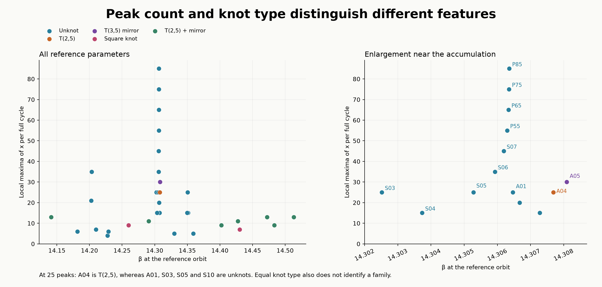
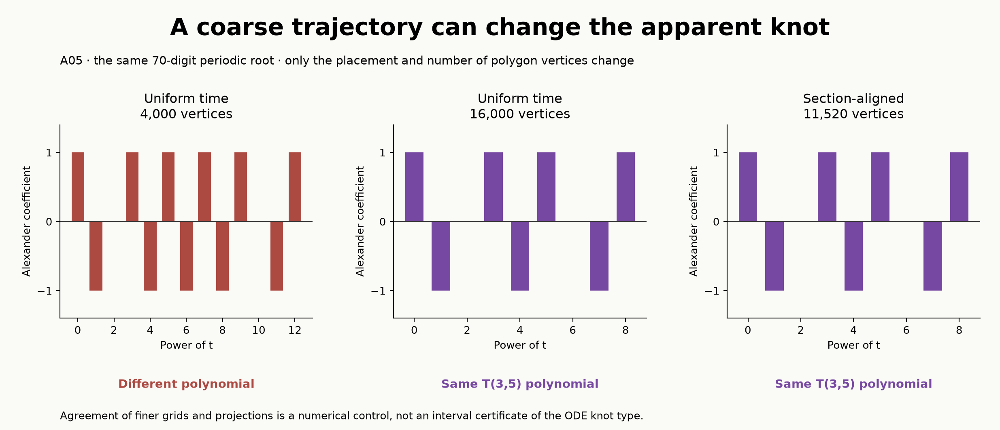
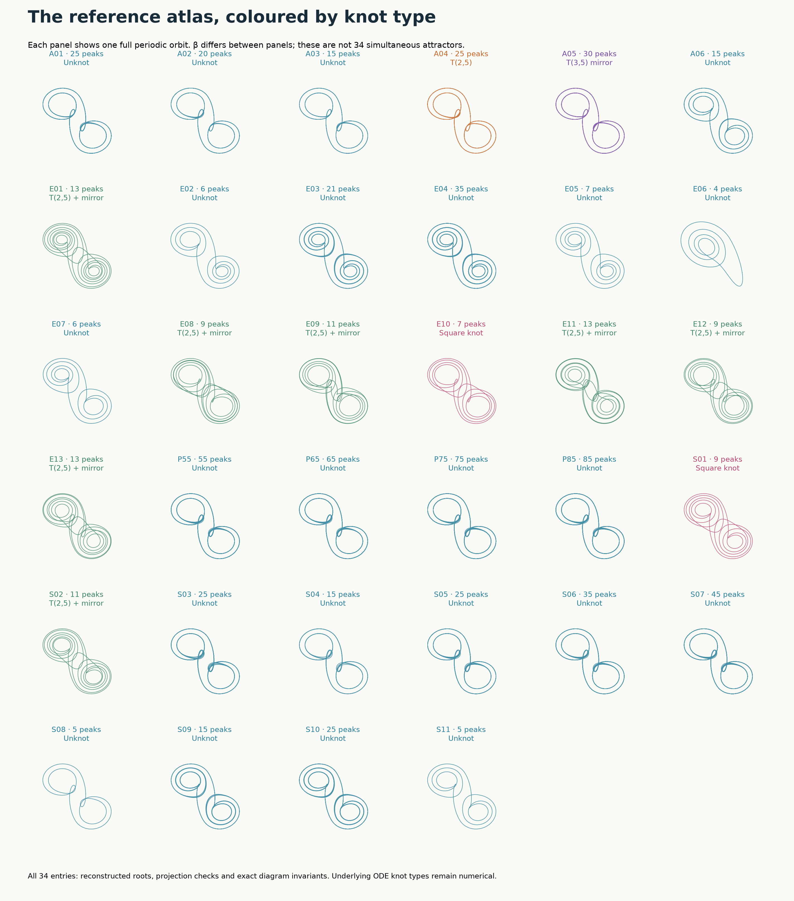

# Knot types of the reference periodic orbits

The 34 reference cycles in the extended atlas have **five numerically identified knot types**. Twenty-three are unknots; eleven are nontrivial knots. The tested 15 → 25 → … → 85 peak sequence consists entirely of unknots. Thus, the mechanism that increases the period and creates progressively thinner stability windows does not, in these eight examples, increase knot complexity.


**How to read the figure.** The upper row shows actual periodic trajectories, with each coordinate rescaled by its range. The lower row shows standard embeddings of the identified knots. A gap indicates the strand passing underneath at a crossing. These standard curves illustrate the topology; they are not additional solutions of Chua's equations. The very similar upper outlines of P85, A04 and A05 conceal three different knot types.

[Interactive 3D atlas](../results/chua-knot-atlas/knot-atlas.html) · [All reference orbits](#6-the-34-reference-orbits) · [Data and reproduction](../results/chua-knot-atlas/README.md) · [Machine-readable review](../results/chua-knot-atlas/review.json)

Download the HTML and open it locally to rotate the actual orbit beside a standard embedding. It contains its data and plotting library. Nothing rotates automatically.

The [combined layer cards](chua-layer-cards.md) place every reference orbit and knot beside its parameter layer, group, full-period waveform and basic characteristics. The README plays these cards at eight seconds per frame; individual static cards are available for direct comparison.

## 1. What is being classified?

A nonstationary periodic orbit of a three-dimensional autonomous ODE is a closed curve. At its least period, uniqueness of solutions prevents a self-intersection. Its knot type records which closed curves can be obtained by continuously deforming the surrounding space without cutting the curve or passing one strand through another. An **unknot** can be deformed into a circle, even when its original projection looks complicated.

This is a property of a curve in **state space**, not a knotting of the plotted layer surfaces in parameter space. A crossing in a two-dimensional drawing is not a collision of trajectories: the two strands generally have different depths.

We use the ideal three-segment model and the same reference-family convention as the [orbit gallery](chua-family-gallery.md). Here α = 9, m₀ = −8/7, m₁ = −5/7 and γ = 0; each representative has its own β. These are 34 catalogue entries at different parameters, not 34 simultaneous attracting cycles. Asymmetric entries display one of the inversion-related partners.

The torus knot T(p,q) winds p and q times around the two directions of a torus, with coprime p and q. A bar denotes its mirror image. The connected sum K # L joins two knots after removing a short arc from each. The square knot is the connected sum of a trefoil and its mirror. Mirror images are distinguished in the saved diagrams; the five rows below are the types occurring among the selected representatives, not an exhaustive count including all symmetry partners.

## 2. Results and their implications for the layers

| Knot type | Reference entries | Number | Alexander polynomial | Determinant |
|---|---|---:|---|---:|
| Unknot | A01–A03, A06; E02–E07; S03–S11; P55, P65, P75, P85 | 23 | 1 | 1 |
| T(2,5) | A04 | 1 | 1 − t + t² − t³ + t⁴ | 5 |
| Mirror of T(3,5) | A05 | 1 | 1 − t + t³ − t⁴ + t⁵ − t⁷ + t⁸ | 1 |
| Square knot | S01, E10 | 2 | (1 − t + t²)² | 9 |
| T(2,5) # mirror of T(2,5) | E01, S02, E08, E09, E11, E12, E13 | 7 | (1 − t + t² − t³ + t⁴)² | 25 |

Polynomials are normalized to have lowest degree zero and positive leading coefficient. The determinant is the absolute value of the polynomial at t = −1. **Determinant one does not imply an unknot:** A05 is an explicit counterexample within this catalogue. Equal Alexander polynomials would not, by themselves, establish equal knot types either. Identification here also uses explicit diagrams, connected-sum decompositions and Reidemeister moves.



Three consequences matter for interpreting the atlas:

1. **Peak count is not knot type.** A04, A01, S03, S05 and S10 all have 25 peaks. A04 has type T(2,5); the other four are unknots. The number of peaks and the temporal ordering of excursions describe different aspects of a motion from its knot type.
2. **Knot type is not family identity.** Twenty-three different reference entries share the unknot type. Knot classification supplements continuation and branch relationships; it cannot replace them.
3. **Different knot types obstruct regular continuation.** Along a continuous family of embedded periodic curves, with a continuously chosen primitive parameterization, the curves form an isotopy. The knot type therefore stays fixed. A proposed regular continuation connecting different types must be re-examined for a branch switch, a singular limit, an incorrect period or a numerical error. This statement does not prohibit bifurcations at which its hypotheses fail.

For the thin sequence, S04, S05, S06, S07, P55, P65, P75 and P85 all reduce to the unknot. This separates two questions that the original atlas could not distinguish: **how many attracting windows occur, and how many knot types their cycles realize**. The [infinite-window argument](chua-infinity-certificate.md) answers the former near a specified tangency. It does not establish infinitely many distinct knot types. Eight unknotted examples neither prove that every later member is unknotted nor rule out other sequences with increasing knot complexity.

## 3. What inversion symmetry forces

The odd vector field satisfies F(−u) = −F(u). For a reference cycle with half-period inversion symmetry,

```math
u(t+T/2)=-u(t).
```

Spatial inversion reverses the orientation of three-dimensional space and sends this knot to itself. On the orbit, it acts as a half-period shift and preserves the direction of traversal. Consequently, the oriented knot is **positively amphicheiral**: it is equivalent to its mirror with the curve orientation preserved. This conclusion follows from the symmetry identity; it is independent of the numerical knot-extraction algorithm.

The symmetric nontrivial representatives found here have a particularly transparent form: a torus knot joined to its mirror. The computation finds two square-knot representatives and seven representatives of T(2,5) # mirror of T(2,5). Symmetry alone does not imply that every symmetric orbit must have this connected-sum form.

For an asymmetric cycle, inversion instead produces a distinct partner. Its knot is the mirror of the first. Thus the unlisted partners of A04 and A05 have the opposite handedness. The saved classifications use the orientation of the ordered coordinates (x,y,z); a reflection used merely to display a figure would reverse handedness.

## 4. Numerical construction and diagram identification

The calculation starts from the 32 original reference roots and the later 75- and 85-peak roots. Existing forecast values, numerical records and display arrays are preserved. New shooting solutions refine β and the flight data while retaining the original multiplier convention: +0.5 for the symmetry-reduced half-return map, and −0.5 for the asymmetric full-return map. The symmetric full-period dominant multiplier is consequently 0.25. The largest change in reference β is less than 2.1 × 10⁻¹³.

Each affine flight is evaluated using arbitrary-precision matrix exponentials. A central flight crossing from x = −1 to x = 1, or conversely, is split at x = 0. Each resulting section-to-section arc receives the same number of time subdivisions. This aligns samples on nearly coincident repeated passages. Closure comes from periodic shooting, with inversion supplying the second half of a symmetric cycle; an arbitrary open trajectory is not closed by a long extra segment.

The main audit uses 60-digit roots with 96 subdivisions per arc and 70-digit roots with 192 subdivisions. The finer polygons are projected in two independently chosen, fixed directions. A04, A05 and P85 also receive 80-digit/384-subdivision checks in both directions. There are **108 orbit-diagram calculations** in total. The precision is that of shooting and affine sampling; the final polygon coordinates and crossing predicates use float64.

For each polygon the program records the generic projection, every crossing, over/under information, crossing-depth margins and a planar-diagram code. Spherogram simplifies the diagram by Reidemeister and strand-pickup moves. Unknots are identified by reduction to a crossing-free diagram, not merely by an Alexander polynomial equal to one. Nontrivial diagrams are decomposed where a connected sum is diagrammatically visible. Each summand is matched to a standard torus diagram, allowing an explicitly saved sequence of type-III Reidemeister moves. For example, the coarse A05 diagram requires two such moves to match the mirror of T(3,5).

The Alexander polynomial is computed in two ways: the determinant of tV − Vᵀ for a Seifert matrix V, and a minor of the Alexander matrix obtained directly from oriented Wirtinger relations. Both use exact integer polynomial arithmetic after the diagram has been fixed. Their agreement checks the algebra and crossing conventions through different constructions. It does not independently validate the geometric extraction of the diagram.

The [review program](../research/review_chua_knots.py) replays the summand identifications, compares resolutions and projection directions, checks file hashes, closure, symmetry, refinement agreement and numerical attraction. Its optional `--replay-diagrams` mode repeats every reduction from the unsimplified planar-diagram code. Twenty-two controls use independently parameterized standard knots, reversed traversal and different projections, including a figure-eight knot outside the recognized torus list.

## 5. A sampling error that changes the knot



For A05, a 4,000-vertex polygon sampled uniformly in time has a degree-12 Alexander polynomial. At 16,000 uniformly spaced vertices, the degree is eight and the diagram matches the mirror of T(3,5). Section-aligned polygons with 5,760, 11,520 and 23,040 vertices agree on that type. The two uniform-time experiments use the same 70-digit shooting root. Their difference therefore cannot be explained by moving to another periodic orbit.

The mechanism is geometric. A chord cuts across the curved trajectory between two saved points. Two passages that are close in space but sampled at different phases can acquire the wrong over/under order. A small shooting residual does not control this interpolation error. The [counterexample record](../results/chua-knot-atlas/sampling-counterexample.json) preserves the discrepant polynomial and both polygons rather than discarding the failed coarse result.

This is why the earlier display arrays are unsuitable as the sole input to a knot classification. Their purpose was to show orbit outlines. The new data establish a numerical convergence comparison specifically for topology.

## 6. The 34 reference orbits



The [review table](../results/chua-knot-atlas/review.json) supplies every entry's β, period, peak count, knot type, polynomial, determinant and number of checks. Each orbit file has a companion shooting record. The [original gallery](chua-family-gallery.md) supplies time signals and recurrence patterns; the [interactive knot atlas](../results/chua-knot-atlas/knot-atlas.html) adds the topological comparison for all 34 entries.

## 7. Evidence limits and relation to earlier work

This report identifies **numerical knot types of selected attracting representatives**. It does not give an interval enclosure proving that each polygon is ambient-isotopic to the exact ODE orbit. Agreement of two or three sample densities, higher precision and multiple projections is evidence of convergence, not such a proof. A rigorous extension would enclose the orbit in separated tubes, control the tangent direction and certify an isotopy to the polygon. The float64 crossing predicates also need an error enclosure for a complete computer-assisted topological certificate.

The exact polynomial calculations and explicit final diagram matches are conditional on the extracted diagrams. Spherogram's general reduction is rerunnable software, not a formally checked move certificate. The historical Lean results elsewhere in this repository do not cover this knot calculation. The study also does not classify every orbit on every continued layer or every unstable periodic orbit in the surrounding dynamics.

Knotted periodic orbits in Chua's circuit are an established subject. Kocarev, Tasev, Dimovski and Chua published a dedicated study in 1994. Letellier and Gilmore later exhibited a universal subtemplate of a double-scroll template, relating the dynamics under specified operating conditions to all knot and link types. Such template statements do not identify which knots occur as the attracting representatives of this particular atlas. The present addition connects parameter-specific attracting families to explicit knot diagrams and preserves the sampling controls. Historical priority for the particular collection has not been established.

- L. Kocarev, Z. Tasev, D. Dimovski and L. O. Chua, “Knotted periodic orbits in Chua's circuit,” *International Journal of Bifurcation and Chaos* **4**(3), 609–621 (1994). [DOI](https://doi.org/10.1142/S0218127494000435); [Chua's publication list](https://people.eecs.berkeley.edu/~chua/publications.html).
- C. Letellier and R. Gilmore, “The universal template is a subtemplate of the double-scroll template,” *Journal of Physics A* **46**, 065102 (2013). [Author-hosted paper](https://www.physics.drexel.edu/~bob/Papers/universal_template.pdf), [DOI](https://doi.org/10.1088/1751-8113/46/6/065102).
- [Spherogram documentation](https://snappy.computop.org/spherogram.html): planar diagrams, Reidemeister simplification, connected-sum decomposition and Seifert matrices.

## 8. Questions made precise by this extension

The first unresolved question is whether the entire measured period-adding sequence remains unknotted. A proof would need an embedded return construction that controls the global excursion as well as each extra return near the saddle. The existing scalar scaling law does not contain that spatial information.

The second is whether additional attracting families realize an unbounded sequence of distinct knot types. A search can now distinguish that question from an unbounded peak count. It can also test whether the observed connected sums arise from a common geometric construction and whether that construction persists when both diode slopes vary.

Finally, at parameters supporting several attractors, the individual knots can be studied jointly as a link. Two individually unknotted cycles can still be linked. That requires reconstructing distinct cycles at the **same** parameters; combining the different-β reference portraits would not answer it.
