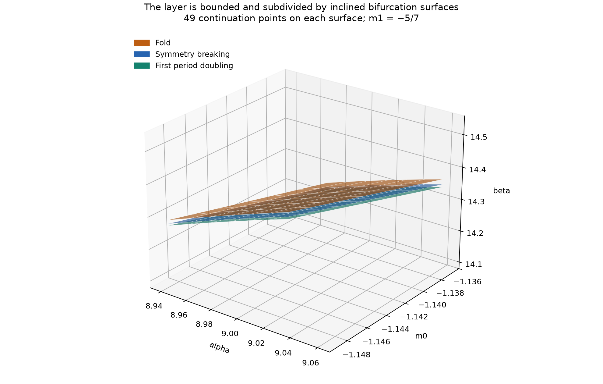

# Fold, symmetry-breaking and period-doubling bifurcations of a Chua periodic family

Numerical continuation of the classical five-maximum window resolves a saddle-node of symmetric cycles, a symmetry-breaking transition to two attracting cycles, and the first two period-doubling thresholds. These internal boundaries are unresolved by the original finite-time Lyapunov mesh.

The calculation concerns one local window of the continuous piecewise-linear model. Independent integrations check selected orbits and multipliers. The resulting bifurcation estimates are floating-point numerical results, without validated interval bounds or a classification of the remaining atlas families.


## Bifurcation sequence along the beta transect

Fix `alpha = 9`, `m0 = -8/7`, and `m1 = -5/7`, using the diode-slope convention of [the methods](methods.md#equations-and-parameter-conventions). The following values are rounded to six decimal places; extra digits in the raw records identify reproducible solver outputs, not certified error bounds.

| Beta, decreasing | Observed transition | What persists afterward |
|---:|---|---|
| 14.330652 | A fold produces an attracting symmetric cycle and a saddle cycle. | Both are periodic solutions; only one attracts nearby states. |
| 14.317275 | The attracting cycle loses half-period central symmetry. | A symmetry-related pair of attracting, asymmetric cycles appears; the symmetric cycle continues but is unstable. |
| 14.310344 | A transverse Floquet multiplier of the asymmetric cycle crosses -1. | A doubled orbit with ten maxima is independently reproduced. The five-maximum cycle continues as an unstable orbit. |
| 14.308751 | A multiplier of the doubled orbit crosses -1. | A second period-doubling threshold is located. The twenty-maximum daughter and the end of the cascade are not continued here. |

The symmetric cycle obeys

```math
u(t+T/2)=-u(t),\qquad u=(x,y,z).
```

At the fold, its period is approximately 10.913400. At the symmetry transition it is approximately 10.825262. An asymmetric orbit at beta = 14.315 has period 10.826591 and a leading transverse multiplier about 0.354991. The doubled orbit at beta = 14.3097 has period 21.657472 and ten maxima.

The two asymmetric cycles are exchanged by `u -> -u`; this does not mean that each individually obeys half-period symmetry. Their distinct upward `x=0` section points were constructed and closed independently. Both still have five maxima per cycle. **A peak-count plot alone therefore misses this symmetry-breaking boundary.**

The regular layer does not disappear at the first doubling: its attracting orbit changes period. Nor does an unstable continuation disappear merely because a direct trajectory no longer converges to it. The calculation establishes the beginning of a period-doubling route, but does not locate the final loss of periodic attraction, prove a subsequent chaotic attractor, or exclude other coexisting attractors.

## Half-return multipliers and symmetry

Let `H` take a state on the upward `x=0` section to its next downward crossing, then invert all coordinates. Near this itinerary the full return map is `P = H o H`. A symmetric orbit is a fixed point of `H`.

- At the upper fold, the leading multiplier of `H` reaches **+1**. Two fixed points of `H` meet. Numerical null-vector tests give nonzero parameter and quadratic coefficients, and two separate branches are recovered just below the fold. At beta about 14.330552 their full-period leading multipliers are approximately **0.6621** and **1.4156**.
- At the symmetry transition, the leading multiplier of `H` reaches **-1**. A two-cycle of `H` corresponds to a pair of distinct symmetry-related full orbits. Both the symmetric and asymmetric full orbits have approximately the same period at this transition. This is the numerical signature of a supercritical symmetry-breaking pitchfork of cycles, rather than a doubling of the full flow period.
- Squaring the half-map multiplier gives **+1 in both cases** for the full return. Looking only for a full Floquet multiplier of +1 would therefore not distinguish the fold from the symmetry transition.

All measured crossings of the diode breakpoints remain transverse at the studied transitions. These transitions are not caused by the orbit grazing `x=+/-1` in this local calculation.

## The three-dimensional sheets

The fold, symmetry-breaking, and first period-doubling loci are continued over the same local box as the atlas zoom:

```text
alpha: 8.94 ... 9.06
m0: -8/7 - 0.006 ... -8/7 + 0.006
m1: -5/7
```

Each surface uses 49 parameter pairs. These are orbit-continuation surfaces, rather than isosurfaces of a finite-time Lyapunov classification. Independently computed central derivatives are retained in the [audit](../results/chua-layers/audit.json).

| Boundary | d beta / d alpha | d beta / d m0 |
|---|---:|---:|
| Fold | 2.14031 | -14.88488 |
| Symmetry breaking | 2.13734 | -15.23306 |
| First period doubling | 2.13585 | -15.40752 |

These are local tangent slopes at the central parameter pair, not a plane fit over the entire box. For example, increasing alpha by 0.001 shifts each boundary upward in beta by approximately 0.00214. The five-maximum attracting interval is about 0.020308 wide in beta at the central pair.



A narrow interval in a beta transect becomes a thin region between moving surfaces as alpha and m0 vary. Nearby surfaces have similar inclinations, producing the layered appearance. The symmetry-breaking surface subdivides that region internally. The first-doubling surface bounds the five-maximum attracting regime, not the entirety of all periodic behavior.

Consequently, a layer can appear to be born or vanish on a particular two-dimensional slice simply because a moving surface enters or leaves that slice. Its true termination in three-parameter space is a separate question. No global endpoint, intersection of different layers, cusp, or complete atlas connectivity is established by this small box.

## Strong contraction and multiplier conditioning

The return map contracts extremely strongly in its second transverse direction. At the symmetry threshold, its full-period determinant is about `3.01e-9`; at the first period doubling the second multiplier is of comparable magnitude. For the doubled orbit the determinant is of order `1e-17`.

The strong contraction motivates a one-dimensional approximation to the local return dynamics. It also causes numerical ill-conditioning: direct evaluation of the determinant or smaller eigenvalue of a rounded matrix can give the wrong sign. The calculation obtains the determinant from Liouville's identity,

```math
\det DP = \exp\left(\int_0^T \mathrm{tr}\,J(u(t))\,dt\right)>0,
```

and combines it with the computed trace to recover the two multipliers without subtractive cancellation. For the inverted half-return, the section orientation gives the negative of the half-flight exponential. This is a property of these return maps, not a statement that the original flow has only one state variable.

## Numerical methods and validation

The initial cycle is located by integrating the full vector field. Its measured sequence of affine regions is then continued using matrix exponentials and closing equations for the section state and all flight times. The analytic derivative of these equations is checked by finite differences. The vector field is continuous across the diode breakpoints, so the variational flow has no saltation jump there; its Jacobian changes between regions.

For selected cycles and transitions:

- DOP853 at two tolerance/step settings and the independent implicit Radau method reproduce closure and the number of breakpoint crossings and maxima.
- An independently integrated full-field variational equation checks the leading Floquet multiplier at all four reported thresholds.
- Affine arcs are sampled for region validity; all three continued surfaces retain transverse breakpoint crossings. The sampler is not an interval enclosure of each entire arc.
- The stable and saddle fold partners, and the distinct partner of an asymmetric orbit, are recovered explicitly.

The [audit](../results/chua-layers/audit.json) contains executable pass/fail gates and observed errors. Every full-field trial is retained, including the less accurate coarse DOP853 replay of a doubled orbit. Agreement of independent numerical methods supports these local results; it does not turn the computations into a proof or an exhaustive basin census.

## Reproduction and evidence

From the repository root, with the dependencies in `requirements.txt`:

```powershell
python research/trace_chua_window.py --initialize-only
python research/chua_layer_bifurcations.py
python research/extend_chua_layer.py
python research/chua_layer_cascade.py
python research/audit_chua_layers.py
python research/plot_chua_layers.py
```

The default destination is `results/chua-layers`. Every command also accepts `--output` for a separate reproduction directory. The plotting command accepts `--assets` for a separate figure destination. The initial full-field survey mode of `trace_chua_window.py` is exploratory; the reported boundaries come from the subsequent affine-flight continuation.

- [Central branches and thresholds](../results/chua-layers/affine-central.json)
- [Asymmetric branch, fold controls, and local surfaces](../results/chua-layers/extended.json)
- [Doubled orbit and second threshold](../results/chua-layers/cascade.json)
- [Independent state checks](../results/chua-layers/verification.json)
- [Independent multiplier checks and sensitivities](../results/chua-layers/audit.json)
- [Sampled independently integrated orbits](../results/chua-layers/verified-orbits.npz)
- [Plot continuation data](../results/chua-layers/plot-data.json)

## Related work and limitations

The follow-up [layer census](chua-layer-census.md) extends this single-family study to a second broad family, 17 checked local windows on a fixed transect, a shrinking period-adding sequence, and a verified overlap with two attracting cycles. It also explains why neither sampled connected components nor transect windows give a global layer count.

Analytic return and half-return maps for this continuous piecewise-linear family are foundational tools in Chua, Komuro, and Matsumoto, *The Double Scroll Family* (1986). Their slope convention incorporates the linear `x` term and differs by one from this repository's diode slopes. The present calculation specializes those longstanding ideas to the atlas's measured narrow window. [Author-hosted primary paper](https://people.eecs.berkeley.edu/~chua/papers/Chua86.pdf), [DOI](https://doi.org/10.1109/TCS.1986.1085869).

De Sousa and coauthors experimentally observed period-adding sequences of shrinking periodic regions in a modified Chua circuit. That provides evidence that fine periodic-window structure is physically observable, but neither their fitted diode characteristic nor their parameter slice is identical to this atlas. Their period-adding sequence must not be conflated with the period doublings computed here. [Primary manuscript](https://arxiv.org/abs/1509.08425).

The next useful calculations are continuation of the higher-period daughters, a basin study across the fold and symmetry transition, and tracing the surfaces far enough to find their global connections or terminations. The eventual disappearance of the entire periodic window, intermittency on its chaotic side, the organization of other layers, and scientific priority for these particular numerical thresholds remain open.
