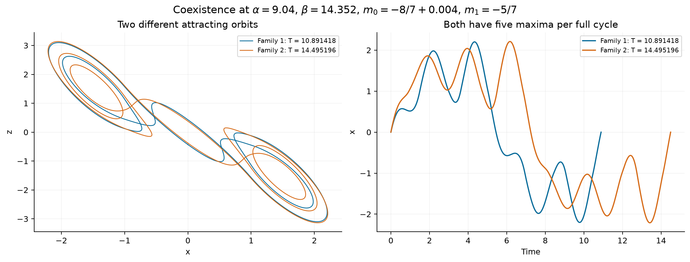
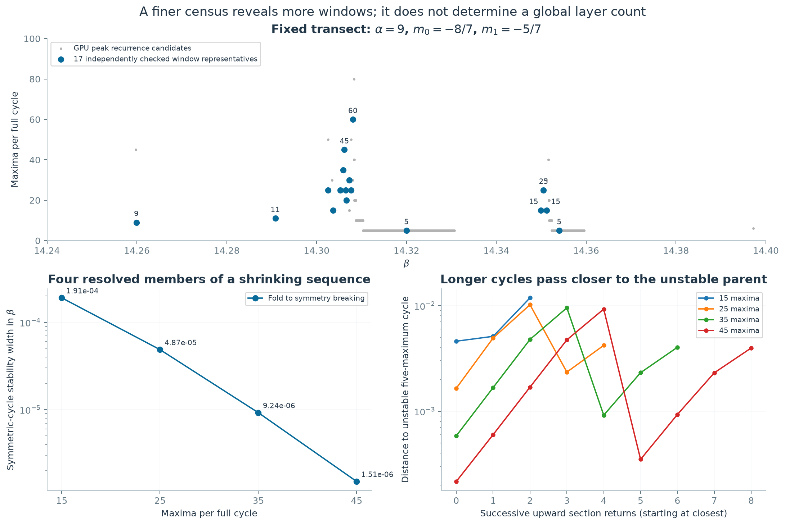

# How many layers does the Chua atlas contain?

**Follow-up:** the [family-labelled atlas refinement](chua-refined-atlas.md) expands the numerical catalogue to 32 families across the three-dimensional box, extends the adding sequence to 65 maxima, and verifies four coexisting cycles. The 17-window central census below remains the earlier, more limited result.

The visible sheets contain more structure than a small stack of separate periodic regimes. We have now continued **two broad five-maximum families**, checked representatives of **17 local periodic windows on one fixed transect**, and resolved a shrinking **15 → 25 → 35 → 45** sequence. The two broad families can **overlap and support different attracting cycles at identical parameters**.

These are numerical results for this repository's continuous piecewise-linear Chua model. Seventeen is an operational count on the stated transect, supported by independently closed attracting orbits and intervening finite-time chaotic screens. It is neither an exhaustive count nor the number of globally connected surfaces in three parameters. No finite total, and no infinitude of attracting windows in this exact box, has been established.

## Matching the visible atlas

The original pink surface was extracted from a 41 × 41 × 41 mesh in

```text
alpha in [8.94, 9.06]
beta  in [14.24, 14.40]
m0    in [-8/7 - 0.006, -8/7 + 0.006]
m1    = -5/7
```

It identifies regular behavior reached from three prescribed starts. It does not label which attracting orbit was reached. The [previous study](chua-layer-bifurcations.md) continued one five-maximum family. A second family now accounts for the neighboring narrow band.


At alpha = 9 and m0 = −8/7, the two families have the following boundaries. Values are rounded numerical estimates, not certified error intervals.

| Family | Fold | Symmetry breaking | First period doubling | Example full period |
|---|---:|---:|---:|---:|
| 1 | 14.330651969 | 14.317275008 | 14.310343678 | 10.834196 at beta = 14.32 |
| 2 | 14.359533766 | 14.354768844 | 14.352340428 | 14.476279 at beta = 14.354 |

Both examples have five local maxima of x over a full cycle. Counting maxima alone therefore cannot identify a family. Family 1's example is symmetric under a half-period shift followed by state inversion; family 2's example lies on its asymmetric branch.

Each boundary of family 2 was continued to 49 points in (alpha, m0), matching the earlier family's 7 × 7 grid. Bilinear interpolation of the regions between fold and first doubling covers 5,086 of the original 6,419 regular nodes, approximately **79.2%**. This approximate comparison only includes the five-maximum cores. Doubled descendants, smaller windows, finite transients, basin selection, and interpolation errors contribute to the remainder. Coverage is not an accuracy score or a measured parameter volume.

## What birth and disappearance mean

When beta decreases across the upper boundary of either broad family, a stable and a saddle periodic orbit meet at a **fold of cycles**. The new attracting cycle can capture trajectories and produces a regular window inside the otherwise chaotic scan. The stable and saddle partners have been recovered on the same side of the second fold; closing-equation derivatives support a nondegenerate fold.

Decreasing beta further first breaks the half-period inversion symmetry. The symmetric cycle loses stability and a pair of symmetry-related asymmetric cycles appears. Their full periods remain close to the parent's, and they still have five maxima. This internal boundary is invisible to a five-peak classifier.

Next, a full-return multiplier crosses −1 and the attracting cycle undergoes period doubling. The original periodic orbit continues as an unstable orbit. Thus **loss of attraction is different from destruction of the orbit**. The earlier work also resolved the next doubling of family 1. The endpoint of the entire cascade, any terminal crisis, and global endings of the sheets have not been determined here. A sheet clipped at the atlas box is not an observed dynamical termination.

The boundaries move smoothly with the other two parameters over the continued patches. A one-dimensional stability interval consequently becomes a thin region bounded by surfaces in parameter space. Different families need not have the same slope, thickness, or basin of attraction.

## A concrete overlap: two stable cycles at one parameter point

At

```text
alpha = 9.04, beta = 14.352, m0 = -8/7 + 0.004, m1 = -5/7
```

the two continued families give distinct attracting cycles:

| Quantity | Family 1 | Family 2 |
|---|---:|---:|
| Full period | 10.891418033 | 14.495195819 |
| Maxima per full cycle | 5 | 5 |
| Largest transverse multiplier magnitude | 0.00223838 | 0.37868301 |
| Independent Radau closure error | 3.62e−11 | 4.67e−10 |

Two explicitly recorded perturbed starts near each orbit return to that orbit after 500 time units; their final section errors are below 2e−10. Both cycles are inversion symmetric, so they are not merely the positive and negative copies of one asymmetric cycle. This establishes numerical coexistence locally, without measuring the complete basins.



The pink atlas merges these outcomes into the same regular label. Overlap can join the colored region without identifying the underlying periodic-orbit families. This is a specific reason why counting connected pink pieces does not count dynamical families.

## The transect census

The census fixes alpha = 9, m0 = −8/7 and m1 = −5/7 and varies beta from 14.24 to 14.40. An FP64 GPU survey used 10,241 nodes, three prescribed initial states, step 0.00125, transient 2,000 and observation 2,400. A subsequent 1,200-unit peak collection used the first start's final state. A focused 10,001-node survey on [14.3058, 14.3068] used one start, step 0.000625 and beta spacing 1e−7.

The following are independently checked attracting cycles, one representative for each of the 17 reported local windows. The full-period maxima and section-return counts are obtained from CPU orbit verification, not simply copied from the GPU peak classifier.

| Beta | Maxima per full cycle | Upward section returns | Full period | Largest transverse multiplier magnitude |
|---:|---:|---:|---:|---:|
| 14.259875000 | 9 | 1 | 23.676219 | 0.505499 |
| 14.290812500 | 11 | 3 | 28.250568 | 0.298010 |
| 14.302515625 | 25 | 5 | 54.324183 | 0.303979 |
| 14.303687500 | 15 | 3 | 32.607845 | 0.007372 |
| 14.305250000 | 25 | 5 | 54.167078 | 0.309341 |
| 14.305921875 | 35 | 7 | 75.749507 | 0.168980 |
| 14.306190000 | 45 | 9 | 97.340923 | 0.740242 |
| 14.306469400 | 25 | 5 | 54.068374 | 0.952144 |
| 14.306670000 | 20 | 4 | 43.270017 | 0.766021 |
| 14.307250000 | 30 | 6 | 64.936514 | 0.970030 |
| 14.307687500 | 25 | 5 | 54.134987 | 0.613906 |
| 14.308078125 | 60 | 12 | 129.938718 | 0.907031 |
| 14.320000000 | 5 | 1 | 10.834196 | 0.634866 |
| 14.349906250 | 15 | 3 | 43.466821 | 0.056844 |
| 14.350507813 | 25 | 5 | 72.392308 | 0.292126 |
| 14.351226563 | 15 | 3 | 43.426070 | 0.938922 |
| 14.354000000 | 5 | 1 | 14.476279 | 0.367458 |

Between every neighboring pair in this table, the saved broad survey contains a parameter node with positive finite-time exponents in all four observation windows for all three starts, and no accepted late peak recurrence. Those 16 witnesses support separation in the observed dynamics; they do not exclude an unobserved coexisting periodic basin. The two checked nine-maximum examples at beta = 14.259875 and 14.259953125 share the same continued stability interval and are counted once.

Two additional GPU candidates, near beta = 14.259734375 and 14.397203125, did not recur in the independent CPU check. Their negative results remain in the data. This does not prove the absence of all attracting cycles at those parameters.



Subsampling the same tightened broad survey gives the following **raw candidate-interval counts**:

| Beta spacing | Sampled nodes | Candidate intervals |
|---:|---:|---:|
| 0.004 | 41 | 2 |
| 0.001 | 161 | 2 |
| 0.00025 | 641 | 6 |
| 0.0000625 | 2,561 | 10 |
| 0.000015625 | 10,241 | 17 |

The last 17 is not the same list as the final verified 17. Candidate intervals can split a single window or fail verification; the focused scan adds further windows. Fourteen distinct checked windows came from the broad search, and three more from the focused search.

An initial peak tolerance of 2e−5 fragmented the baseline scan into 173 intervals. Fixed-step peak-height variation and transient effects make that unsuitable as a physical count. The saved reanalysis uses 5e−4; this tolerance only selects candidates. Exact affine closure, full-field integration, and transverse stability determine acceptance. The original report is retained rather than replaced with the corrected one. GPU peak counts can also alias a full cycle: some candidates labeled 15 or 30 became verified 30- or 60-maximum cycles.

Even the old three-dimensional mesh gives **1,025, 26, or 25** connected regular components depending on whether nodes use 6, 18, or 26 neighbors. None of these is a justified count of exact dynamical layers.

## The 15 → 25 → 35 → 45 sequence

These four symmetric attracting cycles have 3, 5, 7 and 9 upward crossings of x = 0 per full period. This is period adding, distinct from the doubling cascade inside a single window.

| Maxima | Representative beta | Full period | Width from fold to symmetry breaking | Closest return to the unstable five-maximum cycle |
|---:|---:|---:|---:|---:|
| 15 | 14.303687500 | 32.607845 | 1.9111e−4 | 4.6052e−3 |
| 25 | 14.305250000 | 54.167078 | 4.8724e−5 | 1.6490e−3 |
| 35 | 14.305921875 | 75.749507 | 9.2421e−6 | 5.8393e−4 |
| 45 | 14.306190000 | 97.340923 | 1.5063e−6 | 2.1579e−4 |

The width here is only the **symmetric stable core**, not the complete window including asymmetric and doubled descendants. The full period increases by approximately 21.56, 21.58 and 21.59. Across the four members, the core narrows by about a factor of 127.

At each member's beta we also continued the original five-maximum symmetric orbit, now unstable. The last column measures the minimum Euclidean distance in (y, z) on the upward x = 0 section to that unstable orbit's section point. Longer cycles pass progressively closer and make more returns before closing. The unstable parent's largest multiplier magnitude is approximately 3.17, 2.90, 2.79 and 2.74 at these parameters.

This supports the interpretation that an unstable periodic orbit organizes the longer cycles: they make additional near-parent returns and then a larger excursion. It is evidence from section geometry and continued cycles, not a computed global homoclinic connection. Four members do not establish a limiting parameter, a universal scaling law, a fifth member, or infinitely many stable windows.

## Numerical controls and scope

Every accepted representative has a closed affine-flight itinerary, positive flight times, sampled region validity, an independent full-field Radau replay, and a separately integrated full-field variational equation. Eighteen accepted representatives include the duplicate nine-maximum example; the reported count is 17. The maximum accepted Radau closure error is 1.11e−7, the maximum independent variational closure error is 3.32e−11, and the largest observed transverse multiplier magnitude is 0.97004 or less.

The 45-maximum case initially missed the Radau closure threshold: 3.90e−7. Tighter integration reduced the error to 1.16e−8; both trials are retained. Independent variational integrations check the three central boundaries of family 2 and eight boundaries of the adding sequence, with maximum multiplier discrepancy 4.15e−7. Fold nondegeneracy controls use three difference steps. The [executable audit](../results/chua-layer-census/audit.json) passes all recorded gates.

These checks are numerical, not validated interval enclosures. There is no complete basin survey, no proof of a gap free of all periodic attractors, no exhaustive search below the chosen resolution, and no global continuation identifying all connections between families.

## Relation to prior work

Periodic windows and their organization are established Chua phenomena. Chua, Komuro and Matsumoto develop return and half-return maps for the piecewise-linear double-scroll family; their slope convention differs from this repository's diode convention. The existence of infinitely many unstable periodic orbits in a chaotic invariant set would not by itself establish infinitely many attracting parameter windows. [Primary paper, 1986](https://people.eecs.berkeley.edu/~chua/papers/Chua86.pdf).

Maranhão and coauthors describe complex periodic windows in an experimental Chua setting, including windows that extend across large changes in two parameters. This supports our caution that separated intersections in a one-parameter cut need not identify independent multidimensional windows. [Primary manuscript](https://arxiv.org/abs/0712.3842).

De Sousa and coauthors measure shrinking period-adding windows in a modified Chua circuit. This makes an accumulating hierarchy a reasonable hypothesis to investigate, but their diode and parameter section differ from ours. Their observations do not prove infinitude for this atlas. [Primary manuscript](https://arxiv.org/abs/1509.08425).

The contribution here is the reproducible identification, continuation, coexistence check, and resolution-dependent census of particular structures in the existing atlas, not discovery of periodic windows as a new phenomenon.

## Data and reproduction

The [data directory](../results/chua-layer-census/README.md) contains the compact surveys, every cycle check including unsuccessful candidates, sampled orbits, continued surfaces, gap witnesses, audit, and PDF figures. Full GPU peak matrices are omitted from Git; their hashes and the retained array names are recorded in [raw provenance](../results/chua-layer-census/raw-provenance.json). The scan commands regenerate them. Published compact files suffice to repeat CPU verification, continuation, the analysis, and plotting.

From the repository root, with `requirements.txt` installed and an FP64 OpenCL device for the survey:

```powershell
python research/survey_chua_layers.py --output D:/tmp/chua-census-reproduction
python research/survey_chua_layers.py --output D:/tmp/chua-census-reproduction --analyze-only
python research/survey_chua_layers.py --output D:/tmp/chua-census-reproduction --tight
python research/survey_chua_layers.py --output D:/tmp/chua-census-reproduction --label adding --beta-low 14.3058 --beta-high 14.3068 --nodes 10001 --one-seed --tight --dt 0.000625
python research/verify_chua_census.py --output D:/tmp/chua-census-reproduction
python research/verify_chua_census.py --output D:/tmp/chua-census-reproduction --source tight --label cycles-extra --betas 14.259734375 14.259953125 14.302515625 14.305921875 14.3076875 14.308078125 14.3505078125 14.3512265625 14.397203125
python research/verify_chua_census.py --output D:/tmp/chua-census-reproduction --source adding --label adding-cycles --betas 14.30619 14.3064694 14.30667
python research/verify_chua_census.py --output D:/tmp/chua-census-reproduction --label adding-cycles --refine-existing
python research/continue_chua_families.py --output D:/tmp/chua-census-reproduction
python research/analyze_chua_census.py --output D:/tmp/chua-census-reproduction
python research/verify_coexisting_layers.py --output D:/tmp/chua-census-reproduction
python research/audit_chua_census.py --output D:/tmp/chua-census-reproduction
python research/plot_chua_census.py --output D:/tmp/chua-census-reproduction --assets D:/tmp/chua-census-figures
```

Use any suitable writable path in place of the example output paths. The original atlas and earlier continuation data remain inputs from this repository. Current survey code uses the corrected 5e−4 candidate tolerance; it does not reproduce the discarded 2e−5 classifier counts. Numeric results can vary slightly with solver and device versions. Historical per-run code hashes remain in their reports; the final [manifest](../results/chua-layer-census/manifest.json) hashes the published code and evidence.
