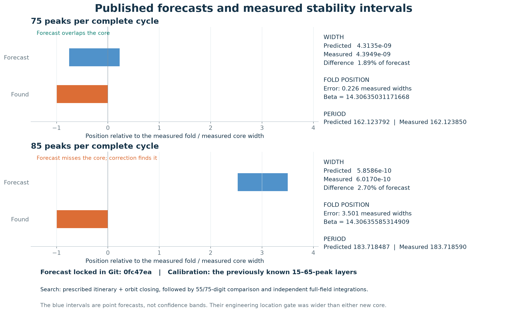
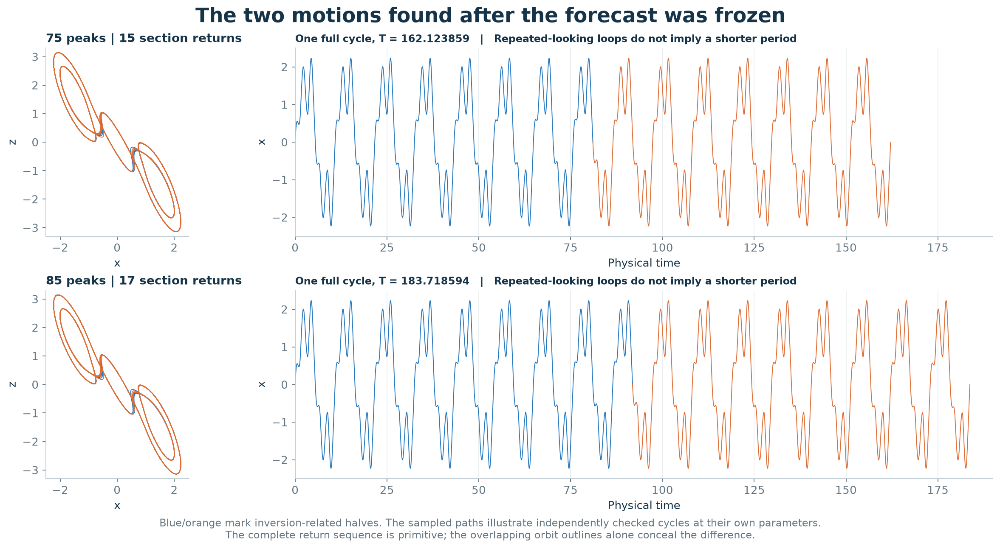
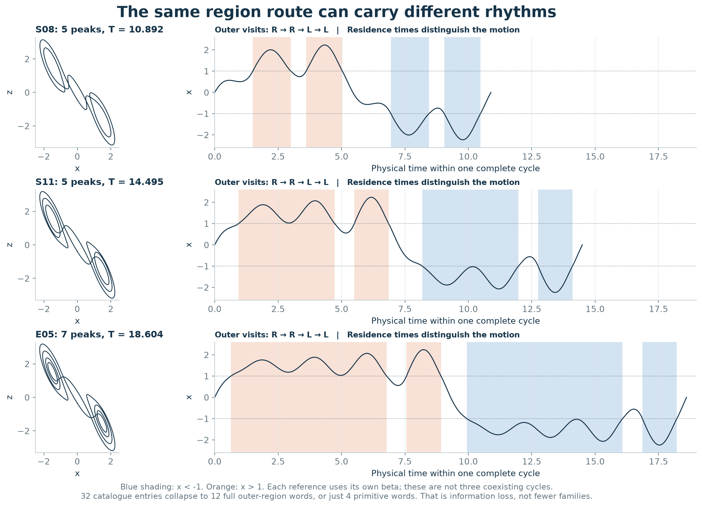
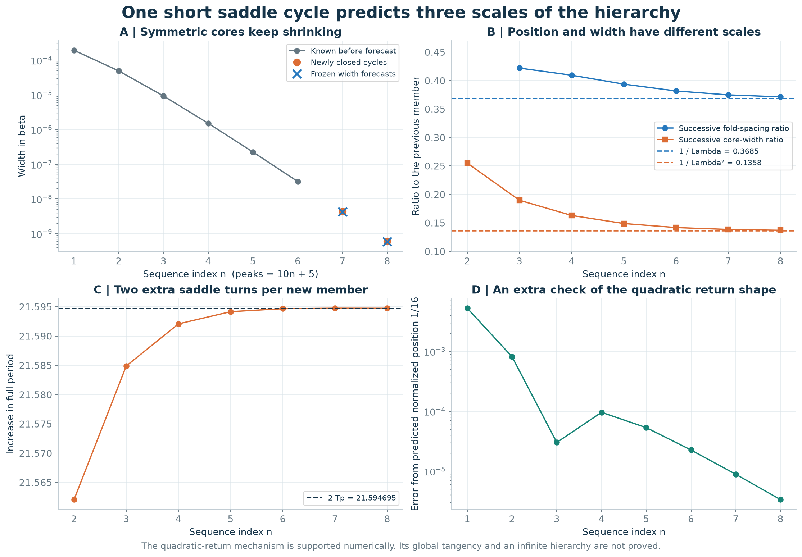
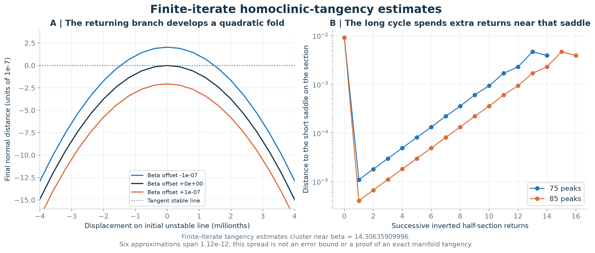

# Periodic-orbit predictions from a homoclinic return model

## Abstract

We use a short unstable periodic orbit to model the spacing, width and period of a measured sequence of Chua stability windows. Parameters fitted to the 15–65-peak members yield forecasts for 75- and 85-peak cycles. These forecasts were published before a targeted orbit search. Both cycles were subsequently computed and checked independently. Their symmetric-cycle stability widths differ from the forecasts by 1.89% and 2.70%; the 75-peak forecast overlaps the measured stability interval, whereas the 85-peak location forecast misses its stability interval and requires correction.

This report describes the numerical prediction stage. The [interval certificate](chua-infinity-certificate.md) subsequently verified the organizing tangency and the hypotheses of the sink-cascade theorem. The numerical forecasts and outcomes remain unchanged. The two computed cycles increase the operational reference catalogue from 32 to 34 entries; their three-dimensional sheets have not been meshed.



Figure 1. Predicted and measured stability intervals of symmetric cycles, expressed relative to the measured fold and normalized by the measured stability width. The location discrepancy for the 85-peak cycle exceeds its measured stability width.

## Forecasts and search results

The theory, target itineraries, numerical forecasts, input hashes and acceptance criteria were published in [commit 0fc47ea](https://github.com/Griboedow/chua-gpu-atlas/commit/0fc47ea) before either new cycle was solved. The numerical values in the [frozen predictions](../results/chua-layer-prediction/predictions-frozen.json) are unchanged. Only the existing 15–65-peak members were used: the last four folds fix four location coefficients, while the short saddle supplies the expansion factor and period. This is an asymptotic calibration, not a parameter-free prediction. An earlier backtest on the already known 65-peak member is explicitly retrospective.

| Quantity | 75 peaks: frozen prediction | 75 peaks: measured | 85 peaks: frozen prediction | 85 peaks: measured |
|---|---:|---:|---:|---:|
| Fold beta, corrected model | 14.306350312712022 | 14.306350311716685 | 14.306355855255894 | 14.306355853149092 |
| Fold beta, leading-order alternative | 14.306350061117207 | — | 14.306355468048233 | — |
| Fold-to-symmetry-breaking width | 4.3135043e-9 | 4.3949166e-9 | 5.8585831e-10 | 6.0170236e-10 |
| Full period at the fold | 162.123792 | 162.123850 | 183.718487 | 183.718590 |
| Upward section returns per full cycle | 15 | 15 | 17 | 17 |
| Inversion symmetry | Yes | Yes | Yes | Yes |
| Fold error / measured width | — | +0.2265 | — | +3.5014 |
| Predicted midpoint inside the measured stability interval | — | Yes | — | **No** |

Widths here cover the symmetric branch from its fold to symmetry breaking, not its entire descendant window. The blue intervals in the figure are point forecasts for those stability intervals, not confidence bands. Both new roots meet the predeclared numerical acceptance criteria (absolute location error below 2e-8, width discrepancy below 20%, period error below 0.002), but the location tolerance is wider than either stability interval. Meeting the location tolerance does not imply that the forecast lies inside the stable interval. The 75-peak forecast overlaps 75.5% of the measured stability interval; the 85-peak forecast has no overlap. For the latter cycle, the predicted motion and approximate width are recovered, but the predicted location requires correction.

The search inserted a predicted short-saddle return into each half of a known cycle and solved the resulting flight equations, starting at the frozen predicted beta. This was a targeted orbit search, not a fresh uniform parameter sweep. [Raw search records](../results/chua-layer-prediction/search-results.json) retain the unsuccessful double-precision trials, the corrected roots and all Newton residuals. [Analysis](../results/chua-layer-prediction/analysis.json) scores the forecasts without refitting them.



These portraits use interior attracting representatives, so their periods differ slightly from the fold periods in the table. The outlines almost coincide: the extra recurrence becomes visible in the complete time signal and the section sequence. Independent full-field integrations detect 75/85 maxima and 15/17 distinct upward returns. The minimum separation of distinct section points is about 1.89e-5/7.02e-6, well above the observed orbit-closure errors. This supports primitive periods rather than repeated traversals of shorter cycles.

## Parameter section and research question

We test whether a return-map mechanism predicts the motions, parameter locations and widths of a measured sequence of thin stability windows. The calibration set is the central sequence with 15, 25, 35, 45, 55 and 65 maxima, at alpha = 9, m0 = -8/7 and m1 = -5/7. The scope is this sequence within the atlas; other periodic families may have different organizing mechanisms.

## Orbit identification and symbolic itineraries

Let L, C and R denote the affine regions x < -1, -1 < x < 1 and x > 1. The successive region visits form a useful itinerary, but this partition is not a demonstrated generating partition. In particular, S08 and S11 have the same half-cycle itinerary C R C R C, although their periods are about 10.89 and 14.50. Different return times solve the same region-word closing problem. A word alone neither establishes orbit identity nor guarantees that an attracting solution exists.



In the original 32-entry catalogue there are only **12 full outer-region words**, modulo cyclic shift and global left/right inversion; removing exact repetitions leaves **four primitive words**. This measures information lost by that coarse code, not a reduction to four dynamical families. E05 adds another example with the same half-region route as S08/S11, but seven peaks and period about 18.60. A single outer-region visit can contain several oscillations. [All 32 motion descriptions](../results/chua-layer-prediction/motion-descriptions.json) preserve the route and timings; [a compact table](../results/chua-layer-prediction/motion-descriptions.csv) is also available.

The appropriate description retains:

1. The primitive full orbit and its inversion symmetry, with phase shifts and inversion partners treated explicitly.
2. The region word and residence times, together with a starting section state. The affine equations reconstruct the orbit from these data.
3. The period, ordered section returns and extrema, to distinguish repeated-looking passes.
4. The transverse multipliers and the branch's known continuation history.

Across the adding sequence, the half-cycle outer-region word is `(RRLL)^n RR`, for n = 1,...,6. Inversion supplies the other half. Its full outer-region word is `(RRLL)^(2n+1)`. Thus the coarse word has a shorter symbolic period than the actual orbit: unequal residence times and return coordinates carry the longer recurrence. The forecast for n = 7,8 is 75,85 maxima and 15,17 upward section returns. Counts must be checked independently; a formal word is only a candidate itinerary.

## Local and global return model

The short five-peak symmetric cycle continues as a saddle cycle in this parameter range. Denote its full period by Tp, its unstable transverse multiplier by Lambda > 1 and its stable multiplier by lambda, with abs(lambda) < 1. A long candidate follows the saddle for additional returns before completing a global excursion. Adding one full saddle return to each half of an inversion-symmetric orbit predicts

```math
T_{n+1}-T_n\longrightarrow 2T_p.
```

The proposed organizing event is a nondegenerate quadratic tangency of the relevant invariant manifolds. At the prediction stage, this event was an unverified hypothesis; it was subsequently addressed by the interval certificate linked above. Under that hypothesis, a local expanding passage multiplies displacement by Lambda^n. A quadratic global return therefore has curvature of order Lambda^(2n). After centering and rescaling, its effective one-dimensional fixed-point problem has the form

```math
X_{k+1}=M-X_k^2+\text{small corrections}.
```

For this quadratic map, a fixed point satisfies M = X + X^2 and its multiplier is -2X. The fold occurs at X = -1/2, M = -1/4; the flip at X = 1/2, M = 3/4. The interval in M has width one. For the inverted half return used here, the flip corresponds to symmetry breaking of the flow cycle, rather than a doubling of its full period.

If the unfolding derivative with respect to beta is nonzero and the strongly contracting direction remains negligible in the rescaling, this gives two different scales:

```math
\beta_n-\beta_\infty\sim A\Lambda^{-n},\qquad W_n\sim B\Lambda^{-2n}.
```

Here Wn is the symmetric-cycle stability width from fold to symmetry breaking. The signs and constants of the position law depend on the global return. Neither the full window including descendants nor all families share a universal numerical constant. In particular, width should shrink approximately as the **square** of the factor governing the distance to accumulation.

For an initial finite-order correction to locations, we freeze the ansatz

```math
\beta_n=\beta_\infty+A r^n+(B+Cn)r^{2n},\qquad r=\Lambda^{-1}.
```

The n-dependent term allows the first correction from parameter-dependent local expansion. This is an asymptotic model, not an exact identity. Its constants are calibrated using existing layers, while Lambda comes from the short saddle cycle. Forecasts retain a simpler leading-order alternative so the effect of the correction is visible.

<a id="spacing-width-period-and-normalized-representative-position"></a>

## Spacing, width, period and normalized orbit position

At the frozen fitted accumulation value, the short saddle has full period **Tp = 10.79734742** and unstable full-return multiplier **Lambda = 2.71343124**. Thus the predicted spacing ratio is **0.36853707**, the width ratio is **0.13581957**, and the period increment is **21.59469485**. The last measured ratios are 0.37136152 and 0.13690871; the last period increment is 21.59474041. These comparisons test three consequences of the same return model.



There is also a shape prediction from the same quadratic model. Half-return multiplier +0.5 means X = -1/4, hence M = -3/16. Its distance from the fold M = -1/4 is 1/16 of the unit fold-to-flip interval. Accordingly, the normalized coordinate (fold beta minus the normalized reference orbit beta) / width should approach **1/16 = 0.0625**. It is 0.06249116 and 0.06249666 for the two new members. This check is derived from the frozen quadratic model, but was evaluated after discovery and was not a separate preregistered acceptance criterion.

## Finite-iterate approximation of the manifold connection

The preceding predictions were made without solving a manifold connection. After finding the cycles, we additionally propagated short lines tangent to the saddle's unstable direction through a global excursion. We solved for a fold of their final displacement normal to the tangent stable line. Two extra terminal choices and three initial local-iteration choices give six finite-iterate approximations.



The estimates cluster near **beta = 14.30635909996**, spanning **1.12e-12**. In the first coordinate convention, three finite-difference steps give curvature near -1.86674e5 and parameter derivative near -2.04763, supporting a quadratic fold with transverse unfolding. Extra terminal iteration reduces the final stable displacement from about 1.77e-11 to about 9e-15. The smallest boundary-crossing speed stays above 1.12 in these computations. [All coordinates, itineraries, derivative checks and curves](../results/chua-layer-prediction/tangency-estimates.json) are retained.

This is a numerical approximation using tangent lines and finitely many iterates, **not a certified exact stable/unstable manifold tangency**. Agreement between its variants is not an error bound. It was evaluated after the orbit search and was not part of the published forecast. Its beta differs from the frozen fitted limit 14.30635910320525 by about 3.24e-9: a tiny absolute bias can already exceed a new stability interval's width. This is consistent with the fine-scale location miss and explains why better width predictions alone do not ensure direct hits on later layers.

## Consequences for the number of resolvable windows

The [interval certificate](chua-infinity-certificate.md) verifies the organizing connection and the hypotheses of the sink-cascade theorem. The following calculation derives the consequences of the prediction model under its own asymptotic assumptions. Exact peak labels and quantitative widths for every uncomputed member remain outside the certificate.

An infinite sequence is a theorem-level conclusion only if the required global connection, quadratic nondegeneracy, dissipativity, admissible itineraries and transverse parameter unfolding are established. A finite fit, however accurate, does not verify those hypotheses for all n. Counting unstable periodic orbits also does not count attracting windows.

Conditional on Wn approximately B Lambda^(-2n), the number of stability intervals wider than a resolution epsilon grows only logarithmically with 1/epsilon:

```math
n_{\max}\approx\frac{\log(B/\epsilon)}{2\log\Lambda}.
```

An additive index convention and finite-order corrections remain. This is a count of resolvable members of this sequence, not the total atlas count and not the number of attractors coexisting at a single parameter tuple. A finite experimental resolution can therefore see only a modest number even if the mathematical hierarchy is infinite.

For the measured saddle expansion, one extra decimal digit of beta resolution would reveal only about **1.15 additional members** asymptotically. This estimate is conditional on the width law and says nothing about the basins captured by a chosen initial condition. The 85-peak stability interval is about **6.65 million times narrower** than the old atlas's 0.004 beta spacing. Continuation resolves this scale without requiring a uniform grid at the same spacing.

The [extended registry](../results/chua-layer-prediction/extended-family-registry.json) appends P75 and P85 under the existing normalized-root identity rule: **34 reference families, global total unknown**. These two distinct primitive roots lie in the original box and have different periods from the earlier representatives. Their three-dimensional sheets have not been meshed here. The original 32-entry atlas, gallery and animations remain reproducible snapshots; the portraits above supply the two new examples. The number 34 is neither a proof of 34 globally disconnected components nor a claim of 34 coexisting attractors.

### Conditional existence statement

The following implication states the assumptions needed for a contraction argument. Suppose that, for every sufficiently large n, a physically admissible return itinerary admits smooth state and parameter coordinates in which its two-dimensional return map Fn converges in C1, uniformly on a common domain, to

```math
Q_M(X,Y)=(M-X^2,0).
```

Assume also that the parameter conversion is transverse, with derivative of order Lambda^(2n), and that a fixed point of this return corresponds to a primitive flow orbit of the stated increasing period. These are assumptions, not conclusions of the numerical checks below.

On the square D = [-1/4, 1/4]^2, for abs(M) <= 1/16, Q maps D strictly into its interior: the first coordinate has magnitude at most 1/8 and the second is zero. Its derivative has induced infinity norm at most 1/2. Uniform perturbations of less than 1/16 in value and less than 1/4 in derivative therefore still map D into itself and contract distances by a factor below 3/4. The contraction mapping theorem gives an attracting fixed point for every such M. Since the hypotheses hold for every sufficiently large n, this yields infinitely many primitive attracting windows. Their beta widths have order Lambda^(-2n). If their centers have a nonzero leading A Lambda^(-n) displacement, their separations are larger than their widths for large n, so the windows are disjoint along the transect.

This proves the **conditional implication** without inferring infinity from a finite list. At this stage the global manifold connection remained to be verified. The later [certificate](chua-infinity-certificate.md) supplies a nondegenerate dissipative connection and applies the classical sink-cascade theorem. It does not claim explicit uniform error bounds for the 10n+5 peak labelling or width formula. The 55/75-digit calculations below are ordinary numerical calculations, not interval bounds on those maps.

This mechanism would give infinitely many parameter windows accumulating near a finite beta. It would **not** mean infinitely many stable cycles coexist at the limiting parameter itself.

### Parameter dependence of the accumulation surfaces

Let theta denote the other parameters, for example (alpha, m0). If the same mechanism persists smoothly with theta, the position law becomes a family of sheets:

```math
\beta_n(\theta)=\beta_\infty(\theta)+A(\theta)r(\theta)^n+\cdots.
```

Differentiation predicts that their tangent directions approach the accumulation surface, with corrections containing both r^n and n r^n. This explains why a stack of curved, almost parallel sheets is a plausible geometric consequence of one organizing mechanism. It remains a local statement: unrelated families can have different accumulation surfaces and overlap. The previously measured central fold slopes for the 15–55-peak sequence approach approximately (2.135, -15.50) in the (alpha, m0) directions; these are supporting old data, not a new three-dimensional validation.

## Prediction and validation protocol

1. Calibration used the previously published 15–65-peak sequence. Checks against those existing values were retrospective.
2. A machine-readable file containing forecasts, input hashes, target itineraries and tolerances was committed before the 75- and 85-peak searches.
3. Forecast quantities were peak count, number of section returns, symmetry, fold location, symmetric-cycle stability width and period. Both leading-order and corrected location models were recorded.
4. Candidate itineraries were constructed by inserting the predicted saddle return. The resulting targeted search measured correction distances relative to the window width.
5. Arbitrary-precision solves were compared at two precisions. Separate full-field integrations checked itinerary validity, orbit closure and attraction.
6. Forecast discrepancies and unsuccessful numerical trials were retained. The reported scores use the published forecasts without refitting.

## Numerical evidence and reproducibility

The solver uses the exact affine-flow formula on each region, evaluated with arbitrary-precision matrix exponentials; the computed roots remain numerical approximations. It solves for the starting section state, positive flight durations and beta together. The normalized targets are half-return multipliers +1 at the fold, -1 at symmetry breaking, and +0.5 for an interior attracting representative. The last gives dominant full-return multiplier 0.25. Original implementations using a different matrix-exponential construction and direct integration of the full vector field provide separate controls.

| Control | 75 peaks | 85 peaks |
|---|---:|---:|
| Largest beta change, 55 to 75 decimal working digits | 7.36e-42 | 3.66e-49 |
| Direct DOP853 full-period state closure | 1.54e-8 | 1.92e-8 |
| Direct Radau full-period state closure | 6.67e-10 | 1.14e-8 |
| Separate affine implementation: closure | 3.88e-11 | 4.45e-10 |
| Separate affine implementation: dominant multiplier | 0.249999894 | 0.249996723 |
| Full-field variational control retained for attraction | 0.249994623 | 0.249999771 |

The last row uses a whole-period variational integration for 75 peaks and successive section-to-section variational integrations for 85 peaks. For the latter, the full vector field and its variation are integrated to each next crossing, the neutral flow direction is removed there, and the resulting two-dimensional derivatives are composed. Two step settings give multiplier errors 3.21e-7 and 2.29e-7 from 0.25. Their maximum next-section state errors are below 2.2e-14; **these are local next-section errors, not whole-period closure errors**. Direct whole-period state checks are reported separately above.

The distinction matters because the first 85-peak whole-period multiplier check missed its 2e-5 error gate: its discrepancy was 7.66e-5. Two smaller-step attempts gave 2.22e-5 and 7.45e-5, also failing. All three remain in [the independent-check record](../results/chua-layer-prediction/independent-checks.json). Changing how the neutral direction was removed resolved the numerical conditioning problem; the threshold was not relaxed. The 55/75-digit agreement checks precision sensitivity within one implementation, not independence or a rigorous error bound.

An initial high-precision implementation trial also failed because of negative matrix indexing. That record is preserved and labeled as an implementation failure, not evidence against a physical orbit. After correction, [checks on two known roots and finite-difference Jacobians](../results/chua-layer-prediction/precision-implementation-checks.json) passed before the accepted high-precision search. All independent numerical gates now pass. None is an interval-arithmetic existence proof.

The [evidence directory and reproduction commands](../results/chua-layer-prediction/README.md) include the frozen file, roots, rejected trials, checks, motion descriptions, extended registry and vector PDF versions of all five figures. The [atlas manifest](../results/chua-layer-atlas/manifest.json) hashes this study and its code alongside the earlier evidence.

## Relation to prior work

Symbolic descriptions and one-dimensional approximations to Chua return maps have a substantial history. Chua and Tichonicky's [1989 Berkeley report](https://www2.eecs.berkeley.edu/Pubs/TechRpts/1989/ERL-89-108.pdf) uses kneading information to organize periodic windows and relate map cycles to flow orbits. Its coding is richer than merely labeling our three affine regions. The present coarse words must not be mistaken for a proved symbolic conjugacy.

The local/global return construction near a homoclinic tangency and the creation of periodic sinks are also established theory; see Gonchenko, Shilnikov and Turaev, [Nonlinearity 21 (2008), 923–972](https://doi.org/10.1088/0951-7715/21/5/003). Applying that theory requires checking its hypotheses for the particular return map. The continuous piecewise-linear vector field is not globally smooth, but fixed transverse crossing itineraries define smooth local flight maps; grazing would require a separate treatment.

The calculation tests parameter-specific forecasts for this numerical hierarchy and specifies the orbit information used to distinguish catalogue entries. Symbolic dynamics, period addition and exponential window shrinkage are established concepts in the cited literature.
