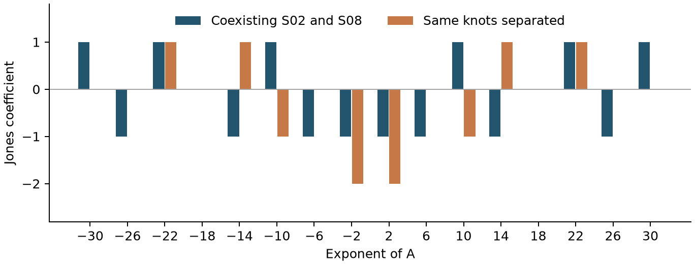

# Two attracting cycles in Chua’s circuit form a non-split link

The S02 and S08 periodic orbits coexist at one parameter point. **No embedded sphere disjoint from both orbits separates them**, even though their linking number is zero. The earlier atlas obtained this result for sampled polygons. An interval calculation now carries it over to the exact trajectories of the piecewise-linear equations. [Original pair and parameter values](chua-link-search.md)

The parameters are $\alpha=8.94$, $\beta=14.26071457889439$, $m_0=-1.1473571428571427$, $m_1=-0.7142857142857143$, and $\gamma=0$, with the written decimals taken exactly. The previously certified periods are approximately 28.230 and 10.846. Each orbit attracts nearby starts. [Shared-coordinate orbit portrait](assets/chua-link-search-overview.png) · [Existence and attraction certificate](../results/chua-link-search/certificate-S02-S08-d140.json)

## The obstruction to separating the curves

For two separated knots the Jones polynomial equals the product of their individual polynomials times $-A^2-A^{-2}$. Its exponent span therefore equals the two individual spans plus four. The exact span is **60** for the joint orbit diagram and would be **44** if the two orbits were separated. Two integer projection directions give the same polynomials. Both mixed crossing sums vanish. The knot determinant of S02 alone is 25, so this attracting orbit is itself knotted. [Exact polynomials](../results/chua-link-certificate/certificate.json) · [Kauffman’s state model](https://doi.org/10.1016/0040-9383%2887%2990009-7)

## From a trajectory to a polygon

We reproduce the certified section boxes and isolate the diode crossing times with Arb. Each straight polygon edge joins rounded positions on a single affine flight. Over a time step $h$, each coordinate of the exact curve differs from its chord by at most $h^2\sup|x_i''|/8$. An interval bound on the acceleration and the rounding errors of both endpoints give a box containing the entire linear deformation from curve to edge.

Every pair of nonadjacent boxes on one orbit is disjoint. Adjacent pieces share a coordinate strictly monotone in the same direction on both the true curve and the polygon, including across the closing vertex. All **5,044,608** pairs of boxes belonging to different orbits are disjoint. Thus each intermediate curve is embedded throughout the simultaneous deformation. The local monotone coordinates make the deformation locally flat, so isotopy extension gives the same ambient link type for the trajectories and the polygons. The crossing predicates and their order then use integer and rational arithmetic on the polygon vertices.

| Independent computations | S02 / S08 edges | Crossings in two projections | Joint / split span |
|---|---:|---:|---:|
| 140-digit geometry | 3,624 / 1,392 | 68 / 52 | 60 / 44 |
| 160-digit geometry, finer mesh | 4,526 / 1,738 | 68 / 52 | 60 / 44 |

At 16 steps per unit time the boxes of two nonadjacent S02 edges overlap. The checker rejects this mesh before computing any polynomial. [Finer mesh](../results/chua-link-certificate/refinement.json) · [Replay instructions](../results/chua-link-certificate/README.md)

Both cycles are hyperbolic sinks of their return maps and cross the diode breakpoints transversely. They therefore continue as attracting cycles for sufficiently small changes in the four parameters on the $\gamma=0$ slice. Their disjoint curves vary by isotopy there, so the non-split link persists in an open neighborhood. Its parameter width remains unmeasured.

Kocarev and colleagues studied knots of periodic trajectories in Chua attractors, and polygonal approximation of smooth knots has an established isotopy theory. The certificate here concerns this specific pair of attracting cycles. The two closely spaced daughter pairs in the earlier study still have numerical link evidence. [Kocarev et al.](https://doi.org/10.1142/S0218127494000435) · [Denne and Sullivan](https://arxiv.org/abs/math/0606008)
