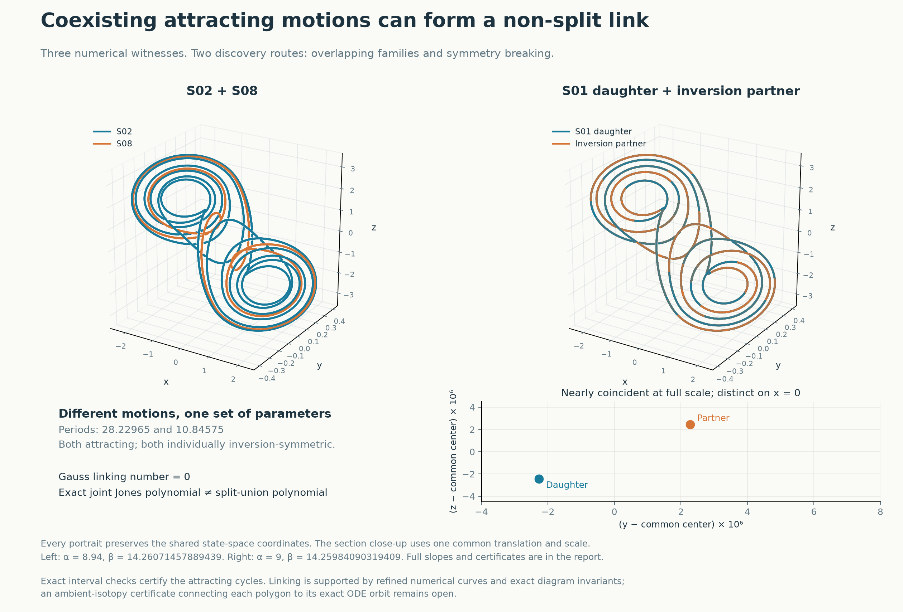
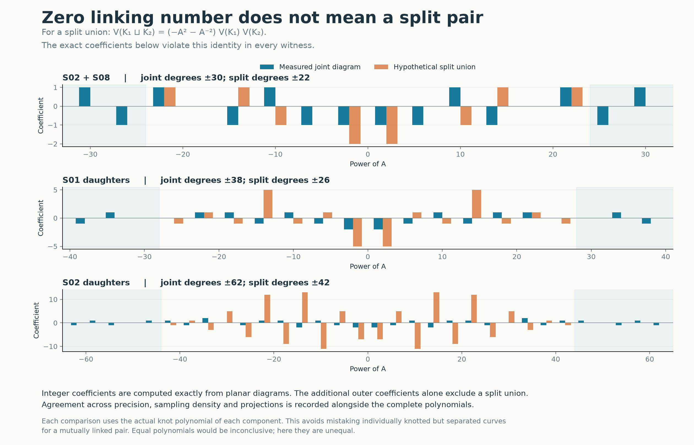

# Linked pairs of coexisting Chua attractors

**Three tested pairs of attracting periodic motions have non-split joint diagrams, although every pair has linking number zero.** Their existence, distinctness and attraction are certified by interval arithmetic. Their link types are numerical results: exact polynomial calculations classify reconstructed polygons, and a certified isotopy from the exact trajectories to those polygons remains to be established.

Imagine making a closed wire along each of two possible long-term motions. Each wire may already be knotted. The new question is whether the two wires can be separated from each other without cutting them. For the three configurations below, the reconstructed wires cannot be separated. These are alternative motions of the same autonomous system at the same parameters, not interacting oscillators.

The search found two routes to such configurations. One combines two different attracting families, S02 and S08, inside an overlap of their stability regions. The other follows asymmetric branches near a symmetry-breaking boundary of a knotted periodic orbit, yielding two nearby attracting cycles. Their joint diagram retains more information than either individual knot.



[Interactive 3D viewer](../results/chua-link-search/linked-pairs.html) · [Data and reproduction](../results/chua-link-search/README.md) · [Independent review record](../results/chua-link-search/review.json)

Download the HTML file and open it locally to rotate the curves and hide components. GitHub displays its source. Components retain their actual shared coordinates; they are not separately shifted to make the link easier to see.

## 1. Question and parameter convention

The [earlier four-cycle experiment](chua-linked-attractors.md) gave unlinks for every tested pair, triple and the full configuration. The present search asks whether other coexisting attracting branches have a non-split union. A two-component link is *split* if an embedded sphere disjoint from the curves separates its two components. Each component may itself be a nontrivial knot.

We use the dimensionless piecewise-linear Chua system

```math
\dot x=\alpha(y-x-h(x)),\qquad
\dot y=x-y+z,\qquad
\dot z=-\beta y,
```

```math
h(x)=m_1x+\frac{m_0-m_1}{2}\bigl(|x+1|-|x-1|\bigr).
```

Here γ = 0 throughout. Each row of the following table specifies one common parameter point for both components. Different rows need not coexist with each other.

| Pair | α | β | m₀ | m₁ |
|---|---:|---:|---:|---:|
| S02 and S08 | 8.94 | 14.26071457889439 | −1.1473571428571427 | −0.7142857142857143 |
| S01 daughter and its inverse | 9 | 14.25984090319409 | −8/7 | −5/7 |
| S02 daughter and its inverse | 9 | 14.290802548649257 | −8/7 | −5/7 |

**The decimal entries are exact chosen decimal parameters**, not abbreviations for nearby fractions. In particular, the S02/S08 slopes must not be silently replaced by −8/7 or −5/7. The certificate constructs rational enclosures from these exact strings. Full roots, flight times and parameter strings are retained in the [data](../results/chua-link-search/README.md).

| Cycle | Full period, approximately | Spectral radius of full return derivative | Upward crossings of x = 0 per primitive period |
|---|---:|---:|---:|
| S02 in the overlap | 28.2296539496 | 0.1712421316 | 3 |
| S08 in the overlap | 10.8457469824 | 0.2505766466 | 1 |
| Each S01 daughter | 23.6763984946 | 0.9429451969 | 1 |
| Each S02 daughter | 28.2507033678 | 0.6089339508 | 3 |

The daughter records use the identifiers `S01-a1e-03` and `S02-a1e-03`. The suffix is a continuation constraint on flight-time asymmetry. It is not a Euclidean distance between the curves or a new global family classification.

## 2. Why zero linking number misses these pairs

The vector field is odd: F(−u) = −F(u). Consequently inversion I(u) = −u sends any periodic orbit to another orbit at the same parameters and with the same stability. It preserves the direction of time along an orbit, but reverses the orientation of three-dimensional space.

For an inversion-related pair C and I(C), the symmetry exchanges the components. Linking number is symmetric in its arguments and changes sign under ambient orientation reversal. Hence

```math
\operatorname{lk}(C,I(C))
=\operatorname{lk}(I(C),C)
=-\operatorname{lk}(C,I(C))=0.
```

The same conclusion applies when inversion preserves each component individually, as for the symmetric S02/S08 pair. A nonzero-linking-number filter would therefore discard precisely these candidates before testing whether they can be separated.

The diagram crossing-sign calculation and an independent solid-angle Gauss integral agree with zero. The selected Alexander-matrix minors also vanish at t = −1 and t = 2 for all three pairs. Those two evaluations are inconclusive; their vanishing is not a proof that the whole Alexander polynomial vanishes or that the link splits.

## 3. A sufficient test for non-splitness

Let J denote the writhe-normalized Kauffman bracket, expressed as a Laurent polynomial in A with t = A⁻⁴ and J(unknot) = 1. For a split union of two component knots,

```math
J_{K_1\sqcup K_2}(A)
=(-A^2-A^{-2})J_{K_1}(A)J_{K_2}(A).
```

We compute the joint polynomial and both individual component polynomials from the same reconstructed configuration. If the joint polynomial differs from this split-union product, the diagram cannot represent a split pair. Equality would leave the question unresolved. Comparing only with the two-component unlink would be wrong when either component is knotted.

For these witnesses, the outermost nonzero terms already establish the difference:

| Pair | Exponent range of joint J | Exponent range if the same components were split | Coefficient at the largest joint exponent |
|---|---:|---:|---:|
| S02 and S08 | −30 to 30 | −22 to 22 | +1 |
| S01 daughters | −38 to 38 | −26 to 26 | −1 |
| S02 daughters | −62 to 62 | −42 to 42 | −1 |

The full integer coefficient lists are stored for [S02/S08](../results/chua-link-search/overlaps/S02-S08/jones-d90-n384-s0.json), [S01 daughters](../results/chua-link-search/daughters/S01-a1e-03-d90-n384-jones-s0.json) and [S02 daughters](../results/chua-link-search/daughters/S02-a1e-03-d90-n384-jones-s0.json). Their distinct joint polynomials also distinguish the three reconstructed link types from one another. They do not identify a unique named link in a table.



The individual component polynomials agree with those of the relevant [knot-atlas representatives](chua-knot-atlas.md): a square knot for S01 and T(2,5) joined to its mirror for S02. The S08 component simplifies to an unknot. Polynomial agreement alone is not a general knot-identification theorem.

## 4. Search ledger and numerical checks

The [protocol](../results/chua-link-search/protocol.md) was frozen in [commit 36ed4c5](https://github.com/Griboedow/chua-gpu-atlas/commit/36ed4c5) before joint classification. It specified inversion pairs, common-parameter overlaps, controls and refinement requirements. The executed search was finite:

| Selection | Cases examined | Outcome |
|---|---:|---|
| Original asymmetric reference and its inverse | 9 pairs | All simplify to split unions; includes individually knotted A04 and A05 |
| Common-node overlap candidates | 137 candidate records, reduced to 5 distinct family combinations | S02/S08 is non-split; S08/S11, A06/S08, S08/S10 and S08/S09 are split |
| Symmetry-breaking continuations from S01 and S02 | Two amplitudes per parent, 0.001 and 0.003 | Both 0.001 pairs are attracting non-split witnesses; S01 at 0.003 is a secondary numerical candidate; S02 at 0.003 is unstable |

The A06/S08 configuration includes the inversion partner of A06, so that test has three components. The catalogue selection uses existing recorded stability bounds; it is not an exhaustive search of all overlaps or all 32 families' parameter domains. Instead of executing the protocol's proposed broad extension of missing stability boundaries, the search pursued the more specific symmetry-breaking construction described below. The protocol remains unchanged so that this adaptation is visible.

All three principal witnesses were reconstructed at 60, 80 and 90 decimal digits, with respectively 96, 192 and 384 samples per affine arc. S02/S08 uses one, two and three projections at those resolutions; each daughter pair uses two at every resolution. An additional 90-digit, 768-sample reconstruction of each daughter pair agrees at projection seed 0. Thus **six joint-polynomial calculations agree for S02/S08 and seven for each daughter pair**, 20 in total. At 384 samples per arc the polygons have 7,680 edges for S02, 3,840 for S08 and 6,912 for each S01 daughter. Both S02 daughters have 7,680 edges; the 768-sample check doubles the daughter counts. Polynomial arithmetic is exact; polygon coordinates and crossing extraction use float64.

The Jones calculation groups partial smoothing states by their connectivity at the unprocessed edge boundary. This gives the same state sum without enumerating every smoothing separately. It agrees with exhaustive enumeration on 14 standard diagrams and their mirrors. For an actual 18-crossing S02/S08 diagram, a separate enumeration of **all 262,144 states** agrees with the grouped calculation. Eight additional controls include split knotted components, unlinks, the Hopf link, Whitehead link and Borromean rings.

The [review program](../research/review_chua_link_search.py) replays the 20 diagram polynomials, recomputes the split products, checks the frozen protocol and compares the refined roots with the interval boxes. Independent DOP853 and Radau integrations check all six oriented trajectories, giving 12 integrations. The largest sampled trajectory discrepancy is 7.95 × 10⁻⁹. At 384 samples per arc the minimum polygon segment distances are approximately 0.01283 for S02/S08, 2.97 × 10⁻⁶ for S01 daughters and 2.03 × 10⁻⁶ for S02 daughters. These distances concern straight polygon segments, not certified separation of the exact curves. The integration comparison also does not bound the error between consecutive polygon vertices.

A separate [algorithm audit](../results/chua-link-search/independent-audit.json) adds 14 exact comparisons involving free components, split knotted components and one-crossing Reidemeister-I diagrams. It independently checks all three pair separations at both interval precisions using outward-rounded serialized balls. These diagnostics support the extraction and certificate implementation but do not by themselves certify the topology of the ODE curves.

## 5. Interval existence and attraction

The [interval verifier](../research/certify_chua_link_witnesses.py) uses the exact affine flow in each linear region, interval event isolation and differentiation of the return map. A Krawczyk inclusion establishes a periodic root within a section box of nominal radius 10⁻⁶⁰. Strict Schur inequalities for the two-dimensional return derivative establish attraction. All six cycles pass at both [140 digits](../results/chua-link-search/certificates-d140.json) and [160 digits](../results/chua-link-search/certificates-d160.json).

For S02 the full-period map contains three upward crossings of x = 0. Treating it as a first-return fixed point would be incorrect. The verifier splits central flights at every candidate zero crossing and validates the resulting signed half-space arcs by interval covers. It retains every upward section image. Each intermediate image is separated from the initial root box, excluding a multiple traversal, and one cycle's root box is separated from every upward image of the other cycle, excluding a phase-shift duplicate.

Two unsuccessful attempts are retained in the [development record](../results/chua-link-search/certificate-development.json): reuse of a verifier that assumed a single upward return, and an enclosure at 90 digits with a wider root box that failed because of interval wrapping. The corrected verifier rejects a deliberately shifted root in both precision runs.

These are computer-assisted interval results, not Lean-checked proofs. The trusted computation includes the interval library, event logic and return-map implementation. The certificates cover existence, distinctness, attraction and primitive periods. They do not cover ambient isotopy to the polygons, complete link classification or a bifurcation theorem for the daughter branches.

## 6. A geometric explanation to test

At the recorded symmetry boundary, we lift the symmetric half-period solution to a full-period problem and perturb along the nearly singular asymmetric direction. A constraint on the difference between the two halves' flight times prevents the solver from returning to the symmetric parent. After choosing a daughter, β is fixed and the periodic root is refined independently.

For S01 and S02, this produces nearby attracting inversion partners just below the respective recorded symmetry boundaries. The β offsets of the 0.001 probes are approximately −1.72 × 10⁻⁶ and −1.94 × 10⁻⁶. The equal periods and multipliers of the partners follow from inversion; their distinctness is checked separately.

A conditional explanation is available. Suppose both daughters are disjoint, one-sheeted normal graphs over a nontrivial parent knot. Connecting their points within each normal disk then gives an embedded annulus. Its boundary consists of two parallel copies of a knotted core, so the pair cannot be split. Inversion can force their linking number to zero without removing this obstruction. The annulus and framing terminology is standard; see the introduction of [Diao and Morton](https://arxiv.org/html/2302.05579v1). Reversing one component's orientation turns a parallel pair into their reverse-parallel convention without changing whether it is split.

In plain terms: splitting one knotted motion into two nearby alternatives can leave two closed strands following the same knotted route. Counting signed winding between them can give zero while the shared knotted route prevents separation. This construction would explain why the successful daughter search differs from the nine split reference pairs.

We have not certified the normal graph, the embedded annulus or its continuation to either witness. This is a proposed mechanism, supported by the branch construction and the independent diagram calculation. A next proof would enclose a common tubular neighbourhood and control the two normal sections. For S02/S08, which are different families, the daughter-annulus explanation is not asserted.

## 7. Relation to the atlas and remaining questions

The atlas records stability regions of periodic-orbit families. The joint link adds information at their overlaps: the individual knot type and stability of each motion do not determine how the two closed trajectories sit together in state space. The split A04/inverse control and the non-split S02/S08 witness make this distinction concrete.

The present result supplies three explicit parameter-specific witnesses and reproducible diagram obstructions. It does not establish that every symmetry-breaking branch is linked, that all attracting links have been found, or that a Borromean or Brunnian triple occurs. Nor does it establish historical priority. Knotted Chua orbits and knot/link structures in double-scroll templates are established subjects; a template result and a certified attracting pair at specified parameters answer different questions.

The most direct next step is a certified isotopy from one pair of exact trajectories to its polygonal approximation. A second is to verify or refute the normal-annulus mechanism along the daughter continuation. Both would strengthen a specific statement already supported by the retained data.

## Sources

- L. Kocarev, Z. Tasev, D. Dimovski and L. O. Chua, “Knotted periodic orbits in Chua's circuit,” *International Journal of Bifurcation and Chaos* **4**(3), 609–621 (1994). [DOI](https://doi.org/10.1142/S0218127494000435).
- C. Letellier and R. Gilmore, “The universal template is a subtemplate of the double-scroll template,” *Journal of Physics A* **46**, 065102 (2013). [Author-hosted paper](https://www.physics.drexel.edu/~bob/Papers/universal_template.pdf), [DOI](https://doi.org/10.1088/1751-8113/46/6/065102).
- Y. Diao and H. Morton, “The braid indices of the reverse parallel links of alternating knots,” *Algebraic & Geometric Topology* **24** (2024), 2957–2970. [Preprint](https://arxiv.org/abs/2302.05579), [DOI](https://doi.org/10.2140/agt.2024.24.2957). Used here for the annulus and framing convention, not to identify the Chua pairs.
- [Spherogram documentation](https://snappy.computop.org/spherogram.html): diagram conventions, simplification and component bookkeeping. The retained calculations use version 2.4.1.
