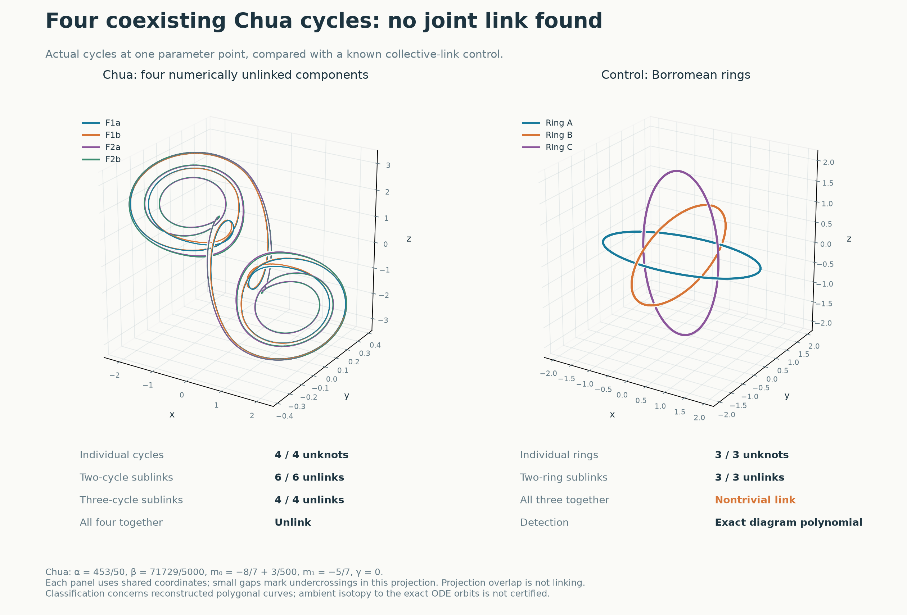
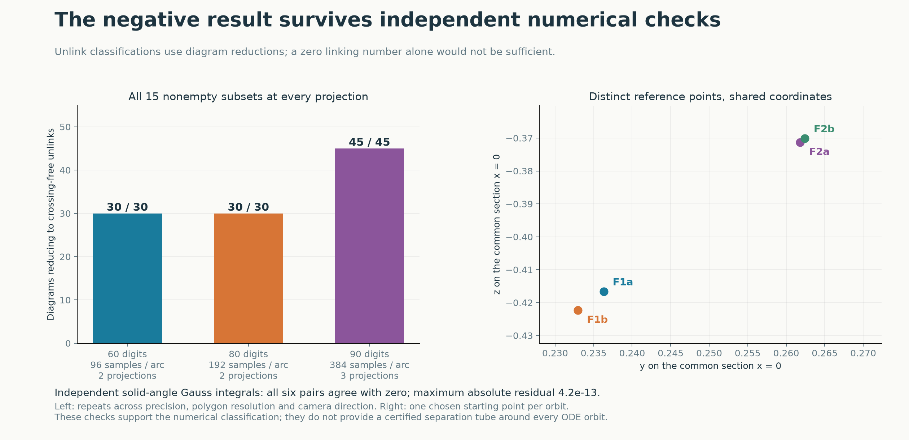

# Are coexisting Chua attractors linked?

**The four tested attracting cycles are numerically unlinked, jointly as well as pairwise.** We searched for a more restrictive possibility: three cycles that are unlinked in every pair but linked as a triple, as in the Borromean rings. None of the four triples has this property. The full four-component configuration also reduces to an unlink.

The subsequent [linked-pair search](chua-link-search.md) finds three non-split numerical pairs at other parameter points, with interval-certified attracting cycles. Those two-component witnesses do not change the negative result here and do not establish a Borromean triple.

In physical terms, imagine making a closed wire along each periodic trajectory. The question is whether the wires can be separated without cutting or passing through one another. This concerns their spatial arrangement; it does not ask whether one attractor can transfer energy to another. The cycles are alternative motions of one autonomous system.



The left configuration uses four trajectories at **one parameter point**. The Borromean rings on the right are an analytic control, not Chua trajectories. The control has zero pairwise linking numbers and unlinked pairs, but its triple is nontrivial. The computation therefore tests more than whether pairwise linking numbers vanish.

[Interactive 3D comparison](../results/chua-linked-attractors/linked-attractors.html) · [Data and reproduction](../results/chua-linked-attractors/README.md) · [Review record](../results/chua-linked-attractors/review.json)

Download the HTML file and open it locally to rotate the curves, hide components and compare the four Chua triples with the control. GitHub displays HTML source rather than running this viewer.

## 1. A joint question at fixed parameters

The earlier [knot atlas](chua-knot-atlas.md) classified individual attracting representatives, generally at different values of β. Combining those portraits cannot establish a link between coexisting attractors. Here every component solves the same Chua equations at the exact parameters

```math
\alpha=\frac{453}{50},\qquad
\beta=\frac{71729}{5000},\qquad
m_0=-\frac87+\frac3{500},\qquad
m_1=-\frac57,\qquad \gamma=0.
```

These are the parameters of the [four-cycle interval certificate](../results/chua-accessibility/four-cycle-certificate-100.json). F1a/F1b and F2a/F2b are two inversion-related pairs. Each cycle has five local maxima of x per full period. Their equal peak counts do not make them the same orbit.

| Cycles | Full period, approximately | Dominant return multiplier magnitude |
|---|---:|---:|
| F1a, F1b | 10.8527918552 | 0.0712973661 |
| F2a, F2b | 14.4992511181 | 0.0125287539 |

We refine the shooting roots while fixing all parameters. Fixing a multiplier instead would generally move β and invalidate the coexistence test. Every projection applies a common affine coordinate transformation to the complete configuration; each component is never separately recentered or rescaled.

The [protocol](../results/chua-linked-attractors/protocol.md) was published in [commit 39a84c8](https://github.com/Griboedow/chua-gpu-atlas/commit/39a84c8) before classifying these joint configurations. It specified all six pairs, four triples and the full configuration, together with controls and evidence limits.

## 2. Complete finite outcome

| Components retained | Configurations | Outcome for every configuration |
|---|---:|---|
| One | 4 | Unknot |
| Two | 6 | Two-component unlink |
| Three | 4 | Three-component unlink |
| Four | 1 | Four-component unlink |

Each outcome agrees across all seven resolution/projection combinations: two at 60 digits, two at 80 digits and three at 90 digits. This gives **105 Chua diagram calculations**. The polygons have 960, 1,920 and 3,840 vertices per cycle, respectively. The shooting and affine flow use arbitrary precision; the final polygon coordinates and geometric crossing tests use float64.



All four triples are included explicitly:

| Triple | 960 vertices, two projections | 1,920 vertices, two projections | 3,840 vertices, three projections |
|---|---|---|---|
| F1a, F1b, F2a | Unlink | Unlink | Unlink |
| F1a, F1b, F2b | Unlink | Unlink | Unlink |
| F1a, F2a, F2b | Unlink | Unlink | Unlink |
| F1b, F2a, F2b | Unlink | Unlink | Unlink |

The criterion is reduction of the extracted link diagram to **zero crossings with the correct number of components**. Zero pairwise Gauss linking numbers alone would not suffice. Nor would failure to simplify establish a nontrivial link: such a case would remain unresolved.

## 3. Controls and geometric sensitivity

The control suite contains separated circles, a Hopf link and Borromean rings, including every nonempty sublink in two projections: **34 cases**. Reflection and reversal of one Hopf component change the sign of its linking number as expected. A separate solid-angle Gauss integral agrees with the crossing-sign calculation. The same integral gives zero, to numerical accuracy, for all six Chua pairs at each resolution.

The Borromean control uses perpendicular ellipses:

```math
C_1(t)=(2\cos t,\sin t,0),\quad
C_2(t)=(0,2\cos t,\sin t),\quad
C_3(t)=(\sin t,0,2\cos t).
```

Every proper sublink simplifies to an unlink. The triple remains nontrivial: its exact writhe-normalized Kauffman state sum, written in A with t = A⁻⁴, is

```math
-A^{-12}+3A^{-8}-2A^{-4}+4-2A^4+3A^8-A^{12}.
```

This differs from the three-component unlink polynomial, A⁻⁴ + 2 + A⁴, and agrees with the standard Borromean diagram. Polynomial equality alone would not identify an arbitrary unknown link as Borromean. Here the analytic control geometry is specified independently. Orthogonal oval constructions are described by [Gunn and Sullivan](https://archive.bridgesmathart.org/2008/bridges2008-63.pdf).

The simplifier leaves eight crossings in this control, although a standard Borromean diagram has six. We retain that outcome rather than use the residual crossing count as a link identifier. We also retain a corrected zero-range scaling error encountered on a planar control. Both arose during control development, before the Chua classifications; see the [development record](../results/chua-linked-attractors/control-development.json).

**Projection crossings are resolution-sensitive.** In projection 2, the F2a/F2b pair has 138, 98 and 50 raw crossings at the three resolutions. All reduce to the two-component unlink. In projection 0 the same pair has 34 crossings at all three resolutions; the full configuration has 140. A third fine-resolution projection has 324 crossings for the full configuration and again reduces to four unlinked components. These raw counts are not topological invariants or estimates of minimum crossing number.

The changing raw counts motivated the third refinement. They also prevent treating a visually complicated projection as evidence of collective linking. The preserved planar diagrams allow the reductions to be replayed without rerunning the ODE reconstruction.

## 4. What is certified, and what is numerical

The existing interval calculation proves the existence, distinction and attraction of four cycles at the stated rational parameter point. The new 90-digit starting coordinates lie inside those certified root boxes. Independent DOP853 and Radau integrations check all four reconstructed curves, their closure and five-peak counts. The [review program](../research/review_chua_linked_attractors.py) also compares root refinements, shared sampling points, source hashes, diagram reductions and control polynomials.

The largest trajectory discrepancy in the eight independent integrations is 5.38 × 10⁻⁹ in the Euclidean state norm. The smallest computed distance between segments of distinct fine polygons is 3.503 × 10⁻⁴, for F2a/F2b. These measure different errors: agreement at sampled points does not bound the true curve between them. Indeed, the largest midpoint deviation from a 1,920-vertex F2 chord to the corresponding new 3,840-vertex sample is 6.006 × 10⁻⁴. These diagnostics are retained without turning their comparison into an isotopy claim.

The link classification remains a **numerical result about approximating polygons**. It is supported by precision, density and projection repeats. It is not an interval proof that the exact ODE curves are ambient-isotopic to these polygons. Such a proof would need separated orbit tubes, tangent control and bounded crossing predicates. Root accuracy alone does not control the geometric error of chords between samples, as the earlier [sampling counterexample](chua-knot-atlas.md#5-a-sampling-error-that-changes-the-knot) demonstrates.

Integer diagram codes and exact polynomial arithmetic can be replayed. Spherogram's reductions are rerunnable software, not a formally verified sequence of individual moves. The repository's Lean statements do not cover this computation. Four negative triples do not exclude Brunnian configurations elsewhere in the system.

## 5. Consequence for the next search

This particular four-attractor overlap does not provide the sought collective entanglement. Coexistence and close passages in state space can occur without a nontrivial joint link.

There is also a useful restriction on a broader search. If distinct periodic curves continue as a disjoint family of embedded circles, their joint link type remains unchanged along that continuation. Thus many nearby samples of the same continued configuration do not supply independent opportunities for a different link type. A change of stability alone need not change the curve's topology. A more informative search would identify other coexisting branch combinations, especially those involving the individually knotted families, and reconstruct them at common parameters. Their reference portraits at different parameters are insufficient.

Pairwise linking numbers would be a first filter in that search. A surviving triple with unlinked proper sublinks would then require a higher-order invariant or an explicit diagram identification. The distinction between pairwise and triple linking is developed, for example, by [DeTurck and colleagues](https://arxiv.org/abs/0901.1612). The present experiment supplies a tested pipeline and a negative reference configuration; it establishes neither a new nontrivial Chua link nor a global obstruction to one.

## Sources

- C. Gunn and J. M. Sullivan, *The Borromean Rings: A Video about the New IMU Logo*, Bridges 2008, pp. 63–70. [Paper](https://archive.bridgesmathart.org/2008/bridges2008-63.pdf).
- D. DeTurck, H. Gluck, R. Komendarczyk, P. Melvin, C. Shonkwiler and D. S. Vela-Vick, *Triple linking numbers, ambiguous Hopf invariants and integral formulas for three-component links*. [Preprint](https://arxiv.org/abs/0901.1612).
- [Spherogram documentation](https://snappy.computop.org/spherogram.html): planar-diagram conventions, simplification and component bookkeeping. The recorded calculations use version 2.4.1.
