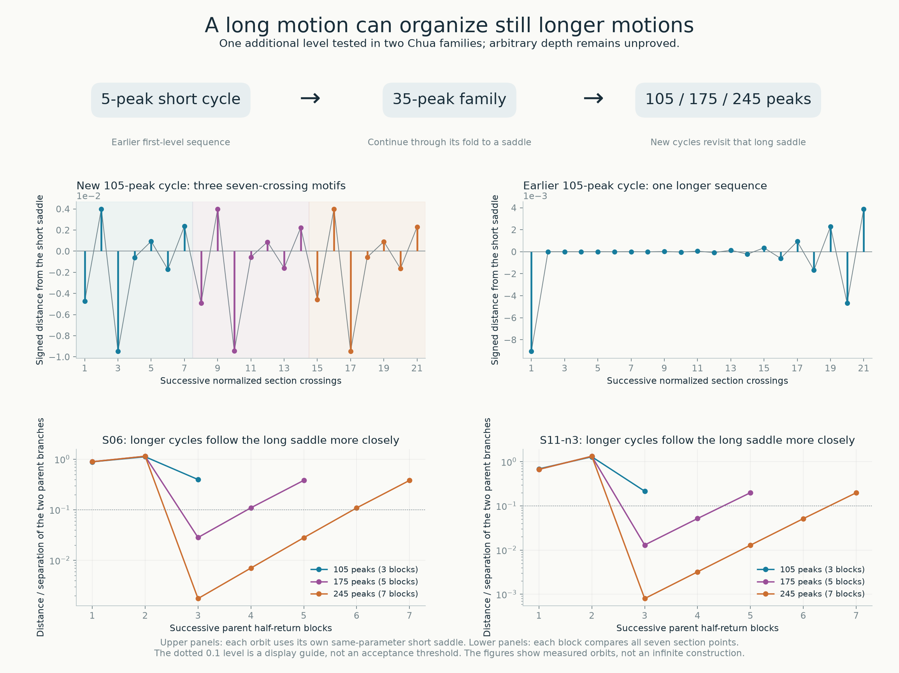
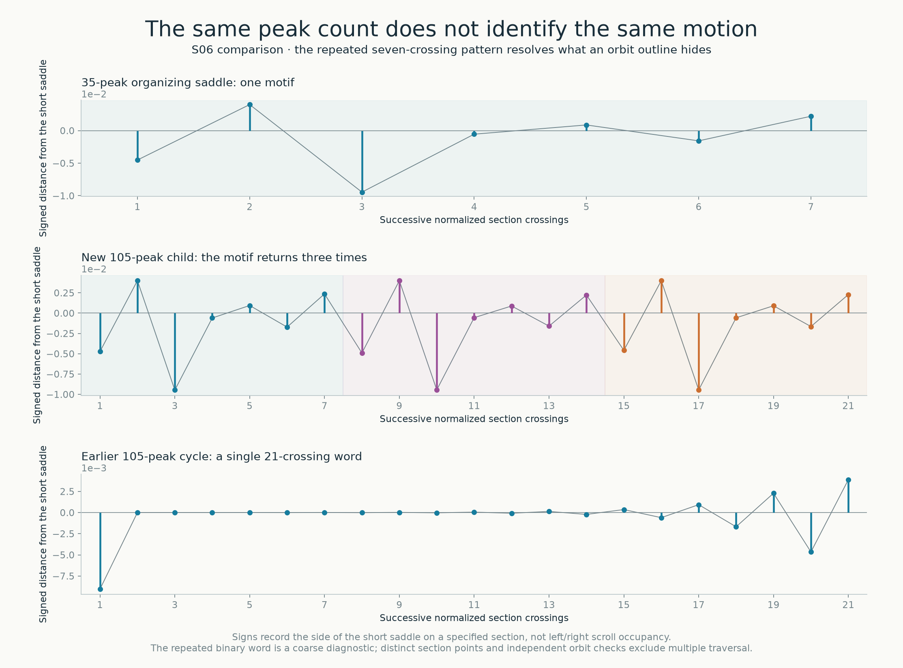
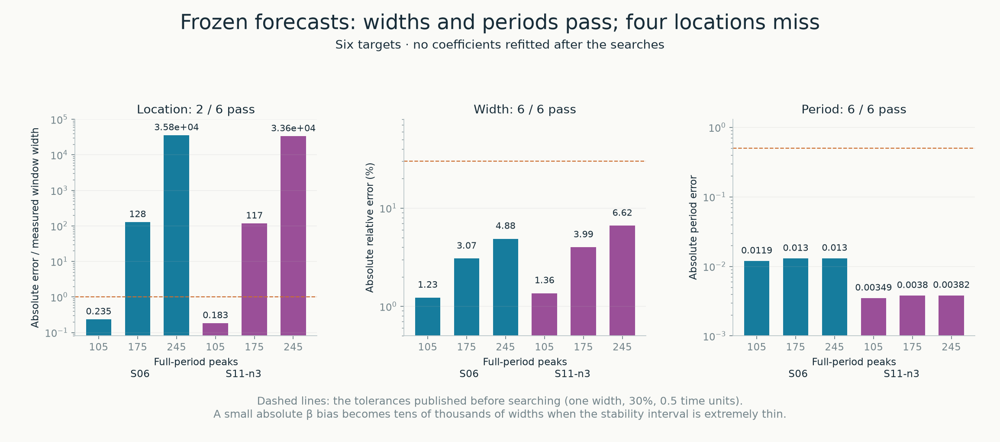
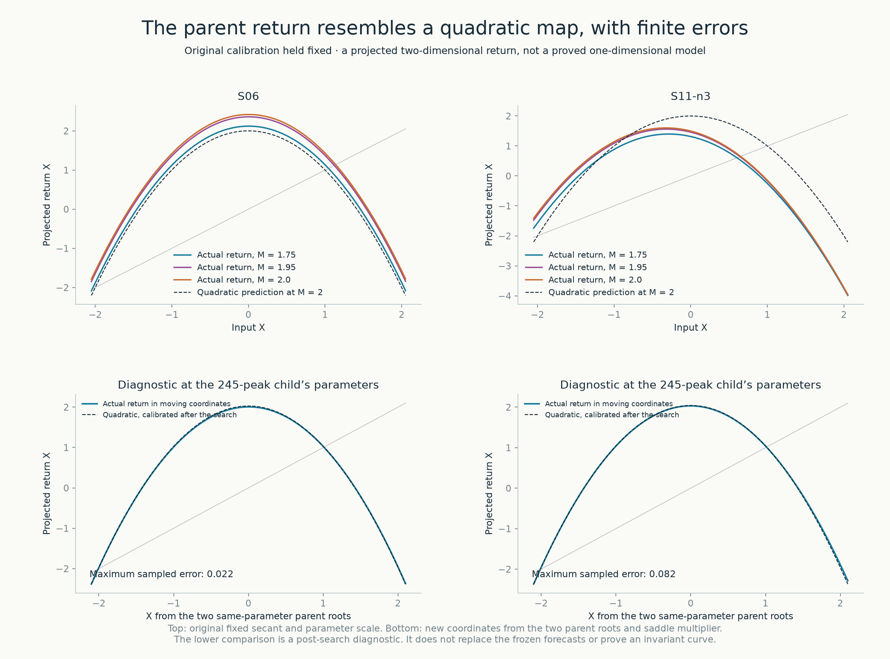

# A long periodic motion can organize a further sequence

**A repeating motion can become the recurring pattern of a more complicated motion.** The earlier atlas sequences repeatedly followed a short, five-peak unstable cycle. Here we take two of their 35-peak families, continue them to saddle cycles, and find new attracting motions with **105, 175 and 245 peaks** near each. The longer motions revisit the whole seven-crossing pattern of the 35-peak parent, with progressively closer passages near it.

This is numerical evidence for **one additional level of return organization in two families**. It does not establish arbitrary recursive depth. “Nested” describes the organization of the return itinerary; the new stability windows need not lie inside the parent's attracting interval. The parent has already become a saddle at the parameters of its children.



The upper plots distinguish two 105-peak motions that an outline or peak count would not distinguish. The lower plots compare complete seven-crossing blocks with a same-parameter 35-peak saddle. A decreasing value means that the entire block follows that saddle more closely. [Vector figure](../results/chua-nested-returns/chua-nested-returns-explanation.pdf).

**Predictions and searches.** All six predicted peak counts were found. All six period and width forecasts pass the tolerances published before searching; only two of six parameter-location forecasts pass. The largest period error is 0.01304, the largest relative width error is 6.62%, and the largest location error is about 35,819 measured window widths. These different outcomes are part of the result.

## 1. What is repeated

The equations and convention are those in the [main description](../README.md#the-system-and-the-question): α = 9, m₀ = −8/7, m₁ = −5/7 and γ = 0. Only β varies. These examples occupy different parameter neighborhoods; they are not six coexisting attractors at one parameter point.

We use the inversion-normalized return to x = 0: follow the trajectory to the next opposite crossing and reverse the state sign. A five-peak short cycle is a fixed point of this elementary map. Each chosen 35-peak parent has seven distinct normalized section points in one symmetric half-period. Let B denote the return following those seven transitions. The parent is a fixed point of B.

The new targets are primitive cycles of B with odd periods k = 3, 5 and 7. Their physical full periods have 35k peaks and their symmetric halves have 7k normalized section points. A “parent block” below means the parent's **half-return followed by inversion**, not an extra complete physical parent period. Increasing k by two adds one full parent circuit to each symmetric half, giving

```math
T_{k+2}-T_k\simeq 2T_B.
```

Here T_B is the full physical period of the same-parameter parent saddle. The calculated children are attracting representatives with dominant signed half-return multiplier +1/2 and full-period transverse spectral radius 1/4. This fixes the representative within a family; it is not a universal multiplier.

| Long-parent family | Earlier short-cycle organizer | New full-period peak counts | Parent period near the 245-peak child |
|---|---|---|---:|
| S06 | S08 | 105, 175, 245 | 75.745139 |
| S11-n3 | S11 | 105, 175, 245 | 101.323319 |

S06 is an existing atlas reference. S11-n3 is the 35-peak cycle found in the [preceding comparison](chua-return-families.md). Their original representatives attract; the long parents used here are **their fold-connected saddle companions**. Numerical continuation follows the signed half multiplier from 0.5 through 1 to 4, connecting the attracting branch to the saddle branch through the saddle-node. We also continue the other 35-peak branch to each child's β and retain both comparisons. A reference label alone does not specify stability.

## 2. Distinguishing a new cycle from repeated traversal



The plotted scalar is the section displacement from the original short saddle, projected onto its left unstable eigenvector. Its sign indicates the side of that saddle in this coordinate, not left/right scroll occupancy. The parent and new child are compared at identical β. The earlier 105-peak control uses its own same-parameter short saddle. [Vector figure](../results/chua-nested-returns/chua-nested-returns-motifs.pdf).

The S06 parent's seven-symbol word is `-+--+-+`; the new children repeat it three, five and seven times. The S11-n3 word is `-+-+-+-`, with the same repetition counts. The earlier ordinary 105-peak S08-sequence cycle instead has a word of minimal length 21, `--+-+-+-+-+-+-+-+-+-+`. It does not pass the seven-symbol repetition diagnostic merely by having 105 peaks.

**A repeated word is not a repeated physical orbit.** Coarse signs discard distances. In each new child the 7k actual section points remain distinct: the smallest pairwise distance among all six examples is 1.16 × 10⁻⁸, whereas independently integrated next-section points agree to at most 1.15 × 10⁻¹⁴. The high-precision orbit reconstruction supplies the separate closure check.

A second negative control deliberately traverses a 35-peak parent three times. We first adjust that parent's half multiplier to the cube root of 1/2. This false candidate then has an apparent 105 peaks, an apparent triple period, closure, and even an apparent half multiplier of 1/2. It is correctly rejected because its section points repeat exactly. Closure, peak count and Floquet normalization alone would not have excluded it. Both controls and their construction are preserved in [negative-controls.json](../results/chua-nested-returns/negative-controls.json).

## 3. Which saddle organizes the extra motion

For each block we compare all seven section points, in order, with the seven points of the long saddle at the child's exact β. The reported distance is their root-mean-square Euclidean separation in (y, z), divided by the root-mean-square separation of the two long-parent branches. The other branch is evaluated in the same normalization.

| Parent | Closest block, k = 3 | Closest block, k = 5 | Closest block, k = 7 |
|---|---:|---:|---:|
| S06 | 0.39610 | 0.028264 | 0.0017566 |
| S11-n3 | 0.21503 | 0.013018 | 0.00079803 |

There are also more consecutive close blocks, not just one close point. At k = 7 the S06 distances after the two excursion blocks are approximately **0.00176, 0.00704, 0.02806, 0.10889, 0.38049**. For S11-n3 they are **0.000798, 0.00321, 0.01290, 0.05138, 0.19795**. The initial growth factors are close to four, consistent with the independently computed long-parent half multipliers 4.01852 and 4.02763. The complete distances to both parent branches are in the [geometry records](../results/chua-nested-returns/geometry-summary.json).

The corresponding period increments use the long parent's time scale:

| Sequence step | Measured period increment | Twice the long-parent period | Difference |
|---|---:|---:|---:|
| S06, 105 → 175 peaks | 151.49082019 | 151.49029670 | 0.00052349 |
| S06, 175 → 245 peaks | 151.49028888 | 151.49027743 | 0.00001145 |
| S11-n3, 105 → 175 peaks | 202.64679653 | 202.64664286 | 0.00015367 |
| S11-n3, 175 → 245 peaks | 202.64664068 | 202.64663728 | 0.00000340 |

The parent period in each row is evaluated at the later child's β. Twice the original short-saddle period is only about 21.593 or 28.935. The repeated internal motif, same-parameter block shadowing, branch connection and period increments jointly support the additional level. None of these observations alone proves a global hierarchy.

## 4. Forecasts fixed before searching

The [protocol](../results/chua-nested-returns/protocol.md) was published in [bd7429b](https://github.com/Griboedow/chua-gpu-atlas/commit/bd7429b). The calibration, six numerical forecasts and search programs were then published in [eaa2eca](https://github.com/Griboedow/chua-gpu-atlas/commit/eaa2eca), before any child search. The [record checker](../research/review_chua_nested_returns.py) compares the frozen files with that commit and checks their source digests.

The forecast uses the quadratic map and a parameter scale determined only from the old parent's fold and symmetry-breaking endpoints:

```math
Q_M(X)=M-X^2,\qquad
M=\frac{\beta_{\mathrm{fold}}-\beta}{W_B}-\frac14.
```

Here W_B is the parent endpoint separation. The map's fixed-point fold and flip occur at M = −1/4 and 3/4. For each odd k we selected the nearest-to-2 quadratic window whose superstable critical orbit has one positive iterate followed by negative iterates before returning to zero. The quadratic window width, multiplied by W_B, predicts the child width. The period forecast is k times the continued long-companion period at the predicted β. No new child enters this calibration.

The initial state scale uses the secant from the old attracting root to its companion: X = −1/4 − s/2. A multiple-shooting solve corrects all k block points and β in the actual two-dimensional Chua return. That correction finds an orbit; it does not retroactively make its location forecast successful.



Widths here are the computed β separations of the child's saddle-node and symmetry-breaking endpoints. They exclude any attracting descendants beyond symmetry breaking. The stated engineering tolerances were one measured width for location, 30% relative width error and 0.5 time units for period; they are not confidence bounds. [Vector figure](../results/chua-nested-returns/chua-nested-returns-predictions.pdf).

| Target | Computed β, rounded | Computed width | Computed period | Location error, in widths | Width error | Period error |
|---|---:|---:|---:|---:|---:|---:|
| S06-k3 | 14.305908020725247018 | 1.69146 × 10⁻⁷ | 227.247860 | 0.235 | −1.23% | +0.011912 |
| S06-k5 | 14.305905883664210902 | 5.20759 × 10⁻¹⁰ | 378.738680 | 128.3 | −3.07% | +0.012964 |
| S06-k7 | 14.305905760039139169 | 1.94465 × 10⁻¹² | 530.228969 | 35,819 | −4.88% | +0.013036 |
| S11-n3-k3 | 14.350752891010100193 | 6.17049 × 10⁻⁸ | 303.973600 | 0.183 | −1.36% | +0.003489 |
| S11-n3-k5 | 14.350752111246943633 | 1.88412 × 10⁻¹⁰ | 506.620396 | 117.5 | −3.99% | +0.003796 |
| S11-n3-k7 | 14.350752066336580559 | 6.97339 × 10⁻¹³ | 709.267037 | 33,574 | −6.62% | +0.003817 |

Width error means computed width / predicted width − 1; period and location errors mean computed minus predicted. Full precision, original predictions and scores are in [forecasts-frozen.json](../results/chua-nested-returns/forecasts-frozen.json) and [scores.json](../results/chua-nested-returns/scores.json). All six direct searches converged. Location misses remain misses even though the starting guesses led to corrected roots. Small absolute β biases dominate extremely thin windows; the quadratic calibration is not yet an accurate locator at their own width scale.

## 5. Testing the actual return, including a limitation



The original attracting-to-companion secant is held fixed in the upper panels. At M = 1.75, 1.95 and 2, each curve samples 83 initial points over −2.05 ≤ X ≤ 2.05, solving every event time anew. The maximum scalar discrepancy from the original quadratic formula reaches **0.436 for S06 and 1.758 for S11-n3**. The output also leaves the original secant, by up to 0.0198 and 0.269 original root separations. Thus the frozen scalar formula is not an accurate description throughout this larger state and parameter range. Twelve matrix-exponential control evaluations agree with the eigen-flow implementation below 5.5 × 10⁻⁵³ in physical section coordinates. [Vector figure](../results/chua-nested-returns/chua-nested-returns-maps.pdf).

The lower panels are explicitly **post-search diagnostics**. At each 245-peak child's β, use the two continued parent fixed points C and A, and the companion's signed half multiplier μ_C, to define

```math
X_C=-\mu_C/2,\qquad X_A=\mu_C/2-1,\qquad
M_*=X_C+X_C^2.
```

Linear interpolation between C and A defines X on their new secant. The resulting projected return differs from M_* − X² by at most 0.0222 and 0.0819 over 85 samples in −2.1 ≤ X ≤ 2.1. This supports the interpretation that the relevant state coordinates move with the parameter. It neither repairs the original forecasts nor establishes a one-dimensional invariant curve or conjugacy. Off-secant components remain in the [moving-coordinate data](../results/chua-nested-returns/moving-coordinate-map.json).

Quadratic return models and repeated periodic windows belong to established bifurcation theory; the particular additional level found here is not presented as a historical priority claim. The contribution is the specified Chua families, prospective forecasts, corrected roots, negative controls and reproducible comparisons.

## 6. Numerical checks and their limits

Each representative and both endpoints were solved at 60 digits and repeated at 85 digits. An independent 90-digit matrix-exponential reconstruction checks the representative's closure, event endpoints, sampled region itinerary, peak count and transverse multiplier. The original search uses eigen-flow event evaluation with local section projections; the reconstruction uses matrix exponentials and sequentially propagated states.

Full-field DOP853 integration independently counts 105, 175 or 245 peaks and 21, 35 or 49 positive section returns. Its variational equation is also integrated between successive section points. Across the six examples:

- Independent high-precision half-closure errors are below 9.8 × 10⁻⁴⁴.
- Independently integrated next-section errors are below 1.15 × 10⁻¹⁴; full-multiplier errors are below 7.9 × 10⁻⁶.
- The six representative and endpoint precision repeats, physical path checks, distinct-point checks and forecast-source checks pass. The complete values and thresholds are in [review.json](../results/chua-nested-returns/review.json) and the individual audit files.

Whole-period integration is a weaker check for these sensitive long orbits: its largest closure drift is **6.27 × 10⁻⁴**, despite correct peak and return counts. The two longest cycles were also integrated at half the maximum step. We retain both drifts and do not substitute the much smaller restarted next-section error for a whole-period closure error. Numerical high-precision reconstruction supplies closure; local full-field integrations supply an independent return-derivative comparison.

These are numerical computations with precision and implementation controls. Sampled itinerary checks are not interval enclosures. No new interval or formal proof is claimed, and the six new representatives have not been meshed across slope parameters or assigned certified knot types. They do not change the count of 34 displayed atlas reference cards.

## 7. What this changes about the atlas

For these examples, a useful description of a layer needs more than its peak count: **which saddle is followed, which return pattern is repeated, and how many blocks occur before closure**. A long periodic family can supply the organizing saddle for a further sequence. This is the tested meaning of recursive organization here.

The [earlier infinity result](chua-infinity-certificate.md) concerns a certified cascade near the S08 organizing tangency. It does not imply infinite recursive depth, infinitely many descendants of either new 35-peak saddle, a unique ancestry for every family, or infinitely many globally disconnected layer surfaces. Establishing a return domain that persists under repeated rescaling, with controlled remainder terms, would be a separate mathematical task.

The next concrete question is whether a validated moving-coordinate return model can predict the new window locations to a fraction of their widths. The present data identify where a fixed calibration fails and provide two families on which to test that correction without changing the original forecast record.

[Data and reproduction](../results/chua-nested-returns/README.md) · [Review guide](chua-review-guide.md) · [Earlier three-sequence comparison](chua-return-families.md)
