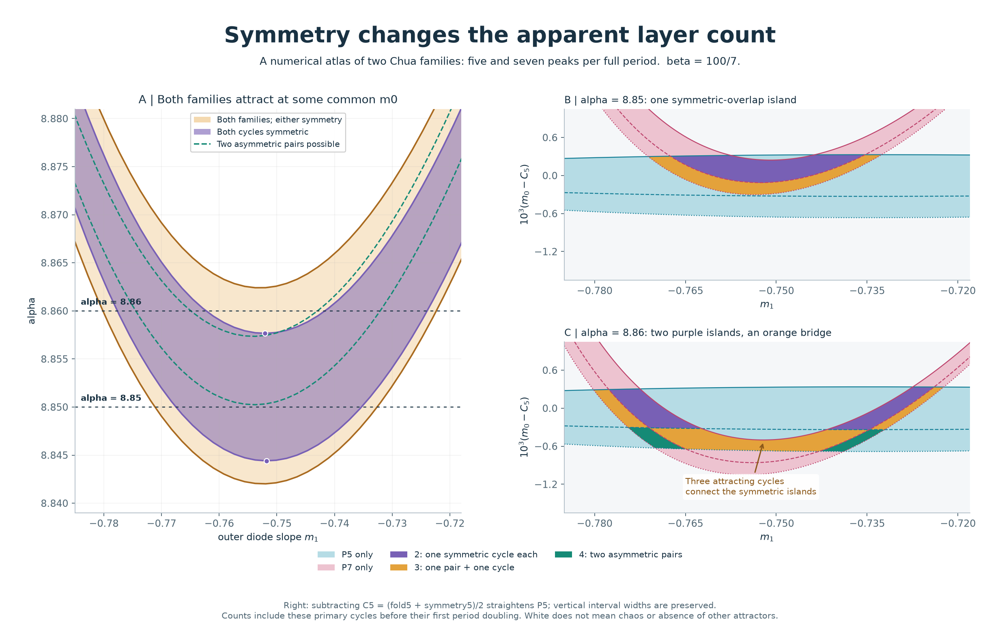
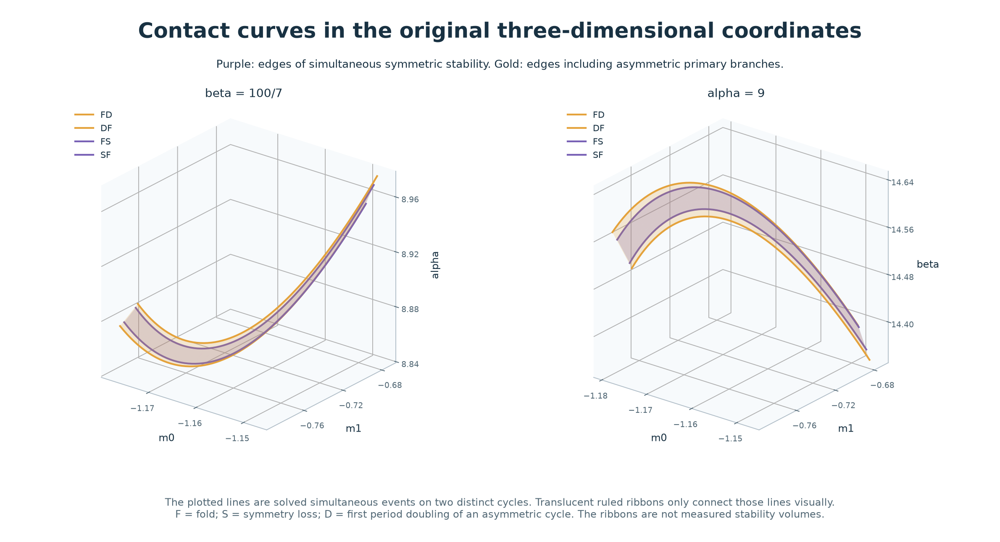
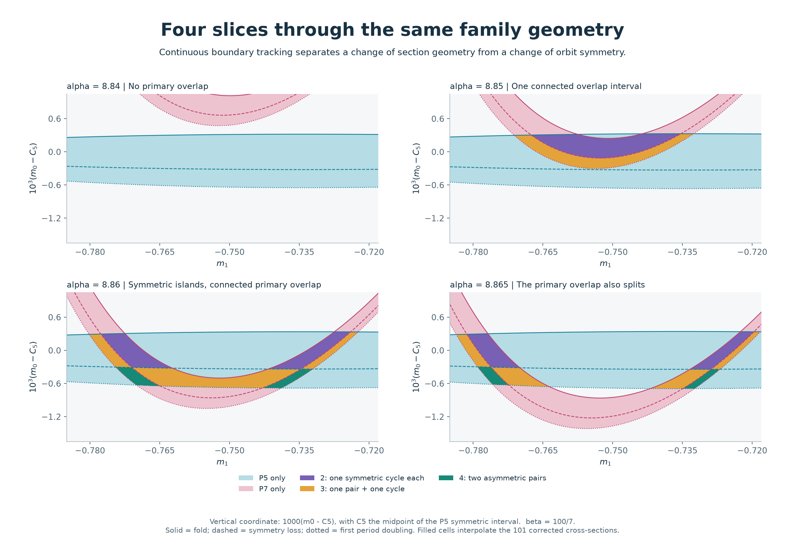
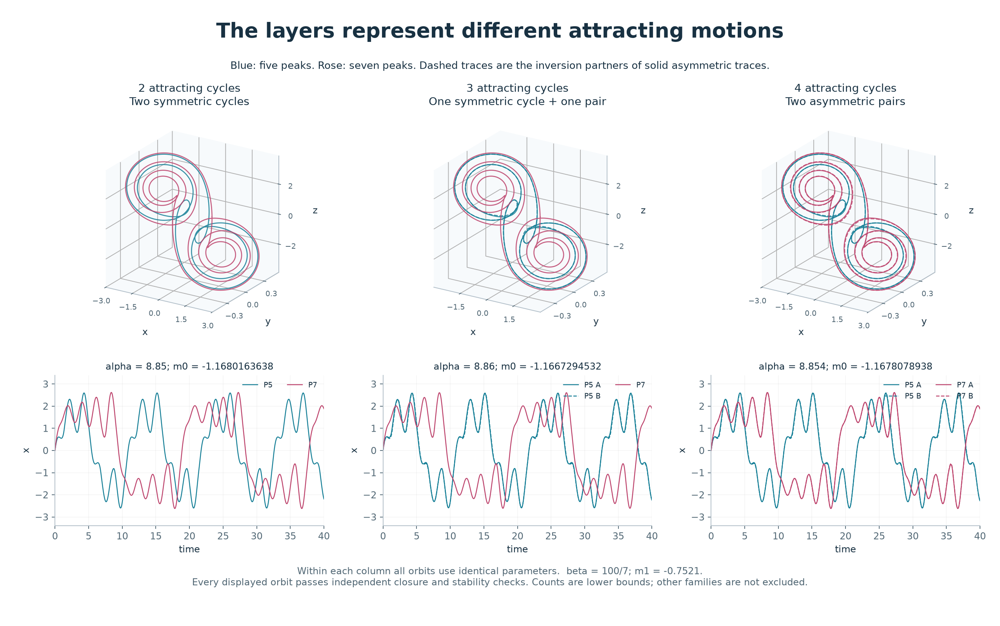
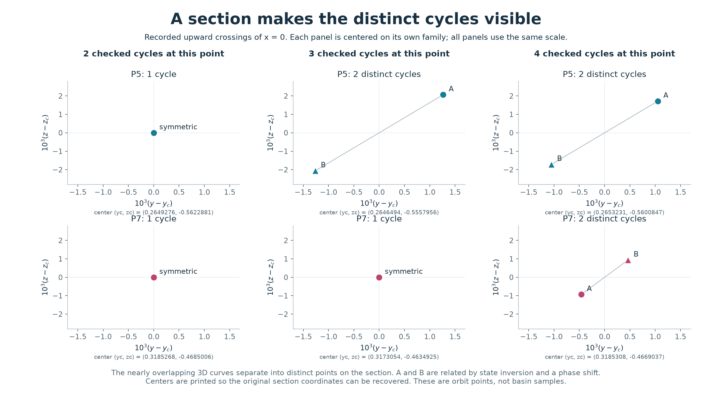
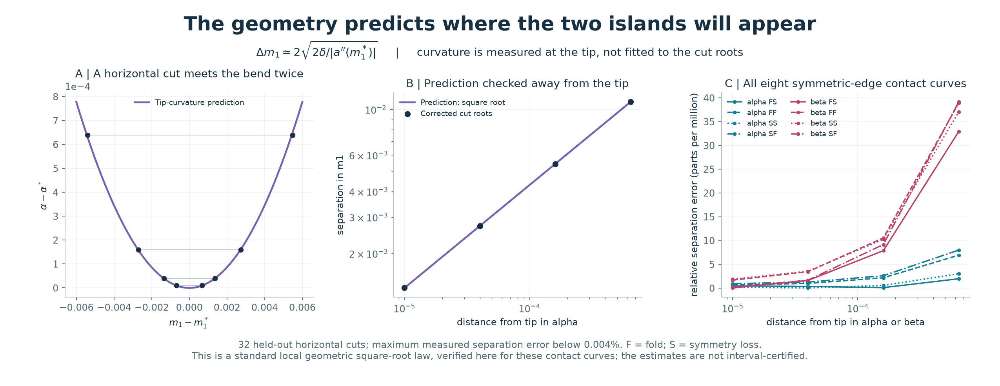

# Symmetry-resolved overlap geometry in Chua's circuit

Computational research note · 30 October 2026

**A gap between two regions of symmetric coexistence can contain three attracting cycles.** In the two families followed here, the symmetric overlap splits into two islands before coexistence of their primary cycles splits. An asymmetric pair replaces one symmetric cycle and supplies a connecting region. This separates a change in the appearance of a parameter slice from the loss of coexistence.



[Offline visual guide](../results/chua-overlap-geometry/guide.html) — download and open locally; it contains all images and four selectable, directly calculated sections. [Data and reproduction](../results/chua-overlap-geometry/README.md) · [Numerical audit](../results/chua-overlap-geometry/audit.json).

## Abstract

We continue the previously identified five- and seven-peak families of the continuous piecewise-linear Chua system, including their symmetry-breaking branches through the first period doubling. Joint closing and marginal-stability equations resolve nine types of simultaneous events on distinct cycles in each of two three-parameter sections. The resulting 18 contact curves contain 1,188 corrected points. Their projection extrema explain the creation and splitting of coexistence intervals in two-dimensional cuts. At fixed beta = 100/7, symmetric coexistence splits near alpha = 8.857664193, whereas coexistence including the asymmetric primary branches splits near alpha = 8.862393535. Independent integrations verify examples with two, three and four attracting cycles. Tip curvature predicts the separation of 32 held-out cut intersections with a maximum measured relative discrepancy of 3.92e-5. The contribution is a reproducible local geometry and symmetry-resolved numerical catalogue, not a new bifurcation type, a new universal scaling law, or an established priority claim.

## 1. Model and meaning of a family

The equations and slope convention are

```math
\dot x=\alpha[y-x-h(x)],\qquad
\dot y=x-y+z,\qquad
\dot z=-\beta y,
```

```math
h(x)=m_1x+\tfrac12(m_0-m_1)(|x+1|-|x-1|).
```

We study `(m0, m1, alpha)` with beta = 100/7, and `(m0, m1, beta)` with alpha = 9. Contact continuation uses m1 in [-0.790, -0.674]. The detailed alpha slices use m1 in [-0.785, -0.718]. This is an autonomous three-state model with no inductor-loss term and no added feedback signal.

P5 and P7 retain the identities of the reference cycles in the [preceding slope-family study](chua-slope-families.md). The labels describe five or seven maxima of x over a full primitive cycle. They are not return-map period numbers, a numbering of every five- or seven-peak orbit, or two additional entries in the older 32-family catalogue.

The vector field is invariant under state inversion. A symmetric orbit satisfies `u(t + T/2) = -u(t)`. After symmetry breaking, an asymmetric orbit and its inverted partner are distinct attractors with the same period. Therefore one continued family can contribute either one or two attracting cycles.

## 2. Three boundaries per family

For each family j, let the following symbols denote m0 values at fixed values of the other parameters:

| Symbol | Boundary | Attracting primary branch on the local stable side |
|---|---|---|
| F_j | Fold of symmetric cycles | One symmetric cycle |
| S_j | Symmetry-breaking branch point | Symmetric cycle changes into an asymmetric pair |
| D_j | First period doubling of an asymmetric cycle | The asymmetric pair reaches its first loss of stability |

The computed ordering is `D_j < S_j < F_j`. For the checked branch segments, the primary-cycle count `nu_j(m0)` is:

| Parameter interval | Count `nu_j` | Attracting primary motion |
|---|---:|---|
| `S_j < m0 < F_j` | 1 | One symmetric cycle |
| `D_j < m0 < S_j` | 2 | Two distinct asymmetric cycles related by inversion |
| Outside these two tracked stable segments, excluding marginal endpoints | 0 | No attracting primary cycle counted on these segments |

The count excludes marginal endpoints, period-doubled descendants, other windows and other families. A zero in this table does **not** assert the absence of attractors. Within the tracked segments, the number of distinct attracting primary cycles is `nu_5 + nu_7`.

The common m0 interval for two symmetric cycles has signed width

```math
W_{\rm sym}=\min(F_5,F_7)-\max(S_5,S_7).
```

Including either symmetry gives

```math
W_{\rm primary}=\min(F_5,F_7)-\max(D_5,D_7).
```

A positive width indicates overlap of these tracked intervals. Four primary cycles are possible when

```math
\min(S_5,S_7)-\max(D_5,D_7)>0.
```

These interval identities are elementary geometry. Their numerical ingredients, validity checks and implications for the selected Chua families are the subject of this note.

## 3. Contact curves, not collisions of orbits

We solve all nine equalities between an edge of P5 and an edge of P7: FF, FS, FD, SF, SS, SD, DF, DS and DD. The first letter always belongs to P5. For example, SF means `S_5 = F_7`: one cycle loses symmetry at the same parameters at which a different family's symmetric cycle is at a fold.

Each equality is solved together with both periodic-orbit closing equations and both marginal-multiplier conditions. The unknowns include both cycles, their common m0, and alpha or beta. Varying m1 traces a curve of simultaneous events. The orbit periods remain separated by more than five time units throughout the stored contact records. Thus these are events on distinct orbits; the trajectories do not merge into each other.



**Figure 2.** Lines are corrected contact curves. The translucent ruled ribbons connect contact loci for visual orientation; their interior is not a computed boundary surface or a measured stability volume. All three axes use the original parameters.

Selected local controls find nonzero differences between the two edge slopes with respect to the free control parameter; the smallest magnitude is about 0.02356. The smallest singular value of the corresponding joint closing-and-marginality Jacobian is about 0.02344. These support transverse, locally well-resolved contacts in the sampled controls. They do not constitute an interval proof over every intervening point.

## 4. Why one interval becomes two

In the alpha section, the contact curves bend back in the `(m1, alpha)` projection. A horizontal cut can miss the overlap strip, cross one connected interval, or cross two separated intervals. Four calculated sections show this progression:



**Figure 3.** Pale blue and pale rose indicate only P5 or only P7 among the tracked primary segments; either can contain an asymmetric pair. Purple means one symmetric cycle from each family. Orange means a pair from one family and a symmetric cycle from the other. Teal means two asymmetric pairs. White makes no classification of other attractors. Boundary values are corrected at 101 m1 values per section; the filled display linearly interpolates those values.

The vertical coordinate subtracts `C5 = (F5 + S5)/2` at each m1 and multiplies by 1,000. This straightens the P5 band so the thin intersections can be seen. It preserves vertical interval widths up to the explicitly stated unit factor. It is not the original m0 axis; the absolute values remain in the data.

The projection tips have the following numerical estimates:

| Transition as alpha increases; beta = 100/7 | Contact | alpha at tip | m1 at tip |
|---|---|---:|---:|
| Primary coexistence interval first appears locally | FD | 8.8420125111 | -0.7523643247 |
| Symmetric coexistence interval first appears locally | FS | 8.8444083210 | -0.7517556091 |
| Symmetric coexistence separates into two intervals | SF | 8.8576641927 | -0.7521004158 |
| Primary coexistence also separates into two intervals | DF | 8.8623935354 | -0.7529164991 |

These are changes of a section through the tracked overlap geometry, not four newly discovered kinds of dynamical bifurcation. The extra digits identify numerical roots; they are not certified error bounds. The differences between the two splitting thresholds are much larger than the measured numerical residuals.

At **alpha = 8.86**, the distinction is explicit. Simultaneous symmetric stability occupies two m1 intervals:

```text
(-0.7776612145, -0.7622692162)
(-0.7416429269, -0.7239305219)
```

Once the asymmetric primary branches are included, the projection admits a common m0 throughout the single interval

```text
(-0.7801697085, -0.7223350824).
```

In particular, the middle is not a loss of the tracked coexistence. A checked point at m1 = -0.7521 contains a P5 asymmetric pair and a P7 symmetric cycle. This is the orange bridge in Figure 1. The statement concerns existence at a suitable m0 for each m1, not one constant m0 across the entire interval.

The beta section exhibits the corresponding inverted bend. As beta decreases at alpha = 9, the primary interval enters near beta = 14.6481061052 and splits near 14.5989681967. The symmetric interval enters near 14.6416053051 and splits near 14.6096888224. These are separate numerical sections, not a claim that the alpha and beta geometries are exactly equivalent.

## 5. What two, three and four attractors look like

All examples below fix beta = 100/7 and m1 = -0.7521. Within each row, every cycle uses identical parameters.

| Checked attracting cycles | alpha | m0 | Composition | Periods, approximately |
|---:|---:|---:|---|---|
| 2 | 8.850 | -1.168016363825815 | Symmetric P5 + symmetric P7 | 10.86665; 18.88848 |
| 3 | 8.860 | -1.166729453183305 | Asymmetric P5 pair + symmetric P7 | 10.85008 for each P5; 18.89632 |
| 4 | 8.854 | -1.167807893755752 | Asymmetric P5 pair + asymmetric P7 pair | 10.84485 for each P5; 18.88328 for each P7 |



**Figure 4.** Blue denotes P5 and rose P7. A solid/dashed pair shows the two inversion-related asymmetric cycles. The three columns use different parameter points; they are not a time sequence or a continuation at fixed m0.

The pair members nearly coincide in the broad orbit view. Their recorded upward crossings of x = 0 make the distinction clearer:



**Figure 5.** All panels use the same offset scale. Each family is centered separately, with its physical center printed below the panel. These are periodic-orbit section points, not basin samples. An asymmetric pair has nonzero half-period inversion error, while inversion followed by an appropriate phase shift maps one partner to the other.

The nine displayed cycles pass independent full-field state-and-variational integration. The largest closure discrepancy is 4.70e-12, and every transverse multiplier magnitude is below one. The three-cycle example has magnitudes approximately 0.49147, 0.49147 and 0.0000650. These establish numerical examples with **at least** the stated number of attracting cycles; they do not exclude additional attractors.

## 6. A quantitative prediction from the bend

Let a contact curve in the projection be `a = a(m1)`, where a is alpha or beta. At a nondegenerate extremum `(m1*, a*)`, its local Taylor expansion is

```math
a(m_1)=a_{\ast}+\tfrac12 a_{\ast}^{\prime\prime}(m_1-m_{1\ast})^2+O((m_1-m_{1\ast})^3).
```

A cut a distance delta from the tip on the intersecting side therefore has leading-order root separation

```math
\Delta m_1\simeq 2\sqrt{\frac{2\delta}{\lvert a_{\ast}^{\prime\prime}\rvert}}.
```

This is the standard square-root geometry of a smooth nondegenerate extremum. We test its quantitative prediction here rather than claim a new scaling law.

The tip is found by solving `da/dm1 = 0` using implicit derivatives of the joint contact system. Curvature is checked at three finite-difference spacings. Using only the tip and its curvature, we predict cuts at distances 1e-5, 4e-5, 1.6e-4 and 6.4e-4 for the FF, FS, SS and SF curves in both parameter sections. The two roots of each horizontal cut are then corrected separately; they are not used to fit the curvature.



**Figure 6.** All 32 cut predictions agree with the corrected root separations to within a measured relative discrepancy of 3.92e-5, or 0.00392%. For the alpha FS tip, alpha* = 8.84440832097 and the estimated curvature is about 43.2118. The reported discrepancies compare numerical calculations, not certified exact values. Differences between the finite-difference curvature estimates also remain in the records.

## 7. Computation and validation

The periodic trajectories are assembled from exact affine-region flights, evaluated with 3-by-3 matrix eigendecompositions. Closing equations include flight times and a section point. Symmetric cycles use a half return followed by inversion; asymmetric cycles use the full return. Because the vector field is continuous at the diode boundaries, the state variational flow has no saltation jump.

For F and S, the dominant signed half-return multiplier is respectively +1 and -1. Both square to +1 on the full-period map. D is solved on an asymmetric full return with multiplier -1. We switch to the asymmetric branch at S, find its first flip edge, and continue interior asymmetric witnesses inward from that edge. Inversion partners are reconstructed with a phase adjustment and separately checked.

Each contact step uses an implicit tangent predictor and a joint Newton correction. Region validity is checked on the affine arcs and at numerically located x extrema. Crossing speeds must exceed 0.02; this study deliberately stays away from the previously observed grazing itinerary change. Numerically bracketed extrema are not interval-certified enumerations.

| Evidence | Result |
|---|---:|
| Contact curves, nine in each parameter section | 18 |
| Corrected contact points | 1,188 |
| Independent contact-cycle checks | 180 |
| Largest independent contact closure discrepancy | 8.18e-13 |
| Largest dominant-multiplier discrepancy | 1.54e-8 |
| Corrected projection extrema | 18 |
| Detailed slice cross-sections | 404 |
| Attracting interior branch checks in those sections | 1,616 |
| Refined interior samples on 36 selected branch segments | 2,340 |
| Additional independent stable-branch midpoint checks | 36 |
| Held-out cut-separation predictions | 32 |
| Separately illustrated attracting-cycle witnesses | 9 |

Independent controls integrate the actual piecewise field and its variational equation with DOP853, relative tolerance 2e-12, absolute tolerance 2e-13 and maximum step 0.02. Five locations on each contact curve are selected for these controls; the remaining contact records have affine closing, multiplier and itinerary checks. Neither this sampling nor the smooth plotted interpolation certifies every parameter between nodes.

As a separate branch check, 36 selected symmetric/asymmetric stable segments are sampled at 65 interior fractions each. All 2,340 samples are attracting, their signed dominant return multipliers vary monotonically along the sampled segment, and each midpoint has an additional independent integration. These controls support the use of the first doubling edge and the stable interval descriptions; they do not rule out every unsampled event by theorem.

## 8. Relation to earlier work and the novelty boundary

The underlying effects have clear predecessors:

| Earlier work | What it already covers | Scope of the present addition |
|---|---|---|
| Rocha and Medrano-T., [four-parameter mapping, 2015](https://doi.org/10.1142/S0218127415300372) | Mapping multiple dynamics across the Chua parameter space | A locally continued, family- and symmetry-resolved overlap geometry with explicit cycle records |
| Nicolau et al., [tracking multistability, 2019](https://link.springer.com/article/10.1140/epjb/e2019-90749-x) | Overlapping periodic structures and multistability, tracked using an added asymmetric feedback signal | Specific unforced P5/P7 branches of the present continuous piecewise-linear model; no added feedback |
| Galias, [continuation-based periodic-window search, 2021](https://doi.org/10.1109/TCSI.2021.3089420) | Finding narrow windows using periodic-orbit continuation in Chua with cubic nonlinearity | Continuation itself is established; our contribution is the particular branch arrangement and its checked data |
| Fu, Paez Chavez and Lu, [grazing-induced dynamics, 2023](https://doi.org/10.1142/S0218127423501857) | Grazing, path following, fold/period-doubling events and coexistence in piecewise-linear Chua | The present contact study remains on validated fixed itineraries and resolves different-orbit event coincidences |

Symmetry breaking and period addition also appear in early Chua studies, including Kennedy's [ABC program and examples, 1994](https://people.eecs.berkeley.edu/~chua/papers/Kennedy94.pdf). Interactive visual catalogues are therefore not new in themselves.

The candidate contribution is specific: **the verified local arrangement of nine types of simultaneous events for these two families; its symmetry-dependent section topology; and quantitative predictions and reproducible witnesses connecting that geometry to two, three and four attracting cycles.** The literature check used available papers and primary-source abstracts. It has not established that the exact branch arrangement is absent from all earlier work. This is a research note and dataset suitable for further comparison and review, not a declaration of a world-first phenomenon.

## 9. Limits and the next scientific test

The counts stop at the first asymmetric period doubling. A gap in primary coexistence at alpha = 8.865 may still contain attracting doubled descendants or another family. The present note therefore does not claim a gap in all multistability, a finite total number of layers, or the global connection structure of the older 32-family catalogue.

The current basin calculations remain too step-sensitive for reliable area estimates or a claim of fractal boundaries. No basin geometry is inferred from the orbit-count figures. A parameter-space overlap does not mean that two invariant trajectories intersect in state space.

The next discriminating extension is to continue the doubled descendants through the primary gap and determine whether the full family overlap remains connected beyond the DF projection tip. Matching these branches against earlier published continuation diagrams, and adding interval bounds for selected simultaneous events, would strengthen both the priority assessment and the mathematical status of the result.

All source records, including the independent checks, curvature-step comparisons and exact cut roots, are retained in [the accompanying dataset](../results/chua-overlap-geometry/README.md). The [atlas manifest](../results/chua-layer-atlas/manifest.json) binds the report, scripts, figures and numerical evidence by SHA-256.
