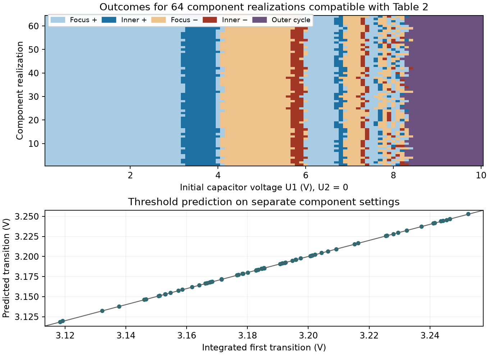

# Preparing hidden oscillations with capacitor voltages in Chua's circuit

At zero coil current, a laboratory operator can select a steady focus or sustained oscillations by charging the capacitors before closing the circuit. We model the experiment of Kuznetsov, Mokaev, Ponomarenko, Seleznev, Stankevich and Chua. At the nominal components, increasing the first capacitor voltage through **about 3.191 V** changes the observed outcome from the positive focus to the positive inner oscillation. With component values compatible with the measurements in their Table 2, the calculated transition ranges from **3.118 to 3.253 V**. A two-voltage preparation centered at **(3.60 V, 0 V)** reached the positive inner regime at all 4,455 sampled combinations of starts and settings in its rectangle. These are predictions for an ideal circuit with saturation. [Published experiment, Figs. 8–10 and Table 2](https://doi.org/10.1007/s11071-022-08078-y)

## Which starts select the same outcome?

Figure 9 of the paper varies the initial voltage on the first capacitor while holding the second capacitor voltage and coil current at zero. Its switch precharges the capacitors and then releases the unforced circuit. Here every integration starts from the prescribed voltages after release. The first screen covered 100 positive voltages on capacitor 1 in steps of 0.10 V, three voltages on capacitor 2 (−0.05, 0, +0.05 V), and 99 settings, for **29,700 launches**. The model reproduces alternating focus and inner-oscillation bands before reaching the large external cycle.

| Intended outcome | Tested initial voltage on capacitor 1 | Tested initial voltage on capacitor 2 | Interpretation |
|---|---:|---:|---|
| Positive focus | 0.30–2.80 V | −0.05 to +0.05 V | Tail converges numerically to the positive equilibrium |
| Positive inner oscillation | 3.50–3.70 V | −0.05 to +0.05 V | Sustained inner motion with positive mean during the observation |
| Negative focus | 4.40–5.30 V | −0.05 to +0.05 V | Tail converges numerically to the negative equilibrium |
| External periodic motion | 9.00–10.00 V | −0.05 to +0.05 V | Repeated returns across both lobes |

All 4,455 starts per rectangle gave the designated outcome on a second 9 by 5 grid at all 99 settings, using a smaller step and a longer observation. The 110 outer-cycle starts initially unresolved by the return-spread test all passed at step 0.005. The rectangle boundaries specify the grid domain. Between-grid voltages and other component combinations remain open. The unknown initial voltages of individual oscilloscope traces prevent a quantitative laboratory threshold comparison. The published interpretation of the two inner motions is hidden chaos. Our label records their observed location and amplitude over finite time. It also admits periodic windows and long transients. [All 29,700 outcomes](../results/chua-precharge/outcomes.csv) · [Rectangle and independent solver checks](../results/chua-precharge/controls.json)

## How far does the first transition move?

We followed the positive-focus to positive-inner transition on the line `U2 = IL = 0` by bisecting the local bracket [2.93, 3.46] V. At step 0.015 the thresholds are 3.19090 V from the components, 3.19068 V from the rounded physical column of Table 2, and 3.19538 V from its mathematical column. The last column uses a different outer slope, −0.1700 in place of about −0.17075, along with small differences in the other parameters. Step refinement to 0.005 and observation to time 900 give **3.19074 V** for the component nominal. The final 4 µV bisection width measures root-search resolution. Across those two integrator settings, the nominal transition differs by about 0.16 mV. Independent DOP853 trajectories at 3.1902 and 3.1912 V reach the expected opposite outcomes.

At the same voltages, changing one component can shift both the normalized dynamics and the relation between volts and model coordinates. The following local derivatives include both effects. They use equal and opposite changes of 0.02% about the nominal components. Shared-component correlations matter when several measurements change together.

| Component varied alone | Change in first threshold per +0.1% at nominal |
|---|---:|
| Coupling resistor R | +30.5 mV |
| Diode resistor R1 | −17.3 mV |
| Gain-setting R3, R4 | +13.3 mV, −13.3 mV |
| Coil inductance L | −6.46 mV |
| Capacitor C1 | +5.15 mV |

The 64 coupled component settings span 3.1183–3.2526 V. A separate 32-point design directly sampling all five parameter ranges in Table 2 spans 3.1368–3.2521 V with the voltage scale held fixed. We calibrated a linear approximation to the dimensionless threshold on these 32 direct parameter settings. For a new parameter vector $p=(\alpha,\beta,\gamma,m_0,m_1)$, the prediction in volts is $B[x_0+c\cdot(p-p_0)]$, using its own measured breakpoint voltage $B$. Using the tabulated coefficients on the 64 component settings gives a root mean square error of **0.243 mV** against the common discretization. Always using the nominal voltage gives **32.78 mV**. The largest absolute prediction error is 0.449 mV. A second integration of all 64 test cases at step 0.005 to time 900 gives **0.219 mV RMS** and **0.358 mV maximum** for the same frozen coefficients. The test thresholds themselves move by up to 0.235 mV under this change. For the minimum threshold, maximum threshold and largest original residual, adaptive DOP853 confirms opposite outcomes at 1 mV below and above the forecast. This retrospective transfer test quantifies numerical error at the sampled settings. [Full threshold records](../results/chua-precharge/sensitivity.json) · [Predictor coefficients, all predictions and independent checks](../results/chua-precharge/transfer.json)

## Component map and the second diode breakpoint

The state obeys equations (6)–(8) of the paper with `x = U1/B`, `y = U2/B`, `z = −R IL/B`, and dimensionless time in units of `R C2`. The passive coil contributes `−γz`. The component-to-parameter conversion follows [the repository's two-op-amp realization](../research/study_chua_circuit_constraints.py). The precharge solver evaluates the physical five-segment, continuous odd diode, including its second breakpoint. For supply magnitude 15 V, `K1 = 1 + R3/R4`, `K2 = 1 + R5/R6`, `B = 15/K1`, the second breakpoint is at `|x| = K1/K2`, and the final slope is `R(1/R1 + 1/R2)`.

Equation (10) of the article prints C1 = 311 nF and C2 = 37 nF. Its following ratios, Table 2, and its conversion of a dimensionless period to milliseconds use **C2 = 311 nF, C1 = 37 nF**. We use that convention, giving $B=1.1605772$ V, $\alpha=8.4054054$, $\beta=12.2301193$, and $\gamma=0.0434573$. All five dimensionless parameters, all eleven measured components in SI units, both diode breakpoints and slopes can be reconstructed from the records. [Component and parameter settings](../results/chua-precharge/settings.csv) · [Source article, §4](https://doi.org/10.1007/s11071-022-08078-y)

The second breakpoint matters after the external cycle is reached. At the nominal components and a 9 V start, DOP853 gives **max |x| ≈ 19.568** with the three-segment diode and **12.644** with five segments, compared with the physical second breakpoint at **12.4145**. The periods are much closer, 1.94131 and 1.94645. At the mathematical column used in the [saddle-residence experiment](chua-saddle-residence.md), the same comparison just above that experiment's saddle threshold gives 19.430 and 12.642. The outer waveform therefore depends on diode saturation even when the near-saddle trajectory remains within the first three segments. [Independent integration data](../results/chua-precharge/controls.json) · [Near-saddle start comparison](../results/chua-precharge/transfer.json)

## Sampling, numerical controls and reproduction

The 99 settings comprise the three nominal conventions, 32 scrambled Sobol points in the independent five-parameter ranges, and 64 coupled component realizations. For the coupled design, resistor coordinates vary within ±1% and capacitor and inductance coordinates within ±0.1%, following the meter precisions reported in §4. We retain the first 64 Sobol points whose derived five parameters all lie in the corresponding Table 2 ranges, after checking 24,194 candidates. The shared R propagates into both diode slopes, β and γ. The independent parameter design fixes the nominal breakpoint scale and saturation geometry. These sampling conventions define bounded deterministic tests. Actual measurement-error distributions, continuous tolerances, supply variation, switch transients, amplifier dynamics and noise require further evidence.

The primary solver uses fixed-step RK4 at step 0.02 to time 600. We classify the final quarter. The focus test uses both the oscillation amplitude and the distance to the analytic equilibrium. Inner oscillations have a tail range above 0.2, mean magnitude above 0.3 and stay within `|x| < 3` during the tail. The external-cycle test requires excursions to both sides of ±3 and a spread below 0.01 in the section coordinates over 24 upward crossings of `x = 0` using cubic interpolation. Broad oscillations failing this recurrence test are recomputed at step 0.005. The rectangle repeat uses step 0.0125 to time 800. DOP853 independently evaluates a diode assembled by its segment slopes and records section events with adaptive integration. [Numerical survey](../results/chua-precharge/survey.json) · [Solver controls](../results/chua-precharge/controls.json)

The [record guide](../results/chua-precharge/README.md) gives field units, CPU dependencies and commands for replay in a separate output directory.
