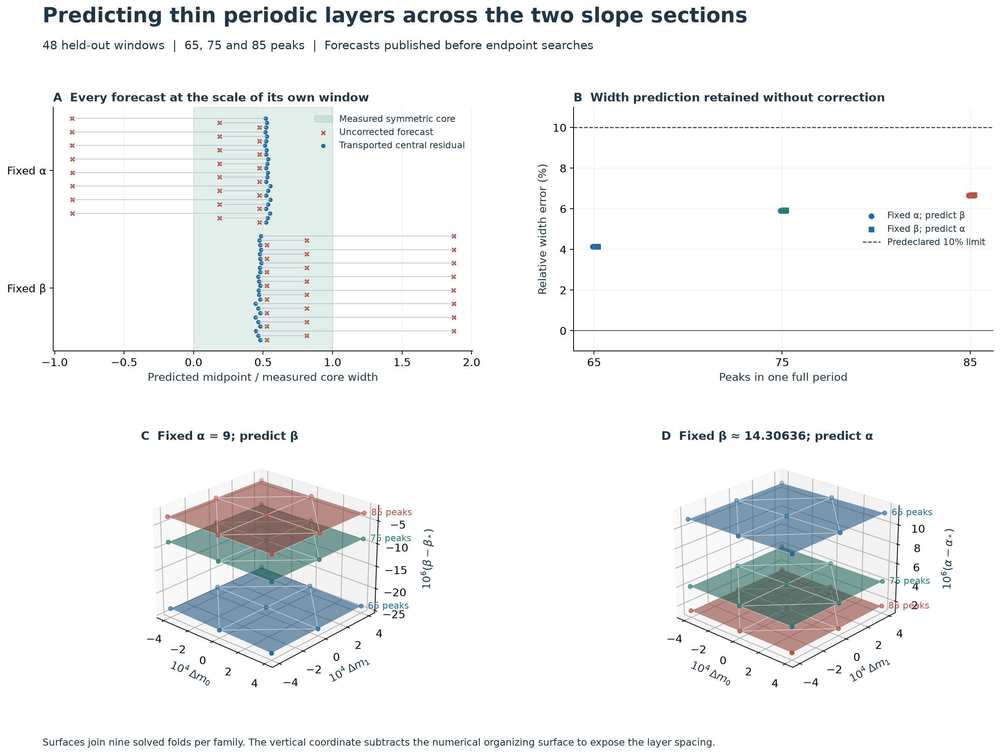
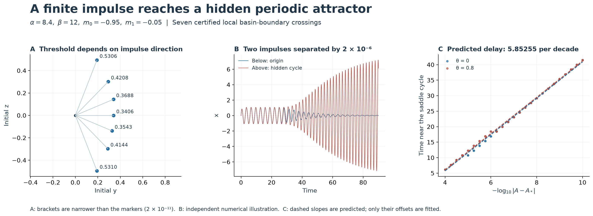
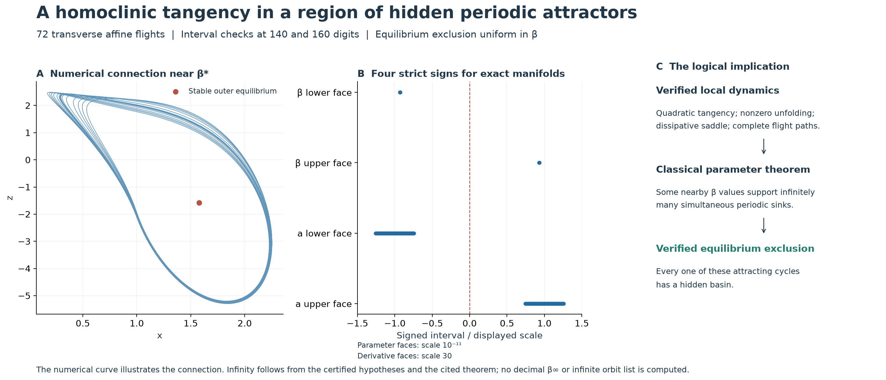

# Predicting thin layers, excitation thresholds and hidden coexistence

## Abstract

We extend the Chua atlas in three directions. First, a prediction model calibrated at the central parameter transect locates all **48 held-out periodic windows** in two slope sections. The uncorrected model locates 32 of them. Second, interval arithmetic encloses seven intersections of impulse rays with a previously certified basin boundary, and the saddle multiplier predicts the observed logarithmic delay near that boundary. Third, an interval certificate establishes a quadratic homoclinic tangency in a parameter region where every attracting periodic orbit is hidden. Applying the localized parameter Newhouse–Robinson theorem gives **infinitely many simultaneous hidden attracting cycles at some nearby individual parameter values** in the ideal three-segment model.

The three results have different evidential status: the cross-parameter forecasts are numerical tests; the boundary intersections and tangency are computer-assisted proofs; infinite coexistence additionally uses an established dynamical theorem. No decimal parameter exhibiting infinite coexistence is identified. The complete arguments have not been formalized in Lean or independently reviewed, and historical priority is not claimed.

| Question | Result | Scope |
|---|---|---|
| Can thin layers be predicted after both slopes change? | Corrected midpoint inside 48/48 held-out stability intervals; maximum width error 6.69% | Two small 3 × 3 slope patches and three families |
| What impulse reaches a hidden cycle? | Seven local crossing brackets of width 2 × 10⁻¹¹; complete lower-amplitude coverage proves the infimum along the y ray | Specified initial-state rays and fixed parameters |
| Can infinitely many coexisting cycles all be hidden? | Certified tangency and uniform equilibrium exclusion, followed by the parameter theorem | One explicitly specified fixed-slope, fixed-α family; ideal γ = 0 model |

## Model, questions and interpretation

An attracting periodic orbit is a motion that repeats and attracts nearby initial states. Its basin is the set of initial states that approach it. A stability region records where a continued periodic-orbit family is attracting; we use "layer" as visual shorthand for this region in the atlas. Thus a layer belongs to parameter space, whereas an orbit and its basin belong to state space.

We consider the dimensionless continuous three-segment system

```math
\begin{aligned}
\dot x&=\alpha[y-x-h(x)],&\dot y&=x-y+z,&\dot z&=-\beta y,\\
h(x)&=m_1x+\frac{m_0-m_1}{2}(|x+1|-|x-1|).
\end{aligned}
```

Here α, β > 0; m₀ and m₁ are the inner and outer slopes. All results below set the additional loss parameter γ to zero. This is the γ = 0 specialization of system (1) in [Stankevich, Kuznetsov, Leonov and Chua (2017)](https://arxiv.org/abs/1710.02677). Their paper studies hidden-attractor birth and asks about the possible coexistence count in §5. The question is repeated in §6 of [Kuznetsov et al. (2023)](https://doi.org/10.1007/s11071-022-08078-y), alongside the difficulty of excluding attractors missed by numerical continuation. That study also distinguishes the ideal equations from circuit and laboratory models. The parameter sets in this report are specified separately for each result; they are not a reproduction of the experimental parameter sets.

We call an attracting periodic orbit **hidden** if, for every equilibrium, some open neighborhood of that equilibrium is disjoint from the orbit's basin. This condition concerns all initial states in those neighborhoods. A trajectory started away from an equilibrium, or a simulation that fails to find an orbit, does not establish hiddenness.

The three questions concern different obstacles to finding and counting motions:

| Obstacle | What this study supplies | How it can be used |
|---|---|---|
| A parameter grid misses a narrow periodic window. | A formula tested against 48 subsequent searches, including the failure of its uncorrected version. | Select search locations and precision before refining a local atlas. |
| The desired motion exists, but the chosen initial state approaches an equilibrium. | Certified basin-boundary crossings and an excitation infimum on one ray. | Bracket an initial state that reaches the hidden cycle; anticipate a long transient close to the boundary. |
| A finite list cannot decide whether a finite maximum exists. | A tangency certificate, uniform hiddenness and a localized parameter-theorem application. | Reduce the infinite-count claim to explicit inequalities and an identifiable analytic argument. |

The last result concerns infinitely many attracting cycles **at the same parameter value**. It is stronger than finding successively longer cycles at different parameter values. Neither statement determines the number of globally disconnected layer surfaces. The original 32 sampled sheets remain a finite catalogue under its stated family convention.

For verification, the [review guide](chua-review-guide.md) maps each conclusion to its assumptions, data fields, producing routines and failure conditions. The figures below distinguish measured orbits, interval bounds and consequences of the imported theorem.

## 1. Predicting two slope sections



Figure 1. Panel A maps each measured stability interval of a symmetric cycle to [0,1] and plots the corresponding predicted midpoint. Panel B retains the original width model. Panels C–D subtract the estimated homoclinic-tangency surface from the vertical coordinate, exposing three layers that would otherwise almost coincide. The surfaces interpolate nine solved folds per family; their thickness does not represent stability width.

### 1.1 Prediction specified before the searches

The slope offsets are Δm₀, Δm₁ ∈ {−0.0004, 0, 0.0004}, measured from the numerical central slopes recorded in the [protocol](../results/chua-followup/sheets/protocol.json). The two sections hold α = 9 or β = 14.30635909996146 fixed and predict the other parameter. Exact serialized parameter values are retained in each orbit record; the floating decimal central slopes approximate −8/7 and −5/7.

At each node, the 35-, 45- and 55-peak folds train the model. The model uses a short saddle periodic orbit, an estimate t* of its homoclinic tangency parameter and its full-return unstable multiplier Λ. With r = 1/Λ and n = 6, 7, 8 for the target 65-, 75- and 85-peak families, the forecast is

```math
t_n=t_*+A r^{n-5}+[B+C(n-5)]r^{2(n-5)},\qquad
w_n=w_{55}r^{2(n-5)}.
```

The geometric factors express the extra residence near the saddle: one additional block contracts the distance to the tangency parameter by approximately r and the window width by approximately r². The fitted coefficients describe the finite-order correction. This is an asymptotic prediction model, not a proved remainder estimate.

The already known central target folds reveal a remaining systematic location error. A second model adds each target family's central fold residual, unchanged across the small slope patch. These **six central targets are calibration data**, excluded from validation. The other sixteen nodes, with three target families each, give 48 held-out tests. Both models and their scoring rules were [published in commit 112b01f before these endpoint searches](https://github.com/Griboedow/chua-gpu-atlas/commit/112b01f). The [bias-correction protocol](../results/chua-followup/sheets/bias-correction-protocol.json) explicitly states this distinction.

### 1.2 Measured result and failure of the uncorrected model

| Measurement over 48 held-out targets | Outcome |
|---|---:|
| Uncorrected midpoint lies inside measured stability interval | 32/48 |
| Bias-corrected midpoint lies inside measured stability interval | 48/48 |
| Largest corrected fold error / measured stability width | 0.022103 |
| Largest absolute relative width error | 6.6803% |
| Independently checked corner cycles | 12/12 |

The uncorrected model misses the 85-peak stability interval at all sixteen held-out nodes. Its error remains small in the physical parameter coordinate, but exceeds these very narrow widths. The correction therefore resolves a measurable limitation of the model, rather than merely improving a plot. Passing the test supports the use of a constant central-node correction on these tested patches; it does not justify extrapolation across the complete atlas.

Each search solves the fold, symmetry-breaking boundary and an interior cycle at 45 decimal working digits. The symmetric cycle loses stability at the symmetry-breaking boundary. Attracting asymmetric branches may extend beyond this interval. Twelve corner cases are independently refined at 65 digits using direct mpmath matrix exponentials, then checked with segmented DOP853 integration of the actual vector field and variational equation. The full-period peak counts are checked. Parameters displaced by ten measured widths fail the unchanged orbit equations. Rejected initial guesses and their subsequent recoveries remain in the [search records](../results/chua-followup/sheets/).

The tangency parameter at each node is estimated using finitely iterated tangent lines, with additional iterates as a numerical check. The earlier exact-manifold certificate concerns the rational classical slice α = 9, m₀ = −8/7, m₁ = −5/7; it is not a parameter-uniform certificate for these floating-decimal slope patches. The nine-node interpolation is a local refinement, not a new dense mesh of all 32 original sheets.

## 2. Excitation of a hidden attracting cycle



Figure 2. Seven local intersections are certified, without interpolating a claimed exact boundary between them. Two nearly equal y impulses separate after a long passage near the saddle cycle. The measured delay follows the predicted logarithmic slope; the offsets of the dashed lines are fitted, their slopes are not.

Fix α = 8.4, β = 12, m₀ = −0.95 and m₁ = −0.05. The origin and a hidden attracting cycle coexist with a saddle cycle. The [previous basin proof](chua-basin-and-coexistence.md#2-proof-of-theorem-a) encloses an exact stable graph u = χ(s) in a local section square. Its two sides converge respectively to the origin and the hidden cycle. We pull this separating graph back to initial states

```math
(x,y,z)=(0,A\cos\theta,A\sin\theta).
```

For θ ≠ 0, the certificate uses the exact decimal direction components saved in the data; θ labels the numerical direction. For θ = 0 the direction (1,0) is exact.

| Direction θ | Numerically located A* |
|---:|---:|
| −1.2 | 0.530964663035 |
| −0.8 | 0.414419640978 |
| −0.4 | 0.354318517043 |
| 0 | 0.340610116440 |
| 0.4 | 0.368778548417 |
| 0.8 | 0.420751991673 |
| 1.2 | 0.530568976128 |

Every entry has a certified local bracket of width 2 × 10⁻¹¹, repeated at 80 and 100 digits. For the y ray, the endpoints rounded outward are

```math
0.3406101164304629\lt A_*\lt0.3406101164504631.
```

### 2.1 What the interval test proves

Propagate a complete amplitude interval through six sign-reduced half returns. All flights are checked over continuous time. Its image lies in the certified local square, where |χ′| ≤ 0.02. The calculation verifies

```math
u'(A)-0.02|s'(A)|\gt0.
```

At the lower bracket endpoint, u + 0.02|s| is negative; at the upper endpoint, u − 0.02|s| is positive. Thus u(A) − χ(s(A)) is strictly increasing and has exactly one zero in the tested interval. The lower side reaches the origin, the upper side reaches the hidden cycle, and the crossing itself approaches the saddle cycle. Four returns were insufficient for some directions; that rejected enclosure is retained.

These local brackets alone do not exclude earlier crossings along the same ray. The separate lower-amplitude calculation covers A from zero to the lower y-ray endpoint. It uses an invariant origin ellipsoid for 0 ≤ A ≤ 0.299, followed by **662 adjoining amplitude intervals**, all certified at 80 digits. Of these, 154 enter the origin capture set through event-map propagation, 476 require continuous-flow capture near diode contacts, and 32 enter the already certified origin side of the saddle separator. Every interval is covered completely. Completion and shared-endpoint checks are recorded in the [evidence directory](../results/chua-followup/README.md#impulse-certificates).

Together these two certificates prove that A* is the **infimum** of y-ray amplitudes reaching the hidden cycle. It is not an attained minimum: the trajectory at A* reaches the saddle. No optimization over all impulse directions, pulse durations or forcing waveforms is asserted.

In operational terms, sufficiently close amplitudes just below A* return to rest; amplitudes just above A* reach the hidden cycle. The six other directions have certified local crossings, without the complete smaller-amplitude exclusion proved for the y ray. Here an impulse means prescribing the initial state. A finite-duration electrical pulse requires a separate input model.

### 2.2 Delay predicted from the saddle

Let λH = 1.830852121058724 be the saddle's unstable half-return multiplier and TH = 1.5371905307324059 its half period. Transversality of the impulse ray to the stable graph makes the initial unstable displacement proportional to |A − A*|. After k local returns it is proportional to |λH|ᵏ|A − A*|. Leaving a fixed neighborhood therefore takes

```math
t_{\mathrm{local}}=-\frac{T_H}{\log|\lambda_H|}\log|A-A_*|+O(1).
```

The predicted increase is **5.852546764 time units per tenfold reduction in distance**. One hundred measurements use two directions, both sides and 25 distances from 10⁻⁴ to 10⁻¹⁰. The four fitted slopes differ from prediction by 0.76–1.67%. The number of local section returns is discrete, so an O(1) staircase is expected. This measures residence near the saddle, not the entire settling time. Twelve long direct-field integrations using DOP853 and Radau independently confirm the two destinations for selected impulses.

## 3. Infinitely many simultaneous hidden cycles



Figure 3. The curve is a numerical illustration near the certified connection. The sign intervals concern exact invariant manifolds. Infinite coexistence is a consequence of the stated theorem application, not a count of plotted or simulated cycles.

Fix the following exact decimal parameters, with γ = 0:

```math
\alpha=13.803545907139778,\qquad
m_0=-1.5179789642291142,\qquad
m_1=-0.10174607415658823.
```

A quadratic homoclinic tangency is certified for some parameter in

```math
29.51661848407718\lt\beta_*\lt29.51661848408720.
```

The return uses the section x = 1 with positive x velocity and consists of an outer flight followed by a central flight. Its saddle has two negative multipliers; squaring the map gives positive multipliers. The interval program verifies 36 ordinary returns, 72 affine flights and **14,555 accepted time cells** for the global connection. Bounds on exact stable and unstable graphs establish quadratic contact and nonzero β unfolding. The complete certificate passes at 140 and 160 digits.

Separately, throughout the larger interval

```math
29.516618475\le\beta\le29.516618493,
```

every point sufficiently close to any equilibrium converges to an equilibrium. Explicit Euclidean balls of radius **2.53 × 10⁻⁷ around the origin** and **0.00322 around each outer equilibrium** satisfy this property. The origin is a saddle; its two unstable exits are enclosed into the attracting outer equilibria. Hence every attracting periodic orbit in this parameter interval is hidden under the equilibrium-neighborhood definition.

The parameter Newhouse–Robinson theorem, localized to the certified return branches, supplies nearby individual β values with infinitely many simultaneous periodic sinks. Their flow suspensions are geometrically distinct attracting cycles. Uniform equilibrium exclusion makes all of them hidden. The [full proof and numerical controls](chua-hidden-infinity-certificate.md) separate the interval hypotheses, analytic localization and imported theorem.

This establishes an absence of any finite upper bound on simultaneous hidden periodic attractors in the stated ideal model. It does not identify a decimal β∞, give the number at β*, imply robustness of infinitely many sinks under component tolerances, or prove a hidden chaotic attractor. Infinitely many attracting cycles also do not determine the number of globally disconnected family sheets.

More precisely, the conclusion has the quantifier order

```math
\begin{gathered}
\forall\varepsilon>0\quad\exists\beta_\infty\in J:\quad
0\lt|\beta_\infty-\beta_*|\lt\varepsilon,\\
\#\{\text{hidden attracting periodic orbits at }\beta_\infty\}=\infty.
\end{gathered}
```

Here J is the displayed uniform-exclusion interval. The same β∞ supports the entire infinite collection. The theorem supplies its existence; the certificate does not print its digits or enumerate that collection.

### 3.1 Search record and relation to the literature

The search retained unsuccessful routes. A continuation of the original classical tangency stopped numerically before crossing m₀ = −1; this is not a proof that the branch terminates. Two surveys totaling 18,432 parameter points in stable-origin sectors produced no candidates passing the specified finite-time chaos filter. That result cannot establish absence of attractors. A separate 4,096-point survey in a sector with stable outer equilibria produced six candidates surviving smaller time steps and longer integration. Their apparent chaos remains numerical. All six admit certified equilibrium exclusion; one led to the tangency proved above.

Our conclusion addresses the periodic part of the coexistence-count question for a specified ideal parameter family. The mechanism is the established Newhouse–Robinson mechanism; the system-specific work is to verify its hypotheses and hiddenness for this Chua return map. This does not settle the subcritical-Hopf conjecture discussed in the 2017 paper, the exact global-stability boundary, or a maximum count of chaotic attractors. Comparison with all earlier Chua coexistence results is still required before making a priority claim.

## 4. Evidence and reproduction

The [review guide](chua-review-guide.md) gives the shortest route from a claim to its checks, including explicit reasons to reject an inference. The [evidence index](../results/chua-followup/README.md) links frozen forecasts, every solved endpoint, failed controls, both-precision certificates, independent calculations and figure PDFs. The calculations run locally; no GitHub Actions are required. Numerical seed refinement, interval validation and independent numerical controls are separate operations. The review commands write to a separate directory and preserve the published evidence.

The principal remaining questions are quantitative: over what slope range the constant bias correction remains accurate, how the threshold varies between tested impulse directions, and which finite collections of hidden cycles can be located simultaneously at explicit parameter intervals of experimentally meaningful width. The existence theorem does not provide those quantities.
