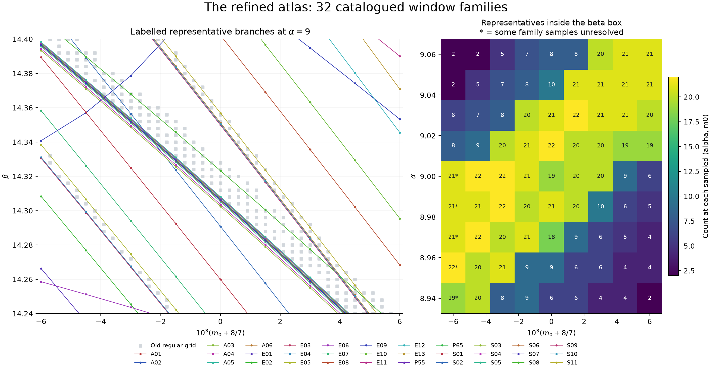
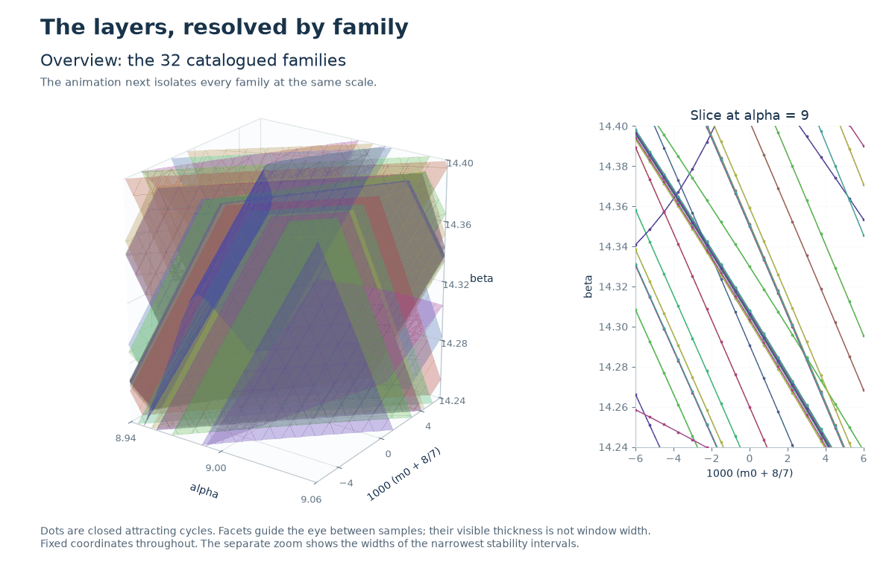
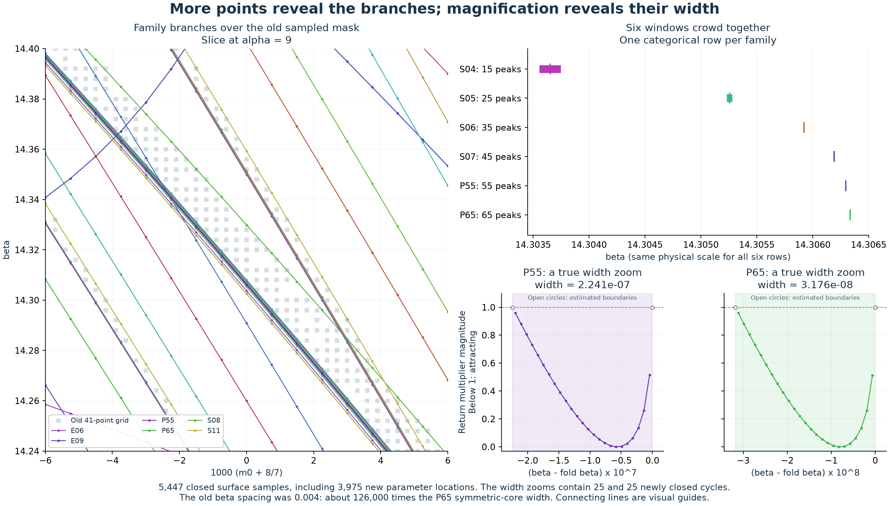
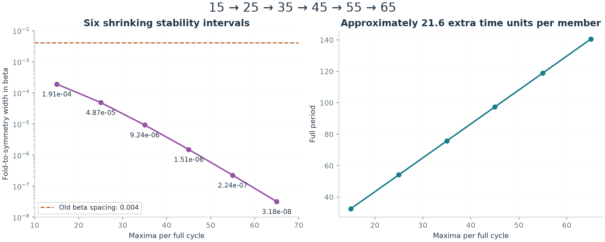
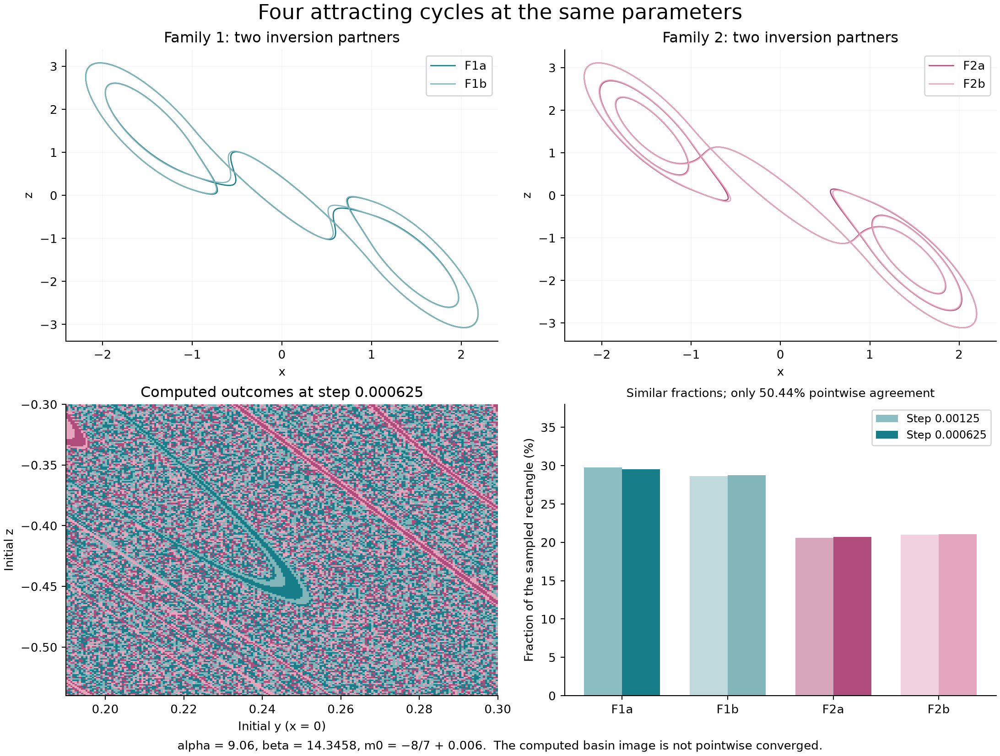
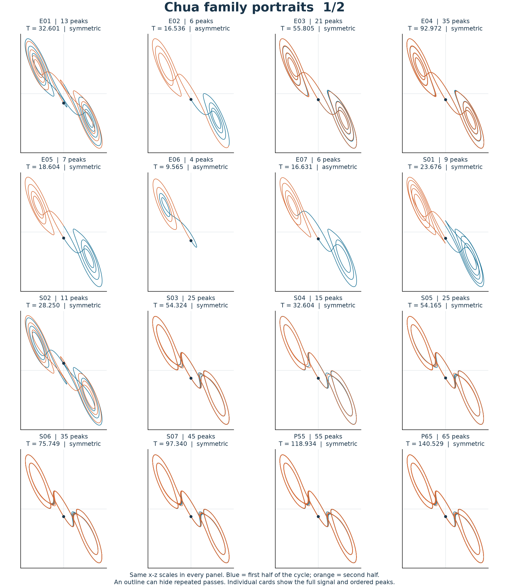
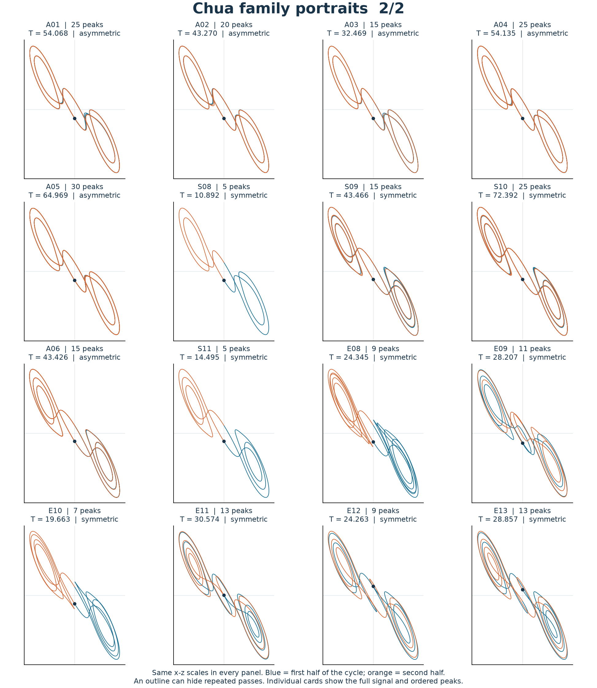

# A family-labelled refinement of the Chua layer atlas

The catalogue now contains **32 numerically distinguished periodic-window families** intersecting the original atlas box. Nineteen have representatives on the original central transect, including two newly resolved thin windows; thirteen were found in off-center searches. We also verify **four coexisting attracting cycles at one parameter point**, and extend the shrinking period-adding sequence to **65 maxima per full cycle**.

This is a count of the families identified by the continuation and ancestry procedure below. It is **not an exhaustive count of all layers**, nor a proof that all 32 remain globally disconnected outside the continued patches. The earlier count of 17 was a local census on one transect, not the total for the three-dimensional atlas.



The [interactive atlas](../results/chua-layer-atlas/atlas.html) lets readers rotate the samples and isolate families in the legend. Download the HTML and open it in a browser; it includes Plotly and works offline. Dots are closed attracting cycles. Connecting lines show mesh adjacency and are not a claim that every interpolated point is attracting. Their visible thickness is unrelated to physical window width. The right-hand count sums representatives whose beta lies in the box at each sampled pair (alpha, m0); it does not count simultaneous attractors at one beta. Asterisks mark incomplete family sampling.

## Seeing the individual layers

The README now isolates every family in turn, using a denser **17 by 17 candidate mesh in (alpha, m0)** around the visible box. This targeted continuation closes **5,447 representatives**, including **3,975 new parameter locations**; **4,126** lie inside beta = 14.24–14.40. A small halo outside that interval allows the displayed facets to be clipped at the box boundary. All selected locations were recovered in the final run. This is a display refinement of the same 32 identities, not another family census.



The left panel shows a single family's representative surface; the right panel shows the alpha=9 slice in the same color. The camera and axes stay fixed. The reference peak count and period identify the family; they are not measurements of the period at every surface point. Facets interpolate neighboring checked vertices only to guide the eye. They neither certify attraction between vertices nor depict a physical window thickness. Nearby sheets can remain visually coincident at this scale, even with denser sampling.



The lower-right panels therefore use the actual beta widths of P55 and P65 on the central transect. Each contains **25 newly closed attracting cycles**, spaced by approximately **8.97e-9** and **1.27e-9** in beta, respectively. These are interior samples from 2% to 98% of the previously estimated symmetric-core interval. Open circles show the boundary estimates, not newly sampled attracting cycles. The upper-right rows separate the six families categorically while retaining a shared physical beta axis.

Every new view sample is checked with the original matrix-exponential flow; ten new sheet points and the midpoint of each thin-core profile also receive independent full-field variational checks. The final sample set passes the closure, multiplier and attraction gates. For P65, the surface retains the earlier negative half-return multiplier, approximately -0.48333. An initial attempt to move the display representatives to +0.5 left 35 unresolved points and is retained as a numerical limitation, not an absent layer. Its normalized +0.5 catalogue identity is unchanged. [The view data, checks, and reproduction commands](../results/chua-layer-atlas/readme-layer-view/README.md) are separate from the original 9 by 9 atlas grids.

## What is being counted?

The model and original domain are unchanged:

```text
dx/dt = alpha [y - x - h(x)]
dy/dt = x - y + z
dz/dt = -beta y
h(x) = m1*x + (m0-m1)/2 * (|x+1| - |x-1|)

alpha in [8.94, 9.06]
beta  in [14.24, 14.40]
m0    in [-8/7 - 0.006, -8/7 + 0.006]
m1    = -5/7
```

A family label groups a periodic branch with the symmetry partners and period-doubled descendants that we have explicitly traced back to it. It is different from a connected component of colored grid nodes, a number of maxima, or a count of attractors at one parameter point.

To compare identities, roots are transported to alpha = 9, m0 = -8/7. Symmetric roots are normalized to half-return multiplier +0.5; asymmetric roots to full-return multiplier -0.5. After tracing ancestry, roots are merged when their symmetry class agrees, beta differs by less than 1e-7, and full period differs by less than 1e-5. The smallest separations in the final catalogue are larger than these merge tolerances. This is a numerical identity convention, not a theorem about global connectivity.

| Catalogue group | Families | Meaning |
|---|---:|---|
| S01–S11 | 11 | Symmetric parent families from the earlier central census |
| A01–A06 | 6 | Asymmetric parent families from that census |
| P55, P65 | 2 | New members of the thin period-adding sequence |
| E01–E13 | 13 | Additional families entering the box away from the central transect |
| Total | **32** | Distinct normalized roots under the stated convention |

The 13 E-family reference roots lie outside beta = 14.24–14.40, but continued attracting representatives lie inside the original three-dimensional box. A single central transect therefore misses them even with an arbitrarily fine beta mesh.

Ancestry also prevents overcounting. The earlier 30-maximum example in A03 is a doubled descendant of a 15-maximum parent; the 60-maximum example in A05 descends from a 30-maximum parent. Off-center examples with 16 and 8 maxima lead back to the same four-maximum E06 family. Positive and negative inversion partners are counted as two attractors when both coexist, but as one family in this catalogue.

The [registry](../results/chua-layer-atlas/family-registry.json), [ancestry records](../results/chua-layer-atlas/offcenter-ancestry.json), and [behaviour table](../results/chua-layer-atlas/family-catalog.csv) preserve the individual identities and parameters.

## Thin layers that the old grid could not resolve

The old 41-point beta axis has spacing **0.004**. The new 65-maximum member has a symmetric stable core only **3.1759e-8** wide on the central transect: about **126,000 times narrower** than that spacing.



| Maxima per full cycle | Upward section returns | Example full period | Width from fold to symmetry breaking |
|---:|---:|---:|---:|
| 15 | 3 | 32.607845 | 1.9111078e-4 |
| 25 | 5 | 54.167078 | 4.8723972e-5 |
| 35 | 7 | 75.749507 | 9.2420990e-6 |
| 45 | 9 | 97.340923 | 1.5063203e-6 |
| 55 | 11 | 118.934625 | 2.2413232e-7 |
| 65 | 13 | 140.529172 | 3.1759077e-8 |

The 55- and 65-maximum folds are at beta approximately 14.306295580122 and 14.306335389782. These are rounded numerical estimates, not certified intervals. The width describes the symmetric core only; asymmetric and doubled descendants can extend the full regular window.

The full period increases by approximately 21.6 each time, while the core shrinks by a factor of about 6,018 from the first to the sixth member. The construction inserts another near-parent return into a half-period itinerary and then solves the closing and stability equations. Independent full-field integration verifies the resulting attracting cycle. The 65-maximum Radau check initially failed the 2e-7 closure gate; tighter tolerances and a smaller maximum step reduced the error from 2.32e-7 to 3.03e-9. Both trials are retained.

Six members support a continuing period-adding hierarchy. They do not establish an exact limiting beta, an infinite number of attracting windows, or the absence of other families between them. Uniform brute-force refinement to this beta scale throughout a three-dimensional box would be wasteful; continuation supplies the thin branches directly.

## Birth, loss of attraction, and apparent disappearance

For the two broad five-maximum families S08 and S11, the earlier [bifurcation study](chua-layer-census.md#what-birth-and-disappearance-mean) established the sequence obtained when beta decreases:

1. A stable and a saddle periodic orbit meet at a fold of cycles. Crossing it creates an attracting regular window.
2. A symmetry-breaking transition replaces the attracting inversion-symmetric cycle with two attracting asymmetric partners.
3. A transverse full-return multiplier reaches -1 and a period-doubled attracting branch appears. The original orbit survives as an unstable orbit.

These are distinct events. Loss of attraction does not imply destruction of the periodic orbit. A branch clipped by the atlas boundary has not reached a dynamical endpoint. Nor does a failed numerical corrector establish an endpoint.

The last issue matters in the refinement. E09 bends strongly, and the initial fixed-itinerary corrector made nonlocal continuation jumps or failed. An automatic event map, with small parameter steps, bounded predictor corrections, and a half-period inversion check, recovers the branch more reliably. For example, at alpha = 9, m0 = -8/7 + 0.0015 the recovered representative is near beta = **14.414971**, whereas the initial continuation had selected a root near **14.408665**. The initial attempt is retained as rejected continuation evidence and is excluded from the displayed E09 samples. The recovered sample itineraries agree; these results do not establish that a change of diode-crossing itinerary caused the initial failures.

Bounded small-step affine continuation agrees with the automatic map to about 1e-11 in beta on five control paths and fills the remaining E09 grid points. Missing E13 samples in the original 9 by 9 atlas remain marked unresolved; the newer view solves all of its selected locations near the visible box, without claiming complete coverage outside that selection. The full 65-member boundary continuation also encountered numerical limits, so P65 is displayed through attracting representatives, not a claimed complete boundary surface. Global crises, endpoints of entire cascades, and all connections between these patches remain undetermined.

## Intersections mean coexistence, not colliding trajectories

At the single parameter tuple

```text
alpha = 9.06, beta = 14.3458, m0 = -8/7 + 0.006, m1 = -5/7
```

both broad families have attracting asymmetric partners:

| Cycle pair | Family | Maxima | Full period | Dominant transverse multiplier |
|---|---|---:|---:|---:|
| F1a, F1b | S08 | 5 | 10.852791855 | -0.07129737 |
| F2a, F2b | S11 | 5 | 14.499251118 | -0.01252875 |

Thus **four distinct attracting cycles coexist**. Independent Radau closure errors are below 1.1e-9, and independent variational multiplier discrepancies are below 6.6e-9. The minimum distance between their upward section points is about 0.001308. The section points, full orbits, and numerical checks are saved in [four-cycles.json](../results/chua-layer-atlas/four-cycles.json).



The overlap concerns regions in **parameter space**. It does not mean that two distinct periodic trajectories cross at the same point in state space. At fixed parameters the initial state determines which basin is followed. The pink atlas can merge these outcomes into one regular label, hiding both their identity and multiplicity.

We sampled 40,401 starts on x = 0, y in [0.19, 0.30], z in [-0.54, -0.30]. All reached one of the four cycles in the two full-grid calculations. Halving the RK4 step from 0.00125 to 0.000625 preserved only **50.44% of individual labels**, although the four sampled area fractions changed by at most **0.213 percentage points**. The finer fractions are approximately 29.55%, 28.74%, 20.67%, and 21.04%. These are fractions of this sampled rectangle, not complete basin volumes or certified probabilities.

The basin image is therefore **not pointwise converged**. A third step on a subset also changed many labels. We do not infer a basin-boundary dimension, Wada property, or exact fractal geometry from the image. The fixed-step perturbation experiment is retained as a sensitivity diagnostic, including its unresolved smallest perturbations.

For the finer full grid, eight consecutive upward returns within 2e-6 of a reference section point certify numerical capture. The median completion time for that criterion is 198.9, the 99th percentile is 490.3, and the maximum is 831.1. These times include the eight-return confirmation delay and are not pure chaotic-transient lifetimes. Among 1,024 selected starts, 566 have positive finite-time exponents in all four windows during the initial 80 time units. This demonstrates strong transient instability before capture and explains why a short scan can resemble chaos even at a parameter point supporting attracting cycles. It does not establish a coexisting asymptotic chaotic attractor.

## How behaviour differs between layers

In plain language, the families differ in the **route and rhythm of their repeating motion**:

- **Where the motion goes.** E06 stays near one outer scroll, or "wing"; the other reference representatives visit both outer regions.
- **How much happens before the pattern repeats.** A cycle can contain 5, 15, 35 or 65 peaks. Longer cycles may make many nearly overlapping passes through similar loops, so a static outline can hide their longer repetition pattern.
- **How long a complete repetition takes.** S08 and S11 both have five peaks, but their reference periods are approximately 10.89 and 14.50, and their signal shapes differ.
- **Whether the two halves are symmetric.** For 23 reference representatives, the second half matches the first after reversing all state coordinates. The other nine representatives are asymmetric. A family's descendant branches can change symmetry as parameters vary.

Several families have almost indistinguishable outlines. Their identity therefore also uses continuation, parentage and parameter location. The catalogue does not imply 32 radically different geometric shapes, or 32 attractors all coexisting at the same parameters.

The [gallery of all 32 families](chua-family-gallery.md) now provides an individual card for every reference representative: orbit outline, the complete time signal, and ordered peak heights. Two overview sheets use identical coordinate scales. An [offline interactive comparison](../results/chua-layer-atlas/family-gallery.html) overlays any two families in 3D and compares their signals, with a phase-shift control for the second signal.

Start with **S08 versus S11** to compare two five-peak patterns, then **S04 versus P65** to see how nearly matching outlines hide very different repetition lengths.

<details>
<summary>Show all 32 reference portraits in this report</summary>

Blue marks the first half of each cycle and orange the second. Every panel uses the same x-z scales. Each family is shown at its own reference beta; these are different parameter choices. The individual gallery cards reveal the time signal and peak sequence that the outlines can hide.





</details>

Peak count alone is inadequate: S08 and S11 both have five maxima, yet different periods and orbit geometry. The catalogue also separates symmetry, number of section returns, average state, and transverse contraction.

| Representative | Main distinction | Period at the normalized reference root |
|---|---|---:|
| E06 | Four maxima; one-scroll biased motion, with x approximately in [-2.208, 0.341] and mean x = -1.242 | 9.565440 |
| S08 | Five maxima; visits both outer regions, with half-period inversion symmetry | 10.891608 |
| S11 | Five maxima; another double-scroll geometry and a longer cycle | 14.495248 |
| A03 | Asymmetric 15-maximum parent of the earlier 30-maximum example | 32.468735 |
| A05 | Asymmetric 30-maximum parent of the earlier 60-maximum example | 64.969283 |
| P55 | Eleven section returns; repeated near-parent excursions | 118.934493 |
| P65 | Thirteen section returns; still longer recurrence | 140.529123 |

These rows use each family's own reference beta at alpha = 9, m0 = -8/7; they are not a coexistence comparison. E06's reference beta lies outside the original beta range, while its continued sheet enters the original box. Every other normalized representative in this catalogue visits both x < -1 and x > 1. The inversion partner of an asymmetric representative reverses its mean state.

For a dominant transverse multiplier magnitude rho, -T/log(rho) gives an asymptotic local relaxation time in physical time units. Normalization fixes rho near 0.25 for symmetric roots and 0.5 for asymmetric roots, so differences at these roots partly reflect the chosen normalization and period. This is not a measurement of basin capture time. At the actual four-cycle overlap, F2 contracts more strongly per cycle despite having a longer period than F1.

## Numerical evidence and remaining limits

The off-center search uses four m0 offsets (-0.006, -0.003, +0.003, +0.006), alpha = 9, 10,241 beta nodes per slice, three starts, RK4 step 0.00125, a 2,000-unit transient and 2,400-unit observation. Late peaks select candidates. Nearby screen fragments are coalesced before selection; 23 of 24 selected candidates pass independent cycle checks. The unresolved candidate is retained. Several accepted candidates have the same parent, giving 13 additional family identities after ancestry and transport.

The original refined atlas contains 2,587 representative samples: 31 complete 9 by 9 (alpha, m0) grids and 76 of 81 E13 points. Of these representatives, 1,125 lie inside the original beta box. Twelve families also have fold and symmetry boundaries on their grids: S01–S11 and P55. All saved final sheet samples are checked against the original matrix-exponential implementation. Two in-box representatives per family receive independent full-field variational integration. The [audit](../results/chua-layer-atlas/atlas-audit.json) records every gate, maximum discrepancy, and incomplete grid; it does not treat missing points as absent branches. The newer 5,447-sample README view has its own [audit](../results/chua-layer-atlas/readme-layer-view/audit.json); these totals overlap and must not be added as distinct samples.

For the twelve bounded sheets, fresh midpoint solves compare cubic interpolation with exact continuation. Maximum beta errors are of order 1e-9–1e-8; the largest error relative to the symmetric-core width is about 3.03%, for P55. This check does not justify interpolating P65's extremely thin stable interval or smoothing the strongly bending E09 patch. Displayed straight segments are visual guides only.

The audit is numerical, not an interval proof. Sampling can still miss thinner windows and inaccessible basins. The catalogue does not bound all possible periods, close all global continuations, or establish an exact finite or infinite total. The concrete advance is a labelled, reproducible set of branches that resolves structures the original grid missed, with explicit coexistence and behaviour checks.

Shrinking periodic-window structures are already known in experimental Chua circuits; see [Maranhão et al.](https://arxiv.org/abs/0712.3842) and [de Sousa et al.](https://arxiv.org/abs/1509.08425). Those experimental models and parameter sections do not prove an infinite attracting hierarchy in this repository's exact box. The contribution here is the quantitative refinement and verification of this particular atlas.

Reproduction commands, compact data, retained unsuccessful trials, and checksums are in the [data README](../results/chua-layer-atlas/README.md).
