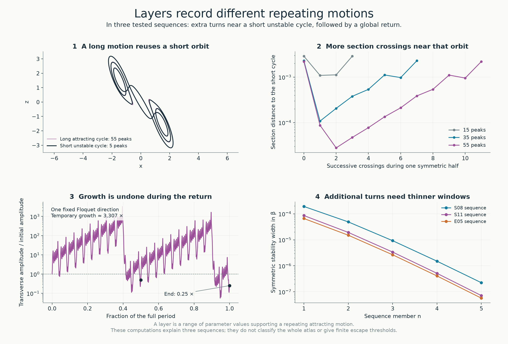
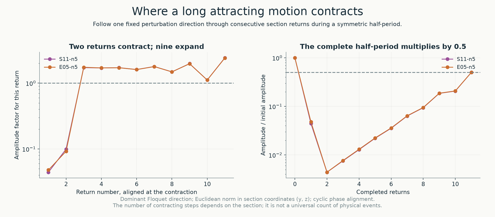
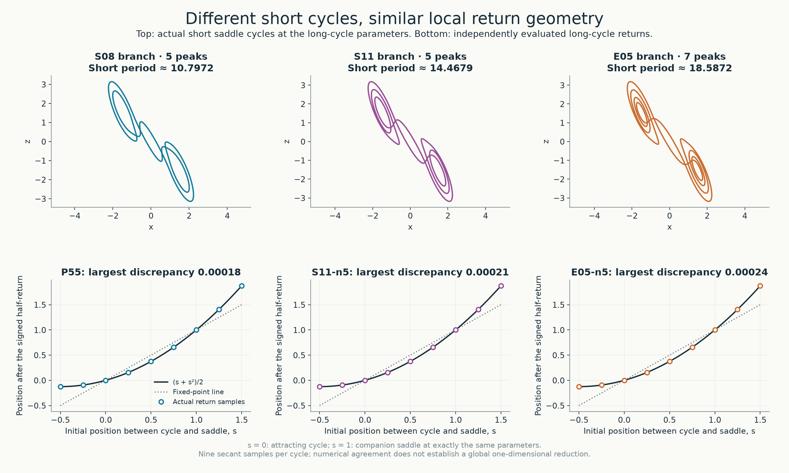
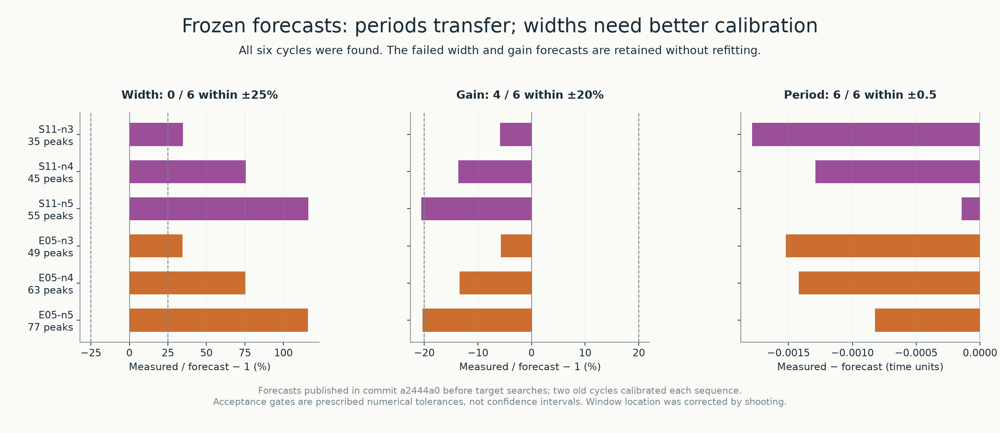

# How repeated motion produces sequences of layers

A layer marks **settings at which one repeating motion attracts nearby trajectories**. In the three sequences studied here, longer motions repeatedly pass close to a short unstable cycle, make an excursion and return. Adding a circuit near that short cycle produces another repeating motion, usually visible only in a thinner parameter interval. Thus several layers can have nearly indistinguishable orbit outlines while differing greatly in repetition time and parameter width.

The return is essential. The trajectory can separate from its neighbors during much of a period and still attract them over the complete period. For the two longest new examples, nine section transitions expand a transported perturbation and two contract it. Together the two contractions reduce its amplitude by about **227 times**; the other nine transitions increase it by about **113 times**. The net half-period factor is **0.5**. This statement concerns a specified infinitesimal Floquet direction, not every finite disturbance.



The first panel deliberately overlays the short saddle and the long attracting cycle: their similar outlines hide the repeated passages. The distance panel resolves those passages on a section. The lower-left panel transports one fixed direction throughout a period, rather than optimizing a new direction at every time. [Vector figure](../results/chua-return-families/chua-return-families-explanation.pdf).

**What was tested prospectively.** Starting from two previously known long cycles per sequence, we published forecasts and then found six further cycles: **35, 45 and 55 peaks** near the S11 branch, and **49, 63 and 77 peaks** near E05. All peak counts agree and all period errors are below 0.002. The width forecasts fail their stated tolerance in all six cases; four of six gain forecasts pass. The shared mechanism is better supported than the early-member extrapolation of its coefficients.

## 1. Three sequences and the meaning of their index

All calculations use the continuous piecewise-linear Chua equations with α = 9, m₀ = −8/7, m₁ = −5/7 and γ = 0. Only β varies. These are three different parameter neighborhoods, not simultaneous attractors at one parameter point.

| Short-cycle branch | Existing long references | Full-period peak counts | Short period near the fifth member |
|---|---|---|---:|
| S08 | S04, S05, S06, S07, P55; later tests through P105 | 15, 25, 35, 45, 55, … | 10.7972 |
| S11 | S09, S10 | 15, 25, **35, 45, 55** | 14.4679 |
| E05 | E03, E04 | 21, 35, **49, 63, 77** | 18.5872 |

Bold counts identify the six new targets. The first sequence and its ten-member analysis are reported in the [preceding study](chua-return-geometry.md). S08, S11 and E05 name continued short-cycle branches: their original catalogue representatives are attracting, while their continuations to the long-cycle parameters used here are saddles. We do not infer a saddle from its reference label alone.

Each long cycle is inversion symmetric. Its representative has dominant multiplier +1/2 for the signed half-return, which follows half the orbit and applies central inversion. The full-period transverse spectral radius is therefore 1/4. This is a common sampling convention, not a universal stability value.

There are 2n + 1 inversion-normalized section transitions during a half-period. Increasing n by one adds a **full circuit of the short saddle to each symmetric half**. If its period is Tₚ, this gives the leading period increment

```math
T_{n+1}-T_n \simeq 2T_p.
```

For the S11 and E05 sequences the peak counts are respectively 5(2n + 1) and 7(2n + 1). These labels describe the computed sequences; peak count alone does not identify a family. In particular, both S08 and S11 have five-peak short cycles but different periods and different parameter neighborhoods.

A plotted layer represents the stability region associated with a continued periodic-orbit family. Its intersection with this fixed-parameter line is a window. The width W used here is the absolute β difference between the computed saddle-node and symmetry-breaking endpoints of the symmetric branch. It does not include attracting descendants beyond symmetry breaking.

## 2. The return that makes the motion attracting

We reconstruct the normalized section points and independently integrate the full field and variational equation between successive crossings of x = 0. At each crossing we remove the phase direction. We then follow the dominant Floquet direction through the entire half-period, keeping its propagated direction instead of replacing it by a separately optimized one.



| Cycle | Product of the two contracting factors | Product of the nine expanding factors | Complete half-period factor |
|---|---:|---:|---:|
| S11-n5, 55 peaks | 0.00440700 | 113.45581 | 0.50000000 |
| E05-n5, 77 peaks | 0.00441527 | 113.24336 | 0.50000001 |

The last displayed discrepancy is numerical integration error. The shooting normalization is exactly +1/2 to the working precision. The two curves are aligned by cyclically moving the first contracting transition to the start; no amplitudes or horizontal scales are fitted. Their close agreement is an observation for these two examples, not a theorem of universal dynamics. [Vector figure](../results/chua-return-families/chua-return-families-contraction.pdf).

The section calculation uses the Euclidean norm of (δy, δz). The overview instead uses the Euclidean transverse quotient norm in the three-dimensional state. Both transport a fixed Floquet direction, but their intermediate amplitudes need not coincide. The return-step contraction count also depends on the section: “two contracting transitions” is not a universal count of physical events. The earlier suggestion of a single contracting section transition was too restrictive.

For maximum transient gain G we separately optimize the initial direction and the start and end phases, as defined in the [preceding report](chua-return-geometry.md#2-what-is-being-amplified). The refined gains of S11-n5 and E05-n5 are approximately **61,693** and **67,952**. They differ from the growth of the particular Floquet direction plotted above. All are infinitesimal amplitude gains in a stated norm, not escape thresholds or basin sizes.

## 3. A common local return curve

At the same β as each attracting cycle we also solve for its nearby saddle companion. Let q be the attracting section point and qₛ the companion. Evaluate the actual signed half-return from q + s(qₛ − q), solving every diode-event time anew, and project the output onto this secant.

The quadratic model, normalized to have fixed points s = 0 and s = 1 and derivative 1/2 at s = 0, predicts

```math
F(s)=\frac{s+s^2}{2},\qquad F'(0)=\frac12,\qquad F'(1)=\frac32.
```



| Cycle | Companion signed half multiplier | Maximum return discrepancy at nine secant samples |
|---|---:|---:|
| P55, earlier S08-sequence test | 1.50016318 | 0.000184 |
| S11-n5 | 1.50018792 | 0.000210 |
| E05-n5 | 1.50018545 | 0.000242 |

The samples span −0.5 to 1.5. No curve coefficients are fitted after fixing the two roots. Repeating the two new samples at 75 and 90 digits reproduces their reported coordinates. The maximum off-secant output is 2.60 × 10⁻⁷ and 6.33 × 10⁻⁶ root separations, respectively. These are local samples of a two-dimensional return; they do not establish a global one-dimensional conjugacy, locate a basin boundary, or determine knot type. [Vector figure](../results/chua-return-families/chua-return-families-comparison.pdf).

The data support a useful description of these sequences: **identify the short saddle, identify the global return, then count the extra circuits near the saddle**. This is more informative than a peak count or a silhouette alone. We have not shown that finitely many such descriptions cover the atlas.

## 4. Forecasts published before the searches

The [protocol](../results/chua-return-families/protocol.md) was published in [bd9e698](https://github.com/Griboedow/chua-gpu-atlas/commit/bd9e698). Calibration and all six numerical forecasts were then frozen in [a2444a0](https://github.com/Griboedow/chua-gpu-atlas/commit/a2444a0), before searching for the new long cycles. Source digests and the original failed Newton search are retained.

For each sequence the unstable full-period multiplier Λ and short period Tₚ were measured at the second known long cycle's β. Set k = n − 2 and t = Λ⁻ᵏ. The leading forecasts were W₂t², G₂/t and T₂ + 2kTₚ. A prescribed two-point correction used

```math
W_n=t^2(A_W+B_Wt),\qquad G_n=A_G/t+B_G.
```

All coefficients use only the two known members. Both leading and corrected errors are stored in [scores.json](../results/chua-return-families/scores.json); the table and figure below score the corrected forecasts. The location seed was corrected by shooting and is **not** scored as a point-location prediction.

| Target | Peaks | Predicted period | Computed period | Difference |
|---|---:|---:|---:|---:|
| S11-n3 | 35 | 101.326134 | 101.324349 | −0.001785 |
| S11-n4 | 45 | 130.260725 | 130.259435 | −0.001290 |
| S11-n5 | 55 | 159.195317 | 159.195175 | −0.000142 |
| E05-n3 | 49 | 130.145411 | 130.143889 | −0.001522 |
| E05-n4 | 63 | 167.319029 | 167.317610 | −0.001420 |
| E05-n5 | 77 | 204.492648 | 204.491826 | −0.000822 |

| Target | Predicted width → computed width | Width error | Predicted gain → computed gain | Gain error |
|---|---|---:|---|---:|
| S11-n3 | 2.50661 × 10⁻⁶ → 3.37614 × 10⁻⁶ | +34.69% | 9,302.92 → 8,758.47 | −5.85% |
| S11-n4 | 2.92934 × 10⁻⁷ → 5.14193 × 10⁻⁷ | +75.53% | 26,416.22 → 22,821.38 | −13.61% |
| S11-n5 | 3.31617 × 10⁻⁸ → 7.17339 × 10⁻⁸ | +116.32% | 77,667.68 → 61,692.65 | −20.57% |
| E05-n3 | 1.97182 × 10⁻⁶ → 2.65461 × 10⁻⁶ | +34.63% | 10,304.00 → 9,715.44 | −5.71% |
| E05-n4 | 2.32220 × 10⁻⁷ → 4.07211 × 10⁻⁷ | +75.36% | 29,124.45 → 25,223.57 | −13.39% |
| E05-n5 | 2.64841 × 10⁻⁸ → 5.72031 × 10⁻⁸ | +115.99% | 85,286.29 → 67,951.89 | −20.32% |

Relative error means computed / predicted − 1. The prescribed gates were 25% for width, 20% for gain and 0.5 time units for period. These are numerical tolerances, not confidence intervals. The outcomes are **0/6 widths, 4/6 gains and 6/6 periods** within those gates. Peak counts agree in all six independently integrated cycles.



[Vector figure](../results/chua-return-families/chua-return-families-forecasts.pdf).

### Why the width extrapolation is insufficient

The short saddle itself changes as β approaches the accumulation neighborhood. In the S11 sequence its full expansion at the second member is 2.99483, but at the fifth it is 2.80566. For E05 the corresponding values are 2.98409 and 2.79670. Repeated powers magnify this mismatch. The short periods change much less, which is consistent with the much smaller period errors. These observations identify a limitation of the calibration; they do not isolate every source of forecast error or supply a corrected predictor.

The relation between measured width and measured gain is more stable than either extrapolation. For S11, W G² progresses through 241.36, 247.77, 258.99, 267.80 and 273.02. For E05 it gives 233.49, 239.75, 250.57, 259.08 and 264.13. The earlier S08 sequence approaches about 231. These finite trends are compatible with the same leading scaling mechanism and different prefactors. They neither prove a limit nor establish a universal numerical constant.

To improve prediction we must locate the limiting saddle and global return, and control the finite-period correction. Substituting a retrospectively fitted coefficient into the published forecasts would erase the test, so the forecasts remain unchanged.

## 5. Numerical verification and limits

All six cycles pass the numerical audit. The forecast failures above are scientific outcomes and are not removed by passing the implementation checks.

| Check | Largest observed error or outcome |
|---|---|
| Re-solve representative and both endpoints at 90 digits | Relative width change below 7.84 × 10⁻⁵⁶ |
| Independent high-precision eigendecomposition of the affine flows | Half-orbit closure below 6.98 × 10⁻⁶²; sampled region paths valid |
| Full-field integration | All peak and section counts agree; full-period drift below 1.42 × 10⁻⁷ |
| Separate full-field section derivatives | Next-point error below 7.94 × 10⁻¹⁵; full multiplier error below 1.40 × 10⁻⁸ |
| Primitive cycles | Distinct section points, rather than repeated traversal of a shorter root |
| Dense phase mesh versus local gain optimization | Relative difference below 0.0094% for all six cycles |
| Independent full-field gain controls for the two longest targets | Relative difference below 7.82 × 10⁻¹² at two step limits |
| Nonlinear return repeat | Nine samples for each new longest target repeated at 75 and 90 digits |
| Provenance | Forecasts and their original calibration inputs unchanged |

The maximum-step controls for whole-period integration are 0.005, with an additional 0.0025 run for each longest target. The much smaller next-section error measures a different check and must not be substituted for whole-period drift. Path validity is sampled; these new calculations do not use interval arithmetic. Gain maxima are sampled and locally refined lower estimates of a continuous supremum, not certified global maxima.

The initial S11-n3 Newton search stalled. A double-precision boundary predictor followed by the same high-precision corrector recovered the target; the original failure and retry records remain available. No forecast value was changed.

The six new roots have no three-dimensional family meshes or knot classifications. The displayed catalogue remains 34 reference cards; the total set of numerically tested cycles is larger. The [earlier infinity argument](chua-infinity-certificate.md) applies near the S08 organizing tangency. This extension does **not** prove infinite sequences near S11 or E05, nor classify globally disconnected layer surfaces.

## 6. What the comparison adds

The principal advance is a tested connection between the visible layers and a small set of dynamical operations: residence near a short saddle, a global return, and the number of extra circuits. The two additional sequences reproduce the period-adding pattern, nearby saddle companions, a normalized quadratic return and concentrated contraction. They also expose where a simple numerical predictor fails.

Quadratic homoclinic rescaling and cascades of attracting periodic windows are established mechanisms. For related universal parameter patterns under stated tangency hypotheses, see [Gonchenko, Li and Turaev](https://arxiv.org/abs/2212.03964). That theory does not automatically identify the organizing bifurcation of every computed Chua sequence. The contribution here is the explicit comparison, prospective tests, retained counterevidence to the early calibration, and reproducible local dynamics. Historical priority for these particular measurements has not been established.

The next theoretical task is a controlled return expansion for each new sequence. The next atlas task is to follow these families through the slope coordinates and determine where their organizing saddle or excursion changes. Neither task can be replaced by counting peaks alone.

[Data and reproduction](../results/chua-return-families/README.md) · [Machine-readable audit](../results/chua-return-families/review.json) · [Earlier ten-member sequence](chua-return-geometry.md) · [Main atlas](../README.md)
