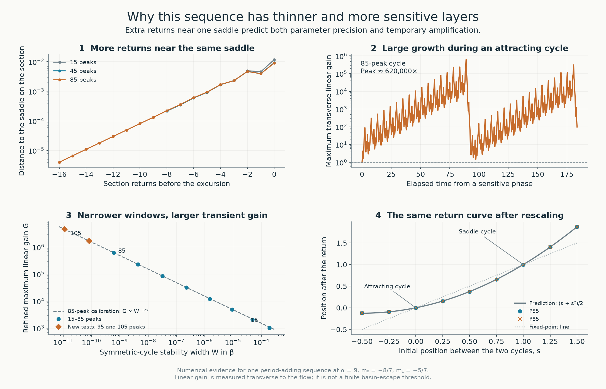
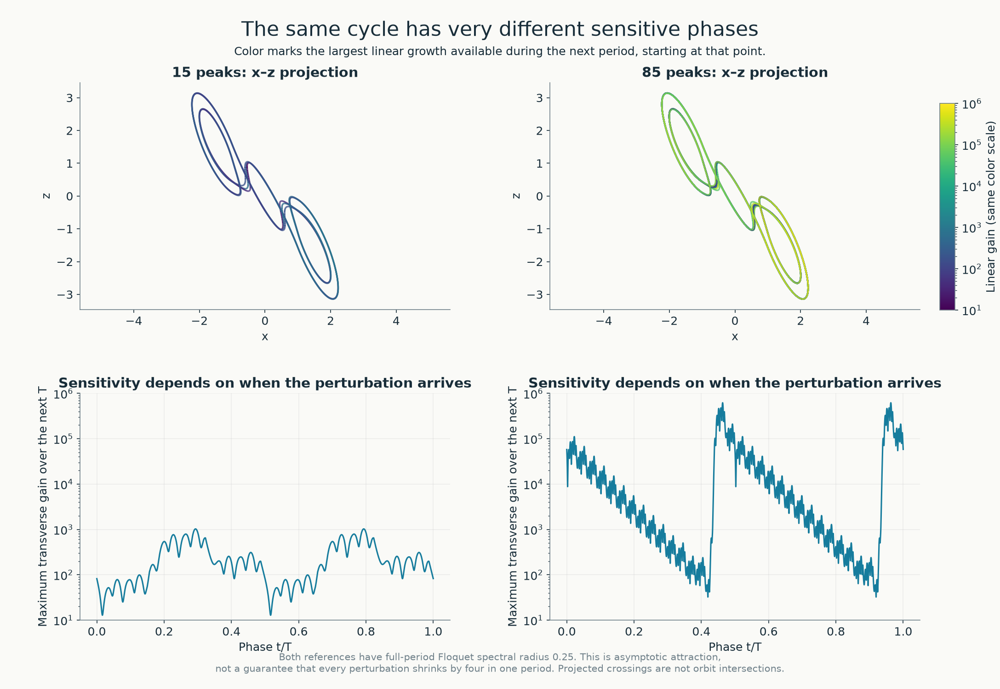
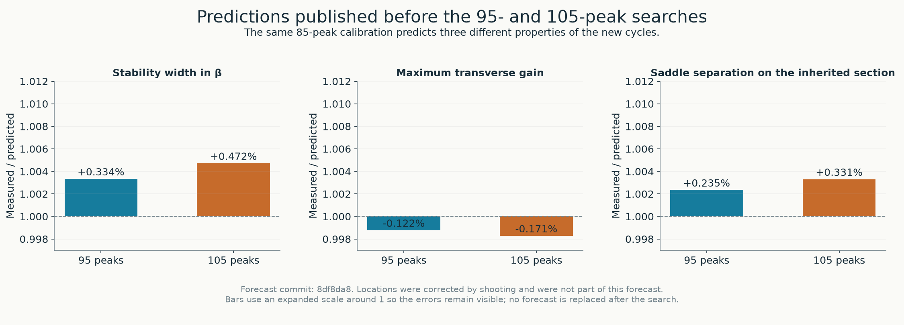
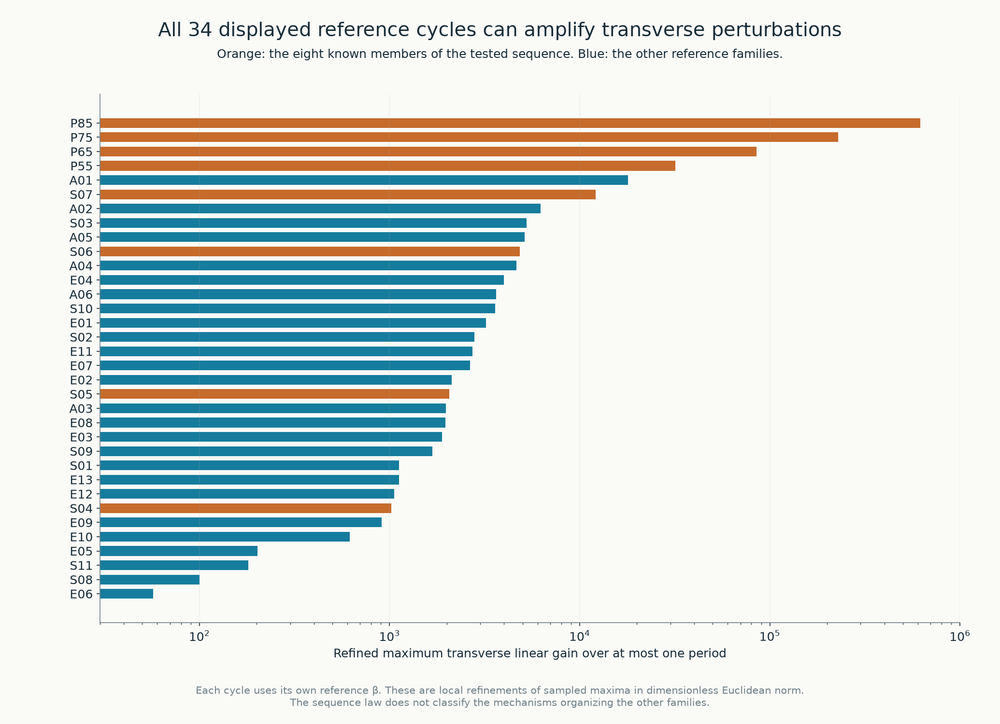

# Return geometry, thin windows and transient amplification

**In the tested sequence, a longer attracting motion spends more time near the same short unstable motion.** It follows that motion for several turns, leaves its neighborhood, and returns. The next member adds one turn near the saddle in each symmetric half of the cycle. Much of the apparent complexity is therefore additional residence time near an existing orbit.

That extra time has a measurable cost. Nearby trajectories separate while passing the saddle; a sufficiently precise return can still make the complete cycle attracting. In this sequence, each additional step eventually multiplies the largest temporary amplification by about **2.71**, while dividing the parameter-window width by about **7.36**. Longer repetition, narrower layers and stronger transient amplification are related consequences of the same return geometry.

We tested this interpretation on the eight previously computed members, then published predictions for two longer cycles **before searching for them**. For the new 95- and 105-peak cycles, all six predictions of width, amplification and companion-cycle separation agree with the computations to **within 0.5%**. Their locations were corrected numerically; location was not part of this test.

This explains one organized sequence within the atlas. It does not classify every family or establish a universal relation for every visible layer. The new claims below are numerical, supported by precision repeats and independent integrations; the earlier [interval argument for infinitely many windows](chua-infinity-certificate.md) is a separate result.



The first panel aligns section crossings by the large excursion. The longer cycles acquire more crossings close to the short saddle. The second follows the largest transverse linear gain from one sensitive initial phase of the 85-peak cycle. The third compares widths and locally refined gain maxima; the two orange points were computed after their forecasts. The fourth evaluates the actual nonlinear return at nine initial states for each of two cycles. [Vector figure](../results/chua-return-geometry/chua-return-explanation.pdf).

## 1. Objects, parameters and scope

We use the [dimensionless continuous piecewise-linear Chua equations](../README.md#the-system-and-the-question), with α = 9, m₀ = −8/7, m₁ = −5/7 and γ = 0. Only β varies. A layer is a sampled stability region of a continued periodic-orbit family; its intersection with this transect gives a parameter interval.

The sequence has 10n + 5 maxima of x per full period, with n = 1, …, 10 in the present computations. The first eight references are S04, S05, S06, S07, P55, P65, P75 and P85. P95 and P105 are new targeted test cycles. The [34-card display catalogue](chua-layer-cards.md) remains a selected set of illustrated references; the two new cycles have not been given three-dimensional family meshes or knot classifications.

For each symmetric cycle, choose the representative whose signed half-return has dominant multiplier +1/2. The signed return follows one half-period and applies central inversion, so the representative is a fixed point of that map. Its full-period transverse spectral radius is 1/4. The width W is the β interval from the saddle-node to the symmetry-breaking endpoint of this symmetric branch. It excludes any additional attracting descendants after symmetry breaking.

All 34 original reference cycles are also compared at their own published reference β values. This is a comparison of different systems, not a claim that all these motions coexist.

## 2. What is being amplified?

A displacement along the orbit mainly changes its phase. We remove that direction and measure displacement transverse to the flow. Let Φ(t+s,t) be the variational propagator, and let the columns of B(t) form an orthonormal basis perpendicular to the vector field. In the Euclidean norm of the dimensionless coordinates, define

```math
K(t,s)=B(t+s)^{\mathsf T}\Phi(t+s,t)B(t),\qquad
G(t)=\sup_{0\le s\le T}\|K(t,s)\|_2,\qquad
G_{\max}=\sup_{0\le t<T}G(t).
```

The calculations sample both times and then locally refine the largest sampled value. Reported gains are numerical lower estimates of the continuous supremum, not certified global maxima. The initial perturbation direction is optimized as part of the singular-value calculation. A curve of this operator norm need not follow the same initial direction at every elapsed time.

**Attraction does not require monotone contraction.** A Floquet spectral radius of 0.25 gives asymptotic decay under repeated full periods. It does not say that every displacement shrinks fourfold during its first period. The return matrix can have a norm greater than one, and its intermediate propagators can have much larger norms. For the 85-peak reference, the locally refined transverse gain reaches about 620,000 during a period; for the 105-peak reference it reaches about 4.55 million.

These are infinitesimal amplitude gains in a stated norm. They are not finite escape thresholds, basin sizes, noise tolerances or energy ratios. They do not imply a positive asymptotic Lyapunov exponent for these attracting periodic orbits.



The orbit color records the largest gain available during the next period when starting at that phase. The lower panels use the same vertical scale. Projected orbit crossings are not intersections in three-dimensional state space. [Vector figure](../results/chua-return-geometry/chua-return-phase-sensitivity.pdf).

The quotient propagators can be composed with transverse projections at intermediate points: the discarded tangent direction is carried into the next tangent direction by the exact variational flow. This avoids contamination by the neutral phase mode in long matrix products. The vector field is continuous at diode breakpoints, so there is no saltation jump there; the Jacobian changes between affine regions.

## 3. A quadratic return relates the measurements

The previously identified short saddle has full-period expansion Λ ≈ 2.7134317829 and period Tₚ ≈ 10.79734742. One additional saddle circuit in each symmetric half predicts

```math
T_{n+1}-T_n\longrightarrow 2T_p,\qquad
\frac{W_{n+1}}{W_n}\longrightarrow\Lambda^{-2}.
```

These period and width predictions precede the present study; see the [first prediction report](chua-layer-prediction.md) and [tangency certificate](chua-infinity-certificate.md). The new amplification hypothesis is

```math
\frac{G_{n+1}}{G_n}\longrightarrow\Lambda,
\qquad W_nG_n^2\longrightarrow C>0.
```

Its interpretation is local expansion followed by a quadratic global return. Near the selected section, a scalar reduction with its constant and linear terms centered can have leading form

```math
z_{\mathrm{next}}=a_n(\beta-\beta_n^0)-b_nz^2,
\qquad b_n\ \text{of order}\ \Lambda^{2n}.
```

This is a reduced model, not an exact identity for the two-dimensional Chua return. The calculation has not bounded its remainder uniformly in n. The square appears because the global map is quadratic in a displacement that has already undergone local expansion. If aₙ remains nonzero and bounded and the relevant coordinate changes remain controlled, rescaling X = bₙz gives Qₘ(X) = M − X², with M = aₙbₙ(β − βₙ⁰). Its attracting fixed-point interval has unit width in M, giving W of order Λ⁻²ⁿ. A passage with linear expansion of order Λⁿ then gives G of order Λⁿ and the proposed product law.

For the normalized attracting multiplier +1/2, Q has M = −3/16. Its two fixed points are −1/4 and −3/4, with derivatives +1/2 and +3/2. Thus the same reduction predicts a companion saddle at the **same β**, with signed half-return multiplier approaching **1.5**, and full-period multiplier approaching **2.25**.

| Reference | Peaks | Period T | Symmetric width W | Refined gain G | Companion half multiplier | W G² |
|---|---:|---:|---:|---:|---:|---:|
| S04 | 15 | 32.60430148 | 1.9111078 × 10⁻⁴ | 1,024.15 | 1.488563177175 | 200.4542 |
| S05 | 25 | 54.16455014 | 4.8723972 × 10⁻⁵ | 2,058.28 | 1.499506151845 | 206.4204 |
| S06 | 35 | 75.74866585 | 9.2420990 × 10⁻⁶ | 4,829.45 | 1.500603369811 | 215.5591 |
| S07 | 45 | 97.34044437 | 1.5063203 × 10⁻⁶ | 12,162.08 | 1.500373577381 | 222.8090 |
| P55 | 55 | 118.93449325 | 2.2413232 × 10⁻⁷ | 31,838.71 | 1.500163183190 | 227.2037 |
| P65 | 65 | 140.52912265 | 3.1759077 × 10⁻⁸ | 85,005.09 | 1.500064072620 | 229.4868 |
| P75 | 75 | 162.12385905 | 4.3949166 × 10⁻⁹ | 229,046.16 | 1.500024191105 | 230.5668 |
| P85 | 85 | 183.71859357 | 6.0170236 × 10⁻¹⁰ | 619,672.60 | 1.500008998258 | 231.0502 |
| P95 | 95 | 205.31331201 | 8.1996152 × 10⁻¹¹ | 1,679,393.75 | 1.500003327961 | 231.2589 |
| P105 | 105 | 226.90801884 | 1.1151983 × 10⁻¹¹ | 4,554,658.93 | 1.500001228138 | 231.3470 |

The approach to a common W G² value is consistent with the hypothesis. Its numerical value depends on the state norm, parameter convention, representative selection and sequence. It is not a universal constant of Chua's system. A finite sequence does not establish an asymptotic limit by itself.

### The separation law depends on the section

The [initial protocol](../results/chua-return-geometry/protocol.md) proposed a companion separation of order Λ⁻ⁿ in a consistently aligned section. The measurements required a more precise statement. In the inherited starting section of the long-cycle construction, separation decreases as Λ⁻²ⁿ. At the largest matched section separation around the orbit, it decreases as Λ⁻ⁿ. A single exponent does not describe all phases.

This agrees with the quadratic model: at multiplier +1/2 the two roots differ by 1/(2bₙ), hence by order W in the initial coordinate. Subsequent local expansion of order Λⁿ can increase their separation to order √W. Across the first eight members, the largest matched section separation divided by √W decreases from 0.01906 to 0.01727. At the section crossing farthest from the organizing saddle, separation divided by W decreases from 0.4483 to 0.3343. Section crossings are normalized by inversion and matched along the common itinerary.

The new forecasts explicitly use the inherited starting section and exponent −2n. The original conjecture remains in the protocol. A distance between two periodic points on a section is not a proved distance to a basin boundary; that would require identifying and controlling the saddle's stable manifold.

### Direct evaluation of the nonlinear return

Let q be the attracting fixed point and qₛ its same-parameter companion. Set q(s) = q + s(qₛ − q), so s = 0 is the attractor and s = 1 the saddle. Recompute every event time for each perturbed initial condition, evaluate the signed half-return, and project its output along this secant.

For a quadratic scalar map, fixing both roots and derivative 1/2 at the attracting root determines the entire normalized curve:

```math
F(s)=\frac{s+s^2}{2}.
```

There are no fitted curve coefficients after that normalization. At nine samples from s = −0.5 to 1.5, the largest absolute discrepancy is **1.84 × 10⁻⁴** for P55 and **1.11 × 10⁻⁵** for P85. The off-secant output is below 8.3 × 10⁻⁷ root separations in these samples. A repeat of P85 with 90 rather than 75 working digits reproduces the reported coordinates. This tests a local secant of the actual event map, not a global one-dimensional conjugacy.

## 4. Predictions published before the new searches

The exploratory [protocol was committed first](https://github.com/Griboedow/chua-gpu-atlas/commit/fb72c48). After the eight-member measurements, the corrected section rule and the P95/P105 numerical forecasts were [frozen in commit 8df8da8](https://github.com/Griboedow/chua-gpu-atlas/commit/8df8da8). The constants use P85 only; each further step multiplies G by Λ and divides W and the inherited-section separation d by Λ².



| Peaks | Quantity | Predicted | Measured | Relative error |
|---:|---|---:|---:|---:|
| 95 | Width W | 8.1722924 × 10⁻¹¹ | 8.1996152 × 10⁻¹¹ | +0.3343% |
| 95 | Transverse gain G | 1,681,439.34 | 1,679,393.75 | −0.1217% |
| 95 | Section separation d | 2.7317667 × 10⁻¹¹ | 2.7381922 × 10⁻¹¹ | +0.2352% |
| 105 | Width W | 1.1099568 × 10⁻¹¹ | 1.1151983 × 10⁻¹¹ | +0.4722% |
| 105 | Transverse gain G | 4,562,470.94 | 4,554,658.93 | −0.1712% |
| 105 | Section separation d | 3.7102724 × 10⁻¹² | 3.7225383 × 10⁻¹² | +0.3306% |

Relative error is measured/predicted − 1. The frozen acceptance gates were 10% for W and G, 15% for d, and 0.001 absolute error for the predicted companion half multiplier 1.5. The observed errors are much smaller; they are not confidence intervals. The two multiplier discrepancies are 3.33 × 10⁻⁶ and 1.23 × 10⁻⁶.

The search inserts a saddle return into the preceding itinerary and corrects the root by high-precision shooting. It does **not** test a forecast of the window's absolute location. The [forecast file](../results/chua-return-geometry/forecasts-frozen.json), all roots, endpoint solves and scores remain available in the [data directory](../results/chua-return-geometry/README.md). [Vector comparison](../results/chua-return-geometry/chua-return-forecast-check.pdf).

## 5. What carries over to the other reference families?



All 34 displayed references admit transient transverse growth in the stated norm. Their locally refined gains range over several orders of magnitude. This establishes that Floquet attraction alone is an incomplete description of their short-time response.

The orange entries belong to the tested period-adding sequence. The blue entries have not been assigned to this same organizing return. Their gains do not establish the product law, identify an organizing saddle, or explain their knot types. The numerical [knot study](chua-knot-atlas.md) found that the eight earlier sequence members are unknots; the present study does not classify P95 or P105 topologically. [Vector catalogue](../results/chua-return-geometry/chua-return-catalogue.pdf).

## 6. Numerical checks and retained limitations

| Check | Observed result | Scope |
|---|---|---|
| Affine reconstruction of all 34 original and two new representatives | Closure and transverse-multiplier gates pass; source hashes are retained | High-precision numerical roots, not interval enclosures |
| Finer phase meshes | For all ten sequence members, 128 subdivisions per affine flight agree with local gain refinement to at most 0.120%; each new target differs by about 0.0175% | No proof that another phase gives a larger maximum |
| Independent full-field variational integrations | Four selected sampled maximizing intervals, at two step limits, agree in gain to relative error below 1.5 × 10⁻¹¹ | Separate subinterval integrations; not whole-period trajectory closure |
| New orbit precision | Re-solving at 95 digits changes β by less than 10⁻⁶⁹; independent eigendecomposition reproduces half-orbit closure below 10⁻⁶⁴ | Independent exponential evaluation; sampled path validity |
| New endpoint precision | Both endpoints are repeated at 95 digits; relative width changes are below 4.5 × 10⁻⁵² | Controls the computed widths; no interval certificate |
| Independent counts | Full-field integrations and the high-precision reconstruction give 95/105 peaks and 19/21 normalized half-period section points | Numerical counts of the selected primitive cycles |
| Companion repeat | P85 shooting coordinates at 70 and 90 digits differ by less than 2.84 × 10⁻⁵⁴ | Checks the very small attracting/saddle separation |
| Actual return-map samples | P85 repeats at 75 and 90 digits; sampled event paths remain in their prescribed regions | Nine secant samples, not a uniform remainder bound |
| Change of norm | The stored-energy amplitude norm retains the late-sequence gain-ratio trend on the same coarse phase mesh | Prefactors and maximizing phases depend on the metric |

The full-field and affine implementations are independent numerical formulations of the same equations; they share the prescribed reference roots and parameter convention. The field is integrated as a continuous piecewise-linear system, including diode-region changes. The second, very small multiplier is controlled through the integrated divergence rather than subtracting nearly equal floating-point matrix products.

Several limitations affect interpretation:

- **Whole-period drift remains visible.** An independent DOP853 integration with maximum step 0.00125 has closure error 1.58 × 10⁻⁷ for P95 and 4.91 × 10⁻⁶ for P105. The latter is far larger than the companion separation in the chosen section. We therefore do not use that integration to resolve the two nearby roots. High-precision shooting and eigendecomposition do so; separate next-section integration errors are below 2.0 × 10⁻¹⁴. These are different checks, with different error meanings.
- **Finite perturbations are not a uniform validation of linear response.** Symmetric displacements from 10⁻⁸ to 10⁻¹¹ give nonmonotone errors as nonlinear effects compete with numerical cancellation. For P105, the 10⁻⁹ test agrees with the sampled linear gain to 0.042%, while the 10⁻⁸ test differs by 4.23%. The complete records are retained; no finite escape threshold is inferred.
- **The coarse phase grid misses narrow maxima.** Eight subdivisions can underestimate the subsequently refined gain substantially. The fine-grid comparison and local refinement are reported separately; neither certifies the global supremum.
- **The first P105 solve exhausted its iteration budget.** Its 18-iteration failure is retained. Increasing the budget to 36, with the original residual gate unchanged, produced the root subsequently checked at higher precision.
- **The metric is specified.** In the amplitude norm √(δx²/α + δy² + δz²/β), P85 has coarse-mesh gain about 274,317, compared with 432,685 in the Euclidean norm on the same mesh. Energy amplification would be the square of the amplitude gain. These values must not be compared with refined maxima as if the time meshes were identical.

The [machine-readable audit](../results/chua-return-geometry/review.json) connects the forecasts, preserved sources, mesh comparisons and independent checks. The [reproduction guide](../results/chua-return-geometry/README.md) lists the executable steps.

## 7. What this explains, and what remains open

For this sequence, the layer index has a dynamical meaning: it counts extra residence near an organizing saddle, with the same type of large excursion. The leading return model relates the period increment, parameter width, transient response and same-parameter saddle companion. It also explains why cycles with nearly the same visible outline can require radically different parameter resolution and numerical precision.

The new computations support a specific mechanism for the measured hierarchy. They do not themselves prove that hierarchy infinite. The [earlier tangency certificate and classical theorem](chua-infinity-certificate.md) supply the existence result for infinitely many attracting windows nearby, without certifying this precise gain law or every future peak label. The number of globally disconnected layer surfaces remains unclassified.

The next mathematical obligation is a uniform error bound for the reduced return and its coordinate changes. The next numerical comparison is to locate organizing saddles and global excursions for the other reference families, and test where this relation survives or fails. Basin escape requires a separate stable-manifold calculation. A complete explanation of the atlas would have to connect those local mechanisms and account for branch changes, overlaps and global family connections.

## Relation to established work

Quadratic homoclinic rescaling and periodic-sink cascades are established theory. The hypotheses used for this Chua family and the relevant classical references are stated in the [infinity report](chua-infinity-certificate.md). Related work on universal parameter patterns near pairs of homoclinic tangencies includes [Gonchenko, Li and Turaev](https://arxiv.org/abs/2212.03964); that setting is not an automatic theorem about all layers in this atlas.

Transient amplification in Floquet-stable systems is also established. [Kiorpelidis, Diakonos, Theocharis and Pagneux, *Physical Review B* 110, 134315 (2024)](https://doi.org/10.1103/PhysRevB.110.134315) study it in a different setting, stable Floquet media. The present contribution is the explicit Chua data, the connection tested against window widths and saddle companions, and the prospective 95/105-peak checks. Historical priority for these particular numerical relations has not been established.
