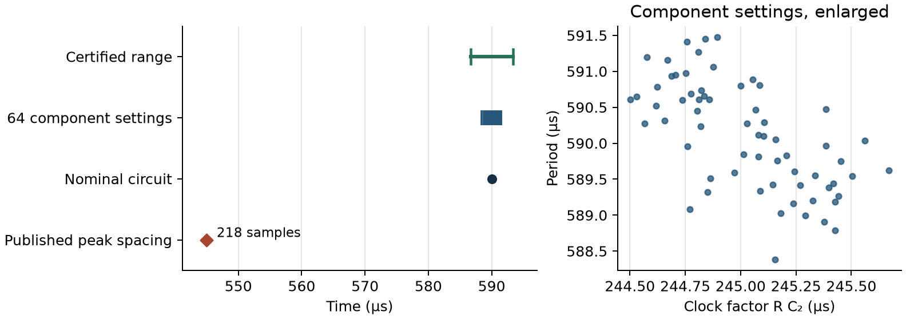
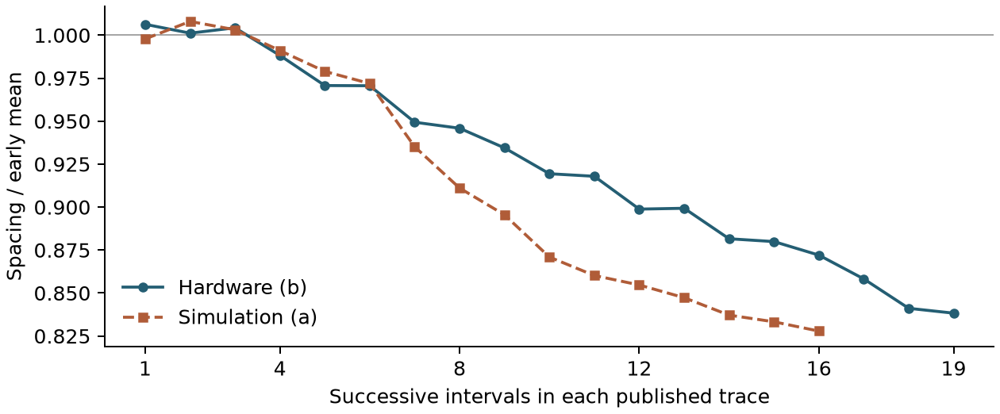

# The saddle-cycle period in Chua’s circuit

Figure 10 of the 2023 circuit experiment marks **218 samples** between two voltage peaks. At the stated 2.5 µs sampling interval this gives **545 µs**. The authors already reported the difference from their model, about 590 µs. Can the stated component uncertainties account for it? For the symmetric saddle cycle of their model, the entire allowed period range lies at least **41.70 µs above** the marked interval. [Original experiment, Fig. 10 and Tables 2–3](https://doi.org/10.1007/s11071-022-08078-y)

| Quantity | µs per turn | Samples at 2.5 µs |
|---|---:|---:|
| Marked hardware interval | 545 | 218 |
| Orbit at nominal component values | 590.00 | 236.00 |
| Orbit at 64 sampled component settings, observed extrema | 588.39–591.48 | 235.35–236.59 |
| Orbit over all allowed settings, outward-rounded enclosure | **586.70–593.35** | **234.68–237.34** |

## What the enclosure covers

We divided the five parameter ranges in Table 2 into 2,048 cells. On each cell an interval shooting calculation enclosed the same saddle cycle, verified its diode crossings and checked its stability. Matching the solutions across all 6,912 internal faces connects them to the nominal orbit. Each period has one upward crossing of $x=-1$. Throughout the orbit $|x|<3.314$ and the second diode breakpoint exceeds 12.177, so the five-segment diode gives the same period. [Interval certificate and source](../results/chua-saddle-period/README.md#interval-certificate)

Physical time is the dimensionless period multiplied by $R C_2$. The same resistance also enters $\beta=C_2R^2/L$, so we used $R C_2=\sqrt{\beta L C_2}$ within each cell. We interpret the reported meter precisions as bounds of ±1% for resistances and ±0.1% for capacitance and inductance. We use $C_2=311$ nF, as in the paper’s time conversion. Equation (10) interchanges the capacitor labels. The 64 numerical settings reuse the measured-component design from the [precharge study](chua-precharge.md).

## What a voltage trace measures

For eight nominal-model launches from the residence experiment, 57 complete turns stayed inside its saddle neighborhood. Counting rising voltage crossings at the scope cadence gave **235–237 samples** over 16 clock phases, including illustrative 1 and 5 mV quantization. Starting instead at the rounded state printed for Fig. 10(a), the first peak-to-peak interval was **235.88 samples**. By the eighth it was **219.90**, and by the ninth **214.07**. At that point the trajectory had left the neighborhood and its peak voltage was growing. [Simulated traces](../results/chua-saddle-period/trace-periods.png) · [Voltage-start experiment](chua-saddle-residence.md)

Peak spacing also changes in the published figure. The last four complete spacings average **0.836** of the first four in the simulation panel and **0.852** in the hardware panel. These ratios use horizontal pixel distances within each panel. The 218-sample marker is on an **early** pair of peaks. The cause of that early discrepancy remains open. Raw timestamps and voltages for each early peak, with the component values for that run, would allow a turn-by-turn comparison. [Digitized peak positions and sensitivity checks](../results/chua-saddle-period/README.md#published-traces)

## Related work

The original paper measured the saddle period, and Galias had already used interval methods to locate periodic orbits in Chua’s circuit. Before this calculation we searched the article DOI with “saddle period”, “218 samples” and “component tolerance”, and screened the titles of 100 citing works returned by OpenAlex on 2026-11-22. We found no prior bound for this Fig. 10 orbit over the Table 2 ranges. [Original article](https://doi.org/10.1007/s11071-022-08078-y) · [Galias on periodic orbits](https://doi.org/10.1007/3-540-30636-6_32) · [Citing works](https://api.openalex.org/works?filter=cites%3AW4312106553&per_page=100&select=id,title,doi)
