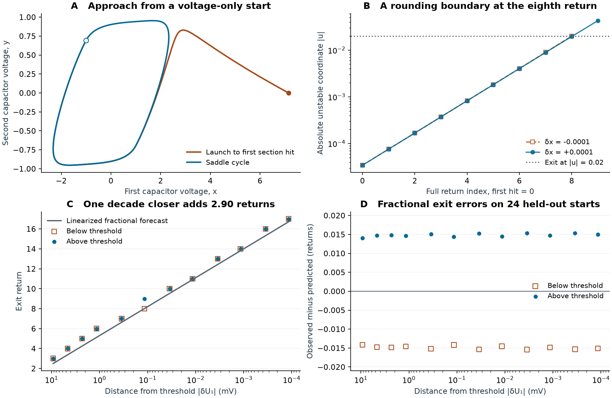

# Voltage-controlled residence near the experimental Chua saddle cycle

How many more oscillations near a saddle cycle can a laboratory see by improving the initial capacitor voltage? On the mathematical parameter set of Kuznetsov and colleagues, bringing the voltage ten times closer to a particular threshold predicts **2.899 additional full returns**. Four numerical comparisons gave 2.8986–2.8994. A forecast committed before the measurements gave the exact integer exit count for 23 of 24 starts, with one error of one return. [Published experimental study, Figs. 9–10 and 14](https://doi.org/10.1007/s11071-022-08078-y) · [Frozen forecasts](https://github.com/Griboedow/chua-gpu-atlas/blob/1de6255e4dd35a9dbf8af5a8564d853b90b6dd64/results/chua-saddle-residence/forecast.json) · [All scores](../results/chua-saddle-residence/scores.csv)

The authors saw 11 oscillations near a saddle in a numerical trace and 8 on their physical circuit. They stabilized the same cycle numerically with Pyragas feedback. Here we transfer the [atlas's residence-time prediction](chua-prediction-and-hidden-coexistence.md#2-excitation-of-a-hidden-attracting-cycle) to their circuit and its single-capacitor launch. The two published traces give a comparison at one setting. Testing the slope on a device requires several controlled launches.



**Figure 1.** The open circle in A marks the section point. B shows the offset pair with different integer counts. C–D compare the held-out measurements with the frozen forecast.

## Locating the saddle and the voltage threshold

We use the continuous three-segment equations (6)–(7) and the mathematical column of Table 2. The parameters are α = 8.41, β = 12.23, γ = 0.0435, m₀ = −1.366 and m₁ = −0.17, with ż = −βy − γz. The launch is (x₀, 0, 0). In the paper's convention x₀ = U₁(0)/B, with B ≈ 1.1606 V. Figure 9 varies U₁ with U₂ and the nominal initial coil current zero. The smaller differences between the physical and mathematical columns of Table 2 matter for setting the threshold on an individual device. [Source, §§3–4 and Table 2](https://doi.org/10.1007/s11071-022-08078-y)

Starting from the published point (−2.321, −0.787, 3.129), we refine a fixed point of the first return to x = −1 with increasing x. The section point is (y,z) ≈ (0.69457429, 3.40794063). One full period is T ≈ 2.40777474 in dimensionless time. Table 3 gives 2.406 by integration and 2.408 by feedback stabilization. The two nontrivial full-return multipliers are approximately 2.21284118 and 8.43 × 10⁻⁷. The flow in each diode segment is affine. We solve for the breakpoint times, propagate the variational equation on each flight, and project its derivative back onto the section. [Flight and shooting implementation](../research/observed_saddle_flights.py)

Let p be the saddle section point, P the return map, q(x₀) the first section hit after precharge, and ℓ ≈ (0.88327345, 0.46885821) the unit left eigenvector for λᵤ = 2.21284118. Roots of ℓ·(Pᵏq(x₀)−p) = 0 locate a transverse approach along the voltage line. For k = 0, 1 and 2, the section distances at the respective roots were 4.51 × 10⁻⁶, 3.80 × 10⁻¹² and below 10⁻¹⁵. Depths 1–3 gave the same start to 13 decimal places. This gives the numerical estimate

$$
x_* \simeq 7.14768463881, \qquad U_* \simeq 8.29560\;\mathrm V.
$$

The nonzero projected derivative with respect to launch voltage distinguishes a crossing from a grazing approach. The derivative after two additional full returns, divided by λᵤ², gives the entry sensitivity G ≈ 0.34417007 per unit x₀. This calculation identifies one local crossing of the stable manifold. Other voltage settings and other basin boundaries can occur on the same launch line.

## Predicting the observable

The first section hit counts as index 0. The exit count N is the first index with |ℓ·(qₙ−p)| ≥ 0.02. For small nonzero launch offset δx = x₀−x*, the leading unstable displacement grows as G δx λᵤⁿ. Solving for the crossing gives

$$
n_{\mathrm{pred}} = \frac{\log [0.02/(G |\delta x|)]}{\log \lambda_u},
\qquad N_{\mathrm{pred}}=\lceil n_{\mathrm{pred}}\rceil .
$$

The published forecast specified both signs of 12 offset magnitudes from 10⁻⁷ to 0.008. It used the return derivative to set the gain and slope, with no fit to measured residence counts. For an observed fractional index we interpolate linearly in the logarithm of absolute projected displacement between the last point inside and the first point outside. This makes the fractional comparison reproducible for a discrete section. [Forecast commit](https://github.com/Griboedow/chua-gpu-atlas/commit/1de6255e4dd35a9dbf8af5a8564d853b90b6dd64)

| Absolute launch offset | Nominal voltage offset | Predicted exit | Measured below | Measured above |
|---:|---:|---:|---:|---:|
| 0.008 | 9.285 mV | 3 | 3 | 3 |
| 0.001 | 1.161 mV | 6 | 6 | 6 |
| 0.0001 | 0.1161 mV | 9 | 8 | 9 |
| 0.00001 | 0.01161 mV | 11 | 11 | 11 |
| 0.000001 | 0.001161 mV | 14 | 14 | 14 |
| 0.0000001 | 0.0001161 mV | 17 | 17 | 17 |

The largest absolute fractional error was 0.01540 return, below the declared tolerance of 0.35. At δx = −0.0001 the observed fractional index was 7.999295, crossing just before the eighth return while the forecast rounded up to nine. The RMS fractional error was 0.01485. Replacing λᵤ with the control value 1.5 at the original gain gave an RMS error of 9.745 returns. For each sign, we compared successive decades from 0.001 to 0.00001. All four increments differed from log(10)/log(λᵤ) by less than 0.00039 return. [Measurements and controls](../results/chua-saddle-residence/measurements.json)

## Independent checks and circuit interpretation

For the duration of one turn in microseconds and how it appears on an oscilloscope, see the [saddle-period comparison](chua-saddle-period.md).

An unsplit DOP853 integration of the absolute-value field reproduced all eight preselected integer counts. Its largest fractional difference from the affine-flight solver was 0.000047 return. It located the two-hit threshold within 4.4 × 10⁻¹¹ in x₀ of the affine result. Centered finite differences of the independent return gave λᵤ = 2.2128411 and 2.2128394 at two step sizes. Halving the flight event-bracketing step preserved all 24 integer counts. These comparisons report numerical agreement. They provide no interval error bound. [Independent integration and scoring](../research/observed_saddle_validate.py)

The largest absolute x during any scored launch through its exit was 7.156 or less, from endpoints and numerical extrema on each affine flight. The physical diode's second breakpoint is near |x| = 14.408/1.1606 ≈ 12.41. Its extra saturation segment therefore lies outside the observed residence paths. It matters for later dynamics. For δx = +0.001, a direct trajectory approached an attracting outer cycle of the three-segment model, with the last return at t ≤ 750 within 8.5 × 10⁻⁷ of its refined section point. The calculated outer cycle reaches |x| ≈ 19.43. For δx = −0.001 the trajectory approached the positive stable equilibrium and was inside its local quadratic capture ellipsoid at t = 250. These are two selected post-exit outcomes. [Numerical post-exit records](../results/chua-saddle-residence/measurements.json)

A direct five-segment control at the same upper launch gave a later cycle reaching |x| ≈ 12.64, with period 1.9463 versus 1.9412 in the three-segment model. [Circuit precharge study](chua-precharge.md) · [Five-segment comparison](../results/chua-precharge/transfer.json)

For a bench test, locate the threshold on the device with U₂(0) and the coil current near zero. Vary the initial voltage on both sides across the usable range of resolution. In the ideal equations z = ẏ − x + y, so both measured voltage traces can reconstruct the section observable. A waveform-based exit rule needs its own calibration for comparing absolute counts. The [noise study](../results/chua-residence-noise/README.md) examines how finite resolution changes the predicted counts.

## Reproduce

From the repository root with NumPy, SciPy, Matplotlib and python-flint installed, this CPU-only command reads the frozen forecast, remeasures the launches and controls, and regenerates Figure 1.

```shell
python research/observed_saddle_validate.py --figure
```

The new CSV, JSON and PNG go to `outputs/chua-saddle-residence/`. Use `--output-dir PATH` to choose another destination. Working precision is binary64. [Published records](../results/chua-saddle-residence/README.md)
