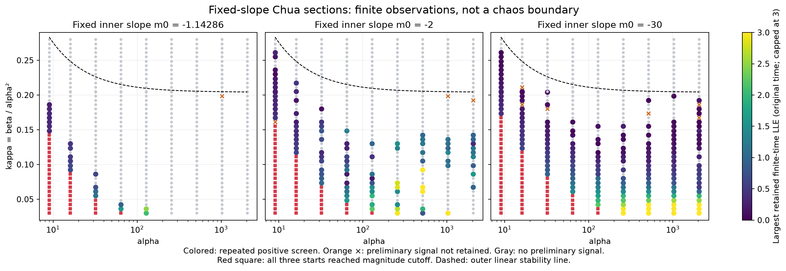
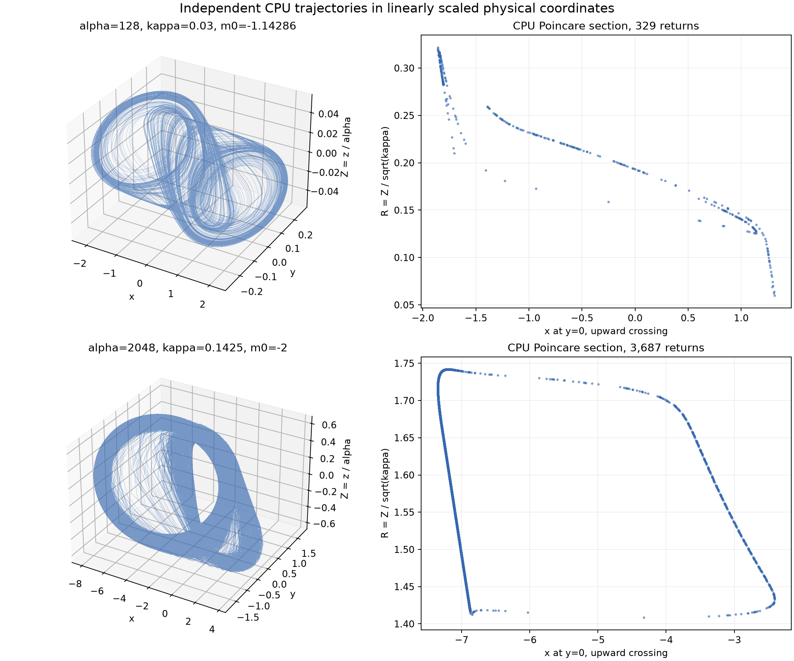

# Numerical continuation of Chua dynamics along beta = kappa alpha squared

We investigate the path β = κα² at fixed diode slopes using exactly rescaled equations and independent numerical controls. The finite calculation extends to α = 2048. Persistence of chaotic attractors as α tends to infinity remains open.

The zero-epsilon model has regular periodic fibers. Coexisting fibers can produce opposite signs of slow amplitude drift, suggesting a mechanism for further analysis at finite epsilon. These observations do not establish a limiting chaotic attractor. The [structural analysis](chua-scaling-structure.md) gives the derivations and primary references.

## Rescaled model and parameter sampling

With $\beta=\kappa\alpha^2$, use $s=\alpha t$ and $Z=z/\alpha$. The exact equations are

```math
x_s=y-x-f(x),\qquad
y_s=Z+\frac{x-y}{\alpha},\qquad
Z_s=-\kappa y.
```

The diode and its breakpoints are unchanged. Requested transient and observation lengths, and reported Lyapunov rates, use the **original dimensionless time** $t$. The tangent norm is Euclidean in $(x,y,Z)$; its finite-window value need not match the historical norm in $(x,y,z)$.

The grid has 1,890 parameter tuples and three starts per tuple:

| Quantity | Values |
|---|---|
| alpha | 9, 16, 32, 64, 128, 256, 512, 1024, 2048 |
| kappa | 41 evenly spaced values from 0.03 to 0.28, plus 10/49 |
| inner diode slope m0 | -8/7, -2, -5, -10, -30 |
| outer diode slope m1 | -5/7 throughout |
| starts in scaled coordinates | (0.7, 0, 0), (0.7, 0.5, 0), (-0.7, 2, 0) |

One start has zero initial oscillator action; the other two have finite action. This is a small prescribed set of basins, not a basin census. The maximal sampled beta is 1,174,405.12. Parameters outside the grid, including kappa below 0.03, are unclassified.

The FP64 GTX 1080 solver uses adaptive Dormand–Prince 5(4), controlling the state and tangent together. The scout discards 100 original-time units and observes 200, with relative tolerance 1e-8 and maximum fast-time step 0.25. All preliminary signals are then continued from saved endpoints for another 100 discarded plus 400 observed units, at relative tolerance 1e-11 and maximum fast-time step 0.125. Absolute tolerances are 0.001 times the relative tolerances. The numerical magnitude cutoff is 1e6 in scaled coordinates.

| Stage | Trajectories | Completed observation | Positive window screen |
|---|---:|---:|---:|
| Scout | 5,670 | 4,744 | 1,617 |
| Tighter continuation, including clock repair | 1,617 selected | 1,616 | 1,536 |

The screen requires a mean rate above 0.01 and a rate above 0.005 in **each** of four observation windows. The other 926 scout trajectories and one selected continuation reach the magnitude cutoff; this alone is not a mathematical proof of divergence. At alpha = 2048, 184 of the 222 selected trajectories retain the positive screen. Counts refer to trajectories, not distinct parameter tuples or parameter-space volume.



Colored points have at least one repeated positive start. Gray points had no preliminary positive start in this finite scout. Orange crosses lost the screen or reached a cutoff during the tighter continuation. The dashed line is the **local outer-equilibrium stability line**, not a global chaos boundary. The standard inner slope loses most of its coarse-grid signals as alpha grows; that does not exclude unsampled narrower or lower-kappa regimes.

## Independent checks and their limits

Four short GPU controls pass against independent DOP853 integrations, original-coordinate Radau integrations, and an exact outer-equilibrium matrix exponential. The largest short-control logarithmic-growth discrepancy is about 2.6e-9. These checks include alpha = 4096, although the survey stops at 2048.

Two selected full-field CPU checks retain positive leading rates:

| Scout row | alpha, kappa, m0 | CPU observation in original time | CPU finite-time spectrum |
|---|---|---:|---|
| 504 | 128, 0.03, -8/7 | 100 completed | (2.31002, -0.00744, -18.55180) |
| 2198, aligned rerun | 2048, 0.1425, -2 | 30 completed | (0.96027, -0.04348, -438.05114) |

The CPU solver uses DOP853 and the full piecewise field at every stage. QR factors are formed every five fast-time units; sections record $y=0$ upward crossings. For row 2198, the tighter aligned run uses relative tolerance 5e-12, maximum fast-time step 0.075, and evolves the QR basis during the five-unit discarded transient. The matched GPU leading rate is **0.95980**, versus **0.96027** on CPU. Both have positive leading rates in all four matched windows. Individual window values differ by up to about 0.30, so the similar whole-interval means must not be advertised as uniform exponent convergence.

At the beginning of that observation, the maximum CPU/GPU state difference is 6.1e-8; at its end it is 0.00343. The full-spectrum sum agrees with the integrated divergence to 1.3e-10. The finite-time flow-direction rate is -0.02408. The second QR rate is therefore not required to equal zero over this short interval, and the numbers above are **not converged asymptotic spectra**.



These are linearly scaled physical coordinates of the three-state Chua system. The high-alpha section is thin and strongly structured. Its appearance alone cannot distinguish a periodic, quasiperiodic, or chaotic set. The positive numerical rates provide additional evidence for these selected finite regimes; no compact attracting invariant set has been rigorously certified. Nor is this a claim of a new geometric attractor type.

An earlier row-2198 CPU attempt failed because a large absolute fast-time clock could not represent a requested tiny step at a diode crossing. Its failure record is retained. A local-clock rerun hit its wall budget after 21.11572 of 30 requested observation units; that partial record also remains separate. It used an identity QR basis after a state-only warm-up, which can delay alignment severely at large alpha. The completed aligned rerun above fixes both operational issues without filling or relabeling the old missing interval.

## An affine transient with a positive finite-time exponent

Scout row 963 has alpha = 1024, kappa = 0.19875 and the standard slopes. Its four positive rates are about 0.0113–0.0115. Nevertheless, its **entire 200-unit observation can be confined analytically to the positive affine branch**.

The outer equilibrium has x = 1.5. An eigenvector envelope bounds the whole exact affine solution by $|x-1.5|\leq0.092842$, so it never reaches a diode breakpoint. Its unstable oscillatory eigenvalues have real part 0.01075655 in original time. That explains the positive finite-time growth without a strange attractor. The exact affine endpoint differs from the scout endpoint by 4.46e-6. The longer continuation loses the positive-window criterion; its eventual behavior outside these observations is not classified by the affine argument.

This counterexample is why the grid is called a **finite-time candidate screen**, even after a tolerance check.

## Periodic fibers and amplitude drift

At infinite alpha, the pair $(y,Z)$ is a harmonic oscillator of fixed amplitude. Its scalar forced equation has an increasing stroboscopic map, so every bounded sequence of returns converges to a fixed point. The limiting fiber itself cannot support recurrent chaos. This order argument does not interchange the infinite-time and infinite-alpha limits.

For row 2198, the five saved observation boundaries give oscillator amplitudes from 1.43027 to 1.71451. Independent frozen-fiber calculations find more than one stable periodic response. At amplitudes 1.67528 and 1.71451 there are **three verified stable responses**: a central response crossing both wells, and two symmetry-related outer responses.

The central response changes stability between the sampled amplitudes 1.52714 and 1.67528: its scalar multiplier changes from 1.16643 to 0.44135. We did not locate or classify the bifurcation. At amplitude 1.71451, the original-time averaged action drift is +0.0490613 on an outer response and -0.351642 on the central response. The 20 periodic controls were independently checked with DOP853 and Radau; action averages were checked with two quadratures.

This supplies a concrete hypothesis: **branch selection and opposite slow amplitude drifts may matter for the finite-alpha switching dynamics**. It rules out assuming a single globally selected attracting fiber in this example. It does not establish a complete return-map mechanism, a limiting chaotic structure, or publication novelty. The exact calculations and primary-literature qualifications are in the [structural note](chua-scaling-structure.md#frozen-fibers-sampled-from-one-finite-parameter-scout).

## Numerical clock repair and preserved evidence

The first tight GPU continuation completed 1,555 rows and encountered 61 numerical failures, all at alpha = 2048. Every failure satisfied `t + h == t` at a large fast-time clock; none reached the old minimum-step guard. Because the field is autonomous, a state update can still be represented even when that absolute clock increment is below one floating-point spacing.

The corrected backend retains small increments with Kahan compensation. Only those 61 failed rows were resumed from their saved state, tangent, clock, log sums and step counts. All 61 then completed; 53 retained the positive screen. Previously completed window log sums and boundary states remain **bitwise unchanged**. The original incomplete records, the legacy kernel and the resumption audit are preserved. A numerical clock failure is neither a physical escape nor evidence for or against chaos.

Scout, first refinement and only-failed-row resumption took approximately 181.7, 744.2 and 239.6 wall seconds respectively on this machine. These are recorded run times, not a CPU/GPU speedup benchmark.

## Reproduction and evidence

Run from the repository root with the project dependencies installed. The historical sequence, including its preserved clock failures, is:

```bash
python research/chua_scaling_gpu.py controls
python research/chua_scaling_gpu.py survey --clock-mode legacy
python research/chua_scaling_gpu.py refine --clock-mode legacy
python research/chua_scaling_gpu.py resume_clock
python research/audit_chua_scaling.py
python research/probe_chua_fiber.py
python research/check_chua_scaling.py 504 --duration 100 --transient 20 --wall 300 --state-only-warm
python research/check_chua_scaling.py 2198 --duration 30 --transient 5 --step 0.075 --rtol 5e-12 --wall 600 --label cpu-2198-aligned
python research/match_chua_scaling.py
python research/analyze_chua_scaling.py
python research/plot_chua_scaling.py
```

The legacy option exists to reproduce the numerical failure history. Fresh investigations should use the default compensated clock. Wall limits are machine dependent; an incomplete run must remain marked incomplete. Regenerating files replaces their local copies, and chaotic endpoints need not agree bitwise across environments.

All settings and raw arrays are under [results/chua-scaling](../results/chua-scaling). The [summary](../results/chua-scaling/summary.json), [CPU/GPU comparison](../results/chua-scaling/cpu-gpu-2198-comparison.json), [affine counterexample](../results/chua-scaling/affine-transient-963.json), [clock audit](../results/chua-scaling/clock-resume-audit.json), and [frozen-fiber evidence](../results/chua-scaling/fiber-probe.json) distinguish the different claims. The original atlas arrays and their historical validation records are unchanged.

## References

1. L. O. Chua, M. Komuro and T. Matsumoto, *The Double Scroll Family*, **IEEE Transactions on Circuits and Systems 33**, 1073–1118 (1986). [DOI:10.1109/TCS.1986.1085869](https://doi.org/10.1109/TCS.1986.1085869).
2. B. Rossetto, *Chua's circuit as a slow-fast autonomous dynamical system*, **Journal of Circuits, Systems and Computers 3**, 483–496 (1993). [Reprinted chapter DOI](https://doi.org/10.1142/9789812798855_0037). Publisher abstract inspected; full chapter unavailable in this pass.
3. R. D. Euzebio and J. Llibre, *Zero-Hopf bifurcation in a Chua system*, **Nonlinear Analysis: Real World Applications 37**, 31–40 (2017). [DOI:10.1016/j.nonrwa.2017.02.002](https://doi.org/10.1016/j.nonrwa.2017.02.002). This concerns a different cubic model and scaling.
