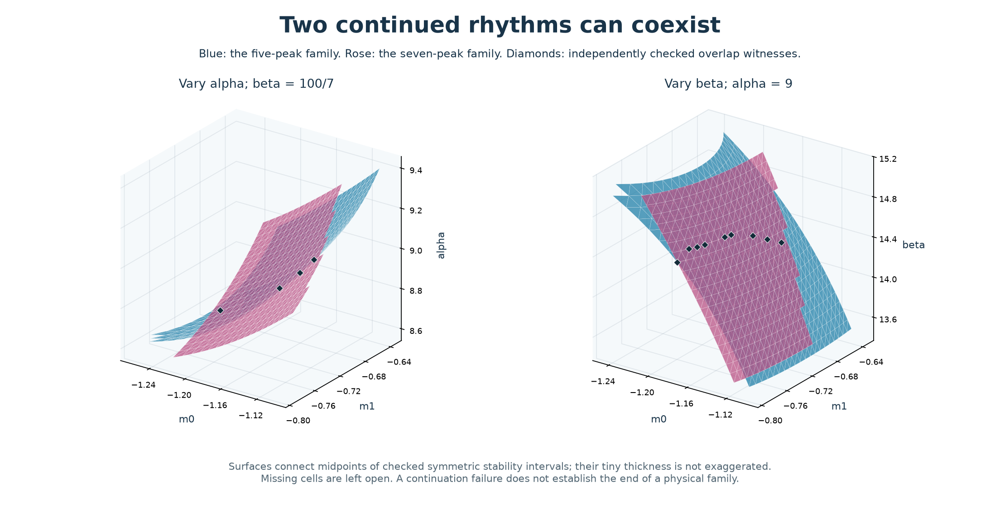
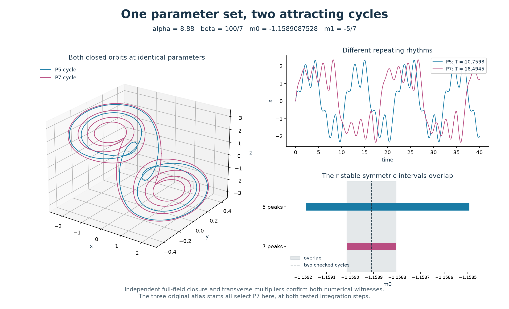
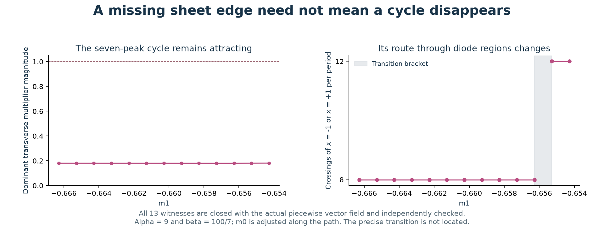
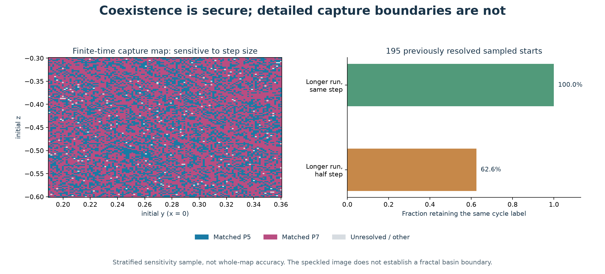

# What the slope-volume layers contain

**Two tracked families overlap: one parameter set can support both a five-peak and a seven-peak attracting cycle.** Continuation also exposes layers far thinner than the original 3D grid and a missing sheet edge where the physical cycle survives by changing its route through the diode regions.

These results follow the two independently closed cycles from the [slope-plane study](chua-slope-plane.md). Local labels **P5** and **P7** refer to those particular continued families. They do not identify every five- or seven-peak orbit, add two new entries to the earlier 32-family catalogue, or provide a global layer count.



Blue follows P5; rose follows P7. Black diamonds mark parameter sets where **both cycles** were closed and independently checked. The surfaces linearly connect the midpoints of continued stable symmetric intervals. Their physical thickness is not enlarged, and cells with missing vertices are omitted. Surface interpolation itself is not evidence of coexistence. A [slow 24-second rotation](assets/chua-slope-family-sheets.gif) uses fixed tilt and zero roll.

## A concrete overlap

At

```text
alpha = 8.88
beta  = 100/7
m0    = -1.15890875278166
m1    = -5/7
```

two different attracting periodic orbits coexist:

| Continued family | Peaks per period | Period | Dominant transverse multiplier magnitude |
|---|---:|---:|---:|
| P5 | 5 | 10.7598408556 | 0.316719158 |
| P7 | 7 | 18.4944609658 | 0.183939300 |

Both multiplier magnitudes are below one. Independent full-field state-and-variational integration closes these witnesses to better than 2.5e-12 and agrees on their dominant multipliers to better than 1.5e-9. Their different periods and peak patterns distinguish two orbits at exactly the same parameters.



The three original atlas starts all select P7 at this witness, both at the baseline step and at half the step with longer integration. A scan using those starts can miss P5 even when the parameter point itself is sampled. **Denser parameter sampling alone does not recover all families: initial-state coverage and orbit continuation also matter.**

Across the new continuation meshes, 13 parameter witnesses were independently verified: four in the alpha volume and nine in the beta volume. Each has two closed attracting cycles. The continued overlap intervals in m0 range from approximately 1.37e-6 to 5.59e-4 wide. These are sampled witnesses, not a complete map of all overlaps or a certification of every point between interval endpoints. See [overlaps.json](../results/chua-slope-families/overlaps.json).

## Why the original volume misses thin layers

At alpha = 9, beta = 100/7, m1 = -5/7, the two central symmetric stability intervals are:

| Family | Symmetry-loss edge in m0 | Fold edge in m0 | Width in m0 | Original 3D step / width |
|---|---:|---:|---:|---:|
| P5 | -1.1408052526 | -1.1398776866 | 0.000927566 | 10.8 |
| P7 | -1.1465478668 | -1.1463659114 | 0.000181955 | 55.0 |

The original volume step in m0 is 0.01. An entire P7 symmetric core can fit between adjacent grid planes about 55 times over. These widths describe the symmetric attracting cores; stable asymmetric extensions can lie beyond them.

Continuation follows the orbit and solves its marginal-stability equations directly. The local meshes use 21 m1 values in [-5/7 - 0.08, -5/7 + 0.08] and 21 alpha values in [8.6, 9.4], or 21 beta values in [100/7 - 0.8, 100/7 + 0.8]. The other control parameter remains at its classical value. At each successful node, m0 is solved for both edges and an attracting cycle is closed between them.

There are **1,599 successful family cross-sections** out of 1,764 requested: P5 has 438 alpha and 440 beta nodes; P7 has 361 alpha and 360 beta nodes. Forty-five attempted nodes failed the continuation checks, and another 120 were not reached by the connected traversal. Those missing nodes are not classified as cycle deaths. All accepted core witnesses retain the reference peak count. Sixty selected edge/core records pass independent full-field controls; their maximum closure error is 1.53e-11 and maximum dominant-multiplier discrepancy is 6.67e-9.

## Two different mechanisms at the central edges

For both families, decreasing m0 through the fold edge produces a stable/saddle pair of symmetric cycles. The closing Jacobian has one small singular value, and the projected parameter and quadratic coefficients stay nonzero under three finite-difference steps. Two nearby distinct cycles are recovered at the same parameters, with transverse multiplier magnitudes on opposite sides of one. This is numerical evidence for a generic saddle-node of cycles.

At the other edge, the symmetric cycle loses stability while a pair of attracting asymmetric cycles appears. The two new cycles are related by state inversion with a phase shift: the measured inversion-pair errors are below 2.9e-10. Slightly beyond the edge, their multiplier magnitudes are about 0.613, while the symmetric parent has a magnitude about 1.196 or 1.198. This supports a symmetry-breaking pitchfork. The original symmetric core ending does not mean that all regular motion ends there.

The signed half-return multipliers distinguish these mechanisms: +1 at the fold and -1 at the symmetry edge. Both correspond to +1 in the full-period map. The [bifurcation records](../results/chua-slope-families/bifurcations.json) retain the coefficients, stable/saddle pair, asymmetric pair, unstable parent and independent checks. These are numerical witnesses, not interval-certified theorems.

## An apparent ending caused by a changed itinerary

The P7 fixed-itinerary continuation develops a missing edge as m1 increases near -0.66. Direct shooting with the actual piecewise vector field follows the seven-peak attracting cycle beyond that edge. Along the checked path, m0 is adjusted and alpha = 9, beta = 100/7 stay fixed.



All 13 independently checked path witnesses remain symmetric, attracting and seven-peaked. Between the sampled values m1 = -0.6562857143 and -0.6552857143, the number of crossings of x = +/-1 changes from eight to twelve per full period. The dominant transverse multiplier magnitude remains around 0.18. The original sequence of affine flights therefore stops describing the orbit, even though the orbit survives. This is consistent with a grazing-related itinerary change; the precise contact parameter and its normal form have not been solved.

Invalid fixed-itinerary edge roots are retained only as a predictor for the m0 values used in this path. They are never accepted as physical boundaries. The [path records](../results/chua-slope-families/itinerary-change.json) include that distinction.

## What the basin experiment does not settle

A 121 by 121 initial-state slice at the overlap witness gives 5,593 captures matching P5, 8,835 matching P7 and 213 unresolved outcomes. Matching uses the ordered peak-height signature of the closed reference, repeated peak count, and a preceding regular-candidate screen. These are finite-time assignments.



The sensitivity check deliberately samples each outcome category. Among 195 previously resolved sampled starts, extending the run at the same step retains all 195 labels. Halving the step as well changes 73 of those 195 labels between P5 and P7. All 96 sampled unresolved starts resolve in both longer calculations. Across all 291 samples, combined step/time agreement is 41.92%; among the previously resolved samples it is 62.56%. Neither percentage estimates whole-map accuracy.

The existence of the two attracting cycles is supported by independent orbit checks. Their finely speckled capture boundaries remain numerically sensitive. This experiment does not establish a fractal basin boundary or reliable basin areas.

The [data guide](../results/chua-slope-families/README.md) contains reproduction commands and [audit.json](../results/chua-slope-families/audit.json) summarizes numerical checks. Periodic windows in Chua's circuit are already known experimentally; this report makes specific claims about the tracked witnesses in this atlas, not priority claims about the general phenomenon. See [Maranhao et al., Experimental observation of a complex periodic window](https://arxiv.org/abs/0712.3842).
