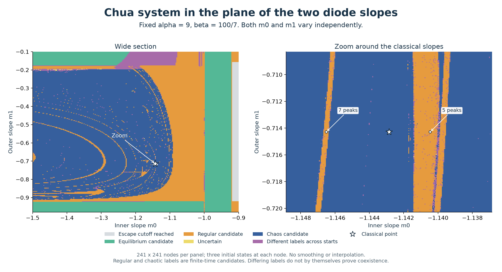
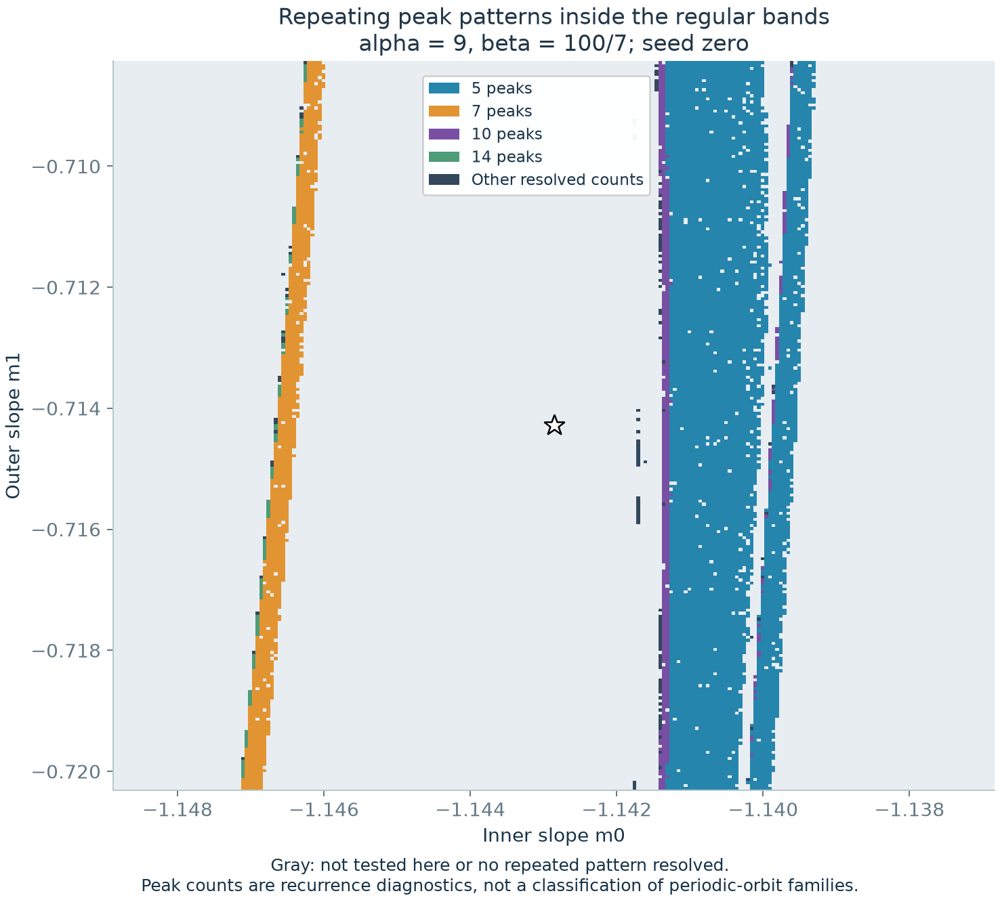

# Chua in the plane of the two diode slopes

At **alpha = 9 and beta = 100/7**, varying the inner slope **m0** and outer slope **m1** produces a broad chaotic-candidate region crossed by **nested curved regular bands**. Near the classical slopes, these bands look almost vertical. Two selected bands contain independently checked attracting cycles with **five and seven peaks per period**.

This is a new two-dimensional section of the four-parameter model. The earlier three-dimensional atlas varied alpha, beta and m0 while fixing m1. Rotating that earlier plot cannot produce this section, and its count of 32 catalogued families does not automatically carry over.

The [three-dimensional extension](chua-slope-volumes.md) now varies alpha or beta as the third coordinate. It includes full and cropped volume views, a slow rotation, and an interactive section viewer. This 2D map is the common central section of both new volumes.

## Reading the picture

- **Blue:** all three starts meet the finite-time chaos-candidate criterion.
- **Orange:** all three have negative or near-zero late exponents without meeting the equilibrium criterion. Periodicity is not established for every orange pixel.
- **Green:** all three meet the equilibrium-candidate criterion.
- **Purple:** the starts receive different classifications. This can indicate basin dependence or unresolved transients; it does not alone establish coexisting attractors.
- **Yellow:** all three remain uncertain. **Gray:** all three reach the operational coordinate cutoff of 100.

The star marks m0 = -8/7, m1 = -5/7. In the wide panel, the regular bands curve back through the chaotic-candidate region. The zoom resolves several narrow bands and a broader strip to the right of the star. What looks like a thin layer in a higher-dimensional parameter view appears here as a band with nonzero width. The displayed pixels remain finite samples, so gaps and isolated pixels are not established branch endpoints.

## Different rhythms in neighboring bands

The peak diagnostic examines the first start at all 9,158 zoom nodes where the preceding three-start screen was uniformly regular. It resolves a repeating peak pattern at 9,138 of them. The most common detected patterns contain **5 peaks (7,111 nodes)** and **7 peaks (1,237 nodes)**. Patterns with 10 and 14 peaks also occur. These counts do not establish ancestry, period doubling, or distinct family identities by themselves.

Two examples on m1 = -5/7 were then closed by full-field shooting and checked by a separate state-and-variational integration:

| Peaks per full cycle | m0 | Period | Dominant transverse multiplier magnitude |
|---:|---:|---:|---:|
| 5 | -1.1404571428571428 | 10.877037 | 0.356585 |
| 7 | -1.1465071428571427 | 18.525046 | 0.591132 |

Both magnitudes are below one, supporting attraction. Independent closure errors are below 1.03e-8, and multiplier discrepancies below 2.57e-8. These are two numerical examples, not a count of all periodic families in this plane. The [cycle records](../results/chua-slope-plane/closed-cycles.json) retain the parameters, shooting vectors and checks.

## Resolution and reliability

Each panel has **241 by 241 nodes**, with the same three prescribed starts used in the earlier atlas. Alpha and beta stay fixed throughout. The wide domain is m0 in [-1.5, -0.9], m1 in [-0.98, -0.10]. The zoom extends 0.006 in each slope direction from the classical point, giving spacing **5e-5** on both axes.

The FP64 GPU calculation uses RK4 step 0.005. The wide view discards 600 time units and observes another 1,600; the zoom discards 1,000 and observes another 2,000. Four Lyapunov windows and the earlier threshold rules determine each start's classification. No smoothing or interpolated image values are used. No tangent-vector numerical failures were returned.

A stratified sample of **512 nodes per panel** was rerun at half the step and twice both durations. Exact displayed-label agreement was **86.13% for the wide view** and **88.87% for the zoom**. The sample deliberately overrepresents uncertain and mixed categories; these percentages are not estimates of whole-grid accuracy. All 128 sampled uniformly chaotic nodes in the wide view and all 326 in the zoom retained that label. Uniformly regular labels persisted at 91/97 and 110/113 sampled nodes, respectively. Many initially uncertain or mixed points changed classification. Step size and integration duration changed together, so this experiment does not separate their effects.

Independent full-field DOP853 controls cover a chaotic example, a regular example, an equilibrium and all three outcomes at one mixed node. At the classical point, all four independent Lyapunov windows remain positive. The two closed-cycle checks provide stronger evidence for the selected regular bands. The full map is still a finite-time screen: it does not locate exact boundaries, resolve every narrow window, establish a fractal dimension, or count all layers.

The [data and reproduction guide](../results/chua-slope-plane/README.md) includes both grids, per-start results, the complete refinement comparison, peak diagnostics and controls.
