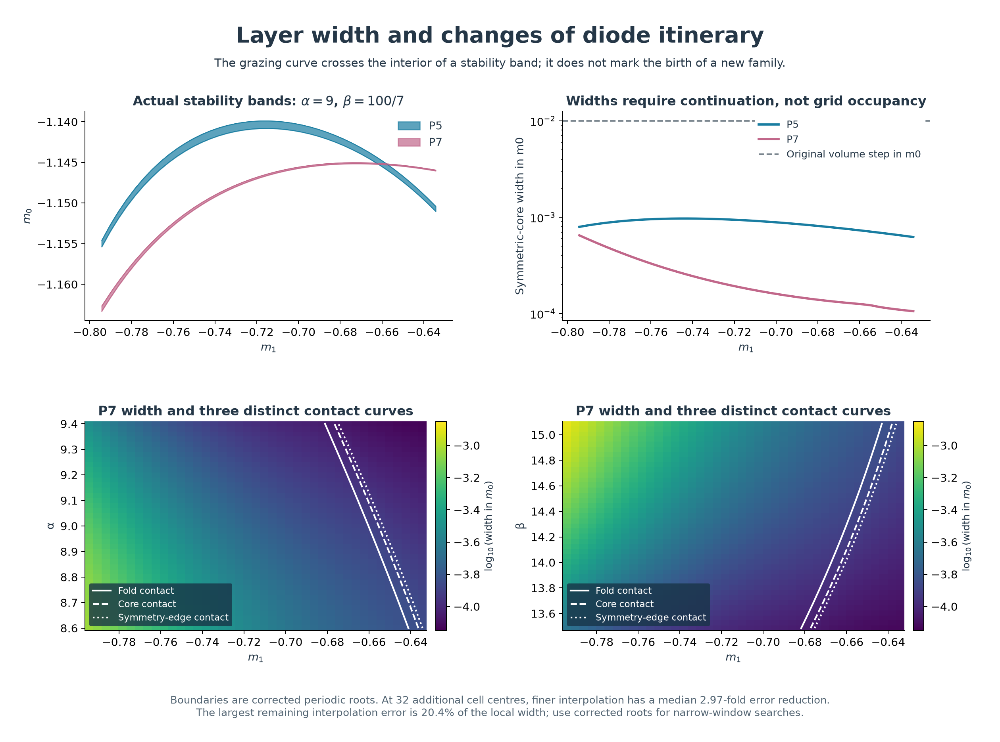
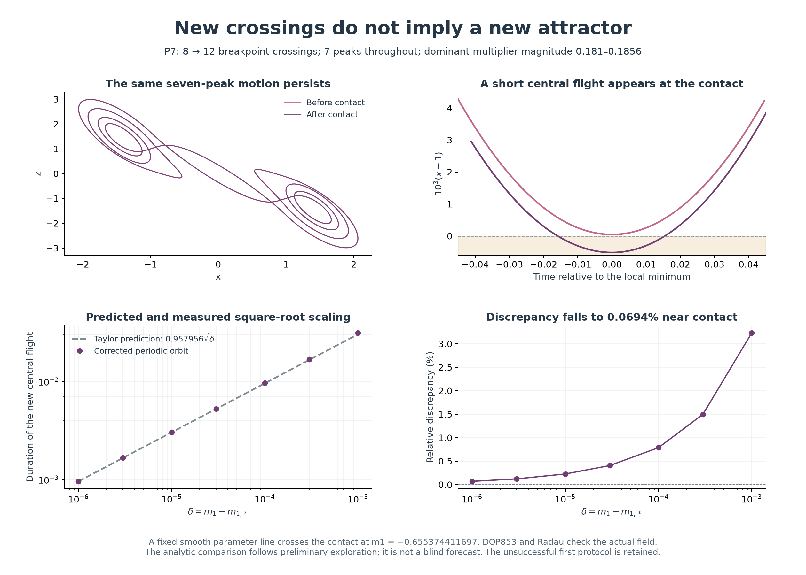

# Refined two-slope atlases and the distinction between cycle birth and grazing

## Abstract

We refine two locally continued periodic families in the parameter volumes (m₀,m₁,α) and (m₀,m₁,β). The meshes contain 6,713 accepted cross-sections out of 6,724 requested, compared with 1,599 in the preceding calculation. Allowing each periodic root to change its diode-region itinerary recovers all 161 previously missing P7 nodes. A quadratic contact with a diode breakpoint changes the number of crossings from eight to twelve without destroying the attracting seven-peak cycle. Its location and a local square-root duration law are computed and checked against independent integration. Twelve separated branch-switch controls retain the fold and symmetry-breaking mechanisms. These are numerical continuation results, not interval certificates or an exhaustive atlas.


Figure 1. Blue and rose identify the continued P5 and P7 families. Purple identifies P7 cores with the additional diode crossings; it is part of the same family. The gold curve locates contact on a selected attracting P7 branch with signed half-return multiplier −0.43. Facets interpolate core midpoints at their actual parameter coordinates. They do not display the true stability thickness or certify the cells between nodes.

## 1. Question and relation to the earlier atlas

The original [slope volumes](chua-slope-volumes.md) show a finite-time regular-motion classification. A connected surface in that classification need not identify one periodic family, and a missing surface need not establish that a cycle ends. The [first family continuation](chua-slope-families.md) resolved P5 and P7 but prescribed one diode-region itinerary throughout each volume. This restriction left holes near a change in P7's path through the piecewise-linear regions.

Both diode slopes are physically relevant parameters. The study by [Kuznetsov and collaborators, including Chua](https://doi.org/10.1007/s11071-022-08078-y) discusses the (m₀,m₁) plane, bifurcation scenarios and component constraints. The present calculation follows our classical P5/P7 branches near α = 9, β = 100/7, with γ = 0. It is not a replication or complete refinement of that paper's hidden-attractor regions at other α, β and γ values. Historical priority for these particular continued sheets is not claimed.

Here P5 and P7 retain their earlier continuation identities. Five or seven peaks alone do not define an identity, and the two labels do not add two entries to the 34-reference catalogue.

## 2. Refined volumes and remaining numerical resolution

Each family uses 41 m₁ values in [−5/7 − 0.08, −5/7 + 0.08]. The third coordinate is either 41 α values in [8.6, 9.4] at β = 100/7, or 41 β values in [100/7 − 0.8, 100/7 + 0.8] at α = 9. Thus the increments are Δm₁ = 0.004, Δα = 0.02 and Δβ = 0.04. At every accepted node, m₀ is solved separately for a fold, a symmetry-loss edge and an attracting midpoint cycle. There is no uniform m₀ sampling step in this calculation.

| Family and volume | Previous accepted nodes | Refined accepted nodes / requested | Recovered old missing nodes | Sampled symmetric-core widths in m₀ |
|---|---:|---:|---:|---:|
| P5, varying α | 438 | 1,671 / 1,681 | 0 | 1.95865e−4 to 2.79966e−3 |
| P5, varying β | 440 | 1,680 / 1,681 | 0 | 2.24580e−4 to 2.85777e−3 |
| P7, varying α | 361 | 1,681 / 1,681 | 80 | 7.25954e−5 to 9.04971e−4 |
| P7, varying β | 360 | 1,681 / 1,681 | 81 | 7.53160e−5 to 1.26059e−3 |

The two volumes share their central section, so these totals count mesh records, not distinct parameter points. All previous accepted nodes are retained and rechecked. Of the eleven remaining P5 holes, five were attempted and six were not reached by the connected traversal. They lie near the low-m₁, low-α or high-β corners. No physical termination is inferred from them. There are 242 and 245 P7 core nodes with the new itinerary in the α and β volumes respectively.



Figure 2. The upper left panel displays the two stability bands in the common m₀–m₁ section. The upper right panel compares their widths with the original volume step, 0.01. The narrowest sampled P7 width is about 138 times smaller than that step. Lower panels distinguish contact at the fold, at the selected interior core and at the symmetry edge.

The largest accepted affine closure residual is 3.00e−11. Eighty-four selected edge/core records pass full-field state-and-variational integration: maximum closure error 1.54e−11 and dominant-multiplier discrepancy 3.67e−9. These controls sample the centre, coordinate extremes and both sides of the itinerary change; they do not independently integrate every mesh record.

At 32 additional cell centres, corrected roots improve on both coarse and fine interpolation. The fine-grid estimate is better at all 32 controls; the median coarse/fine error ratio is 2.97. The largest fine-grid edge error is 7.74e−5 in m₀, or 20.4% of the local stability width. P7's largest tested relative error is 4.92%. Thus even the refined facets should be used as predictors followed by root correction, not as exact boundaries. The [audit](../results/chua-slope-refinement/audit.json) and [held-out centres](../results/chua-slope-refinement/heldout-interpolation.json) retain the individual checks.

## 3. Three events that must be distinguished

Let H be the signed half-return map of a symmetric cycle; its transverse full-period map is H² at the symmetric fixed point. Consequently, half-return multipliers +1 and −1 both give a full-period multiplier +1, although the branch mechanisms differ.

| Event | Numerical evidence | Consequence for the layer |
|---|---|---|
| Fold of symmetric cycles | Half-return multiplier +1; one small closing singular value; nonzero projected parameter and quadratic coefficients; distinct stable and saddle partners | A symmetric stable branch appears with a saddle branch |
| Symmetry breaking | Half-return multiplier −1; two attracting asymmetric roots related by inversion; unstable symmetric parent | The symmetric core ends, while attracting asymmetric descendants persist |
| Internal diode contact | An internal extremum reaches x = ±1; extra crossings appear; the cycle remains attracting | The itinerary changes inside the same family |

The [branch controls](../results/chua-slope-refinement/bifurcation-controls.json) repeat the fold and symmetry switches at twelve distinct family cross-sections. For each family and each volume, they test the two third-coordinate extremes at m₁ = −5/7 and a high-m₁ section. The latter uses α = 9 in the α volume and β = 100/7 + 0.16 in the β volume, avoiding a duplicate of the common section. All twelve recover the stable/saddle fold pair, two attracting asymmetric partners and the unstable symmetric parent. The controls include P7 beyond the diode contact. Several initial branch-switch guesses returned the symmetric parent; those attempts are retained, and accepted pairs are explicitly checked for asymmetry and separation.

This supports persistence of the two mechanisms across the tested locations. It does not classify every boundary point, exclude other bifurcations elsewhere, or resolve the eleven P5 holes.

### Located contact curves

The new P7 crossing pair is born when the second internal minimum of its first outer flight touches x = 1. The inversion-related half of the orbit touches x = −1 simultaneously. The old half-period region sequence is `0, +1, 0, +1, 0`; the new sequence is `0, +1, 0, +1, 0, +1, 0`. Here 0 denotes |x| < 1 and +1 denotes x > 1. Two added crossings per half-period give four added crossings over a full period; the peak count remains seven.

The closing equations, half-return multiplier condition, x = 1 and dx/dt = 0 are solved together, with the contact time and both slopes as unknowns. At α = 9 and β = 100/7:

| Contact location | m₀ | m₁ |
|---|---:|---:|
| Fold, half-return multiplier +1 | −1.145119564885636 | −0.660236446083389 |
| Attracting core, half-return multiplier −0.43 | −1.145273980679323 | −0.655374411697133 |
| Symmetry edge, half-return multiplier −1 | −1.145381108456496 | −0.653335461961121 |

These are three different parameter points. Each contact is continued through 17 third-coordinate values in each volume, giving six sampled curves. The cycle, fold and symmetry edge therefore need not share one itinerary at a given m₁. This explains why replacing only the core orbit's itinerary would leave erroneous boundaries.

## 4. A local quantitative prediction



Figure 3. A small part of an outer flight enters the central diode region. The before/after orbits are nearly coincident at the scale of the full portrait. The local time plot resolves the additional crossings. Lower panels compare a Taylor prediction with corrected cycles on a fixed smooth parameter line.

For the interior contact in the table, write δ = m₁ − m₁,∗ and use the line

```math
m_1=m_{1,*}+\delta,\qquad
m_0=m_{0,*}-0.02154658896\,\delta,
\qquad \alpha=9,\quad \beta=100/7.
```

The slope is obtained from the old itinerary's attracting branch at contact. For its smooth outer-flight extension, the local expansion about the minimum gives

```math
x(t,\delta)-1
=s\delta+\frac{a}{2}(t-t_*)^2
+o\!\left(|\delta|+|t-t_*|^2\right),
\qquad s\approx-0.481175318,\quad a\approx4.194711344.
```

Solving the quadratic approximation for its two zeros predicts

```math
\Delta t\sim 2\sqrt{-\frac{2s}{a}}\sqrt{\delta}
\approx0.957956137\sqrt{\delta},\qquad \delta>0.
```

This predicts the duration of the newly inserted **central** flight, not the period of the whole orbit or the width of a new layer. The vector field is continuous at the breakpoint. The difference between the two affine extensions vanishes there; over an excursion of depth O(δ) and duration O(√δ), the flow correction is expected to be O(δ³ᐟ²). Together with persistence of the hyperbolic periodic root, this motivates testing the leading square-root coefficient on the actual piecewise system. The estimate is a local asymptotic argument, not an interval bound on its remainder.

| δ | Predicted duration | Corrected duration | Relative discrepancy |
|---:|---:|---:|---:|
| 1e−3 | 0.0302932 | 0.0312726 | 3.233% |
| 1e−4 | 0.00957956 | 0.00965505 | 0.788% |
| 1e−5 | 0.00302932 | 0.00303619 | 0.227% |
| 1e−6 | 0.000957956 | 0.000958621 | 0.0694% |

All nine before/after witnesses remain symmetric, attracting and seven-peaked. Their dominant full-period multiplier magnitudes lie between 0.1808 and 0.1856. Full-field DOP853 integration checks all nine; Radau checks three, including the shortest new flight. Time partitions ensure that a very short new segment is resolved, but no state is reset and no affine region is imposed on either independent solver.

The first protocol instead kept the half-return multiplier at −0.43 throughout the crossing. The same proposed coefficient did not converge in that experiment: measured/predicted duration increased to about 1.093 at δ = 3e−6, and the smallest attempted point failed itinerary validation. Those records remain in [the original prediction](../results/chua-slope-refinement/grazing-prediction.json) and [unsuccessful constraint control](../results/chua-slope-refinement/grazing-constraint-control.json). A constant-multiplier constraint cannot simply be assumed to provide a smooth transverse parameter path at grazing. The fixed-line experiment was formulated after preliminary exploration; **it is not a blind or preregistered forecast**. Its [prediction](../results/chua-slope-refinement/grazing-linear-prediction.json) and [computed results](../results/chua-slope-refinement/grazing-results.json) are stored separately.

## 5. Interpretation and limits

The refinement establishes a specific reason for a false end of a sampled family: the prescribed affine itinerary can become invalid while the attracting periodic orbit persists. It also separates the contact curves from the fold and symmetry-breaking boundaries. Within the twelve branch controls, changing m₁ and the third parameter changes positions and widths without replacing those two bifurcation mechanisms.

This calculation resolves two selected families, not every motion in the two volumes. It neither counts all coexisting attractors nor changes the distinction between the finite reference catalogue and the [infinite-window result on a fixed transect](chua-infinity-certificate.md). The contact roots, sampled arcs, normal-form coefficients and interpolation checks here use floating-point arithmetic. An interval-certified grazing curve, the full asymmetric extensions and the unresolved P5 corners remain separate tasks.

[Data, programs and reproduction commands](../results/chua-slope-refinement/README.md) · [Earlier family study](chua-slope-families.md) · [Coexistence geometry](chua-overlap-geometry.md)
