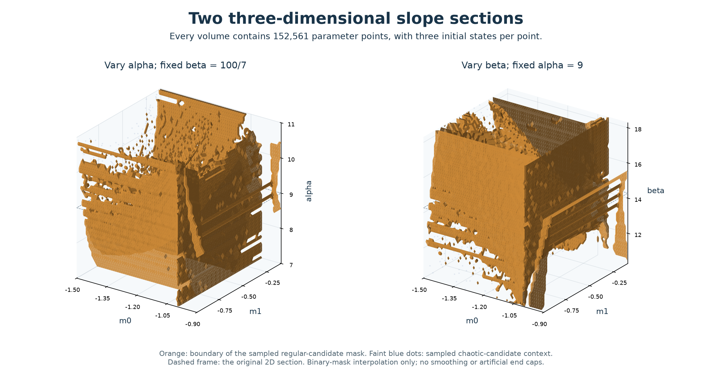
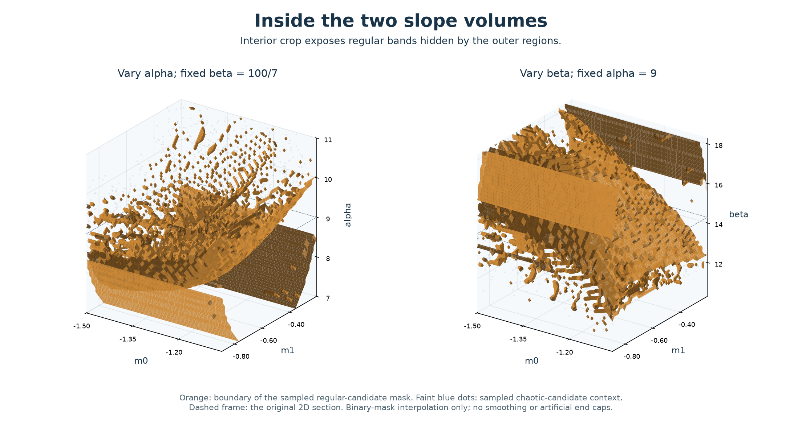
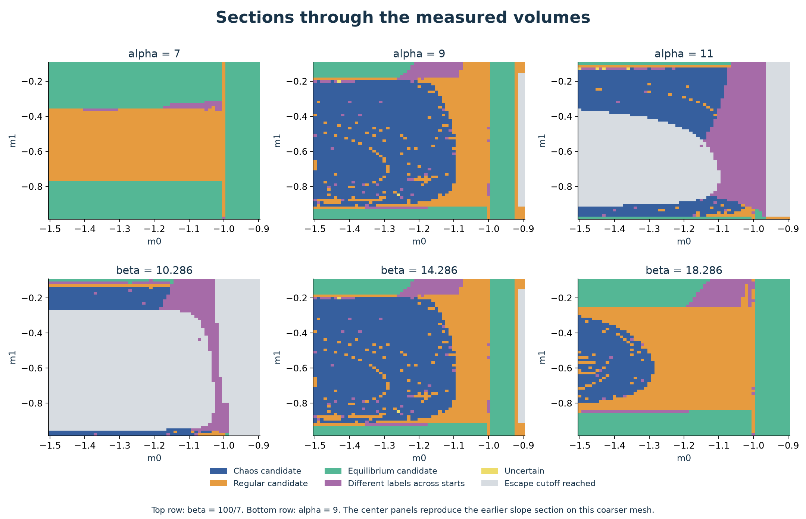

# Two three-dimensional sections through the diode slopes

We compute two three-dimensional parameter sections extending the slope-plane study:

| Coordinates | Fixed parameter | Third-coordinate range |
|---|---|---|
| m0, m1, alpha | beta = 100/7 | alpha = 7 to 11 |
| m0, m1, beta | alpha = 9 | beta = 100/7 - 4 to 100/7 + 4 |

Both retain m0 in [-1.5, -0.9] and m1 in [-0.98, -0.10]. Each volume is obtained from a separate three-dimensional parameter scan.

[Continuation of the five- and seven-peak families](chua-slope-families.md) resolves thin symmetric cores, verifies 13 coexistence examples and follows an attracting cycle through an itinerary change. Those results supplement the finite-time classifications used in the present volumes.

The orange surfaces bound the sampled **regular-candidate mask**: all three starts have negative or near-zero late exponents without meeting the equilibrium criterion. Faint blue dots provide chaotic-candidate context. In these views the regular regions form bent sheets, broad outer regions and narrower connections. Their positions and shapes change with the third parameter.

The broad outer regions hide much of the interior. The following crop removes the high-m0 side and the outer m1 edges:

The crop selects m0 <= -1.06 and -0.90 <= m1 <= -0.20; the retained grid coordinates actually span m0 = [-1.5, -1.06] and m1 = [-0.892, -0.2026667]. It changes only the displayed domain. The full volumes remain available. Dashed frames mark alpha = 9 or beta = 100/7, where the two volumes share the earlier slope section.

[Rotation animation](assets/chua-slope-volumes.gif): a 40-degree horizontal sweep and return over 24 seconds, at fixed elevation and zero roll. Only the camera moves.

## Sections and interactive visualization

The [self-contained interactive viewer](../results/chua-slope-volumes/volumes.html) lets readers rotate both volumes, switch between full and cropped views, show regular or chaotic candidates, and move an m0-m1 section through all 41 alpha or beta levels. Download the HTML and open it in a browser; no network connection is needed.

The controller passed 36 combinations of display settings, section-data checks, a rapid-slider-update check and camera-reset checks using JavaScript state stubs. The recorded validation did not include browser/WebGL interaction. The PNGs and representative GIF frames were inspected visually. [Viewer checks](../results/chua-slope-volumes/viewer-checks.json) preserve this distinction.

These actual sampled sections show why a three-dimensional interpretation needs more than a single plane. The regions change substantially between the ends of each third-coordinate range. The two center panels are the same parameter section and reproduce the earlier map on a coarser mesh.

## Sampling and numerical methods

Each volume has **61 x 61 x 41 = 152,561 parameter nodes**, with three original initial states per node: **915,366 trajectories across the two scans**. The FP64 GPU calculation uses RK4 step 0.005, discards 600 time units and observes another 1,600 in four Lyapunov windows. Classification rules match the [slope-plane report](chua-slope-plane.md).

The steps are 0.01 in m0, approximately 0.0146667 in m1, 0.1 in alpha and 0.2 in beta. The slope coordinates are every fourth row and column of the earlier 241-square wide map. Each volume's central layer reproduces all **3,721 common nodes**: per-start classes and finite Lyapunov estimates agree exactly with that earlier calculation. This is a reproducibility check using the same numerical implementation, not an independent validation.

The alpha volume contains 35,546 uniformly regular-candidate nodes and 54,098 uniformly chaotic-candidate nodes; the beta volume contains 33,212 and 53,515, respectively. Other nodes include equilibria, escape-cutoff events and mixed or uncertain outcomes. These counts are grid statistics, not physical volumes or numbers of families. No tangent-vector numerical failures were returned.

Surfaces use marching cubes at level 0.5 of a binary mask, without smoothing, convex hulls, decimation or artificial end caps. All relevant volume nodes contribute to the meshes. Static blue context dots are deterministically subsampled to at most 1,800 per view; they are not an extra numerical survey. Axes are displayed with comparable visual lengths despite their different units and scales.

## Numerical limits

For each volume, 512 stratified nodes were recomputed at half the step and twice both durations. Exact displayed-label agreement was **87.89% for alpha** and **87.70% for beta**. This sample overrepresents uncertain and mixed labels, so these percentages do not estimate whole-volume accuracy. All 129 sampled uniformly chaotic nodes in the alpha volume and all 137 in the beta volume kept that label. Uniformly regular labels persisted at 97/103 and 96/100 sampled nodes. The full comparison is retained in [refinement.json](../results/chua-slope-volumes/refinement.json).

Full-field DOP853 state-and-variational controls examine four off-center chaos candidates and the common central regular example; the central example is repeated once for each volume. Three off-center candidates retain positive exponents in all independent windows. The low-alpha example at alpha = 7.2, m0 = -1.47, m1 = -0.5986667 is less secure: its original GPU mean was 0.01604, while the first independent mean was 0.00374 with a negative window. A longer matched-start check gives a refined GPU mean of 0.01267 with a negative window, and an independent mean of 0.00852, below the screen's 0.01 threshold. Its original chaos label is therefore **not independently confirmed**. Both follow-ups are retained in [low-alpha-recheck.json](../results/chua-slope-volumes/low-alpha-recheck.json).

The volumes provide a finite-resolution classification. The mesh is four times coarser in each slope direction than the earlier wide 2D map, and much coarser than its local zoom. Thin windows can be missed or appear fragmented; small isolated pieces and holes are not established bifurcations or disconnected families. These surfaces do not count all layers, prove global topology, or assign the previous 32 family identities to the new sections.

The [data README](../results/chua-slope-volumes/README.md) gives all reconstruction, rendering and check commands.
