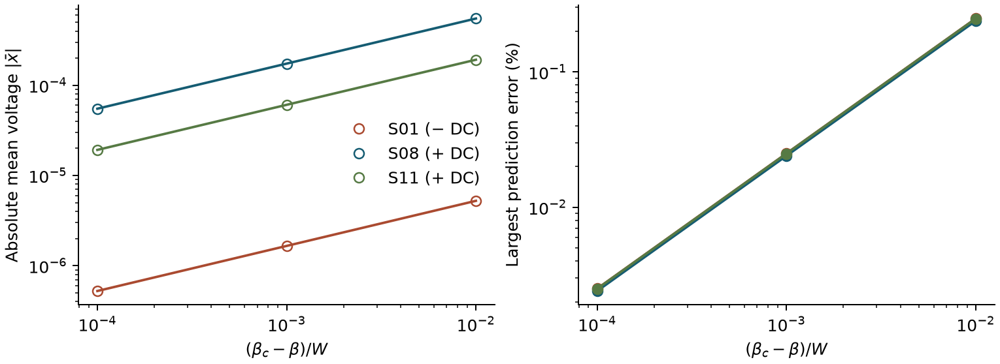

# Predicting the DC voltage at symmetry breaking

A symmetric Chua orbit has zero mean capacitor voltage. When it loses symmetry, its two attracting daughters acquire opposite means. **How large is the DC signal?** At the same fractional distance beyond the bifurcation, the predicted amplitude on S01 is about **105 times smaller** than on S08. The symmetric parent alone supplies the coefficients. [Parent cycles and parameter convention](chua-layer-bifurcations.md) · [Predictions recorded before measuring the daughters](https://github.com/Griboedow/chua-gpu-atlas/blob/da3acdb06cc380c823d58577409d61dac2eebd66/results/chua-symmetry-dc/forecast.json)

At $\alpha=9$, $m_0=-8/7$, $m_1=-5/7$ and $\gamma=0$, let $\delta=\beta_c-\beta>0$ and let $W$ be the symmetric branch’s fold-to-symmetry-breaking width. The plus daughter has the larger $y$ at the chosen upward $x=0$ crossing. The voltages below are dimensionless.

| Family | $\beta_c$ | Predicted $\bar x_+/\sqrt\delta$ at onset | Measured $\bar x_+$ at $\delta/W=10^{-4}$ | Daughter period minus parent period at the same $\beta$ |
|---|---:|---:|---:|---:|
| S01 | 14.2598426254 | −0.00476579 | −5.23647 × 10⁻⁷ | −4.89888 × 10⁻⁸ |
| S08 | 14.3172750075 | +0.04755491 | +5.50014 × 10⁻⁵ | +4.89943 × 10⁻⁶ |
| S11 | 14.3590572742 | +0.02782612 | +1.92079 × 10⁻⁵ | +1.45321 × 10⁻⁶ |



## Derivation

The signed half-return $H$ takes an upward section point $(y,z)$ to the next downward crossing and inverts the state. Its fixed point $p(\beta)$ represents the symmetric orbit. At $\beta_c$ let $A=DH$, $B=D^2H$ and $C=D^3H$ at that point. Let $r,\ell$ be the right and left eigenvectors for $-1$, normalized by $\|r\|=1$, $r_y>0$ and $\ell r=1$. Write $k=d\lambda/d\beta$ for this eigenvalue’s derivative along the parent.

The daughter points satisfy $H(p_+)=p_-$ and $H(p_-)=p_+$. Write $a=\ell(p_+-p_-)/2$. Adding these equations gives the midpoint displacement $h a^2+O(a^4)$ relative to $p(\beta)$. Subtracting them and projecting on $\ell$ gives the flip coefficient $c$ and the leading half-gap.

```math
h=(I-A)^{-1}B[r,r]/2,\quad
c=\ell\big(B[h,r]+C[r,r,r]/6\big),\qquad a^2\sim k\delta/c .
```

Let $J(q)=\int x\,dt$ and $\tau(q)$ be the voltage integral and duration of one half-flight sequence. Inversion reverses the voltage on the second half. Thus $\bar x_+=[J(p_+)-J(p_-)]/[\tau(p_+)+\tau(p_-)]$. Expanding both half-returns also gives the period shift and the daughter’s dominant full-return multiplier $\rho$.

```math
\bar x_+\sim \frac{DJ[r]}{\tau}a,\quad
T_d-T_p\sim\big(2D\tau[h]+D^2\tau[r,r]\big)a^2,\quad
1-\rho\sim4k\delta .
```

The last expression follows by differentiating the center map $u\mapsto(-1-k\delta)u+cu^3$ on both halves. All coefficients use derivatives of the parent’s transverse affine-flight itinerary. Flip normal forms and DC signatures in Chua-family oscillators are established. [Map coefficients](https://doi.org/10.1137/030601508) · [Sancho et al., Chua-family pitchfork and DC signal](https://doi.org/10.1109/81.915394)

## Numerical check

At $\delta/W=10^{-2},10^{-3},10^{-4}$ we froze predictions for the Euclidean section gap $2a$, signed DC voltage, period shift and multiplier deficit. We then solved for both daughters and independently integrated the unsplit ODE, its first variations and the voltage integral using DOP853. Across 36 comparisons the largest relative error was **0.249%**. At the smallest offset it was **0.00250%**, below the predeclared 1% target for each family. This tests the local expansions at nine parameter settings. [Measured branches and controls](../results/chua-symmetry-dc/checks.json)

```bash
python research/predict_chua_symmetry_dc.py
python research/check_chua_symmetry_dc.py
```

The first command regenerates the parent-only forecast. The second checks the archived forecast digest and writes the measured branches and figure. Both default to `outputs/chua-symmetry-dc/`.
