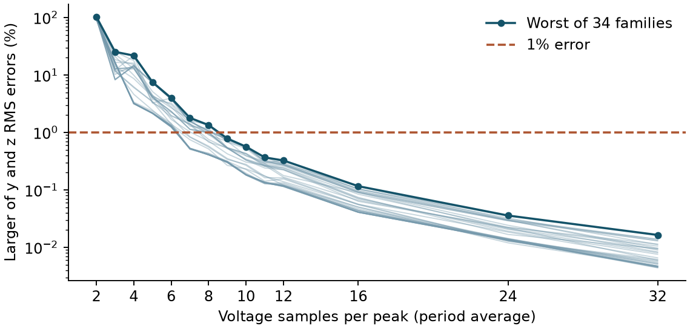

# Recovering two Chua state variables from one capacitor voltage

How finely must the first capacitor voltage $x$ be sampled to recover the second voltage $y$ and the inductor current coordinate $z$? For the 34 reference cycles, **nine equally spaced samples per voltage peak**, averaged over a complete period, kept the relative RMS error below 1% for both coordinates at all 16 tested sampling phases. At eight samples per peak, nine families exceeded 1%. These figures assume the correct period and circuit parameters and a noiseless periodic trace. [Reference orbits](../results/chua-knot-atlas/README.md) · [Per-family errors](../results/chua-voltage-reconstruction/sampling.csv)



## From voltage to current

Parlitz and colleagues experimentally drove the $(y,z)$ subsystem of a Chua receiver with $x$ in 1992. Here we use that subsystem to measure how much sampling and calibration accuracy the atlas waveforms require. [Parlitz et al., experimental receiver](https://www2.eecs.berkeley.edu/Pubs/TechRpts/1992/2218.html)

The equations are $\dot y=x-y+z$ and $\dot z=-\beta y-\gamma z$. For a Fourier component with $s=2\pi i k/T$, the periodic response is

```math
D(s)=(s+1)(s+\gamma)+\beta,\qquad
Y_k=\frac{s+\gamma}{D(s)}X_k,\qquad Z_k=-\frac{\beta}{D(s)}X_k .
```

For $\beta>0$ and $\gamma\ge0$ both roots of $D$ have negative real part, so the periodic response is unique. The formula includes the DC component. On the classical slice $\gamma=0$, the mean of $y$ vanishes and the mean of $z$ equals minus the mean of $x$. No diode slopes enter the reconstruction.

## Sampling and calibration

For a cycle with $p$ local maxima in $x$ per period, a sampling rate of nine means $9p$ observations in one period. The test supplies only those $x$ values to the filter and compares reconstructed $y,z$ against the archived orbit on a denser time grid, including between sample times. Error is RMS divided by the standard deviation of the corresponding reference coordinate.

| Samples per peak | Families below 1% on both coordinates | Largest error |
|---:|---:|---:|
| 6 | 0 / 34 | 3.98% |
| 8 | 25 / 34 | 1.35% |
| 9 | 34 / 34 | 0.785% |
| 12 | 34 / 34 | 0.326% |
| 32 | 34 / 34 | 0.0165% |

Raising the assumed $\beta$ by 1% at 32 samples per peak increased the larger coordinate error to **1.98–2.24%** across the families. Repeating the sampling study with the coarser archived orbit reconstructions changed the reported errors by at most 0.0035 percentage point. An independent time-domain calculation on a known periodic drive agreed with the filter within $2.2\times10^{-12}$ in model units at zero and positive loss. [Numerical controls](../results/chua-voltage-reconstruction/summary.json)

## Try it on one period

This example starts with 45 samples of the five-peak S11 voltage. The input is one dimensionless $x$ column, with no header or repeated endpoint. The output contains $t,x,y,z$ at the same sample times. Use the full period in dimensionless model time.

```bash
python research/chua_voltage_reconstruction.py trace results/chua-voltage-reconstruction/S11-x.csv outputs/S11-states.csv --period 14.495247978979704 --beta 14.359245458104963
python research/chua_voltage_reconstruction.py atlas
```

The second command replays the benchmark from both archived orbit resolutions and writes to `outputs/chua-voltage-reconstruction/`. The script uses NumPy, SciPy and Matplotlib. [Source](../research/chua_voltage_reconstruction.py)
