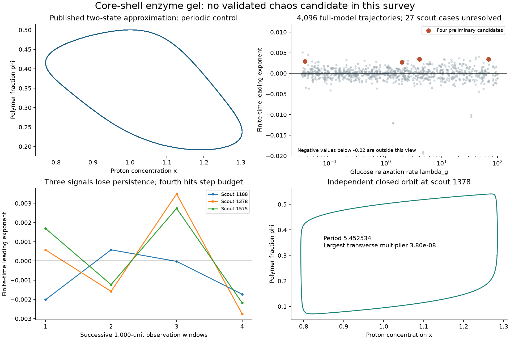

# A four-state enzyme gel: negative and unresolved results

Research note, 30 October 2026. **No validated chaotic candidate emerged from this survey.** Three of four preliminary signals lost persistence on longer integration; the fourth became too stiff for the GPU step budget. An independent closed-orbit calculation identifies one apparently positive case as a strongly stable periodic orbit. Unresolved cases remain open.

**Later single-case check:** an [implicit CPU continuation and periodic closure](core-shell-gel-stiff-followup.md) now identify the fourth preliminary signal, source 2882, as a strongly stable cycle at its saved endpoint. Its original GPU interval remains incomplete, and other stiff cases remain unclassified. The original survey counts below are preserved.



## Model and scope

Shinbo et al. [1] specify four chemical/mechanical states, then study a two-state quasi-steady approximation. We implement their full Eqs. 1–5 with constant external substrates. The Hill permeability and urease activity are retained literally. The surrounding bath is an effectively infinite reservoir; finite-fuel depletion and experimental calibration are separate issues. The article's two-state approximation is planar and cannot contain a classical autonomous strange attractor on a compact regular branch.

With time scaled by the proton relaxation time, define scaled glucose and urea concentrations

```math
G=\frac{k_R^g g}{k_D^h h_c},\qquad
U=\frac{2k_R^u u}{k_D^h h_c},\qquad x=h/h_c.
```

Our exact change of variables gives

```math
G'=\lambda_g(Ae^{-B\phi}-G),\qquad
U'=C-(\gamma+\rho f(x))U,
```

```math
x'=1-x+G-f(x)U,\qquad
\epsilon\phi'=\phi-0.3-25(\phi-0.3)^3+0.4(x-1).
```

Here `lambda_g=(k_D^g+k_R^g)/k_D^h`, `gamma=k_D^u/k_D^h`, `rho=k_R^u/k_D^h`; `A=K_g*g0/h_c` and `C=2*K_u*u0/h_c` use the paper's definitions. Its effective response is

```math
f(x)=\frac{x}{x+K_{ES2}/h_c+(h_c/K_{ES1})x^2}
\left[P_{min}+(P_{max}-P_{min})
\frac{x^n}{x^n+(K_A/h_c)^n}\right].
```

Constants are `h_c=5.62e-5 M`, `K_ES1=5e-6 M`, `K_ES2=2e-9 M`, `K_A=1.404e-5 M`, `P_min=.1992`, `P_max=.8544`, and `n=4.568`. The source reference uses `A=3`, `C=110`, `gamma=25`, `rho=5.68`, `B=7.2`, and `epsilon=.5`.

The source does not determine `lambda_g` independently from its reduced parameters. Finite values below are explicit choices of an original-model rate, including regimes outside the quasi-steady assumption. They are not fitted material measurements. Setting the first two derivatives to zero recovers the published reduced equation exactly; this algebraic identity is independently checked.

## Domain checks

Positive `G,U,x` are invariant: their boundary derivatives point inward, with `f(0)=0`. On a trajectory remaining in `0<phi<1`, let

```math
G_{max}=\max(G(0),A),\quad U_{max}=\max(U(0),C/\gamma).
```

Then `G<=G_max`, `U<=U_max`, and `x<=max(x(0),1+G_max)` by comparison with linear equations. These are **bounds conditional on remaining in the physical polymer-fraction interval**, not a global trapping theorem. The cubic swelling equation need not preserve that interval for arbitrary parameters; physical exits are rejected throughout the transient and observation. Low-urea first-order kinetics, idealized transport and bath assumptions still require physical validation.

## Numerical results

The seeded survey chooses 2,048 parameter tuples and two starts each. Ranges are `A=1..12`, `C=30..600`, `B=3..14`, `epsilon=.03..3`, and `lambda_g=.03..100`; positive scale parameters are sampled logarithmically except `B`, which is uniform. `gamma`, `rho` and `n` remain at source values. One tuple is replaced by the reference above with explicitly chosen `lambda_g=25`. Initial substrate states are quasi-steady at `(x,phi)=(1,.15)` or `(.9,.5)`.

| Calculation | Result |
| --- | --- |
| FP64 GPU, 500 transient + 1,000 observation units | 3,780 complete, 289 physical exits, 27 step-budget cases |
| Preliminary rule: mean LLE > .002 and all four windows > .001 | Four signals, source indices 1188, 1378, 1575, 2882 |
| All four signals plus strongest completed cases, union 25, additional 2,000 + 4,000 units | 17 complete with no retained signal; eight hit step budget |
| Original signals on longer run | 1188, 1378 and 1575 lose window-wise positivity; 2882 unresolved |
| Independent periodic orbit at 1378 | Period 5.4525342115; section closure 4.4e-16; Radau closure 7.3e-12 |

The largest transverse multiplier of the checked cycle is approximately `3.80e-8`, well inside the unit circle. Extremely small remaining multipliers are limited by floating-point resolution. This is strong numerical evidence for a stable periodic orbit, not a theorem about every start at that parameter tuple.

The example also shows why finite-time positive exponents need care: a 400-unit CPU window gives leading estimate `.00947`, despite the independently closed stable cycle. Phase-dependent tangent growth need not average to zero over a finite nonintegral number of periods. Its full QR spectrum passes the integrated-divergence check to `4.7e-11` when QR spacing is `.1`. An earlier spacing of `1` fails that check by `.0468`; that file is retained and explicitly marked **failed diagnostic**, not used as a validated spectrum.

An additional Radau continuation examines all 27 stiff scout endpoints for 100 units each. All complete, but all retain motion and remain unresolved by this equilibrium/exit check. It is a bounded follow-up, not a Lyapunov classification. The [saved record](../results/core-shell-gel/scout-stiff-continuation.json) lists per-case outcomes and elapsed times. These cases must not be counted as negative chaos results.

## Verification and reproduction

Independent analytic-Jacobian differences across 64 states stay below `9e-9` in relative scaled error. GPU/DOP853 state and leading-exponent differences over a short control are below `3e-13`; DOP853/Radau state agreement is below `4e-15`. These verify implementation, not asymptotic dynamics.

```bash
python research/core_shell_gel.py
python research/core_shell_gel.py --source-control
python research/core_shell_gel_gpu.py
python research/core_shell_gel_gpu.py --refine results/core-shell-gel/scout.npz
python research/resolve_core_shell_gel.py
python research/check_core_shell_gel.py --source results/core-shell-gel/scout.npz --index 1378 --transient 200 --duration 400 --qr-interval .1 --output scout-cpu-1378-tightqr
python research/check_core_shell_gel.py --source results/core-shell-gel/scout.npz --index 1378 --cycle
python research/plot_core_shell_gel.py
```

Data retain sampled parameters, starts, final states, all four Lyapunov windows and failure/budget flags. The optional `--broad` mode is an unexecuted future experiment, not part of the results above.

## Literature limits

The primary HTML and ten-page PDF were read. Direct local downloads and the official supplement returned HTTP 403, so the supplement's fit details are unverified. Targeted identifier/author/chaos searches found no exact full-model chaos result; OpenAlex recorded zero citing works on 29 October 2026. Neither observation establishes novelty. Earlier gel/enzyme oscillators [2] and the related microreactor model [3] already exist; their presence is not a demonstration of chaos in this four-state model.

## References

1. Shinbo, S., Sukegawa, T., Yamada, Y., and Maeda, S. (2026). *Theoretical Model of Chemomechanical Self-Oscillation in a Two-Enzyme Core–Shell Hydrogel With pH-Gated Microcapsules*. ChemSystemsChem **8**, e70050. [DOI](https://doi.org/10.1002/syst.70050).
2. Leroux, J.-C., and Siegel, R. A. (1999). *Autonomous gel/enzyme oscillator fueled by glucose: Preliminary evidence for oscillations*. Chaos **9**, 267–275. [DOI](https://doi.org/10.1063/1.166403). Primary abstract inspected; no claim that all original equations were compared.
3. Milster, S., Darwish, A., Göth, N., and Dzubiella, J. (2023). *Synergistic chemomechanical dynamics of feedback-controlled microreactors*. Physical Review E **108**, L042601. [DOI](https://doi.org/10.1103/PhysRevE.108.L042601), [preprint](https://arxiv.org/abs/2306.05181).
