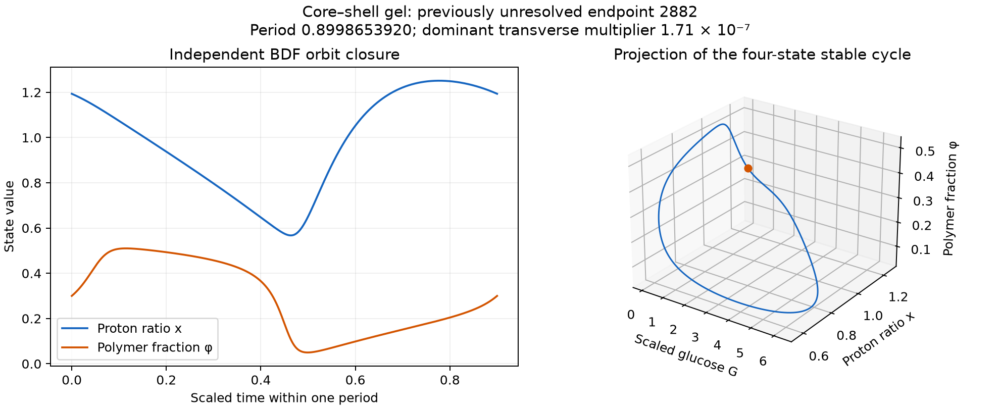

# One unresolved gel endpoint resolves to a stable periodic orbit

The exact saved endpoint of **source row 2882**, previously unresolved because the explicit GPU calculation exhausted its step budget, approaches a strongly stable periodic orbit under an independent implicit CPU continuation. The period is **0.89986539201952** in the source's scaled time. Newton shooting and a second implicit solver close the same orbit. This trajectory does not support a persistent chaotic attractor.



This is a follow-up of one existing parameter tuple in the [four-state core–shell gel survey](core-shell-gel-research.md). No coefficient, constitutive law, initial endpoint, or reference concentration was changed. No other stiff case or previous grid was rerun. The old raw GPU records remain unchanged: the original long interval is still marked incomplete.

## Exact input and scope

The input is `scout-refined.npz`, refined row **20**, whose recorded original scout index is **2882**. The saved refined endpoint follows **2722.0885544800813** additional time units and has step-budget status 3. Its parameters, in the existing source implementation's order, are:

| Parameter | Value |
|---|---:|
| $A$ | 11.91895904503831 |
| $C$ | 506.9085168323992 |
| $\gamma$ | 25 |
| $\rho$ | 5.68 |
| $B$ | 11.73391458797989 |
| $\epsilon$ | 0.04342859565742532 |
| $\lambda_g$ | 69.22864450333562 |
| Hill exponent $n$ | 4.568 |

The exact four-state equations, biochemical response, units, and physical qualifications are given in the earlier note. In particular, this finite $\lambda_g$ is an explicitly chosen original-model rate, not an experimentally fitted material constant. The bath remains a maintained reservoir. These facts do not change because the numerical orbit is well resolved.

## Implicit continuation and independent closure

Analytic-Jacobian **Radau** continued the saved endpoint for 100 additional time units with relative tolerance $10^{-10}$, absolute tolerance $10^{-13}$, and maximum step 0.1. It recorded **111 upward crossings of $\phi=0.3$**. The requested maximum was 200 units; the code stopped at its documented early criterion after at least 100 units and 12 consecutive repeated section returns. Their scaled differences were below $2.5\times10^{-12}$.

The continuation remained in the numerical physical domain:

| State | Sampled minimum | Sampled maximum |
|---|---:|---:|
| $G$ | 0.03092160 | 6.29196083 |
| $U$ | 19.78469559 | 20.01686363 |
| $x$ | 0.56735448 | 1.25126036 |
| $\phi$ | 0.04980998 | 0.51004770 |

Both accepted solver nodes and dense output were checked for positive concentrations and $0<\phi<1$. These numerical checks are not a theorem about all trajectories or the model's experimental validity.

A full four-state variational calculation and Newton shooting then solved the periodic boundary condition on this section. The augmented Radau solver uses the exact Jacobian, including analytic derivatives of the biochemical response and the full second derivatives needed for the augmented system. The derivative check against centered finite differences has scaled error $4.5\times10^{-10}$.

| Closed-orbit diagnostic | Result |
|---|---:|
| Period | 0.8998653920195196 |
| Newton section-local closure | $9.43\times10^{-15}$ |
| Independent BDF section-local closure | $6.30\times10^{-10}$ |
| Dominant transverse multiplier | $1.7113284\times10^{-7}$ |
| Scaled section-map two-norm | $1.7378606\times10^{-7}$ |
| Variational flow-direction identity error | $4.02\times10^{-13}$ |

Closure errors are divided componentwise by $\max(1,|\mathrm{initial\ state}|)$; raw residual vectors are also saved. The independent **BDF** check uses the original normalized four-state field and analytic Jacobian, relative tolerance $10^{-11}$, absolute tolerance $10^{-13}$, and maximum step 0.01. No explicit integrator is used in this follow-up.

The leading transverse exponent inferred from the resolved multiplier is about $-17.3146$ per scaled time unit. The other two direct multipliers are below the conservative absolute resolution floor of $10^{-8}$ and are explicitly flagged **unresolved**, rather than converted into purportedly accurate exponents. The integrated divergence, approximately $-104.71013$ over one period, is stored separately. No accuracy claim is made for a determinant or the unresolved small multipliers.

The section derivative is computed in constant scaled coordinates used to condition shooting; its eigenvalues are invariant under that coordinate scaling. Its very small norm and the independently closed orbit provide strong numerical evidence of local transverse stability. No claim of a rigorous computer-assisted orbit proof is made.

## What this changes

The earlier positive finite-window scout value at row 2882 is not evidence of a persistent chaotic attractor once this endpoint is independently checked. This conclusion applies to this trajectory and parameter tuple. It does not prove global absence of chaos, rule out other coexisting attractors or earlier transients, or classify the remaining step-budget cases.

The continuation, refined orbit, section points, complete settings, input-file hash, raw closure residuals, and multiplier-resolution flags are stored in [stiff-followup-2882.json](../results/core-shell-gel/stiff-followup-2882.json) and [stiff-followup-2882.npz](../results/core-shell-gel/stiff-followup-2882.npz). Total wall time was approximately 93 seconds on the existing CPU environment. The script enforces a 540-second limit and saves completed continuation segments before attempting closure.

```bash
python research/core_shell_stiff_followup.py --wall-limit 540
python research/plot_core_shell_stiff.py
```

## Reference

1. S. Shinbo, T. Sukegawa, Y. Yamada, and S. Maeda, *Theoretical Model of Chemomechanical Self-Oscillation in a Two-Enzyme Core–Shell Hydrogel With pH-Gated Microcapsules*, **ChemSystemsChem 8**, e70050 (2026). [DOI:10.1002/syst.70050](https://doi.org/10.1002/syst.70050). Source-access limitations and the distinction between its full equations and planar quasi-steady analysis are retained in the earlier research note.
