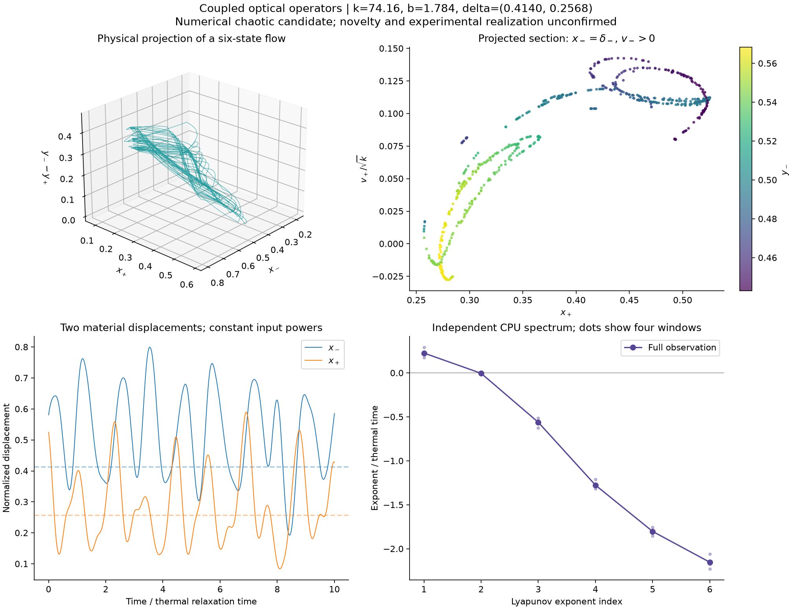
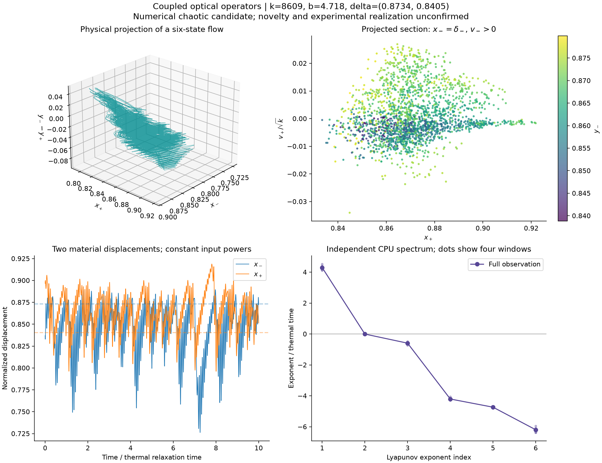
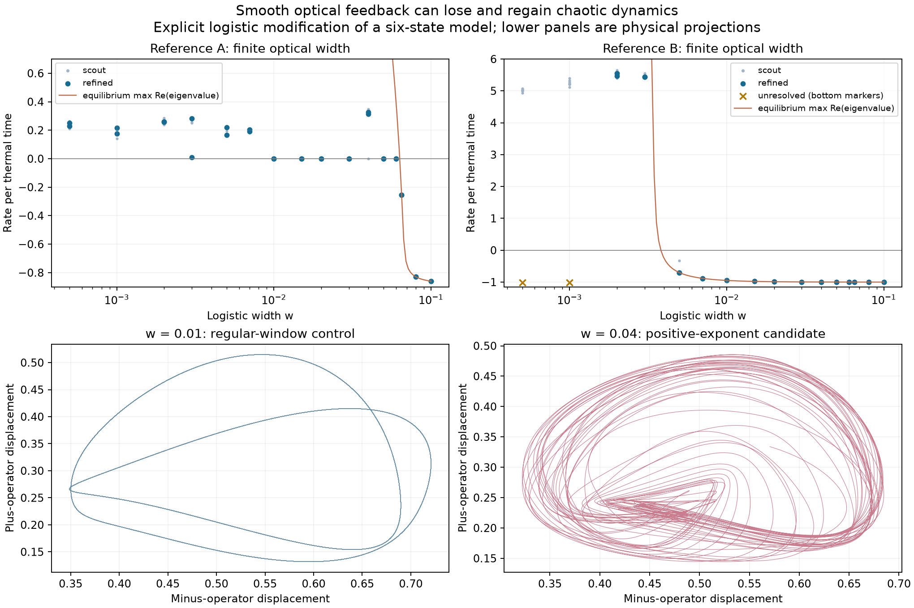
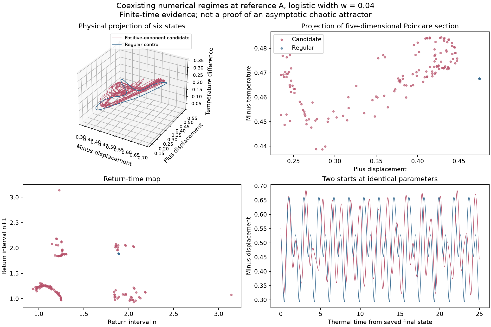
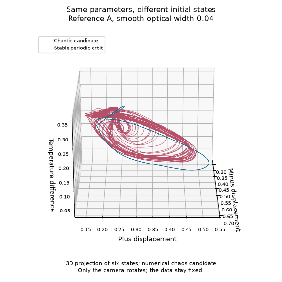
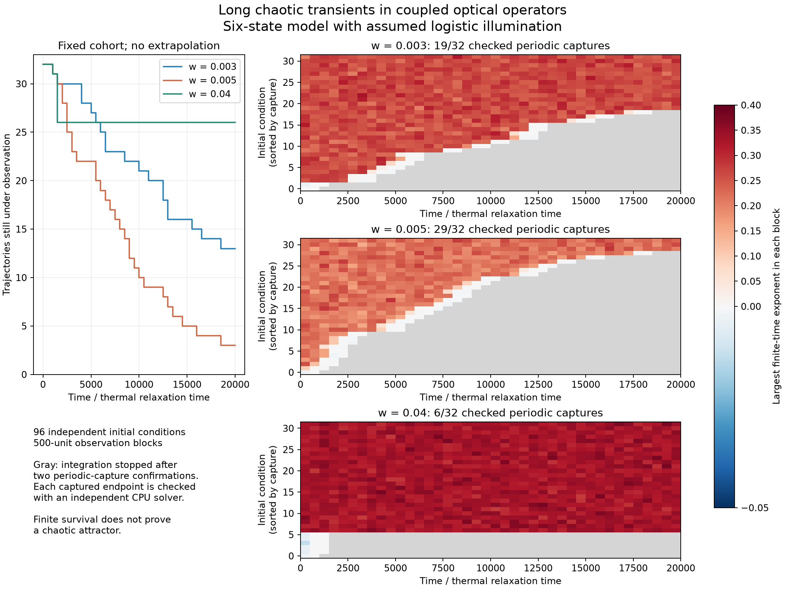

# Chaos candidates in two light-mediated material operators

**Status: independently checked numerical chaos candidates in a published-model interpretation; scientific novelty and experimental realization remain unconfirmed.** The single operator is equivalent to our previous relay limit. The coupled six-state system is a distinct investigation, and its chaotic examples survive an independent numerical ODE solver. One example also survives an explicitly assumed smooth optical transition.

Follow-up analyses separate two issues: an [order constraint](coupled-operators-order-audit.md) excludes nonperiodic compact equilibrium-free limit sets for real-pole mechanics, while a [priority comparison](coupled-operators-priority-audit.md) identifies older chaotic relay, inertial-neuron and six-state ring circuits. An exact earlier match has not been established; a new feedback mechanism or attractor topology is not claimed.

A later [periodic-orbit continuation](optical-cycle-continuation.md) connects the capture cycles at widths 0.003, 0.005 and 0.04 through an unstable segment. Two real-multiplier crossings and an independently checked unstable doubled branch support a local subcritical-flip picture near the first crossing. This is a quantitative model observation, not a demonstrated global route to chaos.

**Longer observation update:** the same lifetime cohort has now been [continued to 100,000 time units](optical-lifetime-extension.md). All 32 starts at each narrow width, 0.003 and 0.005, eventually reach independently checked periodic cycles; the latest first qualifying checkpoint is 73,500. At width 0.04, 26 survivors retain positive estimates in all 800 saved windows. The original 20,000-unit experiment below is preserved as the earlier observation, with its data unchanged.




The three-dimensional picture is a **projection of a six-dimensional flow**, not its complete phase portrait. It shows the two material displacements and the difference between their thermal states. The folded bands and multiple return-section branches are interesting numerical structure, but they do not establish a new topological type of attractor.

## What physical system is being modeled?

Guo et al. [1] connect two responsive cantilevers with constant laser beams. One baffle opens the beam reaching its partner, while the other closes the returning beam. A material's temperature and deformation therefore affect its partner's illumination. The paper demonstrates self-oscillation and communication between materials; it does not supply a chaos analysis in the sections we inspected.

Our [source audit](light-operators-audit.md) records the complete supplement and a consequential ambiguity. We use the continuous heat balance in SI Eq. (10), mechanical Eqs. (17–18), and the illumination conditions of Eqs. (19–20). Temperature remains continuous at switches. The source's displayed exponential step responses do not specify arbitrary initial temperatures; an implementation that resets heat at every switch would be different. We have not recovered the authors' implementation.

Each displacement and thermally preferred displacement is divided by that operator's own fully illuminated deflection. Time is divided by the heat-relaxation time. The model is

```text
x_minus' = v_minus
v_minus' = k*(y_minus-x_minus) - b*v_minus
y_minus' = H(x_plus-delta_plus) - y_minus

x_plus' = v_plus
v_plus' = k*(y_plus-x_plus) - b*v_plus
y_plus' = H(delta_minus-x_minus) - y_plus.
```

Here `k=theta^2`, `b=beta_bar*theta`, and `theta=tau_heat/tau_inertial`. The two deltas are the baffle thresholds divided by the individual illuminated deflections. No external time delay, noise, or extra dynamic state has been added.

## Structural checks

For `k,b>0`, the thermal fractions remain in `[0,1]`. The mechanical subsystems are stable linear filters driven by those bounded fractions. Consequently all forward trajectories from finite states are bounded. This is a model-level boundedness argument, not a statement about the validity of arbitrary deflections in a real cantilever.

With `P(D)=(D+1)(D^2+bD+k)`, the exact pair of jerk equations is

```text
P(D) x_minus = k H(x_plus-delta_plus)
P(D) x_plus  = k H(delta_minus-x_minus).
```

Every open affine branch has the same stable linear part. The flow divergence is `-2*(b+1)`. At a transverse switching event the saltation matrix has determinant one, because the changed heating derivative is tangential to the switching surface. The full Lyapunov spectrum must therefore sum to that divergence, providing a useful numerical control.

For interior thresholds there is no equilibrium strictly inside an affine branch: the binary steady states would require simultaneously `x_minus=x_plus` and `x_plus=1-x_minus`. **This is not an equilibrium-free-system claim.** A Filippov convexification permits an equilibrium on the intersection of the switching surfaces. Our event calculation follows transverse crossings and explicitly rejects unresolved grazing and simultaneous events.

The transformation

```text
T(xm,vm,ym,xp,vp,yp) = (xp,vp,yp,1-xm,-vm,1-ym)
(delta_minus,delta_plus) -> (delta_plus,1-delta_minus)
```

maps parameter-related systems exactly. `T^4=identity`. It is a symmetry of one fixed system when both thresholds equal `1/2`, giving a fourfold symmetry in six-dimensional state space. The two plotted candidates do not have those symmetric parameters. Random algebra checks of the transformation and jerk reduction are saved in `coupled-structure.json`.

## Numerical search and independent checks

The FP64 OpenCL code uses exact affine segments and locates the first crossing on a finite bracketing mesh. It then applies the saltation matrix to the flow tangent. This avoids integrating across a discontinuity with an ordinary unsplit RK step. Mesh refinement is still necessary: sign bracketing alone cannot rigorously exclude two roots inside one bracket.

The scout contains 2,048 parameter tuples with two independent starts each. Its ranges are `k=10..10,000`, `beta_bar=b/sqrt(k)=10^-1.3..10^0.2`, and each delta between `0.005` and `0.995`, using a scrambled Sobol design. The source's Fig. 37 reference replaces the first tuple. This broad search changes physical ratios substantially; it is not a scan confined to measured apparatus parameters.

| Stage | Settings | Result |
| --- | --- | --- |
| Scout, 4,096 trajectories | 1,000 discarded + 4,000 observed switching events; 64 brackets per mechanical period | All completed; 436 preliminary positive candidates; 34.8 s on GTX 1080 |
| Every preliminary candidate | Additional 4,000 discarded + 16,000 observed events; 256 brackets per period | All 436 completed; 422 retained, representing 213 distinct parameter tuples; 233.5 s |
| Reference A, scout index 1026 | Independent DOP853, 200 discarded + 800 observed thermal-time units | Positive leading exponent in all four windows; full six-exponent spectrum |
| Reference B, scout index 3054 | Independent DOP853, 100 discarded + 400 observed thermal-time units | Positive leading exponent in all four windows; repeated with tenfold tighter tolerance and half the QR interval |

The screening criterion is mean leading exponent above `0.005` and all four window means above `0.002`, after successful integration. Retained fractions depend on the chosen sampling distribution and integration lengths; they are not basin probabilities or confidence levels.

An additional 256-trajectory local check uses 32 new random starts per reference and perturbation size, with the same long event counts and 256-point bracketing. All trajectories complete. At reference A, retained counts are `32/32,31/32,23/32,14/32` for log-parameter perturbations `0,0.001,0.01,0.03`; reference B retains `32/32` in all four groups. Every parameter is multiplied independently by `exp(uniform(-j,j))`. This shows local numerical persistence and parameter sensitivity, not a proof of structural stability.

Implementation validation gives an affine-segment discrepancy below `6e-14` against DOP853, fixed-time saltation-Jacobian discrepancy below `9e-10` against finite differences, and a CPU/GPU twelve-event state discrepancy below `4e-14`. The sum of each independent CPU spectrum agrees with the divergence to about `3e-12` or better.

At the source Fig. 37 parameters, the same solver instead returns a strongly stable four-switch periodic orbit: period `1.8608154588` in thermal-time units and largest Poincare multiplier magnitude `0.0101660`. Independent DOP853 closes that orbit within `8.3e-14`. Tiny remaining multipliers have limited relative precision. This is a useful regular control and does not claim exact reproduction of the unavailable author implementation.

| Quantity | Reference A | Reference B |
| --- | --- | --- |
| `k` | 74.1567393414624 | 8608.828902752228 |
| `b` | 1.784180421282182 | 4.7177230976207 |
| `delta_minus` | 0.4139517339970917 | 0.8733635635208339 |
| `delta_plus` | 0.25683679452165964 | 0.8404887881875038 |
| Refined GPU leading exponent, first start | 0.22182 | 4.42050 |
| Independent CPU spectrum | `(0.22650,-0.00373,-0.56073,-1.27571,-1.80234,-2.15235)` | `(4.29812,-0.00402,-0.59409,-4.20581,-4.73502,-6.19464)` |
| Tighter CPU leading exponent | See smooth control below | 4.30254 |

The nearly zero second exponent is consistent with the neutral direction of an autonomous flow. It is not evidence of hyperchaos. Positive finite-time exponents and long bounded trajectories remain numerical evidence, not a proof that the asymptotic object is a strange attractor rather than an extremely long transient.



Reference A has a structured projected return section with several curved branches. Reference B has a broader projected section and much faster expansion. Neither appearance alone establishes a new attractor class. Plotting is densified with exact branch flow between CPU-verified event/QR knots; the maximum branch-end mismatch is below `1.1e-11`, so fast mechanical motion is not represented by sparsely connected QR samples.

## Finite optical width: a stronger physical test

Replace `H(z)` with `S(z)=1/(1+exp(-z/w))` in both illumination laws. This is an **explicit modified model**, not a measured beam profile. The published source gives both approximately 100 micrometres at the baffle edge in Methods and 2–3 mm spot sizes in several supplemental captions. Those reports must not be converted directly to a switching width without the optical geometry.

At reference A, `w=0.005` retains a positive leading exponent under independent DOP853 integration:

```text
(0.22207, 0.00228, -0.46622, -1.38822, -1.79217, -2.14610).
```

The four leading window estimates are `0.14054,0.26572,0.23281,0.24921`. Thus this particular observation does not depend on an infinitely sharp relay. For a logistic profile, the 10–90% transition spans `2*ln(9)*w≈0.02197` of the individual illuminated deflection. This is a dimensionless sensitivity test, not apparatus calibration.

A second run discards 400 thermal-time units and observes 1,600, using `rtol=1e-12` and half the QR interval. It gives leading exponent `0.217994`, with window values `0.21321,0.22287,0.19936,0.23653`; its second exponent is `-0.001236`. The spectrum sum agrees with the analytic divergence within `1.3e-12`.

The smooth model has a unique equilibrium: composing an increasing illumination response with the decreasing response gives a strictly decreasing fixed-point equation. Let `a_minus,a_plus` be the positive magnitudes of their slopes there. Its characteristic equation is

```text
[(lambda+1)(lambda^2+b*lambda+k)]^2 + k^2*a_minus*a_plus = 0.
```

An imaginary pair occurs when

```text
omega^2 = k/(b+1)
a_minus*a_plus = b^2*(k+b+1)^2 / [k*(b+1)^3].
```

For reference A this gives a linear Hopf candidate at `w≈0.0632608463`, `omega≈5.16091404`. It does not locate the chaos boundary or prove the nonlinear Hopf bifurcation type. The algebra and direct eigenvalue check are reproducible.

### Smoothing is not a monotone chaos filter

A width survey now compares both references at 16 widths from `0.0005` to `0.1`, with eight random starts each: **256 trajectories**, all completed. The adaptive FP64 GPU solver integrates the smooth field and its analytic tangent, with local error control and an extra step cap near optical transitions. Short-trajectory validation against independent DOP853 gives state discrepancy `2.9e-11` and leading-exponent discrepancy `2.5e-11`.

The scout discards 200 and observes 800 thermal-time units. At reference A, all eight starts retain positive exponents at the six sampled widths through `0.007`. None passes the screening criterion at `0.01,0.015,0.02,0.03`. At **`w=0.04`**, seven of eight are positive again; none passes at `0.05` or `0.06`, and wider samples approach the stable equilibrium. Reference B retains all eight at the four sampled widths through `0.003`; its wider samples have negative estimates. These are discrete samples, not fully resolved bifurcation intervals.

The two strongest completed scout trajectories at each reference/width were then resumed for an additional 400 discarded and 1,600 observed units, with `rtol=1e-9` and half the step caps. **60 of 64 completed; 17 retained the four-window criterion.** Four high-frequency B runs at `w=0.0005,0.001` exhausted the ten-million-step budget and remain unresolved, not negative. At A, one of the two `w=0.003` trajectories lost its positive signal in late windows; one `w=0.005` trajectory also weakened markedly in its last window. These are reasons to retain the long-transient caveat even when another initial state or an independent run remains strongly positive. The refinement took 561 seconds on the GTX 1080, after a 172-second scout.

An independent, tighter CPU calculation confirms the reappearing positive signal at A, `w=0.04`: after 400 discarded and 1,600 observed units, its spectrum is

```text
(0.331382, -0.000688, -0.431469, -1.309946, -1.882245, -2.275395).
```

Its four leading estimates are `0.33673,0.28541,0.36856,0.33483`, and the spectrum-sum discrepancy is `1.3e-12`. The 10–90% optical transition now spans about **0.17578 normalized displacement units**. The neighboring `w=0.01` CPU control instead gives a nearly neutral first exponent, `0.0000420`, and negative remaining exponents, beginning with `-0.20084`.

Thus broadening this assumed optical response can remove and then restore the observed chaotic regime before equilibrium stabilization. It changes both loop gain and the nonlinear orbit, so the linear equilibrium boundary alone cannot describe the attractor diagram. This is a useful numerical result for the explicitly modified model, not evidence that smoothing always creates chaos or that the source apparatus has this response profile.



The lower panels use actual displacement coordinates, projected from the six-state system. The curve for equilibrium eigenvalues describes local equilibrium stability, whereas the dots describe the sampled trajectories; they need not agree while an oscillatory attractor is present. Crosses at the bottom mark unresolved refinements and have no exponent value.

### A regular orbit coexists with the broad-width chaotic candidate

The regular-window control at `w=0.01` is a stable periodic orbit with **period 2.3551155363**, two upward crossings of the chosen section per full orbit, closure error `3.5e-13`, and largest Poincare multiplier magnitude `0.62423`. A two-crossing orbit alone does not prove a period-doubling route; no branch continuation was performed here.

All eight A starts at `w=0.04` were separately resumed for another 400 discarded plus 3,200 observed units at `rtol=1e-10`. Seven retain leading exponents between **0.3124 and 0.3345**, positive in every window. The eighth stays regular. An independent CPU spectrum from its saved state has a neutral leading direction and five negative directions. Its subsequent Poincare check finds a **stable periodic orbit of period 1.8879301309**, closure error `1.1e-13`, and largest multiplier magnitude **0.676848**.



This supports coexistence of a stable periodic orbit and a long-lived chaotic numerical regime at identical equations and parameters. It does not prove that the latter is an asymptotic attractor rather than a long-lived chaotic saddle. The eight selected initial states are not a measurement of basin volumes. In particular, the weakening narrow-width trajectories above make this distinction consequential.



The blue curve closes while the red trajectory visits a band of loops and produces a spread of section points and return intervals. These are physical observables of a six-state model, not a new coordinate transformation of Chua. However, this appearance and coexistence mechanism do not by themselves establish a new topological class or scientific priority.

### Long runs reveal periodic capture after chaotic transients

The shorter calculations above cannot distinguish a chaotic attractor from a long chaotic transient. A new cohort makes that limitation concrete. We generated **32 fresh initial conditions at each of A's widths `0.003,0.005,0.04`**, with seed `2026102969`, displacement and thermal coordinates uniform on `[0.05,0.95]`, and zero initial velocities. We followed each trajectory for up to **20,000 thermal-time units**, in 500-unit blocks, carrying the tangent vector across block boundaries. Integration stopped after confirmed periodic capture; captured trajectories were not each integrated for the full horizon.

| Optical width | Checked periodic captures | Still chaotic at the observation horizon | Last 500-unit leading exponent among survivors |
| --- | ---: | ---: | --- |
| 0.003 | 19 / 32 | 13 / 32 | 0.2499–0.3010 |
| 0.005 | 29 / 32 | 3 / 32 | 0.2055–0.2632 |
| 0.04 | 6 / 32 | 26 / 32 | 0.3041–0.3623 |

Every survivor has positive estimates in all four windows of its last block. There were no numerical failures or budget exits in this cohort. These counts describe the chosen initial conditions, not basin probabilities or a fitted escape law.

At the two narrow widths, periodic capture continues as late as the checkpoint at **18,000 units**, confirmed one block later. At `w=0.04`, all six captures qualify by time 1,000; the other 26 remain irregular for the full observation. Thus the broader-width candidate has substantially stronger persistence evidence, while the narrow-width examples clearly include very long chaotic transients. We have not proved that every surviving narrow-width trajectory will escape, or that the broad-width set is an asymptotic attractor.



Two new independent CPU controls identify the narrow-width limiting cycles:

| Width | Period | Largest Poincare multiplier magnitude | Orbit closure error |
| --- | ---: | ---: | ---: |
| 0.003 | 1.8368786709 | 0.595198 | 2.1e-12 |
| 0.005 | 1.8356888452 | 0.808881 | 2.8e-12 |

Each has one upward crossing of `xm=dm` per period. The broad-width cycle was independently checked above. The GPU capture rule requires a velocity-balanced one-period return residual below `1e-7` and all four exponent magnitudes below `0.01` at two consecutive checkpoints. A separate CPU DOP853 integration then checked **all 54 classified endpoints** against the corresponding reference cycle, including section location and period. Maximum scaled section mismatch was `2.3e-11`, period mismatch `3.7e-11`, and scaled flow closure `8.9e-11`.

The 96-trajectory GPU calculation took 543 seconds on a GTX 1080 at `rtol=1e-9`, with halved step caps. The endpoint checks use `rtol=1e-12`, `atol=1e-14`, and maximum step `0.005`. A whole-run versus split-run test verifies continuation of both states and tangent vectors. Individual chaotic escape times need not reproduce exactly under a changed numerical tolerance; no such claim is made. Full interval-by-interval exponents, saved endpoint states, statuses and independent checks are in `results/light-operators/lifetimes/`.

This update qualifies the earlier positive smooth-profile examples: a positive exponent over hundreds or thousands of units was genuine evidence of expansion on that interval, but did not establish an attracting chaotic invariant set.

## Prior art and what remains open

General relay chaos is old. Our [relay literature audit](lce-slider-relay-limit.md) already covers several established examples and explicitly lists inaccessible originals. The coupled jerk representation above makes further control-theory equivalence searches necessary. A targeted search for the source title/DOI plus chaos did not identify the same result, which is insufficient to establish novelty.

An OpenAlex snapshot for source work `W4416430930` on 29 October 2026 returned five citing works. The access levels are recorded rather than treating an unexamined citation as cleared:

| Citing work | Inspection and relevance |
| --- | --- |
| Peng et al., [10.1016/j.chaos.2026.118687](https://doi.org/10.1016/j.chaos.2026.118687) | Publisher preview: coupled reaction/diffusion and geometric optical feedback; delay attributed to diffusion. Full equations not retrieved; separate candidate, not cleared for absence of chaos. |
| [10.1016/j.ccr.2026.217958](https://doi.org/10.1016/j.ccr.2026.217958) | Citation metadata only: review on fueling dissipative self-assembly. Full text not audited. |
| Cheng et al., [10.1007/s10118-026-3646-1](https://doi.org/10.1007/s10118-026-3646-1) | Publisher abstract: pre-twisted hydrogel rings, figure-of-eight reconfiguration and irregular tumbling. No faithful dynamic model retrieved yet; irregular tumbling is not itself a chaos diagnosis. |
| Boron et al., [10.1002/advs.76810](https://doi.org/10.1002/advs.76810) | Primary main text: tendon-driven origami tentacles and contact-mediated entanglement, with Cosserat-rod simulation. Its finite grasping operation is not evidence of an autonomous sustained chaotic attractor. |
| Yuan et al., [10.1016/j.chaos.2026.118988](https://doi.org/10.1016/j.chaos.2026.118988) | Publisher preview inspected: collision/friction losses are approximated by equivalent viscous damping. Full equations unavailable; do not treat its numerical model as impact-resolved. |

Other retrieved relay-search results concerned delayed neural relays or a third intermediary oscillator between already chaotic systems. The shared word “relay” does not establish equation equivalence. A comprehensive classification of two stable third-order filters with these cross-coupled switching laws remains unfinished.

## Reproduction

From the repository root, with NumPy, SciPy, PyOpenCL, Matplotlib and Pillow installed:

```powershell
python research/coupled_operators.py
python research/coupled_operators.py --scout --transient 1000 --events 4000 --subdivisions 64
python research/coupled_operators.py --refine results/light-operators/coupled-scout.npz --transient 4000 --events 16000 --subdivisions 256
python research/check_coupled_operators.py --index 1026 --transient 200 --observation 800 --output results/light-operators/coupled-cpu-1026
python research/check_coupled_operators.py --index 3054 --transient 100 --observation 400 --output results/light-operators/coupled-cpu-3054
python research/check_coupled_operators.py --index 3054 --rtol 1e-12 --qr-interval .025 --output results/light-operators/coupled-cpu-3054-tight
python research/check_coupled_operators.py --index 1026 --width .005 --transient 200 --observation 800 --output results/light-operators/coupled-smooth-1026-w005
python research/check_coupled_operators.py --index 1026 --width .005 --transient 400 --observation 1600 --rtol 1e-12 --qr-interval .025 --output results/light-operators/coupled-smooth-1026-w005-tight
python research/audit_coupled_operators.py
python research/check_coupled_operators.py --periodic-control --rtol 1e-12 --qr-interval .02 --output results/light-operators/coupled-periodic-control-cpu
python research/audit_coupled_operators.py --robustness
python research/render_coupled_operators.py --gif
python research/smooth_operators.py
python research/smooth_operators.py --scan
python research/smooth_operators.py --refine results/light-operators/smooth-width-scout.npz --transient 400 --duration 1600 --rtol 1e-9 --step-factor .5
python research/check_coupled_operators.py --index 1026 --width .01 --transient 400 --observation 800 --rtol 1e-12 --qr-interval .025 --output results/light-operators/smooth-cpu-1026-w001
python research/check_coupled_operators.py --index 1026 --width .04 --transient 400 --observation 1600 --rtol 1e-12 --qr-interval .025 --output results/light-operators/smooth-cpu-1026-w004
python research/smooth_operators.py --reentrant-starts --transient 400 --duration 3200 --rtol 1e-10 --step-factor .5
python research/analyze_smooth_operators.py
python research/check_coupled_operators.py --source results/light-operators/smooth-reentrant-starts.npz --index 1 --transient 400 --observation 800 --rtol 1e-12 --qr-interval .025 --output results/light-operators/smooth-cpu-1026-w004-regular
python research/analyze_smooth_operators.py --regular-control
python research/analyze_smooth_operators.py --gif
python research/optical_lifetimes.py --controls
python research/optical_lifetimes.py --validate
python research/optical_lifetimes.py --run --starts 32 --blocks 40
python research/analyze_optical_lifetimes.py --audit --plot
```

The saved NPZ files include all surveyed parameters, starts, statuses, exponents/windows and final states; independent CPU traces include physical coordinates and Poincare sections. CPU verification requires no GPU. The analytic GPU implementation currently supports underdamped mechanics only.

## References

1. Guo, H., Li, K., Yang, J., Li, D., Liu, F., and Zeng, H. (2025). Light-mediated communication in responsive materials ranging from individual self-oscillators to feedback-driven network. *Nature Communications* **16**, 11315. [doi:10.1038/s41467-025-66395-3](https://doi.org/10.1038/s41467-025-66395-3). Supplementary Notes 2.1–2.3, pp. 34–47; main-text Methods / Light excitation.
2. di Bernardo, M., Johansson, K. H., and Vasca, F. (2001). Self-oscillations and sliding in relay feedback systems: symmetry and bifurcations. *International Journal of Bifurcation and Chaos* **11**, 1121–1140. [doi:10.1142/S0218127401002584](https://doi.org/10.1142/S0218127401002584). A primary relay comparison, not the same two-operator transfer structure.
3. Mallet-Paret, J., and Smith, H. L. (1990). The Poincare–Bendixson theorem for monotone cyclic feedback systems. *Journal of Dynamics and Differential Equations* **2**, 367–421. [doi:10.1007/BF01054041](https://doi.org/10.1007/BF01054041). Author/institutional abstract inspected. A possible route for an overdamped smooth-model analysis; no theorem is applied to the discontinuous underdamped candidates here.
4. Letellier, C., and Aguirre, L. A. (2012). Required criteria for recognizing new types of chaos: Application to the “cord” attractor. *Physical Review E* **85**, 036204. [doi:10.1103/PhysRevE.85.036204](https://doi.org/10.1103/PhysRevE.85.036204). Publisher abstract inspected; our figures do not constitute that topological analysis.
