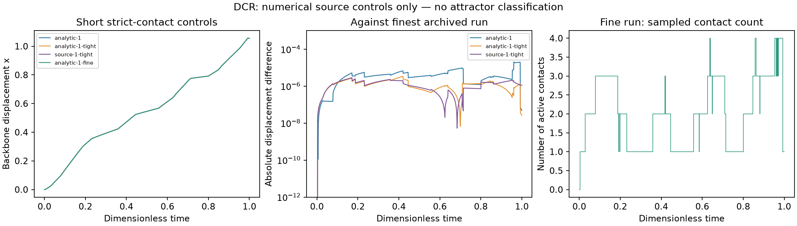

# Motor-contact rotors: a promising model with an unresolved event law

**Outcome:** five short implicit-solver controls completed, but no chaotic attractor is classified. Two longer attempts exhausted their stated CPU budgets. More fundamentally, a strict contact predicate leaves a local continuous-time continuation problem at contact entry. A large GPU survey would currently mix a physical question with an unspecified numerical contact selection.

The model is Warmington, Rossiter and Bloomfield-Gadêlha's discontinuously coupled rotor network [1]. It represents motor-like rotors intermittently pushing a common spring-loaded backbone. It is an interesting physical direction because coupling is established and removed by contact, rather than by a continuously acting sinusoidal interaction. The paper already reports deterministic irregularity and sensitivity; these phenomena would not be new observations by this project.



*These are short source-solver diagnostics, not an attractor portrait. The trajectories use the same saved initial phases. The right panel samples the contact count every 0.001 time unit; it does not locate all events.*

## Which equations were implemented?

We independently implemented the pinned **author-code variant** [2], with the minus-sine rotor position. The discrepancy with the printed plus-sine formula is preserved in the [source audit](dcr-source-audit.md). There are 101 variables: backbone displacement and 100 rotor phases. Phases can be viewed modulo a full turn; any three-dimensional drawing would be a projection.

Let the angular gate be $H_j$, the full distance-and-angle contact indicator be $C_j$, and the backbone velocity be $v$. The residual equations at zero extra load are

```math
\begin{aligned}
0&=\sum_{j=0}^{N-1}H_j |\cos\theta_j|F_s(\dot\theta_j)
    -\alpha v-\beta x,\\
\dot x&=v,\\
\dot\theta_j&=\begin{cases}
v/|\cos\theta_j|,&C_j=1,\\
2\pi,&C_j=0,
\end{cases}\\
F_s(\omega)&=1-\frac{\omega}{4\pi}\bigl(1+\tanh(40\omega)\bigr).
\end{aligned}
```

The source geometry is $c=0.14$, rotor spacing 1.204, tooth spacing 1.092, and contact distance 0.02. The angular interval and distance inequality are both **strict**. Ordinary distance to the wrapped tooth positions is used, not shortest distance on a circle. The source's optional callback is disabled, as in its default solver call; that callback is separately audited and is not treated as a derived contact law.

In FP64, the free-rotor force evaluates exactly to zero. Its mathematical value is exponentially small but nonzero. The [structural report](dcr-structure.md) distinguishes those conventions, proves uniqueness of the algebraic velocity for the source geometry and tested drag range, and derives conditional displacement bounds. These checks do not by themselves settle event continuation.

## Why the contact boundary matters

For one rotor and tooth, contact motion preserves their gap. On reaching the strict distance boundary, however, the predicate still chooses free motion directed into the band. Immediately inside, the gap derivative becomes zero. At an isolated transverse entry, this has the local scalar pattern: move inward at the boundary, but stop at every interior point. There is no absolutely continuous solution continuing from that boundary under those precise local rules.

A finite-step solver can penetrate slightly into the band and then lock the resulting gap. A closed-contact or differential-inclusion interpretation may supply a meaningful limiting model, but must be declared and checked. The [source audit](dcr-source-audit.md) gives the conditional argument, angular-boundary complication, and why event-aware tangent dynamics require saltation updates. This is not a global assertion that every trajectory fails, and it does not invalidate the authors' finite-step observations.

## Independent controls

The implementation uses SUNDIALS IDA through `scikit-sundae 1.2.0`, with a consistent initial derivative. It does not execute the authors' Julia file or reproduce their entire software environment. All starts use our seed **2026103021**, with the actual initial vectors saved. The source did not supply the same seeded phase realization, so a trajectory-by-trajectory reproduction is not claimed.

An optimized nearest-tooth computation agrees with an explicit all-tooth calculation in 128 seeded off-interface controls. The largest distance difference is $1.78\times10^{-14}$; the residual difference is zero. Consistent initial derivatives satisfy the residual to $8.89\times10^{-15}$, and the analytic fixed-branch Jacobian agrees with directional finite differences to relative error $1.45\times10^{-9}$. These are algebra checks away from switching surfaces.

At alpha = beta = 1, one 0.2-unit and four 1-unit controls completed. The following differences use the finest archived run as a numerical reference, not an exact solution:

| Maximum step | Relative and absolute tolerance | Jacobian | Max displacement difference | Max full-state difference | Wall time |
|---:|---:|---|---:|---:|---:|
| 0.0001 | 1e-7 | Analytic within branches | 2.03e-5 | 1.64e-4 | 1.76 s |
| 0.00005 | 1e-8 | Analytic within branches | 3.35e-6 | 1.64e-5 | 4.29 s |
| 0.00005 | 1e-8 | IDA finite differences | 2.84e-6 | 1.71e-5 | 8.31 s |
| 0.000025 | 1e-9 | Analytic within branches | Reference | Reference | 11.71 s |

The two alpha = beta = 4 attempts requested 30 time units. They reached wall limits of 180 and 240 seconds; their last residual-callback times were 13.4583 and 13.3804. **Callback states may be unaccepted solver trials. They are diagnostic snapshots, not certified trajectory endpoints.** No missing interval is filled in. Both outcomes remain budget-unresolved and say nothing conclusive about periodicity or chaos. The paper's Fig. 5 simulations are much longer, so even a completed 30-unit run would not reproduce their asymptotic regime.

The [summary and input hashes](../results/dcr/control-summary.json), original metadata, and arrays preserve all seven attempts. Differences decreasing over a short interval support implementation consistency; they do not establish a unique continuous-time event convention, long-time convergence, or a strange attractor.

## Reproduction and next useful step

Install the project's normal dependencies, then `python -m pip install -r requirements-dcr.txt` for these optional controls. Run from the repository root:

```bash
python research/dcr.py
python research/audit_dcr_structure.py
python research/check_dcr_ida.py --duration 1 --analytic --label own-short-control
python research/analyze_dcr.py
```

Use a new label to preserve the archived runs. The analysis script reads existing data and redraws the figure without integration. This model has no GPU mass-search implementation: the useful next step is to specify and validate contact capture, release, grazing and simultaneous-event rules, then compare that model with the literal source-solver limit. A smooth contact regularization would also be an explicitly modified model.

## References

1. B. Warmington, J. Rossiter, H. Bloomfield-Gadêlha. *A discontinuously coupled network of phase oscillators replicates cooperation between motors in actomyosin systems*. **J. R. Soc. Interface 23**, 20250438 (2026). [DOI:10.1098/rsif.2025.0438](https://doi.org/10.1098/rsif.2025.0438). Full-source provenance and limitations are recorded in [screening VI](late-candidate-screening-6.md).
2. *Discontinuously coupled rotor model*, version 1.0.0. [Zenodo:18196853](https://doi.org/10.5281/zenodo.18196853); [pinned CC0 author implementation](https://github.com/polymaths-lab/actomyosin-kuramoto-rotor-model/blob/796c5e39468b06fd6fc2c378437d618593948e98/DCR_Model_available.jl). Our residual implementation is independent; the equation and code provenance are retained.
3. N. J. Kong, J. J. Payne, J. Zhu, A. M. Johnson. *Saltation matrices: The essential tool for linearizing hybrid dynamical systems*. **Proc. IEEE 112**, 585–608 (2024). [DOI:10.1109/JPROC.2024.3440211](https://doi.org/10.1109/JPROC.2024.3440211). Applicability to an explicitly defined event model is discussed in the source audit.
