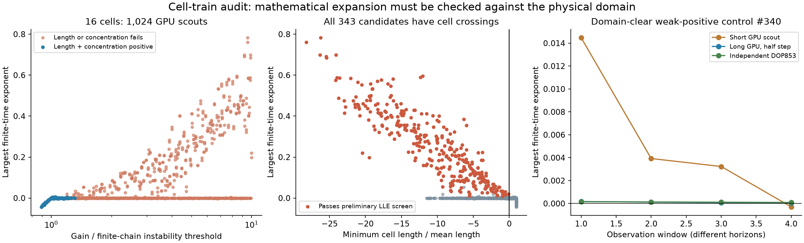

# A confined epithelial cell train: expansion outside the physical domain

**Result: no physically admissible chaos candidate in this bounded search.** We screened the published discrete mechanochemical model of Parmar et al. [1], using 16 cells and its full 47-dimensional dynamics. All 343 preliminary positive-exponent candidates developed negative cell lengths. Four strong mathematical candidates retained positive exponents in longer, half-step calculations, but the cell crossings remained. They are not evidence for chaos in living tissue.



## Exact discrete model

The source couples overdamped vertex motion, an evolving rest length, and phosphorylated myosin. We use its discrete Eqs. (1–4), with fixed endpoints, rather than inventing a low-dimensional surrogate or discretizing its continuum approximation. The author manuscript [2], version 3, was downloaded; its equation page was visually checked. The source's geometric extension and elastic strain should not be conflated: the myosin feedback in Eq. (4) uses extension relative to the constant mean length.

Let `u_0=u_N=0`, let `u_1,...,u_(N-1)` be displacements in mean-cell-length units, and define

```text
x_i = u_(i+1) - u_i                 (geometric extension)
a_i = 1 - rest_length_i/mean_length
c_i = myosin_i/baseline_myosin - 1
rho = sqrt(tau_a*tau_c)
r = sqrt(tau_a/tau_c)
alpha = v*tau_a_physical/mean_length
beta = beta_tilde*tau_c_physical/baseline_myosin.
```

Here `tau_a,tau_c` are first expressed in mechanical relaxation units `zeta/k`; the new time is `s=t/rho` in those units. Direct normalization of the discrete equations gives

```text
u_j' = rho*(u_(j+1)-2*u_j+u_(j-1)+a_j-a_(j-1))
a_i' = (-a_i + alpha*tanh(c_i))/r
c_i' = r*(-c_i + beta*tanh(x_i)).
```

There are `3N-1` states and four positive dimensionless parameters. `research/epithelial_chain.py` and `.cl` are independent implementations. They add no collisions, saturation clamps, stochastic terms, or inertia.

## Boundedness, equilibrium and the finite-chain threshold

These useful conclusions follow directly from the equations:

* **All finite-dimensional trajectories are bounded.** Bounded `tanh` forcing bounds each `a_i` and `c_i`. The fixed-end displacement matrix is strictly stable and is driven by bounded differences of `a_i`. This proves mathematical boundedness for positive parameters, but not positivity of cell length or concentration.
* **The homogeneous equilibrium is unique.** At equilibrium each cell has the same tension, proportional to `x_i + alpha*tanh(beta*tanh(x_i))`. This is a strictly increasing function of `x_i`. Therefore all extensions coincide; their sum is zero, so all are zero. The chemical states then vanish.
* **The divergence is constant:** `-2*rho*(N-1)-N*(r+1/r)`. Negative divergence alone does not establish a strange attractor.

For the nonuniform linear modes, set

```text
q_n^2 = 4*sin(n*pi/(2*N))^2,    n=1,...,N-1
z = rho*q_n^2,    B = r+1/r,    A = alpha*beta.
```

The characteristic polynomial is

```text
(lambda+z)*(lambda+1/r)*(lambda+r) + z*A.
```

Routh–Hurwitz gives the instability threshold `A_n=B*(z+B+1/z)`. The finite chain first loses linear stability at the minimum over its allowed modes. The two uniform chemical eigenvalues are `-r,-1/r`. This is a linear statement, not a proof of a nonlinear Hopf branch or absence of chaos elsewhere. At `r=1` the uniform chemical block is defective; numerical eigenvalue splitting near `-1` should not be misread as an instability.

## Search and checks

The GTX 1080 FP64 solver evolves the analytic tangent equation with RK4, renormalizing at each step. Short trajectories agree with independent adaptive DOP853 to `9.3e-12` in state and `2.2e-13` in the exponent. Finite-difference Jacobian errors are below `4.6e-10`, and the finite-chain modal eigenvalues agree to `8.2e-14` for the nondegenerate controls.

The scout consists of 512 reproducible Sobol parameter tuples and two common initial states, at `N=16`:

| Quantity | Logarithmic search range |
| --- | --- |
| `rho` | 0.316–10 |
| `r` | 0.251–3.981 |
| `beta` | 0.200–2.000 |
| `alpha*beta / min(A_n)` | 0.891–10 |

Each run discards 250 normalized time units and observes 500 with step at most 0.005. A preliminary candidate requires mean exponent above 0.005 and all four observation windows above 0.002. All 1,024 runs completed in 54.6 seconds. Of them, 129 retained positive cell lengths and concentrations at sampled observation steps; 75 additionally retained positive effective rest lengths. **None of the 343 preliminary candidates retained positive cell lengths.**

Follow-ups selected the four largest scout exponents and the 20 largest among runs with positive cell lengths and concentrations. They discard 1,000 and observe 2,000, halving the step to 0.0025. All 24 completed in 271 seconds. Only the four already-unphysical candidates passed the screen; their means were approximately `0.7810,0.7655,0.7156,0.6707`. The remaining 20 had means at most `0.00103` and none passed the screen.

The strongest domain-clear weak-positive scout, index 340, declined from mean `0.00534` to `0.000103` in the long GPU run, with steadily declining window exponents. Independent DOP853, initialized from the saved scout state and given another 500 transient units followed by 1,000 observation units, gives mean `0.000124`, with windows `[0.000159,0.000135,0.000112,0.0000898]`. The cell-length minimum is 0.639. This is not convincing evidence of chaos. We have not certified whether its ultimate state is periodic, quasiperiodic, or another very weak regime.

Only four of the 343 preliminary mathematical candidates received long checks. The others remain short finite-time observations because they already fail the cell-length condition. No independent full Lyapunov spectrum was computed for the unphysical candidates. The small positive control is not promoted to an attractor discovery, and no global no-chaos theorem is claimed.

## Physical and novelty limits

Cell length is `1+x_i`; a negative value means that neighboring vertices have crossed. The equations contain no contact or neighbor-reordering rule, so such trajectories cannot represent the intended cell train. Adding either rule would define a different system. Myosin concentration `1+c_i` must also be nonnegative. Effective rest length `1-a_i` is reported separately: its interpretation as a geometric preferred length or an active prestress offset needs care. Our rejection of the preliminary candidates does not depend on this ambiguity, because their actual cell lengths are already negative.

This search changes parameters and uses a 16-cell train; it is not a quantitative reproduction of the source's 100-cell phase diagram or fitted experimental examples. A broader cell-count/near-onset search remains open. Mathematical boundedness does not rescue an invalid physical regime.

The primary paper reports waves and oscillations. An OpenAlex forward-citation check returned three records. One, Sarkar et al. [3], explicitly reports chaos in an **inertial** mechanochemical solid with a different cubic reaction law; its primary equations were inspected. The other two concern a three-dimensional vertex model [4] and embryonic oscillations [5], respectively; the former was inspected at abstract level and the latter in the primary article. Older actomyosin chaos [6] and Boocock's thesis [7] also prevent any broad claim that tissue or mechanochemical chaos is new. Exact-title/identifier and equation-family searches did not locate a matching chaos demonstration for this discrete chain, but that is not proof of absence. No novelty claim is needed for the negative physical screening result.

## Reproduction

```powershell
.venv/Scripts/python.exe research/epithelial_chain.py --validate
.venv/Scripts/python.exe research/epithelial_chain.py --cells 16 --power 9
.venv/Scripts/python.exe research/epithelial_chain.py --refine results/epithelial-chain/n16-scout --indices 297 296 127 326 340 484 25 24 805 560 341 983 982 910 561 65 511 787 268 804 425 269 64 816 --transient 1000 --duration 2000 --dt .0025 --output results/epithelial-chain/n16-refined
.venv/Scripts/python.exe research/check_epithelial_chain.py
.venv/Scripts/python.exe research/render_epithelial_chain.py
```

Data, numerical settings, initial states and selection indices are under `results/epithelial-chain/`. Domain minima are sampled during observation, so positivity is a necessary numerical screen, not a certified invariant-domain proof.

## References

1. Parmar, T., Dow, L. P., Pruitt, B. L., and Marchetti, M. C. (2025). Spontaneous and Induced Oscillations in Confined Epithelia. *PRX Life* **3**, 013002. [doi:10.1103/PRXLife.3.013002](https://doi.org/10.1103/PRXLife.3.013002).
2. Same authors. [arXiv:2408.02806v3](https://arxiv.org/abs/2408.02806v3), 11 February 2025. Discrete Eqs. (1–4), model section pp. 2–3. Version 3 was used for the local equation audit, not an unversioned HTML rendering.
3. Sarkar, S., Ash, B., Wu, Y., Boechler, N., Shankar, S., and Mao, X. (2025). Mechanochemical Feedback Drives Complex Inertial Dynamics in Active Solids. *Physical Review Letters* **135**, 258301. [doi:10.1103/19rh-3whq](https://doi.org/10.1103/19rh-3whq); [primary preprint equations](https://arxiv.org/html/2505.18272v2).
4. Yu, P., Zhang, R., and Li, B. (2025). Cell Stiffness-Mediated Mechanochemical Waves in Three-Dimensional Tissues. *Physical Review Letters* **135**, 108401. [doi:10.1103/r4fs-4qqk](https://doi.org/10.1103/r4fs-4qqk). Abstract-level inspection only.
5. Fleury, V. (2026). Spontaneous cephalic oscillations in vertebrate embryos support the Inside Story scenario of human development and evolution. *Scientific Reports* **16**, 20002. [doi:10.1038/s41598-026-50217-7](https://doi.org/10.1038/s41598-026-50217-7). Citation-context check.
6. Ramaswamy, R., and Jülicher, F. (2016). Activity induces traveling waves, vortices and spatiotemporal chaos in a model actomyosin layer. *Scientific Reports* **6**, 20838. [doi:10.1038/srep20838](https://doi.org/10.1038/srep20838).
7. Boocock, D. R. (2023). *Mechanochemical pattern formation across biological scales*. Doctoral thesis, Institute of Science and Technology Austria. [doi:10.15479/at:ista:12964](https://doi.org/10.15479/at:ista:12964). Repository abstract inspected; full thesis not audited in this block.
