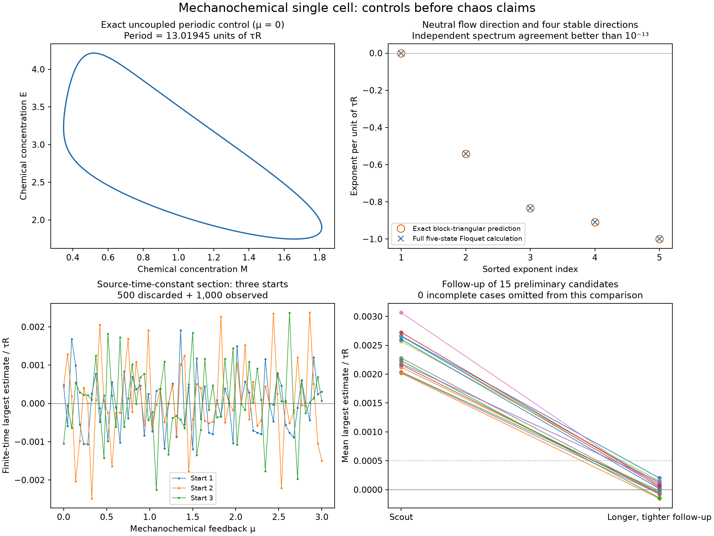
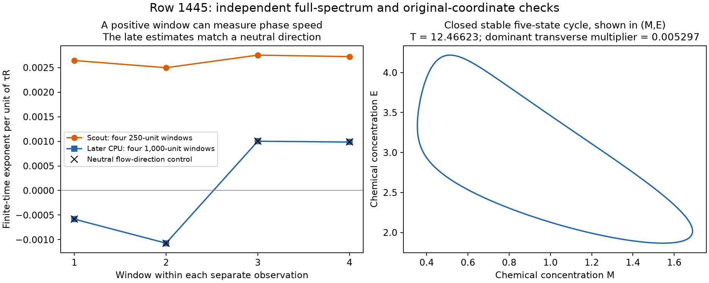

# A mechanochemical single cell: numerical controls and a negative chaos search

**Status, 30 October 2026:** all 3,267 survey trajectories completed. Of 187 selected longer follow-ups, 186 completed and **none passed the retained-candidate criterion**; one stiff extreme case exhausted its step budget. An independent full-spectrum calculation identifies a stable cycle behind one of the most consistent preliminary positive signals. This is a study of the literal fixed-reference single-cell equations, not a claim of new chaos. The source's spatial model already has published chaos, and a separate source-figure reproduction discrepancy remains unresolved.



The short-time estimates in the lower panels are not a chaos map. The right panel includes all fifteen preliminary candidates: they all completed follow-up and lost retention. The separate incomplete trajectory was selected by its high mean, not by the preliminary four-window criterion.

## Model, reference convention, and physical scope

The Harmonic Hopf Solid (HHS) study [1] couples Brusselator chemistry to mechanical deformation and a chemical degrader. We implement its **five-state autonomous single-cell Equation S2**, with the source's explicit choice `f(L,t)=0`. We do not add the spatial model's cubic saturation or replace the single-cell mechanical relaxation with a uniform spatial mode.

In coordinates `(M,E,D,y,x)`, the equations are

```math
\begin{aligned}
\dot M&=1-4M+M^2E,\\
\dot E&=3M-M^2E-DE,\\
\tau_D\dot D&=0.1-D+\mu Dx,\\
\tau_L\dot y&=E-E_r-y,\\
\dot x&=y-x.
\end{aligned}
```

The source time unit is `tau_R`, set to one; no conversion to physical seconds is calibrated. The fixed reference is **Er=3.8626272360560576**, the concentration at the uncoupled chemical equilibrium. It is not replaced by the initial value of `E`. The exact affine reconstruction is `L=1-alpha*x`, `L0=1-alpha*y`, with `mu=alpha*beta` and `alpha>0`.

The [source audit](hhs-source-audit.md) describes six independent integrations in the original `(M,E,D,L0,L)` coordinates. Under this fixed-reference convention, all six retain substantial oscillations where Fig. S1 shows several constant traces. The text reuses the reference symbol for initial concentrations, the panel and caption parameter descriptions differ, and the plotted starts are rounded. We preserve the discrepancy without fitting a replacement reference or alleging an error in an implementation we have not seen. The inspected source archive contains manuscript/figure files but no simulation implementation or raw trajectories.

The [structural note](hhs-structure.md) proves a global bound for every finite admissible initial state, with nonnegative chemical concentrations and positive initial degrader. That bound depends on the initial state and can be extremely conservative. It is not a proof of chaos, positive cell lengths, or small strain. The simpler monotone cyclic-loop exclusion does not directly apply because the chemical subsystem adds a side loop with a changing derivative sign.

## Controls before the survey

The CPU implementation checks the full analytic Jacobian by complex-step differentiation at 128 random states. It also verifies the original-coordinate transformation, the chemical-sum identity, and the persistent reference equilibrium. Relative algebra residuals are below `2e-15`. DOP853 in normalized coordinates and Radau in original coordinates agree within `1.4e-12` over 30 model-time units.

At zero feedback, the chemistry is a planar oscillator with three stable driven/filter directions. Its full five-state periodic orbit closes with period **13.0194523059451**. Direct Floquet exponents are

```math
(0,\;-0.541945993331,\;-0.833333333333,\;-0.909090909091,\;-1).
```

They agree within `1e-14` with the independently predicted chemical radial exponent and the exact filter exponents `-1/tau_L`, `-1/tau_D`, `-1/tau_R`. Independent original-coordinate Radau closure is about `1e-13`. This is a nontrivial test of the complete five-state variational calculation, not a check against five unrelated scalar growth rates.

The FP64 OpenCL implementation uses adaptive Dormand–Prince 5(4), controls state and tangent errors, and renormalizes the tangent after every accepted step. Eight short controls agree with independent implicit Radau state/tangent integrations and equilibrium matrix exponentials within `4e-14`. A 250-unit periodic control at two tolerances and maximum steps agrees in state within `1.6e-9` and `3.3e-11`, respectively; largest-exponent differences are below `1.2e-10`. The [validation records](../results/hhs) retain settings and errors.

## Survey and follow-up

The source-time-constant section has 65 equally spaced values of `mu` from 0 to 3, with `tau_D=1.1`, `tau_L=1.2`. A further 1,024 scrambled Sobol tuples sample logarithmic ranges `mu=0.001..30`, `tau_D=0.05..30`, `tau_L=0.05..30`, with seed `2026103015`. Every tuple has three rounded chemical starts printed in source Fig. S1: `(1.05,3.43)`, `(0.44,2.71)`, `(0.49,4.21)`. Each has `D=0.1`, `x=y=0`; the fixed reference remains the same for all starts.

| Stage | Trajectories | Additional discarded / observed model time | Relative tolerance | Maximum step | Result |
|---|---:|---:|---:|---:|---|
| Survey | 3,267 | 500 / 1,000 | `1e-8` | `0.05` | All complete; 15 preliminary passes |
| Follow-up from saved endpoints | 187 | 2,000 / 8,000 | `1e-10` | `0.025` | 186 complete; zero retained; one step-budget exit |

Absolute tolerance is `0.001` times relative tolerance. Each observation is split into four equal windows. Preliminary selection requires a mean exponent above `0.002` and all four windows above `0.001`, in inverse source-time units. Follow-up includes **all 169 trajectories with four positive signs**, union the preliminary passes and the 24 largest means. Retention requires mean above `0.0005` and all windows above `0.00025`. These thresholds are disclosed screening rules, not a proof-based definition of a chaotic attractor.

All fifteen preliminary passes lose retention. Among completed follow-ups, **24 still have small positive signs in all four windows**, and 111 have positive means. The largest completed mean is `0.000308064`. We do not classify every such trajectory as periodic or prove its asymptotic exponent nonpositive. Source indices, window sums, elapsed clocks, accepted/rejected step counts, endpoints and tangents are saved. The complete survey took about **88.7 seconds**, and the selected follow-up stage **408.1 seconds**, on the GTX 1080; these times exclude separate CPU controls and are not a matched speedup benchmark.

One trajectory, source row **3009**, at approximately `(mu,tau_D,tau_L)=(28.0751,0.0625362,0.673702)`, reached the 12-million-attempt cap at follow-up time **3717.15** of the requested 10,000 units. Its degrader was approximately **15,670** at the stop, making explicit integration stiff. Its partial exponent is not counted as a completed negative result. The endpoint, tangent and raw partial logs remain available for independent assessment.

A targeted implicit Radau continuation of that saved endpoint recovers a stable cycle with period **8.11583492961927**, dominant transverse multiplier **0.00128370498**, and a second resolved multiplier about `5.25e-7`. State-only Radau closure is `5.1e-13`; an independent original-coordinate BDF closure is `1.3e-10`, scaled by `max(1,abs(initial component))`. Raw component residuals are saved: the small degrader value at the section is approximately `0.00483`, so the much larger peak does not hide its closure error. Two tiny direct Floquet multipliers remain unresolved. The final augmented Radau calculation uses an exact Hessian-based Jacobian; an earlier finite-difference Jacobian produced overflow warnings that are recorded rather than silently discarded. This endpoint check does **not** complete the missing 10,000-unit GPU interval or prove global absence of chaos; the completion count remains 186/187.

For the illustrative reconstruction `alpha=0.1`, every completed survey observation has positive sampled lengths; the smallest is about `0.9181`. This is not a source calibration. Only accepted observation states enter these diagnostics; they are not rigorous between-step or transient bounds. Concentration ranges can be extreme: observed `D` reaches approximately `3.12e5` somewhere in the broad mathematical survey. Positivity therefore cannot certify biological concentrations, small strain, or the physical validity of independently varied time constants and coupling.

## Why a very consistent preliminary positive signal was misleading

Source row **1445**, at `(mu,tau_D,tau_L)=(0.119772090397,0.998910344723,0.0544440627234)`, has scout window estimates near `0.00265`, all positive. A separate CPU calculation starts from its saved endpoint, discards 1,000 more units, and observes 4,000 with all five variational vectors, QR every `0.5`, DOP853 relative tolerance `1e-11`, and maximum step `0.025`.

Its finite-time full spectrum is approximately

```math
(0.00008331,\;-0.42015239,\;-0.81734040,\;-1.22862864,\;-18.36735195).
```

The sum agrees with the integrated divergence within `1.4e-9`. The four leading window estimates are approximately `(-0.0005825,-0.0010714,0.0010019,0.0009853)`. They coincide with an independently propagated, normalized flow direction within `3.2e-14`. Their small positive values reflect finite-window changes of speed along a neutral direction, not an independent unstable direction.



Shooting closes a stable periodic orbit with period **12.4662339230156** and dominant transverse multiplier **0.00529688344**. Newton closure is `3.7e-15`, and a separate original-coordinate Radau integration closes within `1.1e-14`. The full trajectory and upward `M=Mref` section crossings are saved. The picture is a two-coordinate projection of the five-state cycle.

The extremely fast contracting Floquet multiplier is below direct double-precision monodromy resolution. It is explicitly flagged as unresolved; its tiny numerical eigenvalue is not used as a precise exponent or determinant test. The repeatedly orthogonalized full spectrum separately resolves the fast rate near `-18.36735`.

## Mathematical findings and remaining limits

The [equilibrium calculation](hhs-structure.md) distinguishes an additional-equilibrium saddle-node near **mu=1.056241674** from the persistent-reference zero eigenvalue near **1.056642289**. These are close but distinct events. The reference equilibrium still has an unstable complex pair at the latter value, so this is not a Hopf stabilization. Two linear Hopf candidates on the compressed branch occur near **1.086113804** and **2.426735066** at the source time constants. Nonzero crossing slopes and left-half-plane remaining eigenvalues were checked; no nonlinear Hopf coefficient or complete continuation is claimed.

These results provide independent controls and specific source-reproduction questions. They do not turn the broad published spatial-chaos result into a new discovery, establish novelty of any exact single-cell regime, or exclude chaos everywhere in the bounded five-state system. A different reference convention or spatial saturation would define a separately specified calculation.

## Reproduction

Use Python with NumPy, SciPy, Matplotlib and PyOpenCL. The GPU survey requires an FP64-capable OpenCL device; source and CPU controls do not. Run from the repository root:

```bash
python research/hhs.py
python research/audit_hhs_structure.py
python research/hhs_gpu.py --controls
python research/hhs_gpu.py --long-control
python research/hhs_gpu.py
python research/hhs_gpu.py --refine results/hhs/scout.npz
python research/check_hhs.py --row 1445
python research/check_hhs_stiff.py
python research/summarize_hhs.py
python research/plot_hhs.py
```

Saved numerical arrays and strict metadata are in [results/hhs](../results/hhs); [summary.json](../results/hhs/summary.json) is generated from those arrays. The six independent source-figure controls have their own exact implementation and settings in [source-audit.json](../results/hhs/source-audit.json).

## References

1. S. Mondal, P. Dewan, L. S. Kumar, and S. Sarkar, *Symmetry-protected phases in a 1D active solid with mechanochemical feedback*, **Physical Review Letters 137**, 078401 (2026). [DOI: 10.1103/p1bw-v87g](https://doi.org/10.1103/p1bw-v87g); [public manuscript and complete supplement](https://arxiv.org/html/2504.19655v3). This study uses single-cell S2, not the spatial equation.
2. The [version and prior-work audit](late-candidate-screening-3.md), [source reproduction audit](hhs-source-audit.md), and [structural derivation](hhs-structure.md) record the exact model, source access, displayed-equation issues and limits of the novelty assessment.
