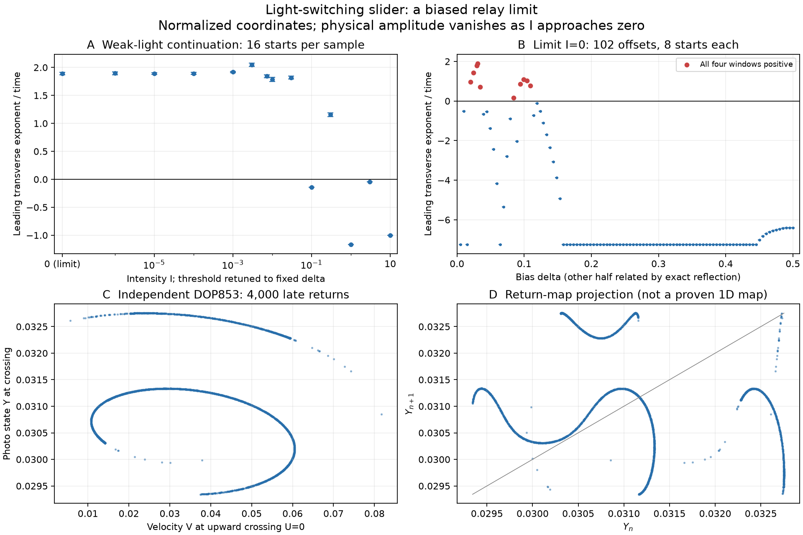

# A weak-light limit and the role of switching bias

The ideal light-switching slider has persistent positive numerical exponents even in its **rescaled small-intensity limit**. The limit makes the mechanism easier to compare with classical relay feedback. It does not predict nonzero motion in darkness, and it does not establish a new class of chaotic equations.

This continues the [published-model investigation](lce-slider-research.md) and [switching-width audit](lce-slider-switching.md). Source equations are those of Ge et al. [1]; the scaling and calculations below are our independent work.



## Exact scaling, singular physical limit

Starting from

$$\dot u=v,\qquad \dot v=k(d-u-\phi)-bv,\qquad
\dot\phi=I H(u)(1-\phi)-\phi,$$

set, for **positive** intensity,

$$q=\frac{I}{1+I},\quad (U,V,Y)=\frac{(u,v,\phi)}q,\quad\delta=\frac dq.$$

The transformed equations are exactly

$$\dot U=V,\qquad \dot V=k(\delta-U-Y)-bV,\qquad
\dot Y=(1+I)H(U)-[1+I H(U)]Y.$$

At each fixed positive intensity this is an invertible coordinate change, with the same time variable and Lyapunov exponents. The transformed vector fields have a finite limit at `I=0`, although the transformation itself becomes singular there:

$$\dot U=V,\qquad \dot V=k(\delta-U-Y)-bV,\qquad \dot Y=H(U)-Y.$$

Eliminating `V,Y` on each open branch gives

$$U'''+(b+1)U''+(k+b)U'+kU=k[\delta-H(U)].$$

This is a biased, negative, zero-hysteresis relay around the stable plant with denominator `(s+1)(s²+bs+k)`. Its relative degree is three. Displacement, velocity and acceleration are continuous at a transverse switch; jerk jumps. For `k,b>0`, `Y` stays in `[0,1]`, and the stable mechanical subsystem has bounded forcing, hence bounded forward response. This argument does not settle solution uniqueness at every possible grazing contact.

Holding `delta` fixed changes the physical threshold as intensity changes: `h=g/k-C q delta`. Physical displacement from the threshold, velocity and concentration are `C q U`, `C q V` and `q Y`. A bounded normalized family therefore shrinks as `I -> 0`. At exactly zero illumination the original concentration decays and the mechanical motion damps. **The limiting chaotic numerics are not a claim of oscillation without light or of persistence at fixed device geometry.**

There is a further experimental restriction: a fixed physical optical transition width does not remain narrow relative to `q` as intensity decreases. The earlier smooth-switch calculations show why this matters. The ideal scaling alone cannot establish arbitrarily weak-light chaos in a real slider.

## Intensity survey and independent checks

The reference is `k=816.0170161251663`, `b=13.491678487182265`, `delta=0.030904198409989477`. Sixteen identical normalized initial sections are tested at each of fourteen intensity samples. Every trajectory discards 2,000 and observes 8,000 complete upward returns; each return includes one light and one dark flight. Analytic affine flights are evaluated in FP64 on a GTX 1080, with event bracketing at 256 subdivisions per mechanical period.

All **224 trajectories** completed in 24.98 seconds. At each of `I=0, 1e-6, 1e-5, 1e-4, .001, .003, .0072352368, .01, .03, .3`, all sixteen starts have positive leading exponents in all four observation windows. At `.1, 1, 3, 10`, all sixteen have negative leading **transverse** exponents. These samples show regular windows between positive samples; they do not establish continuous chaotic intervals, basin probabilities or confidence bounds. Error bars in the figure are the minimum-to-maximum spread across the finite starting ensemble.

At the normalized `I=0` reference:

| Method | Discarded + observed returns | Transverse spectrum per unit time | Four leading windows |
| --- | ---: | --- | --- |
| Independent DOP853, `rtol=1e-12` | 1,000 + 4,000 | `1.892427, -16.383592` | `1.861337, 1.910806, 1.944736, 1.853581` |
| Analytic flights, 512 subdivisions | 2,000 + 8,000 | `1.905665, -16.397439` | `1.920531, 1.873702, 1.911939, 1.916683` |

The autonomous neutral flow exponent is omitted by the return section. Neither a small positive neutral estimate nor a positive finite-time exponent alone proves a strange attractor. The two methods observe different long chaotic trajectories after roundoff separates them; their close averages are a consistency check, not a statistical error estimate.

For this limit the divergence is the constant `-(b+1)`. The exact event-map determinant additionally contains the crossing-speed ratio. Comparing the QR sum against this full identity gives discrepancies `4.44e-14` and `1.60e-14`. The independent DOP853 run takes 224.24 seconds; the longer CPU analytic run takes 92.83 seconds. These timings concern different workloads and are not a controlled hardware speedup benchmark.

Short-time validation also compares the original and normalized GPU models at positive intensity, independent DOP853 and analytic event states/times/Jacobians, finite-difference return derivatives, and GPU/CPU four-return trajectories at `I=0`, the original intensity, and `I=1`. All checks pass; numerical errors and tolerances are saved in `results/lce-slider/intensity-limit/validation.json`.

## Bias selects very different regimes

At `I=0` the exact reflection

$$ (U,V,Y,\delta)\mapsto(-U,-V,1-Y,1-\delta) $$

maps trajectories into trajectories, reversing the two illumination branches. Thus only `0<delta<=1/2` needs a separate mathematical study. This symmetry does **not** hold at finite intensity, where light and dark relaxation rates differ.

A second GPU survey uses 102 offsets from `.005` to `.5`, with eight common starts and the same 2,000+8,000 return settings. All **816 trajectories** complete in 22.53 seconds. Ten sampled offsets retain positive leading exponents in every window for all eight starts:

`.01985, .0248, .02975, .0309041984, .0347, .0842, .0941, .09905, .104, .10895`.

All other sampled offsets have negative leading transverse exponents. The uncomputed reflected half is a consequence of the exact equation symmetry, not additional simulated data. Narrow windows can be missed by this mesh, and additional basins can be missed by eight starts.

At the symmetric offset `delta=.5`, independent shooting closes a one-return periodic orbit with period **`0.2185373300`** and transverse multipliers **`0.2470281, 0.1705512`**. Both are inside the unit circle. A separate DOP853 return closes to `7.8e-15`; its return Jacobian agrees to `4.8e-14`. The half-period state also satisfies the reflection symmetry to `4.9e-15`. This supplies a stable periodic control, rather than interpreting every irregular-looking trace as chaos.

The two lower panels show the independent chaotic trajectory's return section and a projection of consecutive photo states. Strong contraction leaves thin curved sets, while the projection folds and has multiple branches. This is a useful clue about switching-time sensitivity. It is **not** a derivation of a closed one-dimensional map or a proof of its invariant measure.

## How much of this is already classical?

General relay chaos is old. The stable-branch observation alone does not establish novelty. Our narrower comparisons are:

- Johansson's thesis [2], printed p. 25, Example 15, reproduces Cook's 1985 example with `G(s)=-1/(s²-.1s+1)` and unit hysteresis. We read and visually checked the thesis page, not Cook's complete original paper. That displayed example has an unstable second-order linear part and hysteresis, unlike this stable third-order zero-hysteresis limit.
- Boiko et al. [3], in the publisher's accessible section about Atherton's example, give `W(s)=1/[(s-d)(s²+2s+10)]` and describe saddle-focus equilibria with a one-dimensional unstable manifold. This is already the same broad family of factored third-order relay plants. The displayed unstable-pole regime differs from our stable plant and imposed bias. Only the publisher's abstract and section excerpts were accessible; we cannot rule out a matching regime elsewhere in that paper or its cited work.
- Johansson and Rantzer [4] study global convergence in classes of third-order relay systems. Only the abstract was retrieved. Its scope cannot be assumed to cover every stable plant, every bias and every switching convention.
- Atherton's own later account [5], Section 6.6.5, connects the Amrani–Atherton work to ideal-relay examples whose cubic denominator has `a0=4`, `a1=1.25`, and an unstable complex pair for `a2<3.2`. The displayed chaotic example belongs to that unstable-branch regime. We read pp. 111–114 and visually checked pp. 112–113. This author account narrows the comparison without substituting for an audit of every example in the original proceedings paper.

The earlier [audit](lce-slider-switching.md) compares three more published relay/jerk examples. Cook's original paper and Amrani–Atherton's full 1989 proceedings article remain incompletely audited. No claim of the first chaotic stable relay, the first chaotic elastomer, or a previously unknown mathematical system is justified by this search.

What this block adds is a reproducible reduction of the particular slider model to a simpler limiting problem, independent numerical evidence there, and a concrete role for threshold bias. A possible contribution would have to be framed around that model, parameter regime, mechanism and physical feasibility after a more complete prior-art check.

## Reproduction

Run from the repository root after installing the project and research dependencies:

```bash
python research/search_lce_slider_limit.py --validate
python research/search_lce_slider_limit.py
python research/search_lce_slider_bias.py
python research/check_lce_slider.py --source results/lce-slider/intensity-limit --index 0 --normalized --method DOP853 --transient 1000 --cycles 4000 --rtol 1e-12 --output results/lce-slider/intensity-limit-cpu
python research/check_lce_slider.py --source results/lce-slider/intensity-limit --index 0 --normalized --method analytic --transient 2000 --cycles 8000 --subdivisions 512 --output results/lce-slider/intensity-limit-analytic
python research/analyze_lce_slider_limit.py
```

Normalized scans store `delta` in parameter column four and `(V,Y)` in section columns. Original scans store `d` and `(v,phi)`. The `--normalized` option is therefore essential when independently checking these new files. Both conventions are recorded in scan metadata. Original-mode defaults remain unchanged.

## References

1. **Ge, D., Hong, Q., Liu, X., and Liang, H.** (2024). Self-Oscillation of Liquid Crystal Elastomer Fiber-Slide System Driven by Self-Flickering Light Source. *Polymers*, **16**(23), 3298. [doi:10.3390/polym16233298](https://doi.org/10.3390/polym16233298).
2. **Johansson, K. H.** (1997). *Relay Feedback and Multivariable Control*. Doctoral dissertation, Lund Institute of Technology, report TFRT-1048. [Author-hosted thesis](https://people.kth.se/~kallej/papers/phd_thesis.pdf), printed p. 25, Example 15.
3. **Boiko, I. M., Kuznetsov, N. V., Mokaev, R. N., and Akimova, E. D.** (2021). On asymmetric periodic solutions in relay feedback systems. *Journal of the Franklin Institute*, **358**(1), 363–383. [doi:10.1016/j.jfranklin.2020.10.024](https://doi.org/10.1016/j.jfranklin.2020.10.024). Access limited to publisher abstract and section excerpts.
4. **Johansson, K. H., and Rantzer, A.** (1996). Global Analysis of Third-Order Relay Feedback Systems. [doi:10.1016/S1474-6670(17)57954-9](https://doi.org/10.1016/S1474-6670(17)57954-9). [University report record](https://portal.research.lu.se/en/publications/global-analysis-of-third-order-relay-feedback-systems-2/). Abstract only in this pass.
5. **Atherton, D.** (2011). *An Introduction to Nonlinearity in Control Systems*. Bookboon, ISBN 978-87-7681-790-9, Section 6.6.5, pp. 111–113. [Accessible copy](https://csva.s3.amazonaws.com/schools/839/Civil/738/An%20Introduction%20to%20Nonlinearity%20in%20Control%20Systems.pdf). This is the author's later description of his group's examples; the original 1989 paper remains incompletely audited.
