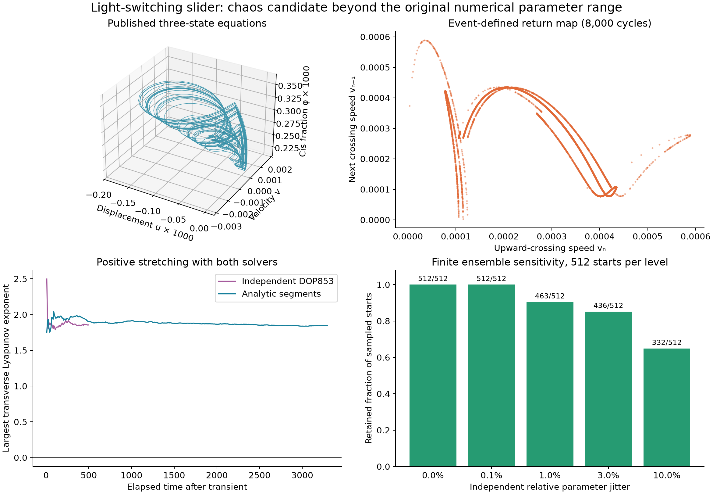

# Event-resolved search in a light-switching elastomer slider

**Status: 29 October 2026.** We find a second independently checked chaos candidate, this time in a three-state model with an ideal position-triggered light switch. The equations are those of Ge et al. [1], but the positive examples use stiffness and damping beyond the numerical ranges in their Table 2. This is not experimental confirmation, a rigorous strange-attractor proof, or a claim that relay chaos is new.



The physical idea is a hanging photo-responsive fiber that moves a slider and thereby switches its own illumination. The paper investigates steady and periodic motion. Its full text, including Eqs. 9 and 11–13, was read before implementation. No author software was used.

## Exact reduction of the printed equations

Dropping dimensionless bars, the model is

$$\dot x=v_x,\qquad \dot v_x=g-k(x+C\phi)-b v_x,\qquad
\dot\phi=I H(x-h)(1-\phi)-\phi.$$

Here `H` switches between zero and one. We use the dimensionless differential equations as printed, without claiming a calibrated conversion back to a device. For `C>0`, set

$$u=(x-h)/C,\quad v=v_x/C,\quad d=(g/k-h)/C.$$

Then

$$\dot u=v,\qquad \dot v=k(d-u-\phi)-bv,\qquad
\dot\phi=I H(u)(1-\phi)-\phi.$$

This is an exact change of variables. The dynamic parameters reduce to **four**: `k,b,I,d`. Gravity, contraction and switch position enter the normalized dynamics only through `d`; changing `C` also rescales the physical amplitude.

There is a further useful scaling. With `q=I/(1+I)`, set `U=u/q`, `V=v/q`, `Y=phi/q`, and `delta=d/q`. The mechanical equation becomes `V'=k(delta-U-Y)-bV`; the molecular response is `Y'=(1+I)(1-Y)` with light on and `Y'=-Y` with light off. Thus small intensity mostly reduces amplitude when the threshold is retuned to hold `delta` fixed. This limiting observation is mathematical, not a statement that illumination can be removed from a real oscillator.

## Boundedness and the source of nonlinearity

For `I>0`, the interval `0 <= phi <= q` is forward invariant: the vector field points inward at both endpoints in either lighting state. The mechanical subsystem is a stable linear oscillator driven by the bounded input `k(d-phi)` when `k,b>0`. Its variation-of-constants formula gives a bounded response and an absorbing bound after the initial transient. Therefore growth of the simulated state is not the mechanism behind the positive exponent.

On either side of the switch the dynamics is affine and stable. The two branch equilibria have displacements `u=d` (dark) and `u=d-q` (illuminated). When `0<d<q`, neither belongs to its own open half-space. Switching is essential. The search focuses on this interval; behavior at grazing points is not classified by the argument.

This distinction matters: **two individually stable affine flows can generate complex motion when the switching times depend on the state.** General relay systems already have a long chaos literature [2]. A possible publication gap here can concern only this specific material model and regime.

## Computation without sampled switching

Within a lighting interval, let `r=1+I` and `q_on=I/(1+I)` when illuminated, or `r=1`, `q_on=0` in darkness. Then

$$\phi(t)=q_{on}+(\phi_0-q_{on})e^{-rt}.$$

The forced mechanical solution is a sum of this exponential and damped sine/cosine terms. Our independent implementation evaluates it analytically, brackets the next transverse crossing of `u=0`, and bisects to locate that event. It does not update the light state only at fixed sampling times. The implementation currently covers the underdamped case `k>b^2/4`.

We differentiate the **event-defined map**, including the dependence of crossing time on the initial condition. If `M(t)` is the affine tangent propagator, `n=(1,0,0)` and `f` is the incoming vector field at the crossing, its derivative is obtained from

$$\left(I-\frac{f n^T}{n^Tf}\right)M(t).$$

Restriction to the velocity/concentration coordinates gives a two-dimensional section map. Two successive crossings define a full return. A negative largest transverse exponent is compatible with a stable periodic orbit; the continuous flow's neutral time direction has been removed.

The GPU uses FP64 OpenCL. Independent CPU controls use both analytic segments with Brent root finding and DOP853 integration of each affine field and its full tangent matrix, with direction-aware terminal events. Near-zero crossing speeds and failed returns are explicit failure statuses.

## Recorded results

| Experiment | Trajectories | Outcome |
| --- | ---: | --- |
| `k=0.1..10`, `b=0.002..0.5`, `I=0.005..0.5`, `d/q=0.005..0.995` | 8,192 | No retained candidates |
| Long follow-up of the 16 largest values in that survey | 16 | No retained candidates |
| Expanded `k≈0.005..1000`, damping ratio `0.001..0.75`, same intensity/threshold intervals | 8,192 | 14 candidates: two starts at each of seven parameter tuples |
| Expanded candidates plus other large values; 2,000 discarded + 8,000 observed returns; fourfold finer event bracketing | 32 | The same 14 retain positive four-window estimates |

The ordinary survey stays within the paper's tabulated intervals for stiffness, damping and intensity; it is not a reconstruction of all physical combinations in that table. The wide survey deliberately extrapolates these mathematical parameters. Large-amplitude trajectories elsewhere in either survey need separate checks of material validity.

A reproducible reference is `wide/scan.npz`, index **2222**:

```text
k = 816.0170161251663
b = 13.491678487182265
I = 0.007235236837126186
d = 0.0002219930226626585
initial section (v, phi) = (0.023299383405718962, 0.0020761739302452855)
```

Independent DOP853, after 300 discarded and 1,200 observed returns, gives transverse exponents **`[1.854575, -16.343240]`** per dimensionless time. Its leading exponent in four successive windows is `1.82345, 1.94604, 1.78081, 1.86941`.

The longer analytic-segment CPU calculation discards 2,000 and observes 8,000 returns: **`[1.844783, -16.336447]`**, over 3,294.7 time units. Its leading windows are `1.87962, 1.87557, 1.81234, 1.81197`. For the corresponding continuous flow, the expected neutral direction lies between the positive and negative exponents. This is ordinary chaos evidence, not hyperchaos.

The section-Jacobian determinant obeys

```math
\log|\det DP|=\int\![-b-1-IH(u)]\,dt+\log|v_{start}/v_{end}|.
```

The two CPU spectrum-sum checks agree with this identity to approximately `4e-14` and `1e-14`. The exact affine flow agrees with a short DOP853 trajectory to `2.2e-14`; the return-map Jacobian agrees with finite differences to `5.8e-10`; CPU and GPU agree after four returns to `1.3e-15`. These are numerical consistency checks, not rigorous error bounds.

Local sensitivity uses independent relative perturbations of all four parameters, 128 tuples and four starts per level. After 2,000+8,000 returns, retained counts out of 512 are:

| Relative perturbation | Retained |
| --- | ---: |
| 0 | 512 |
| 0.1% | 512 |
| 1% | 463 |
| 3% | 436 |
| 10% | 332 |

These are finite ensemble fractions. They do not prove that an entire open neighborhood is chaotic.

## Does this require an obviously invalid material state?

Not in the sampled reference trajectory. An illustrative reconstruction with `C=0.2`, `g=1.2`, and `h=0.001426159` gives, across 100 late cycles:

- displacement `x≈0.00138693..0.00142690`;
- elastic strain `x+C phi≈0.00145431..0.00150075`, positive throughout the sampled trajectory;
- cis fraction `phi≈0.00021077..0.00037293`.

Thus this example is compatible with small strain, small cis fraction and tensile loading within the ideal equations. It still requires stiffness/damping outside the authors' numerical range, a very fine switching threshold, and a device-specific dimensional calibration. Robustness to realistic switching width, contact effects, noise and additional material relaxation remains unresolved. These could remove the regime.

## Finite switching width and older relay models

The [follow-up notebook](lce-slider-switching.md) tests a logistic switch. Narrow transitions retain positive leading exponents; wider examples settle onto independently closed stable periodic orbits or a stable equilibrium. It derives an equilibrium stability condition and an exact jerk representation, then compares three older relay models. Device calibration and exact-model novelty remain unresolved.

## Literature status and remaining questions

Exact-title, DOI, fiber-slider, self-flickering, chaos and Lyapunov searches did not identify a matching result in the checked sources. The article itself cites other chaotic LCE systems; the material class is not unexplored. Relay chaos and numerical effects of digitally sampled switching are also established [2]. We have not completed an equivalence search through all older relay models.

An OpenAlex forward-citation snapshot is included. It returned three records, including a seemingly unrelated enzyme review. This is a reason to treat citation indexes as imperfect leads, not proof of complete coverage. The special-issue editorial was retrieved through indexed publisher text and discusses the periodic study. The ACS publisher page could not be retrieved in this pass; novelty remains explicitly unverified.

The most useful next checks are:

1. Extend the completed finite-width sensitivity experiment to a physically measured response and additional initial states.
2. Continue periodic orbits and locate the bifurcations or grazing events behind the folded return map.
3. Determine whether an equivalent relay system and this parameter regime have already been analyzed.
4. Establish realistic dimensional parameters, switching resolution and omitted material timescales.
5. Use validated return-map bounds if a mathematical proof becomes practical.

## Reproduction

```bash
python research/lce_slider.py
python research/search_lce_slider.py
python research/search_lce_slider.py --wide
python research/search_lce_slider.py --refine results/lce-slider/wide --top 32 --transient 2000 --cycles 8000 --subdivisions 256 --output results/lce-slider/wide-refined
python research/search_lce_slider.py --refine results/lce-slider/scout --top 16 --transient 2000 --cycles 8000 --subdivisions 128 --output results/lce-slider/scout-refined
python research/check_lce_slider.py --output results/lce-slider/cpu-2222
python research/check_lce_slider.py --method analytic --transient 2000 --cycles 8000 --output results/lce-slider/analytic-2222
python research/analyze_lce_slider.py
```

Arrays and settings are in [`results/lce-slider`](../results/lce-slider). `scan.npz` contains parameters, section starts, final sections, four stretching windows, elapsed times and statuses. The CPU files also retain section trajectories and running spectra. The figure and all implementation code are original.

## References

1. **Ge, D., Hong, Q., Liu, X., and Liang, H.** (2024). Self-Oscillation of Liquid Crystal Elastomer Fiber-Slide System Driven by Self-Flickering Light Source. *Polymers*, **16**(23), 3298. [doi:10.3390/polym16233298](https://doi.org/10.3390/polym16233298). [Open full text](https://pmc.ncbi.nlm.nih.gov/articles/PMC11644104/).
2. **Kowalczyk, P., and Glendinning, P. A.** (2011). Micro-chaos in Relay Feedback Systems with Bang-Bang Control and Digital Sampling. IFAC World Congress. [Author-hosted preprint and record](https://eprints.maths.manchester.ac.uk/1600/). Related switching literature, not a claim of mathematical equivalence to the slider model.
