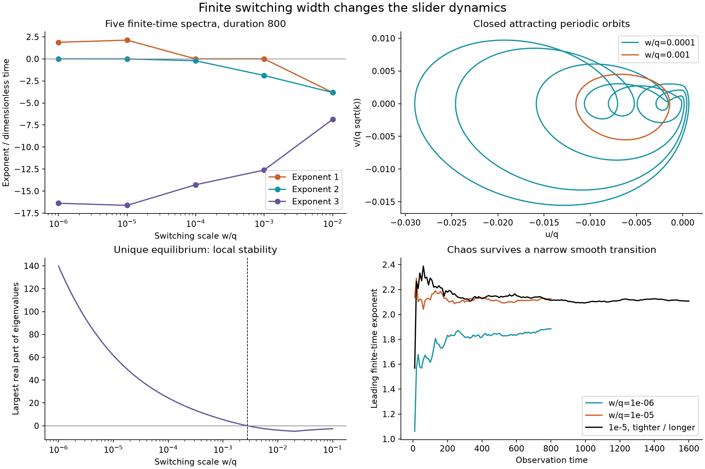

# Switching resolution and older relay models

This extends the [slider notebook](lce-slider-research.md). The new numerical results concern an **explicitly changed model**: `H(u)` is replaced by `S(u)=1/(1+exp(-u/w))`. Here `w` is a logistic scale; the 10–90% transition spans `2 log(9) w`. This is sensitivity analysis, not a measured optical response. The invariant concentration interval and stable mechanically forced subsystem still give bounded forward solutions.



## Chaos, periodic windows and rest

The reference parameters and late ideal-relay starting state are unchanged. Five DOP853 calculations evolve the full three-dimensional variational system, with QR every 0.1 time units, 200 discarded and 800 observed time units, `rtol=1e-10`, `atol=1e-12`, and maximum step 0.01.

| `w/q` | Full finite-time spectrum | Interpretation and control |
| --- | --- | --- |
| `1e-6` | `1.88504, 0.00237, -16.37937` | Four positive leading windows |
| `1e-5` | `2.12685, -0.00208, -16.61672` | Four positive leading windows |
| `1e-4` | `-0.00039, -0.21059, -14.28098` | Independently closed stable periodic orbit |
| `1e-3` | `0.00213, -1.88347, -12.61061` | Independently closed stable periodic orbit |
| `1e-2` | `-3.81705, -3.81855, -6.85650` | Convergence to the unique stable equilibrium |

The largest spectrum-sum/divergence discrepancy is `1.31e-10`. A periodic orbit has a neutral flow direction: the small positive value at `1e-3` is **not** chaos evidence. A small positive second exponent in the chaotic cases is likewise not hyperchaos evidence. Five samples do not establish a monotone transition or locate every intervening window; connecting plot lines only guide the eye.

The `w/q=1e-5` control doubles the transient and observation to **400+1,600**, tightens the tolerance to `1e-12`, and halves the maximum step to 0.005. It retains spectrum **`[2.107689, -0.000907, -16.598736]`**, with leading windows `2.12641, 2.10165, 2.10577, 2.09692` and divergence discrepancy `4.76e-12`. The roughly 0.9% change in the leading mean is compatible with finite-time variability; a formal statistical error bound is not claimed.

Independent shooting, using the analytic variational matrix, `rtol=1e-12` and maximum step 0.005, closes the regular orbits:

| `w/q` | Period | Upward returns through the equilibrium-displacement section | Floquet multipliers |
| --- | ---: | ---: | --- |
| `1e-4` | `1.6553216866` | 4 | `1, -0.710092, approximately -5.4e-11` |
| `1e-3` | `0.2225172717` | 1 | `1, -0.657907, -0.060445` |

Scaled closure residuals are below `5e-17`; neutral multipliers agree with one to approximately `2.4e-11`. The tiny contracting multiplier has limited relative accuracy. Resolved transverse multipliers are inside the unit circle. These are numerical checks, not interval-certified proofs. A four-return orbit alone does not establish a period-doubling route.

## Analytical local stability boundary

The smooth model has exactly one equilibrium because `u + I S(u)/(1+I S(u)) = d` is strictly increasing. At that equilibrium define `a=1+I S(u)` and `c=I(1-phi) S'(u)`. Our direct calculation gives

$$p(\lambda)=(\lambda+a)(\lambda^2+b\lambda+k)+kc.$$

All coefficients are positive, so Routh–Hurwitz stability reduces to

$$b(k+ab+a^2)>kc.$$

For this reference, equality occurs at `w/q=0.00278283773`, with eigenvalues approximately `±28.80126 i` and `-14.49196`. This is a **linear Hopf candidate**; nonlinear criticality and nondegeneracy have not been established. At `w/q=0.01`, the simulation endpoint agrees with the stable equilibrium to `1.6e-18`. Local stability does not exclude coexisting remote attractors.

The physical implication remains conditional: chaos survives a narrow smooth transition in the tested examples, while a wider response can replace it with regular motion or rest. A real device's transition width is now a concrete quantity to measure before claiming physical relevance.

## Exact jerk representation and prior art

For the **ideal** switch, eliminating `Y` from the normalized equations on each open branch gives, with `r=1+I H(U)`,

$$U'''+(b+r)U''+(k+br)U'+rkU=rk\delta-k(1+I)H(U).$$

Displacement, velocity and acceleration remain continuous at a transverse switch; jerk jumps. The normalized limit `I -> 0`, at fixed `delta`, is

$$U'''+(b+1)U''+(k+b)U'+kU=k[\delta-H(U)].$$

At `delta=1/2`, its forcing is `-(k/2) sgn(U)`. The linear denominator `(s+1)(s^2+bs+k)` is stable for positive `b,k`. This connects the slider to classical negative relay feedback. The subsequent [weak-light and bias study](lce-slider-relay-limit.md) now simulates this normalized limit with independent CPU/GPU checks and a stable symmetric periodic control. Physical amplitudes shrink and the threshold must be retuned as intensity decreases.

Three primary-source comparisons narrow particular matches:

- Piper and Sprott [1] use `x'''+A x''+B x'=C(sgn(x)-x)`. Their displayed chaotic circuits have unstable outer affine branches, unlike our stable branches. The symmetric relay sign also differs. These spectra preclude identifying the displayed examples through an invertible affine state transformation and positive constant time scaling. General nonlinear equivalence is not excluded.
- Srisuchinwong and Nopchinda [2] add bias to a signum jerk circuit. Their reported branch eigenvalues contain an unstable complex pair. Bias alone therefore does not make their displayed example equivalent to the slider.
- Di Bernardo, Johansson and Vasca [3], Section 2.2, use a third-order plant with a quadratic numerator and relative degree one, enabling sliding. Our limiting plant has a constant numerator and relative degree three, so their transfer functions are not related by a change of state realization. At finite intensity our branch matrices also have different traces, unlike a relay acting on one common constant matrix.

These are narrow comparisons, **not a completed novelty audit**. Older biased relays, switching-dependent plants, hysteretic systems and singular limits remain relevant. Cook (1985), DOI [10.1016/0167-6911(85)90071-4](https://doi.org/10.1016/0167-6911(85)90071-4), and Amrani–Atherton (1989), *Designing autonomous relay systems with chaotic motion*, [DOI 10.1109/CDC.1989.70167](https://doi.org/10.1109/CDC.1989.70167), pp. 512–517, are further leads; their complete original equations were not retrieved in this pass. The latter identifier and page range were verified against the publisher-deposited Crossref record because later bibliographies disagree on pagination. General relay chaos is established.

## Reproduction

```bash
python research/smooth_lce_slider.py
python research/smooth_lce_slider.py --fractions 1e-5 --transient 400 --duration 1600 --rtol 1e-12 --max-step .005 --output results/lce-slider/smooth-refined
python research/analyze_smooth_lce_slider.py
```

Spectra and histories are under `results/lce-slider/smooth`; periodic traces and the equilibrium boundary are under `smooth-controls`. Code and figures are original. Source PDFs are not redistributed.

## References

1. **Piper, J. R., and Sprott, J. C.** (2010). Simple Autonomous Chaotic Circuits. *IEEE Transactions on Circuits and Systems II*, **57**(9), 730–734. [doi:10.1109/TCSII.2010.2058493](https://doi.org/10.1109/TCSII.2010.2058493). [Author-hosted paper](https://sprott.physics.wisc.edu/pubs/paper345.pdf).
2. **Srisuchinwong, B., and Nopchinda, D.** (2013). Current-tunable chaotic jerk oscillator. *Electronics Letters*, **49**(9). [doi:10.1049/el.2013.0029](https://doi.org/10.1049/el.2013.0029). [University-hosted paper](https://www2.siit.tu.ac.th/prapun/EC/SeniorProject2019/BL3.pdf).
3. **Di Bernardo, M., Johansson, K. H., and Vasca, F.** (2001). Self-Oscillations and Sliding in Relay Feedback Systems: Symmetry and Bifurcations. *International Journal of Bifurcation and Chaos*, **11**(4), 1121–1140. [doi:10.1142/S0218127401002584](https://doi.org/10.1142/S0218127401002584). [Author-hosted paper](https://people.kth.se/~kallej/papers/relay_ijbc01.pdf).
